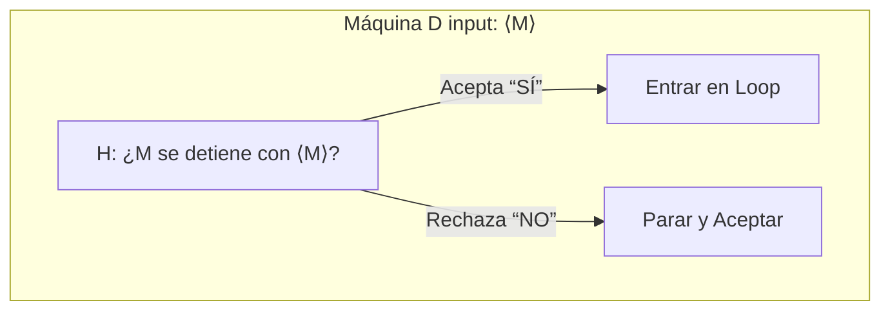
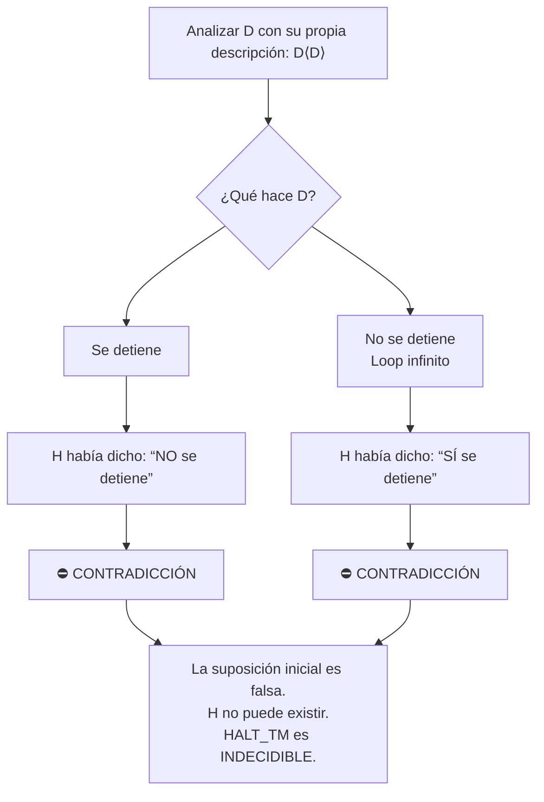

# Autómatas y Lenguajes Formales - Introducción a decidibilidad

## 7.2 El problema de la detención (Halting Problem).

---

### **1. Objetivo de Aprendizaje**

Al final de esta guía, serás capaz de:

- Enunciar formalmente el **Problema de la Detención** (_Halting Problem_).
- Comprender su enorme relevancia como el primer y más importante problema indecidible.
- Seguir y explicar la **demostración por diagonalización y contradicción** de su indecidibilidad.
- Entender las profundas implicaciones que este problema tiene en los límites de la computación.

### **2. ¿Qué es el Problema de la Detención?**

Es la pregunta fundamental: **¿Puede un programa predecir si otro programa se detendrá?**

Formalizado por Alan Turing en 1936, se trata del problema de determinar, a partir de la descripción de una **Máquina de Turing (MT)** $M$ y una cadena de entrada $w$, si $M$ se detiene (termina su ejecución) o entra en un bucle infinito cuando se ejecuta con la entrada $w$.

**Definición Formal como Lenguaje:**
El lenguaje del Problema de la Detención es:

$$ HALT_{TM} = \{ \langle M, w \rangle \mid M \text{ es una MT que se detiene sobre la entrada } w \} $$

Donde $\langle M, w \rangle$ es una codificación válida de la máquina $M$ y la cadena $w$ en un alfabeto común ( por ejemplo, $\{0, 1\}$ ).

> **Teorema (Turing, 1936):** $HALT_{TM}$ es un lenguaje **indecidible**. No existe ninguna Máquina de Turing que lo decida.

### **3. Intuición Antes de la Demostración**

Imagina que quieres construir un programa depurador perfecto, llamado `H`. Este programa recibe dos argumentos: 1) el código fuente de otro programa `P` y 2) una entrada `I` para ese programa.

`H` debe analizar `P` e `I` y, sin ejecutar `P`, predecir correctamente y en tiempo finito si `P(I)` eventualmente se detendrá o se colgará en un bucle infinito.

La tesis de Turing y su demostración prueban que la creación de dicho programa `H` es **imposible**. Siempre habrá al menos un caso (un programa y una entrada) para el cual `H` falle, no responda o se contradiga.

### **4. Demostración de Indecidibilidad (Por Contradicción)**

La demostración es un razonamiento por contradicción que sigue una estructura de "diagonalización", similar a la paradoja del barbero.

#### **Paso 1: La Suposición**

Supongamos, por contradicción, que $HALT_{TM}$ **es decidible**. Esto significa que existe una Máquina de Turing $H$ que lo decide. $H$ se comporta así para cualquier entrada $\langle M, w \rangle$:

- Si $M$ se detiene con $w$, entonces $H$ **acepta** ( $H$ emite un "SÍ" ).
- Si $M$ no se detiene con $w$ (entra en loop), entonces $H$ **rechaza** ( $H$ emite un "NO" ).

Crucialmente, $H$ **siempre se detiene**; esa es la definición de un decisor.

#### **Paso 2: Construir una Máquina "Diabólica"**

Usamos $H$ como una subrutina para construir una nueva Máquina de Turing $D$ (la _diagonalizadora_ o _contradictora_).

El diseño de $D$ es el siguiente:
"_$D$ toma como entrada la descripción de una máquina $\langle M \rangle$ y hace lo siguiente:_

1.  _Ejecuta $H$ con la entrada $\langle M, \langle M \rangle \rangle$. Es decir, le pregunta a $H$ si $M$ se detiene cuando recibe su propio código como entrada._
2.  _Si $H$ predice que $M$ **se detiene** con $\langle M \rangle$ (es decir, $H$ acepta), entonces $D$ entra **voluntariamente en un bucle infinito**._
3.  _Si $H$ predice que $M$ **NO se detiene** con $\langle M \rangle$ (es decir, $H$ rechaza), entonces $D$ **se detiene inmediatamente** y acepta._"

Podemos pensar en $D$ como la máquina que **hace lo contrario** de lo que $H$ predice.

#### **Paso 3: La Contradicción**

Ahora, consideramos qué pasa cuando le damos a $D$ su **propia descripción** como entrada. Es decir, ejecutamos $D(\langle D \rangle)$.

Analizamos los dos casos posibles:

1.  **Caso A:** Supongamos que $D$ **se detiene** con la entrada $\langle D \rangle$.
    - Para que $D$ se detenga, tuvo que llegar al paso 3 de su diseño. Llegó al paso 3 porque $H(\langle D, \langle D \rangle \rangle)$ **rechazó**.
    - $H$ rechazó significa que predijo: "_$D$ **NO** se detiene con $\langle D \rangle$_".
    - Pero nosotros estamos suponiendo que $D$ **SÍ** se detuvo. **¡CONTRADICCIÓN!**

2.  **Caso B:** Supongamos que $D$ **NO se detiene** (entra en loop) con la entrada $\langle D \rangle$.
    - $D$ entra en loop sólo si llega al paso 2 de su diseño. Llegó al paso 2 porque $H(\langle D, \langle D \rangle \rangle)$ **aceptó**.
    - $H$ aceptó significa que predijo: "_$D$ **SÍ** se detiene con $\langle D \rangle$_".
    - Pero nosotros estamos observando que $D$ **NO** se detuvo. **¡CONTRADICCIÓN!**

#### **Paso 4: Conclusión**

En ambos casos llegamos a una contradicción lógica. La única premisa que podemos falsificar es nuestra suposición inicial.

> **Por lo tanto, nuestra suposición de que la máquina $H$ existe debe ser falsa. No existe un decisor para $HALT_{TM}$. El Problema de la Detención es indecidible.**

### **5. Ejercicios Propuestos**

1.  **Análisis:** Explica por qué la demostración no funciona si intentamos aplicar el mismo razonamiento a una MT que reconoce un lenguaje decidible simple, como el de las cadenas con un número par de 'a's.
2.  **Implicaciones:** Investiga y describe dos implicaciones prácticas del Halting Problem en el campo de la ingeniería de software (p. ej., en el desarrollo de compiladores, análisis estático de código o verificación formal).
3.  **Reducción (Avanzado):** El problema de la pertenencia para MTs ( $A_{TM} = \{\langle M, w \rangle | M \text{ acepta } w\}$ ) se demuestra indecidible reduciendo el Halting Problem a él. ¿Cómo harías esta reducción? (Pista: Piensa en modificar una MT $M$ para crear una MT $M'$ que siempre acepte si se detiene).

### **6. Resumen**

- **El qué:** El Problema de la Detención pregunta si una MT $M$ se detiene con una entrada $w$. Su lenguaje formal es $HALT_{TM}$.
- **El porqué es importante:** Fue la primera demostración de un problema **indecidible**, estableciendo que existen límites fundamentales a lo que puede ser computado algorítmicamente.
- **El cómo se prueba:** Mediante una ingeniosa **demostración por contradicción y diagonalización**, donde se construye una máquina $D$ que force a una paradoja lógica a cualquier supuesto decisor $H$.
- **Implicación:** No puede existir un algoritmo general que analice programas y prediga perfectamente su terminación. Esto afecta campos como la verificación de software y el diseño de compiladores.

### **7. Referencias**

- **Viso G., E., Introducción a la teoría de la computación.** (2008). La bibliografía base del curso. Debe contener el desarrollo formal de la demostración.
- **Sipser, M., Introduction to the Theory of Computation.** (2005). Capítulo 4. Explica el Halting Problem de manera excepcionalmente clara y accesible.
- **Hopcroft, J. E., Motwani, R., and Ullman, J., Introduction to Automata Theory, Languages, and Computation.** (2007). Capítulo 9. Presenta una demostración rigurosa y detallada.
- **Aho A.V., et al., Compilers: Principles, Techniques, & Tools.** (2007). Sección 1.6. "The Science of Building a Compiler". Aborda cómo los compiladores deben lidiar con problemas indecidibles (como el Halting Problem) en la práctica, usando aproximaciones y heurísticas.
