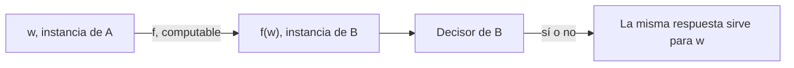

# Autómatas y Lenguajes Formales - Introducción a decidibilidad

## 7.3 Reducción.

---

Demostrar desde cero que un problema es indecidible, con un argumento diagonal, es laborioso. Afortunadamente, basta hacerlo una vez. Una **reducción** de un problema $A$ a un problema $B$ es una forma mecánica de convertir las instancias de $A$ en instancias de $B$ con la misma respuesta. Si existe, $B$ es al menos tan difícil como $A:$ un algoritmo para $B$ daría uno para $A.$ Con el problema de la detención como punto de partida, las reducciones permiten demostrar la indecidibilidad de casi cualquier otro problema.

### Reducción de mapeo

**Definición.** Un lenguaje $A \subseteq \Sigma^*$ se **reduce** a un lenguaje $B \subseteq \Delta^*,$ y se escribe $A \leq_m B,$ si existe una función **total y computable** $f : \Sigma^* \rightarrow \Delta^*$ tal que, para toda $w,$

$$ w \in A \iff f(w) \in B $$

La función $f$ traduce cada pregunta sobre $A$ a una pregunta sobre $B$ con la misma respuesta. Que sea computable es esencial: la traducción tiene que hacerse con un algoritmo.



### Propiedades

**Teorema.** Si $A \leq_m B,$ entonces:

1. Si $B$ es decidible, $A$ es decidible.
2. Si $B$ es recursivamente enumerable, $A$ es recursivamente enumerable.

**Demostración.** Si $M_B$ decide $B,$ la máquina que con entrada $w$ calcula $f(w)$ y ejecuta $M_B$ decide $A.$ Si $M_B$ solo reconoce $B,$ la misma máquina reconoce $A.$ $\blacksquare$

Las contrapositivas son las que se usan para demostrar imposibilidad:

1. Si $A$ es indecidible y $A \leq_m B,$ entonces $B$ es indecidible.
2. Si $A$ no es RE y $A \leq_m B,$ entonces $B$ no es RE.

Además, $\leq_m$ es **transitiva**, porque la composición de funciones computables es computable, y $A \leq_m B$ implica $\overline{A} \leq_m \overline{B},$ con la misma $f.$

**La dirección importa.** Para demostrar que $B$ es indecidible hay que reducir un problema indecidible conocido **a** $B,$ no al revés. Reducir $B$ a un problema indecidible no dice nada: cualquier problema, incluso uno trivial, se reduce a HALT.

### El patrón de las reducciones sobre máquinas

Casi todas las reducciones desde HALT o $A_{MT}$ tienen la misma forma: dada una instancia $\langle M, w \rangle,$ se construye una máquina nueva $M'$ que **ignora su propia entrada** (o la usa de forma controlada) y simula $M$ con $w.$ Así, el comportamiento de $M'$ queda **determinado por** si $M$ se detiene o acepta con $w.$ La construcción de $M'$ a partir de $\langle M, w \rangle$ es un proceso mecánico, así que $f(\langle M, w \rangle) = \langle M' \rangle$ es computable, aunque $f$ nunca **ejecute** a $M.$

**Ejemplo 1: aceptar la cadena vacía.** $\text{VACÍA} = \{\langle M \rangle \mid M \text{ acepta } \varepsilon\}$ es indecidible.

Se reduce HALT a VACÍA. Dada $\langle M, w \rangle,$ sea $M'$ la máquina que, con cualquier entrada $x,$ simula $M$ con $w$ y, si la simulación termina, acepta. Entonces $M'$ acepta $\varepsilon$ si y solo si $M$ se detiene con $w.$ $\blacksquare$

**Ejemplo 2: equivalencia.** $\text{EQ}_{MT} = \{\langle M_1, M_2 \rangle \mid L(M_1) = L(M_2)\}$ es indecidible.

Se reduce HALT a $\text{EQ}_{MT}.$ Dada $\langle M, w \rangle,$ sea $M_1$ la máquina que acepta todo y $M_2$ la que, con cualquier entrada, simula $M$ con $w$ y luego acepta. Si $M$ se detiene con $w,$ $L(M_2) = \Sigma^* = L(M_1);$ si no, $L(M_2) = \emptyset \neq L(M_1).$ $\blacksquare$

**Ejemplo 3: $A_{MT}$ y HALT se reducen el uno al otro.**

- $\text{HALT} \leq_m A_{MT}:$ $\langle M, w \rangle \mapsto \langle M', w \rangle,$ donde $M'$ es igual a $M$ pero con el estado de rechazo convertido en de aceptación. $M'$ acepta $w$ si y solo si $M$ se detiene con $w.$
- $A_{MT} \leq_m \text{HALT}:$ $\langle M, w \rangle \mapsto \langle M'', w \rangle,$ donde $M''$ es igual a $M$ pero en lugar de rechazar entra en un ciclo infinito. $M''$ se detiene con $w$ si y solo si $M$ acepta $w.$

### Reducciones de Turing

Una **reducción de Turing**, $A \leq_T B,$ permite algo más general: decidir $A$ con un algoritmo que puede consultar un **oráculo** de $B$ cuantas veces quiera y usar las respuestas como guste, por ejemplo **negándolas**. Toda reducción de mapeo es una de Turing, pero no al revés. Por ejemplo, $\overline{A_{MT}} \leq_T A_{MT}$ (se pregunta y se niega la respuesta), pero $\overline{A_{MT}} \not\leq_m A_{MT},$ porque $\overline{A_{MT}}$ no es RE y $A_{MT}$ sí lo es.

Las reducciones de Turing también transfieren la indecidibilidad: si $A \leq_T B$ y $A$ es indecidible, $B$ también. Pero no transfieren el ser RE, y por eso para clasificar problemas en RE, co-RE o ninguno se usan las reducciones de mapeo.

**Ejemplo 4: un problema que no es ni RE ni co-RE.** $\text{EQ}_{MT}$ no es RE ni co-RE.

- $\overline{A_{MT}} \leq_m \text{EQ}_{MT}:$ con $\langle M, w \rangle,$ sea $M_1$ la máquina que rechaza todo y $M_2$ la que, con cualquier entrada, simula $M$ con $w$ y acepta si $M$ acepta. Entonces $L(M_1) = L(M_2)$ si y solo si $M$ no acepta $w.$ Como $\overline{A_{MT}}$ no es RE, $\text{EQ}_{MT}$ no es RE.
- $\overline{A_{MT}} \leq_m \overline{\text{EQ}_{MT}}:$ la misma construcción con $M_1$ que **acepta** todo. Como $\overline{A_{MT}}$ no es RE, $\overline{\text{EQ}_{MT}}$ no es RE, es decir, $\text{EQ}_{MT}$ no es co-RE.

### Implementación en Python

Una reducción es un **programa que escribe programas**. En Python, las funciones son valores, así que una reducción se puede escribir como una función que recibe un programa y una entrada y devuelve un programa nuevo. El código implementa las reducciones de los ejemplos 1 y 2 y las prueba con programas cuyo comportamiento se conoce, ejecutando con un límite de pasos.

```python
import sys

def con_paciencia(programa, entrada, limite=20_000):
    """Ejecuta programa(entrada) con un límite de pasos; devuelve su resultado o '∞'."""
    pasos = 0
    def contar(frame, evento, arg):
        nonlocal pasos
        pasos += 1
        if pasos > limite:
            raise TimeoutError
        return contar
    sys.settrace(contar)
    try:
        return programa(entrada)
    except TimeoutError:
        return '∞'
    finally:
        sys.settrace(None)

# Reducción de mapeo HALT ≤m ACEPTA_VACIA: f(P, w) = el programa Q que ignora su entrada,
# ejecuta P con w y, si P termina, acepta. Q acepta ε si y solo si P se detiene con w.
def f_halt_a_vacia(P, w):
    def Q(x):
        P(w)
        return True
    return Q

# Reducción HALT ≤m EQ: g(P, w) = (Q1, Q2) con Q1 que acepta todo y Q2 que primero ejecuta P(w).
# L(Q1) = L(Q2) si y solo si P se detiene con w.
def g_halt_a_eq(P, w):
    Q1 = lambda x: True
    def Q2(x):
        P(w)
        return True
    return Q1, Q2

# Programas de prueba cuyo comportamiento conocemos
def termina_si_par(n):
    while n % 2 == 1:
        pass
    return n

def cuenta(n):
    return sum(range(n))

for P, w in [(termina_si_par, 4), (termina_si_par, 3), (cuenta, 100)]:
    Q = f_halt_a_vacia(P, w)
    Q1, Q2 = g_halt_a_eq(P, w)
    print(f"{P.__name__}({w}): se detiene -> {con_paciencia(P, w) != '∞'};"
          f"  Q acepta ε -> {con_paciencia(Q, '') is True};"
          f"  Q1 y Q2 coinciden en ε, 0, 1 -> {all(con_paciencia(Q1, x) == con_paciencia(Q2, x) for x in ['', '0', '1'])}")
```

Salida:

```text
termina_si_par(4): se detiene -> True;  Q acepta ε -> True;  Q1 y Q2 coinciden en ε, 0, 1 -> True
termina_si_par(3): se detiene -> False;  Q acepta ε -> False;  Q1 y Q2 coinciden en ε, 0, 1 -> False
cuenta(100): se detiene -> True;  Q acepta ε -> True;  Q1 y Q2 coinciden en ε, 0, 1 -> True
```

Las funciones `f_halt_a_vacia` y `g_halt_a_eq` nunca ejecutan a `P`: solo construyen programas nuevos, en tiempo constante. Por eso son computables y totales, aunque los programas que producen puedan no terminar.

### Ejercicios Propuestos

1. **Computabilidad de la reducción.** En la reducción del ejemplo 1, ¿por qué es crucial que $f$ sea computable? ¿Por qué no importa que $M'$ pueda ciclar?

2. **Vacuidad.** Demuestra que $E_{MT} = \{\langle M \rangle \mid L(M) = \emptyset\}$ es indecidible. ¿Es RE? ¿Es co-RE?

3. **Regularidad.** Demuestra que $\{\langle M \rangle \mid L(M) \text{ es regular}\}$ es indecidible. Sugerencia: construye $M'$ que acepta $\{0^n1^n\}$ si $M$ no acepta $w$ y $\Sigma^*$ si la acepta.

4. **Dirección.** Un compañero afirma que el problema de decidir si la longitud de una cadena es par es indecidible, porque se puede reducir a HALT. ¿Qué está mal?

5. **Clasificación.** Si $A \leq_m B$ y $A$ no es RE, ¿qué se puede decir de $B?$ ¿Y si $A \leq_m B$ y $B$ es co-RE?

### Soluciones

**Ejercicio 1.** Si $f$ no fuera computable, el decisor de VACÍA no serviría de nada, porque no se podría construir la instancia por preguntar. Que $M'$ cicle no importa porque nadie la ejecuta: solo se construye su descripción y se le pasa al supuesto decisor, que por hipótesis siempre responde.

**Ejercicio 2.** Se reduce $A_{MT}$ al complemento de $E_{MT}:$ con $\langle M, w \rangle,$ $M'$ simula $M$ con $w$ ignorando su entrada y acepta si $M$ acepta; $L(M') \neq \emptyset$ si y solo si $M$ acepta $w.$ Así, $\overline{E_{MT}}$ es indecidible y también $E_{MT}.$ El complemento $\overline{E_{MT}}$ es RE (se busca una cadena aceptada intercalando simulaciones), así que $E_{MT}$ es co-RE y no es RE.

**Ejercicio 3.** $M'$ con entrada $x:$ si $x$ es de la forma $0^n1^n,$ acepta; si no, simula $M$ con $w$ y acepta si $M$ acepta. Entonces $L(M') = \Sigma^*$ (regular) si $M$ acepta $w,$ y $L(M') = \{0^n1^n\}$ (no regular) si no. Así, $A_{MT} \leq_m \text{REGULAR},$ que es indecidible.

**Ejercicio 4.** La dirección está al revés. Que un problema se reduzca a HALT solo dice que no es más difícil que HALT; los problemas decidibles se reducen a cualquier problema no trivial. Para concluir que es indecidible habría que reducir HALT a él, y no se puede, porque es decidible.

**Ejercicio 5.** Si $A$ no es RE, $B$ tampoco lo es. Si $B$ es co-RE, como $\overline{A} \leq_m \overline{B}$ y $\overline{B}$ es RE, $\overline{A}$ es RE: $A$ es co-RE.

### Referencias

1. Sipser, M., _Introduction to the Theory of Computation_. Cengage, 2013. Capítulo 5.
2. Hopcroft, J. E., Motwani, R., and Ullman, J., _Introduction to Automata Theory, Languages, and Computation_. Pearson, 2007. Sección 9.3.
3. Rogers, H., _Theory of Recursive Functions and Effective Computability_. MIT Press, 1987. Capítulos 7 y 9.
4. Post, E. L. (1944). Recursively enumerable sets of positive integers and their decision problems. _Bulletin of the AMS_, 50(5), 284-316.
