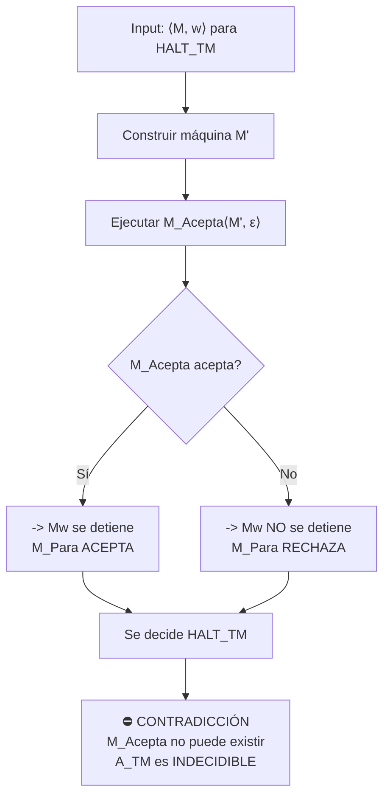

# Autómatas y Lenguajes Formales - Introducción a decidibilidad

## 7.3 Reducción.

---

### **1. Objetivo de Aprendizaje**

Al final de esta guía, serás capaz de:

- Definir el concepto de **reducción** entre problemas o lenguajes.
- Explicar cómo se utiliza la reducción como herramienta principal para **demostrar indecidibilidad**.
- Aplicar la técnica de reducción para relacionar la dificultad de distintos problemas.
- Diferenciar entre una **reducción de Turing** y una **reducción de mapeo (many-one)**.

### **2. ¿Qué es una Reducción?**

Una reducción es una forma de **convertir un problema (A) en otro problema (B)**, de modo que si podemos resolver B, entonces podemos resolver A. Es una forma de decir: **"El problema A no es más difícil que el problema B"**.

Si sabemos que el problema A es muy difícil (o imposible) de resolver, y podemos reducir A a B, entonces B debe ser al menos tan difícil como A. Si A es indecidible, entonces B también debe serlo.

**Analogía:** Supón que no sabes cómo abrir una botella de vino (Problema A). Si tienes un abrebotellas (que resuelve el Problema B: "abrir botellas con tapón de corcho"), puedes _reducir_ el problema de abrir la botella de vino al problema de usar el abrebotellas. Si no tuvieras un abrebotellas, el problema de abrir la botella de vino sería imposible con ese método. La imposibilidad de abrir la botella sin la herramienta correcta implica la necesidad del abrebotellas.

### **3. Reducción para Demostrar Indecidibilidad**

Esta es la aplicación más poderosa del concepto. La lógica es la siguiente:

1.  Sabemos que un problema $A$ es **indecidible** ( e.g., el Problema de la Detención $HALT_{TM}$ ).
2.  Queremos demostrar que un nuevo problema $B$ es también **indecidible**.
3.  **Reducimos** $A$ a $B.$ Es decir, mostramos que si tuviéramos un decisor $M_B$ para $B,$ entonces podríamos construir un decisor $M_A$ para $A.$
    ```mermaid
    flowchart LR
        subgraph Reduccion [Estrategia de Reducción]
            A[Problema Indecidible A] -->|Transformar entrada de A<br>en entrada de B| B[Problema B]
            B -->|Usar decisor M_B| SolB[Solución para B]
            SolB -->|Interpretar| SolA[Solución para A]
        end
    ```
4.  Pero sabemos que $M_A$ **no puede existir** (porque $A$ es indecidible).
5.  Por lo tanto, nuestra suposición de que $M_B$ existe debe ser falsa.
6.  **Conclusión:** $B$ es indecidible.

La reducción transforma instancias del problema $A$ en instancias del problema $B,$ preservando la respuesta (sí/no).

> **Definición Formal (Reducción de Mapeo - Many-One):**
> Un lenguaje $A$ es **reducible** a un lenguaje $B$ $(A \leq_m B)$ si existe una **función computable** $f: \Sigma^* \rightarrow \Sigma^*$ tal que para toda cadena $w:$
> 
> $$w \in A \iff f(w) \in B$$
> 
> La función $f$ transforma una instancia de $A$ en una instancia de $B.$ Si podemos decidir $B,$ entonces podemos decidir $A$ comprobando si $f(w) \in B.$

### **4. Ejemplo Clásico: Demostrar que $A_{TM}$ es Indecidible**

**Problema B:** El Problema de la Aceptación $(A_{TM}).$

$$ A_{TM} = \{ \langle M, w \rangle \mid M \text{ es una MT que acepta la cadena } w \} $$

**Queremos demostrar:** $A_{TM}$ es indecidible.

**Estrategia:** Reducir el Problema de la Detención ( $HALT_{TM}$ ), que ya sabemos es indecidible, a $A_{TM}$ ( $HALT_{TM} \leq_m A_{TM}$ ).

Si podemos resolver $A_{TM},$ entonces podemos resolver $HALT_{TM}.$ Como $HALT_{TM}$ es indecidible, $A_{TM}$ debe serlo.

#### **Construcción de la Reducción**

1.  **Suposición:** Supongamos que $A_{TM}$ es decidible. Entonces existe un decisor $M_{Acepta}$ para él.
2.  **Objetivo:** Construir un decisor $M_{Para}$ para $HALT_{TM}$ usando $M_{Acepta}.$
3.  **Cómo funciona $M_{Para}$:**
    - **Entrada:** $\langle M, w \rangle$ (una MT y una cadena).
    - **Paso 1:** Construir una nueva Máquina de Turing $M'$ a partir de $M$ y $w.$
      - $M'$ toma como entrada cualquier cadena $x$ ( ignorará $x$ ).
      - $M'$ simula a $M$ ejecutando sobre $w.$
      - Si la simulación de $M(w)$ se detiene y **acepta**, entonces $M'$ **acepta**.
      - Si la simulación de $M(w)$ se detiene y **rechaza**, entonces $M'$ **acepta**.
      - (Si $M(w)$ no se detiene, $M'$ no se detiene).
      - **¡$M'$ acepta todo lo que se le ponga si $M(w)$ se detiene!**
    - **Paso 2:** Ejecutar el supuesto decisor $M_{Acepta}$ con la entrada $\langle M', w_0 \rangle$ ( donde $w_0$ es cualquier cadena, p.ej., $\epsilon$ ).
    - **Paso 3:**
      - Si $M_{Acepta}$ acepta $\langle M', \epsilon \rangle,$ significa que $M'$ acepta $\epsilon.$ Por construcción, esto sólo pasa si $M(w)$ se detuvo. Entonces $M_{Para}$ **acepta** ( $M$ se detiene con $w$ ).
      - Si $M_{Acepta}$ rechaza $\langle M', \epsilon \rangle,$ significa que $M'$ no acepta $\epsilon.$ Por construcción, esto sólo pasa si $M(w)$ **nunca se detuvo**. Entonces $M_{Para}$ **rechaza** ( $M$ no se detiene con $w$ ).



4.  **Conclusión:** Hemos construido $M_{Para},$ un decisor para $HALT_{TM},$ usando $M_{Acepta}.$ Pero sabemos que $HALT_{TM}$ es indecidible, por lo que $M_{Acepta}$ no puede existir. **Por lo tanto, $A_{TM}$ es indecidible.**

### **5. Ejercicios Propuestos**

1.  **Análisis:** En la reducción de $HALT_{TM}$ a $A_{TM},$ ¿por qué es crucial que la función que transforma $\langle M, w \rangle$ en $\langle M', \epsilon \rangle$ sea computable?
2.  **Demostración:** Intenta esbozar una reducción para demostrar que el **Problema de la Equivalencia** ( $EQ_{TM} = \{ \langle M_1, M_2 \rangle \mid L(M_1) = L(M_2) \}$ ) es indecidible. ( Pista: Reduce $A_{TM}$ a $EQ_{TM}.$ Para una MT $M$ y una cadena $w,$ construye dos MTs $M_1$ y $M_2$ tales que sean equivalentes sólo si $M$ acepta $w$ ).
3.  **Investigación:** Los problemas **Turing-reconocibles** (también llamados semidecidibles) son aquellos para los cuales existe una MT que se detiene y acepta todas las cadenas que sí están en el lenguaje, pero puede no detenerse para las que no están. Usando la reducción, investiga: si $A \leq_m B$ y $A$ no es Turing-reconocible, ¿qué puedes decir de $B?$

### **6. Resumen**

- **Propósito:** La reducción es la herramienta **fundamental** para probar que un problema es indecidible (o más tarde, que es NP-Completo).
- **Lógica:** Si $A \leq_m B$ y $A$ es indecidible, entonces $B$ es indecidible. Se "transfiere" la indecidibilidad de un problema a otro.
- **Método:** Para reducir $A$ a $B,$ se describe una **función computable** que transforma cualquier instancia de $A$ en una instancia de $B$ de manera que la respuesta sea la misma.
- **Tipos:** La reducción mostrada $(\leq_m)$ es una **reducción de mapeo (many-one)**. Existe un tipo más general llamado **reducción de Turing**, donde se permite usar al decisor de $B$ como un **oráculo** (subrutina) múltiples veces.

### **7. Referencias**

- **Sipser, M., Introduction to the Theory of Computation.** (2005). Capítulo 5: "Reducibility". La mejor exposición didáctica sobre el tema, con ejemplos claros.
- **Hopcroft, J. E., Motwani, R., and Ullman, J., Introduction to Automata Theory, Languages, and Computation.** (2007). Capítulo 9. Incluye múltiples reducciones para demostrar la indecidibilidad de varios problemas.
- **Viso G., E., Introducción a la teoría de la computación.** (2008). Debe contener el tratamiento formal de las reducciones dentro del plan de estudios del curso.
- **Kozen, D. C., Automata and Computability.** (1997). Presentación muy concisa y formal del tema. Excelente para ver las definiciones matemáticas precisas.
