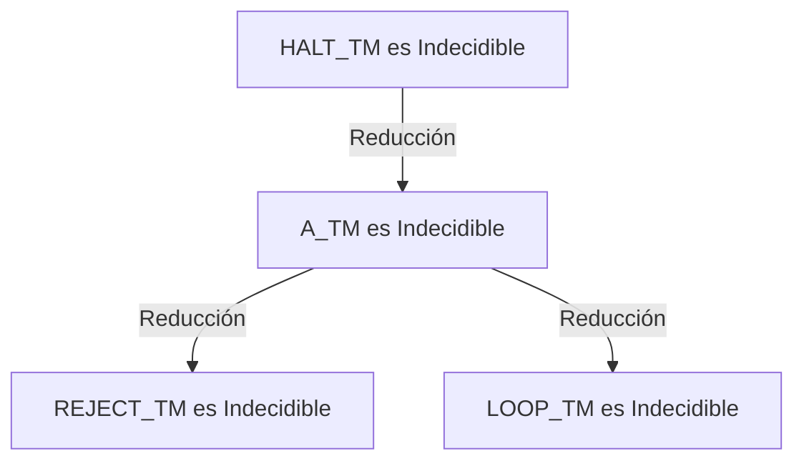
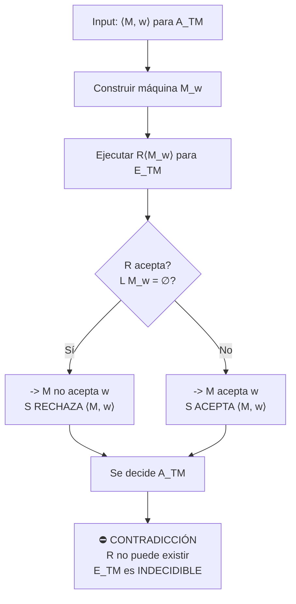

# Autómatas y Lenguajes Formales - Introducción a decidibilidad

## 7.4 Indecidibilidad en Máquinas de Turing.

---

### **1. Objetivo de Aprendizaje**

Al final de esta guía, serás capaz de:

- Comprender por qué las **propiedades fundamentales** de las Máquinas de Turing son indecidibles.
- Identificar y enunciar los **principales problemas indecidibles** relacionados con MTs.
- Aplicar el concepto de **reducción** para demostrar la indecidibilidad de nuevos problemas.
- Entender las implicaciones prácticas de estos resultados en la teoría de la computación.

### **2. Revisión: La Raíz de la Indecidibilidad**

El teorema fundamental que establece la indecidibilidad en MTs es la **indecidibilidad del Problema de la Parada $(HALT_{TM})$**:

$$ HALT_{TM} = \{ \langle M, w \rangle \mid M \text{ es una MT que se detiene sobre la entrada } w \} $$

**Teorema:** $HALT_{TM}$ es indecidible. No existe una MT que lo decida.

Este resultado es la **pieza angular** a partir de la cual, mediante **reducciones**, se demuestra la indecidibilidad de una gran variedad de problemas sobre MTs.

### **3. Clasificación de Problemas Indecidibles sobre MTs**

Los problemas indecidibles sobre MTs se pueden categorizar en tres grupos principales:

#### **3.1. Problemas sobre el Comportamiento de una MT (Entrada-Especifica)**

Estos problemas preguntan sobre el comportamiento de una MT **con una entrada específica** $w.$

1.  **Problema de la Aceptación $(A_{TM})$:**

    $$ A_{TM} = \{ \langle M, w \rangle \mid M \text{ es una MT que acepta la cadena } w \} $$

    **Teorema:** $A_{TM}$ es indecidible. ( Se prueba por reducción de $HALT_{TM}$ a $A_{TM}$ ).

2.  **Problema del Rechazo:**

    $$ REJECT_{TM} = \{ \langle M, w \rangle \mid M \text{ es una MT que rechaza la cadena } w \} $$

    **Teorema:** $REJECT_{TM}$ es indecidible.

3.  **Problema del Lazo Infinito:**

    $$ LOOP_{TM} = \{ \langle M, w \rangle \mid M \text{ es una MT que entra en un loop infinito sobre } w \} $$
    
    **Teorema:** $LOOP_{TM}$ es indecidible.

#### **3.2. Problemas sobre el Lenguaje de una MT (Propiedades Globales)**

Estos problemas preguntan sobre propiedades del **lenguaje** que una MT reconoce, independientemente de una entrada específica.

1.  **Problema de la Vaciedad $(E_{TM})$:**

    $$ E_{TM} = \{ \langle M \rangle \mid M \text{ es una MT y } L(M) = \emptyset \} $$

    **Teorema:** $E_{TM}$ es indecidible.

2.  **Problema de la Totalidad $(ALL_{TM}$ o $TOTAL_{TM})$:**

    $$ TOTAL_{TM} = \{ \langle M \rangle \mid M \text{ es una MT y } L(M) = \Sigma^* \} $$

    **Teorema:** $TOTAL_{TM}$ es indecidible.

3.  **Problema de la Finitud $(FINITE_{TM})$:**

    $$ FINITE_{TM} = \{ \langle M \rangle \mid M \text{ es una MT y } L(M) \text{ es un conjunto finito} \} $$

    **Teorema:** $FINITE_{TM}$ es indecidible.

4.  **Problema de la Regularidad $(REGULAR_{TM})$:**
    
    $$ REGULAR_{TM} = \{ \langle M \rangle \mid M \text{ es una MT y } L(M) \text{ es un lenguaje regular} \} $$

    **Teorema:** $REGULAR_{TM}$ es indecidible.

#### **3.3. Problemas entre dos MTs**

Estos problemas comparan el comportamiento o lenguaje de dos MTs.

1.  **Problema de la Equivalencia $(EQ_{TM})$:**

    $$ EQ_{TM} = \{ \langle M_1, M_2 \rangle \mid M_1, M_2 \text{ son MTs y } L(M_1) = L(M_2) \} $$

    **Teorema:** $EQ_{TM}$ es indecidible.

### **4. Demostración por Reducción: El Caso de $E_{TM}$**

Vamos a demostrar que el problema de la vaciedad $(E_{TM})$ es indecidible.

**Estrategia:** Reducir el problema de la aceptación ( $A_{TM}$ ), que ya sabemos es indecidible, a $E_{TM}$ ( $A_{TM} \leq_m E_{TM}$ ).

#### **Construcción de la Reducción**

1.  **Suposición:** Supongamos, por contradicción, que $E_{TM}$ es decidible. Existe un decisor $R$ para él.
2.  **Objetivo:** Construir un decisor $S$ para $A_{TM}$ usando $R.$
3.  **Cómo funciona $S$ con entrada $\langle M, w \rangle$:**
    - **Paso 1:** Construir una nueva MT $M_w$ a partir de $M$ y $w.$
      - $M_w$ toma como entrada cualquier cadena $x.$
      - $M_w$ **ignora** $x$ y simula $M$ sobre $w.$
      - Si la simulación de $M(w)$ **acepta**, entonces $M_w$ **acepta** $x.$
      - Si la simulación de $M(w)$ **rechaza o no se detiene**, entonces $M_w$ **rechaza** $x$ o no se detiene.
    - **Paso 2:** Ejecutar el supuesto decisor $R$ para $E_{TM}$ con la entrada $\langle M_w \rangle.$
    - **Paso 3:**
      - Si $R$ acepta ( $L(M_w) = \emptyset$ ), entonces $M(w)$ no aceptó $w.$ Por lo tanto, $S$ **rechaza** $\langle M, w \rangle.$
      - Si $R$ rechaza ( $L(M_w) \neq \emptyset$ ), entonces existe alguna $x$ que $M_w$ acepta. Por construcción, $M_w$ sólo acepta cadenas si $M(w)$ acepta. Por lo tanto, $S$ **acepta** $\langle M, w \rangle.$

4.  **Conclusión:** Hemos construido $S,$ un decisor para $A_{TM},$ usando $R.$ Pero $A_{TM}$ es indecidible, por lo que $R$ no puede existir. **Por lo tanto, $E_{TM}$ es indecidible.**

### **5. Ejercicios Propuestos**

1.  **Análisis:** Para la reducción de $A_{TM}$ a $E_{TM},$ describe con precisión el lenguaje de la máquina construida $M_w$ en los dos casos: a) cuando $M$ acepta $w,$ y b) cuando $M$ no acepta $w.$
2.  **Demostración:** Esboza una reducción de $A_{TM}$ a $TOTAL_{TM}$ para demostrar que es indecidible. ( Pista: Construye una MT $M'$ que acepte todo input $x$ si y sólo si $M$ acepta $w$ ).
3.  **Pensamiento Crítico:** ¿Por qué el problema de la pertenencia para Autómatas Finitos ( $A_{DFA} = \{\langle B, w \rangle \mid B \text{ es un DFA que acepta } w\}$ ) es decidible, mientras que $A_{TM}$ no lo es? ¿Qué diferencia fundamental entre DFAs y MTs causa esto?

### **6. Implicaciones y el Teorema de Rice**

Los resultados anteriores no son coincidencias aisladas. Son consecuencia de un teorema profundo y general:

> **Teorema de Rice (Informal):** **Toda propiedad no trivial** del lenguaje reconocido por una Máquina de Turing es **indecidible**.
>
> **Teorema de Rice (Formal):** Sea $P$ una propiedad no trivial de lenguajes Turing-reconocibles ( i.e., $P$ es un subconjunto de todos los lenguajes Turing-reconocibles, donde $P \neq \emptyset$ y $P \neq \text{todos los lenguajes}$ ).
> Entonces, el lenguaje $\{ \langle M \rangle \mid L(M) \in P \}$ es **indecidible**.

**Ejemplos:** Las propiedades "ser un lenguaje vacío", "finito", "infinito", "regular", "libre de contexto", etc., son todas no triviales. El Teorema de Rice nos dice **inmediatamente** que los problemas $E_{TM},$ $FINITE_{TM},$ $REGULAR_{TM},$ etc., son indecidibles, sin necesidad de construir una reducción para cada uno.

### **7. Resumen**

- **Núcleo:** La indecidibilidad del **Problema de la Parada $(HALT_{TM})$** es el resultado fundamental.
- **Método:** La técnica de **reducción** $(A \leq_m B)$ es la herramienta principal para demostrar la indecidibilidad de nuevos problemas.
- **Alcance:** Una **inmensa variedad de problemas** naturales sobre las propiedades de las Máquinas de Turing y los lenguajes que aceptan son indecidibles.
- **Generalización:** El **Teorema de Rice** captura la esencia de este fenómeno, estableciendo que casi cualquier pregunta interesante sobre el lenguaje de una MT es algorítmicamente irresoluble.

### **8. Referencias**

- **Sipser, M., Introduction to the Theory of Computation.** (2005). Capítulo 5: "Reducibility". La exposición más clara y didáctica, incluye el Teorema de Rice.
- **Hopcroft, J. E., Motwani, R., and Ullman, J., Introduction to Automata Theory, Languages, and Computation.** (2007). Capítulo 9: "Undecidability". Contiene un catálogo extenso de problemas indecidibles y sus reducciones.
- **Viso G., E., Introducción a la teoría de la computación.** (2008). Tratamiento formal adaptado al curso.
- **Kozen, D. C., Automata and Computability.** (1997). Presentación concisa y rigurosa, ideal para una segunda lectura.
