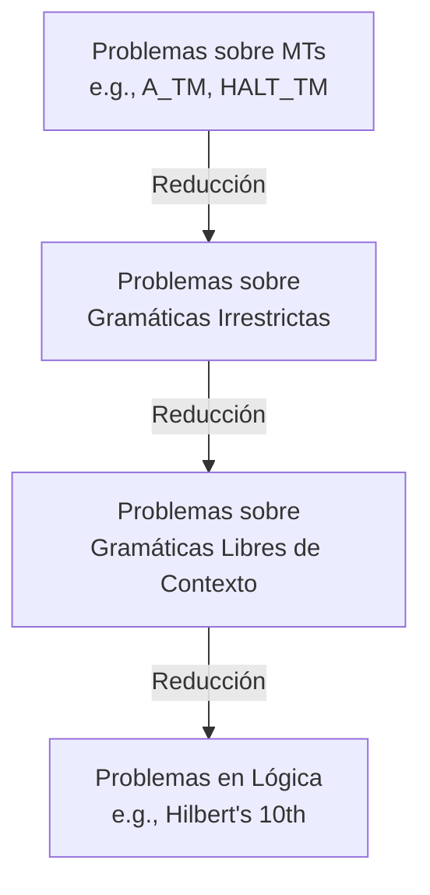

# Autómatas y Lenguajes Formales - Introducción a decidibilidad

## 7.5 Otros problemas de indecidibilidad.

---

### **1. Objetivo de Aprendizaje**

Al final de esta guía, serás capaz de:

- Reconocer que la indecidibilidad se extiende más allá de problemas sobre MTs.
- Identificar problemas indecidibles clásicos en **lógica**, **matemáticas** y **teoría de lenguajes formales**.
- Comprender el **método de reducción** para establecer la indecidibilidad de estos problemas.
- Valorar las implicaciones filosóficas y prácticas de estos resultados.

### **2. Introducción: Un Panorama más Amplio**

El descubrimiento de problemas indecidibles por Alan Turing no fue un hecho aislado. Surge en el contexto del **Programa de Hilbert**, que buscaba un sistema formal completo y consistente para todas las matemáticas. Los trabajos de Gödel (Teoremas de Incompletitud) y Church (Indecidibilidad de la Lógica de Primer Orden) demostraron que este programa era imposible. La indecidibilidad es una propiedad fundamental de los sistemas formales suficientemente expresivos.

### **3. Problemas Indecidibles en Teoría de Lenguajes Formales**

Aunque muchos problemas para lenguajes regulares (DFA/NFA) y libres de contexto (PDA/CFG) son decidibles, al aumentar el poder expresivo aparecen problemas indecidibles.

#### **3.1. Problemas Indecidibles para Gramáticas Irrestrictas (Tipo 0)**

Las Gramáticas Irrestrictas generan todos los lenguajes Turing-reconocibles. Por lo tanto, muchos problemas sobre ellas son indecidibles por el Teorema de Rice.

1.  **Equivalencia de Gramáticas Irrestrictas:**
    Dadas dos gramáticas irrestrictas $G_1$ y $G_2$, ¿generan el mismo lenguaje? ( $L(G_1) = L(G_2)$ ?).
    **Indecidible.** ( Se reduce desde $EQ_{TM}$ ).

2.  **Intersección Vacía:**
    Dadas dos gramáticas irrestrictas $G_1$ y $G_2$, ¿es la intersección de sus lenguajes vacía? ( $L(G_1) \cap L(G_2) = \emptyset$ ?).
    **Indecidible.**

3.  **Ambigüedad:**
    Dada una gramática irrestricta $G$, ¿es $G$ ambigua?
    **Indecidible.** (Existen G.I. para las cuales es imposible decidir si existe más de un árbol de derivación para una cadena).

#### **3.2. Problemas Indecidibles para Lenguajes Libres de Contexto (LLC)**

Sorprendentemente, incluso para LLCs (que son decidibles), algunos problemas **entre dos o más gramáticas** son indecidibles.

1.  **Equivalencia de LLCs:**
    Dadas dos Gramáticas Libres de Contexto (GLC) $G_1$ y $G_2$, ¿es $L(G_1) = L(G_2)$?
    **Teorema:** Este problema es **indecidible**. (Bar-Hillel, Perles, Shamir, 1961).
    _Nota: La equivalencia para Autómatas Finitos (DFA) SÍ es decidible._

2.  **Intersección Vacía para LLCs:**
    Dadas dos GLCs $G_1$ y $G_2$, ¿es $L(G_1) \cap L(G_2) = \emptyset$?
    **Indecidible.** (Muy útil para demostrar la indecidibilidad de otros problemas).

3.  **Universalidad para LLCs:**
    Dada una GLC $G$ sobre un alfabeto $\Sigma$, ¿genera todas las cadenas posibles? ( $L(G) = \Sigma^*$ ?).
    **Indecidible.** (Se puede reducir desde el problema de intersección vacía).

### **4. Problemas Indecidibles en Lógica y Matemáticas**

#### **4.1. El Décimo Problema de Hilbert (Ecuaciones Diofánticas)**

Planteado por David Hilbert en 1900, pregunta: _¿Existe un algoritmo para determinar si una ecuación polinomial (diofántica) con coeficientes enteros tiene soluciones enteras?_

**Teorema (Yuri Matiyasevich, 1970):** El décimo problema de Hilbert es **indecidible**. No existe un algoritmo general que resuelva este problema para todas las ecuaciones.

Formalmente, el conjunto:

$$ H_{10} = \{ p(x_1, ..., x_n) \mid p \text{ es un polinomio con coeficientes enteros que tiene una raíz entera} \} $$

es **indecidible**.

#### **4.2. Indecidibilidad de la Lógica de Primer Orden**

La Lógica de Primer Orden (LPO) es el sistema formal donde se pueden escribir la mayoría de teoremas matemáticos.

**Problema de la Validez:** Dada una fórmula $\phi$ en LPO, ¿es $\phi$ universalmente válida? (¿es un teorema lógico?).

**Teorema (Church, 1936):** El problema de la validez en la Lógica de Primer Orden es **indecidible**. No existe un algoritmo que pueda determinar si cualquier fórmula de primer orden es verdadera en todas las interpretaciones.

Sin embargo, es **semidecidible**: existe un procedimiento (e.g., usando resolución o tableaux semánticos) que eventualmente encontrará una prueba si la fórmula es válida, pero puede no terminar si no lo es.

#### **4.3. El Problema de la Correspondencia de Post (PCP)**

Un problema indecidible muy útil para reducir a problemas sobre cadenas y gramáticas.

**Definición:** Dado un conjunto de _fichas_, cada una con una cadena superior y una inferior:

$$ \left[ \frac{w_1}{v_1} \right], \left[ \frac{w_2}{v_2} \right], ..., \left[ \frac{w_k}{v_k} \right] $$

¿Existe una secuencia de estas fichas (con repetición permitida) tal que la concatenación de las cadenas superiores sea igual a la concatenación de las cadenas inferiores?

**Ejemplo:** Con las fichas $\left[ \frac{ab}{a} \right], \left[ \frac{b}{ab} \right], \left[ \frac{a}{b} \right]$, la secuencia [1, 3, 2] es una solución:

- Superiores: $ab + a + b = abab$
- Inferiores: $a + b + ab = abab$

**Teorema (Emil Post, 1946):** El Problema de la Correspondencia de Post es **indecidible**. Es decir, no existe un algoritmo que decida si una instancia arbitraria del PCP tiene solución.

### **5. Ejercicios Propuestos**

1.  **Investigación:** El problema de la "palabra mortal" (_mortality problem_) para matrices pregunta, dadas matrices cuadradas $M_1, M_2, ..., M_k$, ¿existe algún producto de estas matrices (con repetición) que sea la matriz cero? Investiga si este problema es decidible o indecidible.
2.  **Reducción (Avanzado):** El PCP se usa a menudo para demostrar la indecidibilidad de la ambigüedad para GLCs. Investiga el esquema general de esta reducción.
3.  **Reflexión:** ¿Por qué crees que el problema de la equivalencia es decidible para autómatas finitos pero indecidible para autómatas de pila y máquinas de Turing? ¿Qué cambio fundamental ocurre?

### **6. Resumen**

- **Ubicuidad:** La indecidibilidad no es una rareza de las MTs; es una propiedad fundamental de los sistemas formales suficientemente complejos (lógica, matemáticas, lenguajes formales).
- **Herramienta Principal:** La **reducción** es el método universal para probar indecidibilidad: se "hereda" de un problema ya conocido.
- **Problemas Clave:**
  - **Teoría de Lenguajes:** Equivalencia y ambigüedad para GLCs.
  - **Matemáticas:** El 10mo problema de Hilbert.
  - **Lógica:** Validez en primer orden.
  - **Juegos/Problemas:** El Problema de la Correspondencia de Post (PCP).
- **Implicación:** Existen límites inherentes al conocimiento algorítmico. No todos los problemas matemáticos bien definidos pueden ser resueltos por una computadora.

### **7. Referencias**

- **Hopcroft, J. E., Motwani, R., and Ullman, J., Introduction to Automata Theory, Languages, and Computation.** (2007). Capítulo 9. Excelente para los problemas indecidibles en lenguajes formales (equivalencia de GLCs, PCP).
- **Sipser, M., Introduction to the Theory of Computation.** (2005). Capítulo 5. Aborda la indecidibilidad de la lógica de primer orden.
- **Aho A.V., et al., Compilers: Principles, Techniques, & Tools.** (2007). Sección 1.6. Menciona la indecidibilidad de problemas de análisis estático de código, relacionados con los problemas de lenguajes formales.
- **Davis, M., Computability and Unsolvability.** (1958). Un clásico que cubre en profundidad el décimo problema de Hilbert y otros problemas indecidibles en matemáticas.
