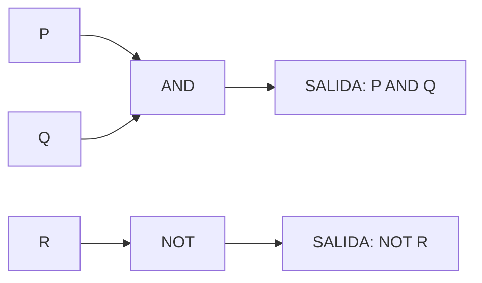
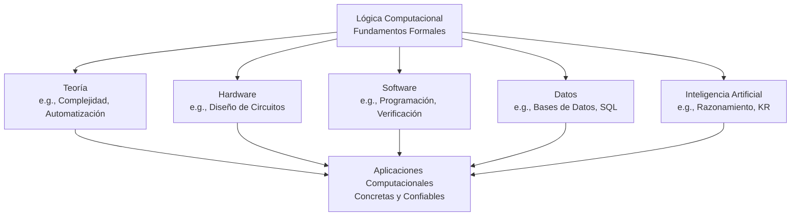

# Lógica Computacional - Introducción
## 1.1 Importancia de la lógica para las ciencias computacionales.

---

### **1. Definición Central: ¿Qué es la Lógica Computacional?**

La Lógica Computacional es la rama de la informática y las matemáticas que se encarga de la representación y manipulación formal del conocimiento y del razonamiento, para su aplicación en el diseño, análisis y verificación de sistemas computacionales.

> "La lógica es el cálculo de la ciencia computacional." — R. Shore

No es solo un tema teórico; es la **herramienta fundamental** para dar precisión, rigor y automatización a los procesos de razonamiento que realizan las computadoras.

### **2. Funciones y Fórmulas Clave (El Lenguaje de la Lógica)**

La lógica proporciona un lenguaje formal con sintaxis y semántica bien definidas. Estos son algunos de sus elementos básicos.

#### **Sintaxis: Construyendo Expresiones Válidas**
*   **Proposiciones (P, Q, R):** Enunciados que pueden ser verdaderos (`T`) o falsos (`F`). Ej: "El servidor está en línea".
*   **Conectivos Lógicos:**
    *   **Conjunción (AND):** $P \land Q$
    *   **Disyunción (OR):** $P \lor Q$
    *   **Negación (NOT):** $\lnot P$
    *   **Implicación (IF... THEN...):** $P \to Q$
    *   **Doble Implicación (IF AND ONLY IF):** $P \leftrightarrow Q$

#### **Semántica: Asignando Significado (Tablas de Verdad)**
La semántica define el valor de verdad de una fórmula compleja basándose en los valores de sus componentes.

| $P$ | $Q$ | $P \land Q$ | $P \lor Q$ | $P \to Q$ |
|:---:|:---:|:-----------:|:-----------:|:---------:|
| T   | T   | T           | T           | T         |
| T   | F   | F           | T           | F         |
| F   | T   | F           | T           | T         |
| F   | F   | F           | F           | T         |

#### **Fórmulas de Equivalencia Lógica**
Dos fórmulas son equivalentes $(\equiv)$ si tienen la misma tabla de verdad. Son cruciales para simplificar expresiones.
*   Ley de Doble Negación: $\lnot(\lnot P) \equiv P$
*   Leyes de De Morgan:
    *   $\lnot (P \land Q) \equiv \lnot P \lor \lnot Q$
    *   $\lnot (P \lor Q) \equiv \lnot P \land \lnot Q$
*   Definición de Implicación: $P \to Q \equiv \lnot P \lor Q$

### **3. La Importancia en Distintas Áreas de la Computación**

La lógica es el andamiaje sobre el que se construyen muchas áreas clave de la computación.

#### **a) Fundamentos de la Programación**
La lógica proposicional y de predicados está incrustada en la estructura misma de los lenguajes de programación.

*   **Expresiones Booleanas:** Las condiciones en `if`, `while`, `for` son fórmulas lógicas.
    ```python
    # Ejemplo en Python: (P AND Q) OR (NOT R)
    if (user_is_authenticated and user_has_permission) or not requires_login:
        access_granted()
    ```
*   **Lógica de Predicados:** Se usa en bases de datos y programación lógica (Prolog).
    ```sql
    -- Ejemplo en SQL: ∀x (Employee(x) ∧ Salary(x) > 50000) → Manager(x)
    SELECT name FROM Employees WHERE salary > 50000;
    ```

#### **b) Diseño de Circuitos Digitales (Lógica Digital)**
Los circuitos de la CPU y la memoria se construyen con compuertas lógicas que implementan directamente operadores booleanos.



#### **c) Verificación Formal y Model Checking**
Se utilizan lógicas temporales (e.g., LTL, CTL) para especificar y verificar formalmente que sistemas complejos (protocolos de red, drivers de hardware) cumplan con propiedades críticas como **ausencia de deadlocks** o **livelocks**.

> "El model checking es una técnica para verificar automáticamente si un modelo de un sistema satisface una especificación de corrección." (Huth & Ryan)

#### **d) Inteligencia Artificial y Representación del Conocimiento**
La lógica permite representar conocimiento sobre el mundo de manera declarativa y realizar inferencias automáticamente mediante **algoritmos de resolución**.
*   **Sistema Basado en Conocimiento:**
    *   Hechos: `EsUn(padre, humano)`
    *   Reglas: $\forall x (\text{EsUn}(x, \text{humano}) \to \text{EsUn}(x, \text{mortal}))$
    *   Conclusión (Inferida): `EsUn(padre, mortal)`

#### **e) Bases de Datos y Lenguajes de Consulta**
El álgebra relacional y el cálculo relacional (el fundamento teórico de SQL) se basan en la lógica de predicados de primer orden.

#### **f) Ciencias de la Computación Teórica**
*   **Complejidad Computacional:** El problema **SAT** (satisfacibilidad de fórmulas proposicionales) fue el primer problema demostrado como NP-Completo, un pilar de la teoría de la complejidad.
*   **Semántica de Lenguajes de Programación:** La lógica se utiliza para definir formalmente el significado de los programas (semántica operacional, denotacional y axiomática).

### **4. Ejercicios Propuestos**

1.  **Traducción:** Expresa en lenguaje formal la siguiente frase: "Si un usuario no está autenticado y intenta acceder a un recurso premium, entonces se le redirigirá a la página de login y se registrará el intento".
    *   Define tus proposiciones atómicas (P, Q, R...).
    *   Escribe la fórmula lógica correspondiente.

2.  **Simplificación:** Usando las leyes de equivalencia lógica, simplifica la siguiente expresión:

    $ \lnot (P \lor \lnot Q) \land (\lnot P \to R) $

3.  **Aplicación en Programación:** Reescribe el siguiente código Python utilizando principios de lógica para hacerlo más claro y eficiente.
    ```python
    if not (a > 10):
        if b <= 5:
            print("Option 1")
        else:
            if not (a <= 10) or not (b > 5):
                print("Option 2")
    ```

4.  **Pensamiento Crítico:** ¿Por qué crees que la propiedad de la **precisión absoluta** que ofrece la lógica formal es indispensable para la comunicación con una computadora, en contraste con la comunicación entre humanos?

### **5. Diagrama de Relaciones**

El siguiente diagrama ilustra cómo la Lógica Computacional actúa como un puente fundamental entre la teoría y las aplicaciones prácticas.



### **6. Referencias**

*   **Huth, M., Ryan, M. (2004).** *Logic in Computer Science.* Capítulo 1. Excelente para entender la conexión entre lógica y verificación de sistemas (model checking).
*   **Nerode, A., Shore, R.A. (1997).** *Logic for Applications.* Capítulo 1. Ofrece una perspectiva más orientada a los fundamentos matemáticos y su uso en CS.
*   **Ben-Ari, M. (2008).** *Mathematical Logic for Computer Science.* Capítulo 1. Muy didáctico, con excelentes ejemplos y ejercicios.
*   **Fitting, M. (1996).** *First-Order Logic and Automated Theorem Proving.* Para profundizar en el tema de demostración automática de teoremas, el corazón de muchos sistemas de razonamiento.
