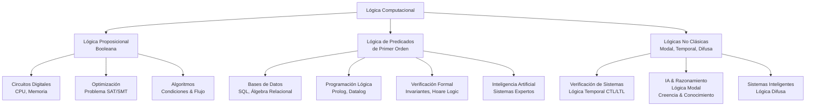

# Lógica Computacional - Introducción

## 1.2 Panorama de aplicaciones en distintas áreas de las ciencias de la computación.

---

### **1. Definición y Enfoque**

La Lógica Computacional no es una disciplina aislada, sino el **sustento formal y el lenguaje común** que permea y habilita el avance en prácticamente todas las áreas de las ciencias de la computación. Su aplicación va desde los niveles más bajos de abstracción (hardware) hasta los más altos (inteligencia artificial), proporcionando precisión, automatización y capacidad de razonamiento.

> "La lógica se utiliza para formalizar y, por lo tanto, automatizar el razonamiento tanto sobre el mundo como sobre los sistemas computacionales mismos." — Ben-Ari, M.

### **2. Mapa Conceptual de Aplicaciones**

El siguiente diagrama ofrece una visión general de cómo las diferentes lógicas se aplican en las ciencias de la computación.



### **3. Aplicaciones Detalladas con Ejemplos**

#### **a) Arquitectura de Computadores y Diseño Digital**

**Lógica Utilizada:** Lógica Proposicional (Booleana).
**Aplicación:** Todas las operaciones de un procesador se realizan mediante circuitos compuestos por compuertas lógicas (AND, OR, NOT, XOR). La Unidad Aritmético-Lógica (ALU) es esencialmente un complejo circuito combinatorio que evalúa funciones booleanas.

- **Ejemplo (Sumador de 1 bit):**
  - Entradas: A, B, Cin (acarreo de entrada)
  - Salidas: S (suma), Cout (acarreo de salida)
  - **Fórmulas:**
    - $S = A \oplus B \oplus C_{in}$ (XOR)
    - $C_{out} = (A \land B) \lor (C_{in} \land (A \oplus B))$

#### **b) Bases de Datos y Sistemas de Información**

**Lógica Utilizada:** Lógica de Predicados de Primer Orden (Cálculo de Predicados).
**Aplicación:** El lenguaje de consulta **SQL** y el modelo relacional están fundamentados en la lógica. Una consulta es, en esencia, una fórmula lógica que define las tuplas que se desean seleccionar.

- **Ejemplo (Consulta SQL como Fórmula Lógica):**
  ```sql
  SELECT nombre FROM Empleados WHERE salario > 50000 AND departamento = 'Ventas';
  ```
  - **Traducción a Lógica de Predicados:**
    - Sea $E(x)$: "x es un empleado", $Nombre(x, n)$, $Salario(x, s)$, $Departamento(x, d)$.
    - La consulta encuentra todos los $n$ para los que existe un $x$ tal que:
    $$
    \exists x (E(x) \land Nombre(x, n) \land Salario(x, s) \land s > 50000 \land Departamento(x, \text{'Ventas'}))
    $$

#### **c) Verificación Formal de Software y Hardware**

**Lógica Utilizada:** Lógica Temporal (LTL, CTL), Lógica de Hoare.
**Aplicación:** Permite demostrar matemáticamente que un sistema (e.g., un protocolo de comunicación, un driver) cumple con propiedades críticas de **correctitud**, **ausencia de bloqueos (deadlock)** y **vivacidad (livelock)**.

- **Ejemplo (Lógica Temporal - LTL):**
  - Propiedad: "Es siempre cierto que si una solicitud (`req`) se envía, eventualmente se concederá (`ack`)".
  - **Fórmula LTL:** $\Box(req \to \Diamond ack)$
  - Donde $\Box$ es "siempre" y $\Diamond$ es "eventualmente".

- **Ejemplo (Lógica de Hoare para Correctitud de Programas):**
  - **Triple de Hoare:** $\{P\}~C~\{Q\}$
    - $P$: Precondición (assertión inicial).
    - $C$: Comando o programa.
    - $Q$: Postcondición ( assertión que debe cumplirse tras ejecutar $C$ ).
  - **Código (Intercambio de variables):**
    ```python
    # Precondición: {P: x = a, y = b}
    temp = x
    x = y
    y = temp
    # Postcondición: {Q: x = b, y = a}
    ```

#### **d) Inteligencia Artificial y Representación del Conocimiento**

**Lógica Utilizada:** Lógica de Predicados, Lógicas Modales, Lógica Difusa.
**Aplicación:** Representar conocimiento del mundo real de forma declarativa y permitir que las máquinas realicen inferencias automáticamente.

- **Ejemplo (Sistema Basado en Reglas - Modus Ponens):**
  - Base de Conocimiento:
    1.  $\forall x (Humano(x) \to Mortal(x))$ // Regla
    2.  $Humano(Socrates)$ // Hecho
  - **Inferencia:** Aplicando la regla, se puede inferir (derivar) el nuevo hecho: $Mortal(Socrates)$.

#### **e) Complejidad Computacional y Optimización (SAT Solvers)**

**Lógica Utilizada:** Lógica Proposicional.
**Aplicación:** El problema de satisfacibilidad proposicional (SAT) fue el primer problema identificado como NP-Completo. Los solucionadores modernos de SAT (SAT solvers) son herramientas increíblemente potentes que pueden resolver problemas de planificación, verificación y optimización de millones de variables.

- **Ejemplo (Problema SAT):**
  - Fórmula: $(P \lor Q) \land (\lnot P \lor R) \land (\lnot Q \lor \lnot R)$
  - **Pregunta:** ¿Existe una asignación de valores de verdad (V/F) para $P, Q, R$ que haga que toda la fórmula sea verdadera?
  - **Solución:** Sí, por ejemplo: $P=V, Q=F, R=V$.

#### **f) Lingüística Computacional y Procesamiento del Lenguaje Natural (PLN)**

**Lógica Utilizada:** Lógica de Predicados, Lógicas Modales.
**Aplicación:** Representar el significado semántico de oraciones para tareas como extracción de información, traducción automática y question answering.

- **Ejemplo (Representación Semántica):**
  - Oración: "Todos los estudiantes entregaron alguna tarea."
  - **Lógica de Predicados:**
    $\forall x (Estudiante(x) \to \exists y (Tarea(y) \land Entregar(x, y)))$

### **4. Ejercicios Propuestos**

1.  **Traducción Lógica:** Formaliza en lógica de predicados la siguiente sentencia: "Cada archivo en el sistema que es grande y está comprimido fue modificado la semana pasada". Define tus predicados claramente ( e.g., $Archivo(x)$, $Grande(x)$, $ModificadoLaSemanaPasada(x)$ ).

2.  **Lógica Temporal:** Imagina un semáforo para peatones. Escribe una fórmula en Lógica Temporal (LTL) que exprese la propiedad: "El semáforo nunca debe estar en verde para los coches y en verde para los peatones al mismo tiempo". Usa los átomos `verde_coches` y `verde_peatones`.

3.  **Pensamiento Crítico - SAT Solvers:** ¿Por qué la capacidad de resolver eficientemente el problema SAT (aunque sea en casos prácticos) tiene un impacto tan enorme en áreas como la verificación de hardware? Relaciónalo con el concepto de NP-Completitud.

4.  **Aplicación en Bases de Datos:** Dada la siguiente base de datos relacional:
    - `Empleado(ID, Nombre, DeptID)`
    - `Departamento(DeptID, Nombre, Presupuesto)`
    - `Jefe(EmptID, JefeID)`
      Escribe la consulta SQL para encontrar "Los nombres de todos los empleados que trabajan en un departamento con presupuesto mayor a 1 millón y que tienen un jefe". Luego, intenta esbozar cómo se representaría esa consulta en Cálculo Relacional de Tuplas (basado en lógica de predicados).

### **5. Referencias**

- **Huth, M., Ryan, M. (2004).** _Logic in Computer Science._ Capítulos 1, 3 y 6. Excelente para verificación (model checking) y lógica temporal.
- **Nerode, A., Shore, R.A. (1997).** _Logic for Applications._ Capítulos 1, 2 y 5. Ofrece una base sólida en lógica de predicados y su uso en programación lógica.
- **Ben-Ari, M. (2008).** _Mathematical Logic for Computer Science._ Capítulos 1, 2, 4 y 12. Muy didáctico, con ejemplos de SAT, verificación y lógica de Hoare.
- **Fitting, M. (1996).** _First-Order Logic and Automated Theorem Proving._ Para profundizar en el mecanismo detrás de la inferencia automática.
- **Socher-Ambrosius, R., Johann, P. (1997).** _Deduction Systems._ Para entender las diferentes formas de sistemas de deducción automática.
