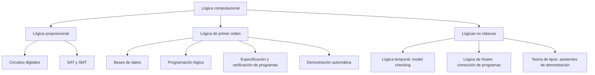

# Lógica Computacional - Introducción

## 1.2 Panorama de aplicaciones en distintas áreas de las ciencias de la computación.

---

La lógica aparece en todos los niveles de la computación, desde las compuertas de un procesador hasta los asistentes de demostración. Cada área usa la lógica que necesita: la proposicional basta para describir circuitos, la de primer orden para consultas y especificaciones, y las lógicas modales y temporales para hablar de estados que cambian. Este tema recorre las aplicaciones principales con un ejemplo concreto de cada una; los temas posteriores desarrollan la teoría que las sustenta.

### Mapa de aplicaciones



### Arquitectura y diseño digital

Un circuito combinatorio calcula una función booleana, que es una fórmula de la lógica proposicional con 1 para verdadero y 0 para falso. El **sumador completo** de un bit recibe $A,$ $B$ y el acarreo de entrada $C,$ y produce la suma $S$ y el acarreo de salida:

$$ S = A \oplus B \oplus C, \qquad C_{\text{sal}} = (A \land B) \lor (C \land (A \oplus B)) $$

donde $\oplus$ es el **o exclusivo**, verdadero si exactamente uno de sus argumentos lo es. Encadenando $n$ sumadores completos se suman números de $n$ bits. Las equivalencias lógicas sirven para **minimizar** circuitos, es decir, encontrar una fórmula equivalente con menos compuertas, y la verificación de que dos circuitos son equivalentes se reduce a un problema SAT: $\varphi \equiv \psi$ si y solo si $\varphi \oplus \psi$ es insatisfacible.

### Satisfacibilidad y optimización

Una fórmula es **satisfacible** si alguna asignación la hace verdadera. El problema SAT pregunta exactamente eso. Por ejemplo, $(P \lor Q) \land (\lnot P \lor R) \land (\lnot Q \lor \lnot R)$ es satisfacible: tiene dos modelos, $P = V,$ $Q = F,$ $R = V$ y $P = F,$ $Q = V,$ $R = F.$

SAT es NP-completo (Cook, 1971), así que no se conoce un algoritmo eficiente en el peor caso. Aun así, los **SAT solvers** modernos, basados en el algoritmo DPLL y el aprendizaje de cláusulas (tema 2.6), resuelven en la práctica instancias con millones de variables. Por eso se usan para verificar hardware, planificar, asignar horarios y resolver dependencias de paquetes. Los **SMT solvers**, como Z3, extienden SAT con teorías como la aritmética de enteros o los arreglos.

### Bases de datos

El modelo relacional se fundamenta en la lógica de primer orden: una tabla es un predicado, y una consulta es una fórmula cuyas variables libres son las columnas del resultado. La consulta

```sql
SELECT nombre FROM Empleados WHERE salario > 50000 AND departamento = 'Ventas';
```

corresponde, en el **cálculo relacional**, al conjunto de los $n$ que satisfacen

$$ \exists s\, (\text{Empleado}(n, s, \text{Ventas}) \land s > 50000) $$

El teorema de Codd (1972) dice que el cálculo relacional y el álgebra relacional tienen el mismo poder expresivo, y la optimización de consultas consiste en reescribir fórmulas por otras equivalentes más baratas de evaluar.

### Programación lógica e inteligencia artificial

En **Prolog** y **Datalog** un programa es un conjunto de fórmulas de un tipo restringido, las cláusulas de Horn, y ejecutarlo es demostrar una consulta (tema 6). Una base de conocimiento clásica:

$$ \forall x\, (\text{Humano}(x) \to \text{Mortal}(x)), \qquad \text{Humano}(\text{sócrates}) $$

De ellas se deduce $\text{Mortal}(\text{sócrates})$ por **modus ponens**. Los sistemas expertos, las ontologías de la web semántica (basadas en lógicas descriptivas) y la planificación automática siguen este principio: el conocimiento se escribe de forma declarativa y un motor de inferencia deduce consecuencias.

### Especificación y verificación de programas

**Lógica de Hoare.** Una **tripleta de Hoare** $\{P\}\ C\ \{Q\}$ afirma que si el programa $C$ empieza en un estado que satisface la precondición $P$ y termina, el estado final satisface la postcondición $Q.$ Por ejemplo, para el intercambio de dos variables:

```python
# {x = a  y  y = b}
temp = x
x = y
y = temp
# {x = b  y  y = a}
```

Las reglas de la lógica de Hoare (tema 7.2) permiten demostrar tripletas como esta para todo valor de $a$ y $b,$ sin ejecutar el programa.

**Lógica temporal y model checking.** Para sistemas concurrentes y reactivos, que no terminan, interesan propiedades sobre secuencias de estados. La lógica temporal lineal (LTL) añade operadores como $\Box$ (siempre) y $\Diamond$ (alguna vez en el futuro). La propiedad "toda solicitud es atendida alguna vez" es

$$ \Box\, (\text{solicitud} \to \Diamond\, \text{respuesta}) $$

Un **model checker** explora automáticamente todos los estados del sistema y, si la propiedad falla, devuelve una traza contraejemplo. Clarke, Emerson y Sifakis recibieron el premio Turing de 2007 por esta técnica.

### Demostración automática y asistentes de demostración

Los **demostradores automáticos** (Vampire, E) buscan demostraciones en lógica de primer orden con resolución y unificación (tema 5.5). Los **asistentes de demostración** (Coq, Lean, Isabelle) verifican demostraciones escritas por personas en lógicas de orden superior; con ellos se han verificado un compilador completo de C (CompCert) y un núcleo de sistema operativo (seL4). Su fundamento es la correspondencia de Curry-Howard: una demostración es un programa y una fórmula es su tipo (tema 7.1).

### Resumen

| Área | Lógica | Ejemplo |
| --- | --- | --- |
| Diseño digital | proposicional | sumador, minimización de circuitos |
| Optimización | proposicional, SMT | SAT solvers, planificación |
| Bases de datos | primer orden | cálculo relacional, SQL, Datalog |
| Inteligencia artificial | primer orden, descriptivas | sistemas expertos, ontologías |
| Verificación | Hoare, temporal | tripletas, model checking |
| Lenguajes de programación | teoría de tipos | sistemas de tipos, asistentes de demostración |

### Implementación en Python

El programa ilustra cinco de las aplicaciones a pequeña escala: verifica el sumador completo contra la suma aritmética, enumera los modelos de la fórmula SAT del tema, evalúa una consulta como fórmula, deduce hechos nuevos con reglas y revisa una propiedad de seguridad sobre una traza de estados de un semáforo.

```python
from itertools import product

# 1. Hardware: el sumador completo coincide con la suma aritmética
def sumador(a, b, c):
    s = a ^ b ^ c
    c_out = (a & b) | (c & (a ^ b))
    return s, c_out

print('sumador correcto:', all(sumador(a, b, c) == ((a + b + c) % 2, (a + b + c) // 2)
                               for a, b, c in product([0, 1], repeat=3)))

# 2. SAT: todas las asignaciones que satisfacen (P ∨ Q) ∧ (¬P ∨ R) ∧ (¬Q ∨ ¬R)
formula = lambda p, q, r: (p or q) and (not p or r) and (not q or not r)
modelos = [v for v in product([True, False], repeat=3) if formula(*v)]
print('modelos:', [''.join('V' if x else 'F' for x in v) for v in modelos])

# 3. Bases de datos: la consulta es la fórmula ∃x (E(x) ∧ Nombre(x, n) ∧ ...)
empleados = [('Ana', 62000, 'Ventas'), ('Luis', 48000, 'Ventas'), ('Eva', 75000, 'Sistemas')]
print('consulta:', [n for (n, s, d) in empleados if s > 50000 and d == 'Ventas'])

# 4. IA: encadenamiento hacia adelante con reglas Humano(x) -> Mortal(x)
hechos = {('Humano', 'Socrates')}
reglas = [('Humano', 'Mortal'), ('Mortal', 'Finito')]
cambio = True
while cambio:
    cambio = False
    for (premisa, conclusion) in reglas:
        for (pred, x) in sorted(hechos):
            if pred == premisa and (conclusion, x) not in hechos:
                hechos.add((conclusion, x))
                cambio = True
print('hechos:', sorted(hechos))

# 5. Verificación: □¬(verde_coches ∧ verde_peatones) sobre una traza finita
traza = [{'vc'}, {'vc'}, set(), {'vp'}, set(), {'vc', 'vp'}, {'vc'}]
violaciones = [i for i, estado in enumerate(traza) if {'vc', 'vp'} <= estado]
print('siempre seguro:', not violaciones, ' violaciones en los instantes', violaciones)
```

Salida:

```text
sumador correcto: True
modelos: ['VFV', 'FVF']
consulta: ['Ana']
hechos: [('Finito', 'Socrates'), ('Humano', 'Socrates'), ('Mortal', 'Socrates')]
siempre seguro: False  violaciones en los instantes [5]
```

La revisión de la traza encuentra el instante 5, en el que coches y peatones tienen verde a la vez. Un model checker hace lo mismo, pero sobre **todas** las trazas posibles del sistema, no solo sobre una.

### Ejercicios Propuestos

1. **Primer orden.** Formaliza la frase "todo archivo del sistema que es grande y está comprimido fue modificado la semana pasada", definiendo los predicados que uses.

2. **Lógica temporal.** Escribe en LTL la propiedad "el semáforo nunca está en verde para los coches y para los peatones al mismo tiempo", con los átomos $c$ y $p.$

3. **SAT.** Explica por qué verificar que dos circuitos combinatorios son equivalentes se puede reducir a SAT, y por qué eso hace útiles a los SAT solvers aunque SAT sea NP-completo.

4. **Bases de datos.** Con las tablas `Empleado(id, nombre, depto)`, `Departamento(depto, presupuesto)` y `Jefe(id, jefe)`, escribe en SQL y en cálculo relacional la consulta "nombres de los empleados de un departamento con presupuesto mayor a un millón que tienen jefe".

5. **Hoare.** ¿Es verdadera la tripleta $\{x > 0\}\ x := x - 1\ \{x \geq 0\}$ si $x$ es un entero? ¿Y si $x$ es un número real?

### Soluciones

**Ejercicio 1.** Con $A(x),$ $G(x),$ $C(x)$ y $M(x)$ para "es archivo del sistema", "es grande", "está comprimido" y "fue modificado la semana pasada":

$$ \forall x\, \big( (A(x) \land G(x) \land C(x)) \to M(x) \big) $$

**Ejercicio 2.** $\Box\, \lnot (c \land p),$ equivalentemente $\Box\, (\lnot c \lor \lnot p).$ Es una propiedad de **seguridad**: si falla, falla en un instante concreto, como el instante 5 de la traza del programa.

**Ejercicio 3.** Si los circuitos calculan $\varphi$ y $\psi,$ son equivalentes si y solo si $\varphi \oplus \psi$ no tiene modelos, y un modelo, si existe, es una entrada en la que difieren. Que SAT sea NP-completo habla del peor caso; las instancias que provienen de circuitos reales tienen estructura que los solvers aprovechan, y en la práctica se resuelven con millones de variables.

**Ejercicio 4.**

```sql
SELECT E.nombre
FROM Empleado E JOIN Departamento D ON E.depto = D.depto
WHERE D.presupuesto > 1000000
  AND EXISTS (SELECT 1 FROM Jefe J WHERE J.id = E.id);
```

En cálculo relacional, el resultado es el conjunto de los $n$ tales que

$$ \exists i\, \exists d\, \exists b\, \exists j\, \big( \text{Empleado}(i, n, d) \land \text{Departamento}(d, b) \land b > 10^6 \land \text{Jefe}(i, j) \big) $$

**Ejercicio 5.** Con enteros es verdadera: si $x > 0,$ entonces $x \geq 1$ y $x - 1 \geq 0.$ Con reales es falsa: $x = 0.5$ satisface la precondición y termina con $x = -0.5.$ La validez de una tripleta depende del dominio de las variables, que es parte de la especificación.

### Referencias

1. Huth, M., and Ryan, M., _Logic in Computer Science: Modelling and Reasoning about Systems_. Cambridge University Press, 2004. Capítulos 1, 3 y 4.
2. Ben-Ari, M., _Mathematical Logic for Computer Science_. Springer, 2012. Capítulos 6, 13 y 15.
3. Abiteboul, S., Hull, R., and Vianu, V., _Foundations of Databases_. Addison-Wesley, 1995. Capítulos 4 y 5.
4. Biere, A., Heule, M., van Maaren, H., and Walsh, T. (eds.), _Handbook of Satisfiability_. IOS Press, 2021.
5. Clarke, E. M., Grumberg, O., and Peled, D., _Model Checking_. MIT Press, 1999.
