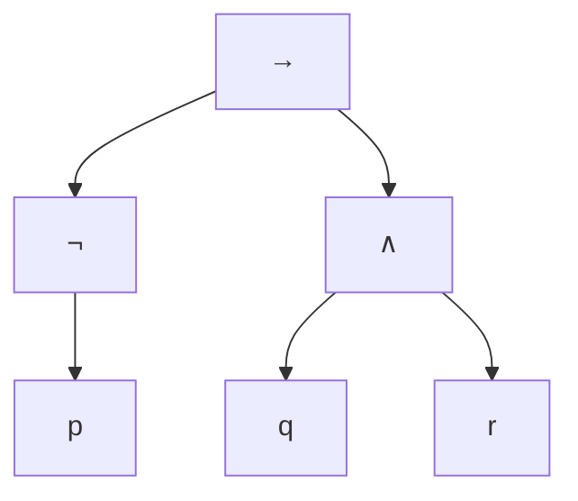

# Lógica Computacional - Lógica proposicional

## 2.1 Sintaxis: lenguaje formal, recursión e inducción estructural.

---

La **sintaxis** de una lógica dice qué sucesiones de símbolos son fórmulas, sin decir nada de su significado. Para la lógica proposicional, el conjunto de fórmulas se define **recursivamente**, y esa definición da dos herramientas que se usan durante todo el curso: la **recursión estructural**, para definir funciones sobre fórmulas, y la **inducción estructural**, para demostrar propiedades de todas las fórmulas.

### El alfabeto

El lenguaje de la lógica proposicional usa tres tipos de símbolos:

- **Variables proposicionales,** un conjunto infinito numerable $\text{VAR} = \{p, q, r, p_1, p_2, \ldots\}.$
- **Conectivos,** la negación $\lnot$ y los binarios $\land,$ $\lor,$ $\to$ y $\leftrightarrow.$ A veces se añaden las constantes $\top$ (verdadero) y $\bot$ (falso).
- **Símbolos auxiliares,** los paréntesis $($ y $).$

Una expresión es cualquier cadena finita sobre este alfabeto; la mayoría no son fórmulas, como $)p\lnot\land.$

### Definición recursiva de las fórmulas

**Definición.** El conjunto $\text{FORM}$ de las **fórmulas** es el menor conjunto de expresiones tal que:

1. **Base.** Toda variable $p \in \text{VAR}$ es una fórmula (una fórmula **atómica**).
2. **Negación.** Si $\varphi$ es una fórmula, $\lnot \varphi$ es una fórmula.
3. **Conectivos binarios.** Si $\varphi$ y $\psi$ son fórmulas y $\circ \in \{\land, \lor, \to, \leftrightarrow\},$ entonces $(\varphi \circ \psi)$ es una fórmula.

"El menor conjunto" sustituye a la cláusula "nada más es fórmula": $\text{FORM}$ es la intersección de todos los conjuntos que contienen a las variables y son cerrados bajo las reglas 2 y 3. Equivalentemente, una expresión es fórmula si y solo si se puede construir con una sucesión finita de aplicaciones de las reglas, una **sucesión de formación**. Por ejemplo, $(\lnot p \to (q \land r))$ se forma con

$$ p,\ q,\ r,\ \lnot p,\ (q \land r),\ (\lnot p \to (q \land r)) $$

**En notación BNF**, con $p$ para una variable:

$$ \varphi ::= p \mid \lnot \varphi \mid (\varphi \land \varphi) \mid (\varphi \lor \varphi) \mid (\varphi \to \varphi) \mid (\varphi \leftrightarrow \varphi) $$

**Convenciones.** Para leer con comodidad se omiten los paréntesis exteriores y se usa una precedencia: $\lnot$ liga más que $\land$ y $\lor,$ que ligan más que $\to,$ que liga más que $\leftrightarrow;$ además, $\to$ asocia a la derecha. Así, $\lnot p \land q \to r$ abrevia $((\lnot p \land q) \to r)$ y $p \to q \to r$ abrevia $(p \to (q \to r)).$ Las convenciones son solo abreviaturas; la definición oficial es la estricta.

### Árboles de sintaxis

Cada fórmula tiene un **árbol de sintaxis**: las hojas son variables y cada nodo interno es un conectivo con sus subfórmulas como hijos. Para $(\lnot p \to (q \land r)):$



Las **subfórmulas** de $\varphi$ son las fórmulas de los subárboles: aquí, $p,$ $q,$ $r,$ $\lnot p,$ $(q \land r)$ y la propia fórmula. El conectivo de la raíz es el **conectivo principal**.

### Inducción estructural

**Teorema (principio de inducción estructural).** Sea $P$ una propiedad de fórmulas. Si

1. $P(p)$ se cumple para toda variable $p,$
2. $P(\varphi)$ implica $P(\lnot \varphi),$
3. $P(\varphi)$ y $P(\psi)$ implican $P((\varphi \circ \psi))$ para cada conectivo binario $\circ,$

entonces $P(\varphi)$ se cumple para toda fórmula $\varphi.$

**Demostración.** El conjunto $A = \{\varphi \in \text{FORM} \mid P(\varphi)\}$ contiene a las variables y es cerrado bajo las reglas de formación, por las hipótesis. Como $\text{FORM}$ es el **menor** conjunto con esas propiedades, $\text{FORM} \subseteq A.$ $\blacksquare$

Es la inducción sobre los números naturales aplicada a la altura del árbol de sintaxis, pero sin necesidad de mencionar números.

**Ejemplo.** Toda fórmula tiene el mismo número de paréntesis izquierdos que derechos.

**Demostración.** Sea $i(\varphi)$ el número de paréntesis izquierdos y $d(\varphi)$ el de derechos. Base: una variable no tiene paréntesis, $i(p) = d(p) = 0.$ Negación: $i(\lnot \varphi) = i(\varphi) = d(\varphi) = d(\lnot \varphi)$ por hipótesis de inducción. Binarios: $i((\varphi \circ \psi)) = 1 + i(\varphi) + i(\psi) = 1 + d(\varphi) + d(\psi) = d((\varphi \circ \psi)).$ $\blacksquare$

### Lectura única

Para definir funciones por recursión hace falta que cada fórmula se construya de **una sola manera**: si $(\varphi \circ \psi)$ también pudiera leerse como $(\varphi' \circ' \psi')$ con otras partes, una definición recursiva podría dar dos valores distintos.

**Lema.** Ningún prefijo propio no vacío de una fórmula es una fórmula.

**Demostración (idea).** Por inducción se muestra que todo prefijo propio no vacío de una fórmula que empieza con $($ tiene más paréntesis izquierdos que derechos, mientras que una fórmula tiene los mismos. Para las fórmulas que empiezan con $\lnot,$ se aplica la hipótesis de inducción a la subfórmula. $\blacksquare$

**Teorema (lectura única).** Toda fórmula es exactamente de una de las formas: una variable, $\lnot \varphi$ con $\varphi$ única, o $(\varphi \circ \psi)$ con $\varphi,$ $\circ$ y $\psi$ únicos.

**Demostración.** El primer símbolo distingue las tres formas. Si $(\varphi \circ \psi) = (\varphi' \circ' \psi'),$ entonces $\varphi$ y $\varphi'$ empiezan en la misma posición, así que una es prefijo de la otra; por el lema, $\varphi = \varphi'.$ Luego $\circ = \circ'$ y $\psi = \psi'.$ $\blacksquare$

Por eso son indispensables los paréntesis de la definición estricta: sin ellos, $p \land q \lor r$ tendría dos lecturas.

### Recursión estructural

**Teorema (recursión estructural).** Dados valores $f(p)$ para cada variable y funciones $F_\lnot$ y $F_\circ$ para cada conectivo, existe una única función $f$ sobre las fórmulas tal que

$$ f(\lnot \varphi) = F_\lnot(f(\varphi)), \qquad f((\varphi \circ \psi)) = F_\circ(f(\varphi), f(\psi)) $$

La existencia y unicidad se demuestran por inducción estructural, usando la lectura única. Ejemplos:

$$ \begin{aligned} \text{prof}(p) &= 0, & \text{prof}(\lnot \varphi) &= 1 + \text{prof}(\varphi), & \text{prof}((\varphi \circ \psi)) &= 1 + \max(\text{prof}(\varphi), \text{prof}(\psi)) \\ \text{tam}(p) &= 1, & \text{tam}(\lnot \varphi) &= 1 + \text{tam}(\varphi), & \text{tam}((\varphi \circ \psi)) &= 1 + \text{tam}(\varphi) + \text{tam}(\psi) \end{aligned} $$

$$ \text{sub}(p) = \{p\}, \quad \text{sub}(\lnot \varphi) = \{\lnot \varphi\} \cup \text{sub}(\varphi), \quad \text{sub}((\varphi \circ \psi)) = \{(\varphi \circ \psi)\} \cup \text{sub}(\varphi) \cup \text{sub}(\psi) $$

La profundidad es la altura del árbol de sintaxis y el tamaño su número de nodos: variables y conectivos, sin contar paréntesis.

**Proposición.** Para toda fórmula, $\text{tam}(\varphi) \leq 2^{\text{prof}(\varphi) + 1} - 1$ y $|\text{sub}(\varphi)| \leq \text{tam}(\varphi).$

**Demostración de la primera.** Base: $1 \leq 2^1 - 1.$ Negación: $1 + \text{tam}(\varphi) \leq 2^{\text{prof}(\varphi) + 1} \leq 2^{\text{prof}(\varphi) + 2} - 1.$ Binarios: con $h = \max(\text{prof}(\varphi), \text{prof}(\psi)),$ $1 + \text{tam}(\varphi) + \text{tam}(\psi) \leq 1 + 2(2^{h + 1} - 1) = 2^{h + 2} - 1.$ La segunda es análoga: cada regla añade a lo más una subfórmula nueva y exactamente un símbolo. $\blacksquare$

### Implementación en Python

El programa es un **analizador sintáctico** de descenso recursivo que sigue la definición: lee una fórmula y devuelve su árbol, representado con tuplas, o dice por qué la expresión no es una fórmula. Las funciones `prof`, `tam` y `subformulas` son recursiones estructurales. Al final comprueba en 2000 fórmulas aleatorias las propiedades demostradas por inducción.

```python
import random

BINARIOS = '∧∨→↔'

def analizar(s):
    """Devuelve el árbol de una FBF estricta, o lanza ValueError si no lo es."""
    s = s.replace(' ', '')
    arbol, resto = formula(s)
    if resto:
        raise ValueError(f'sobra {resto!r}')
    return arbol

def formula(s):
    if not s:
        raise ValueError('falta una fórmula')
    if s[0].isalpha():                      # variable: letra seguida de dígitos
        i = 1
        while i < len(s) and s[i].isdigit():
            i += 1
        return s[:i], s[i:]
    if s[0] == '¬':
        sub, resto = formula(s[1:])
        return ('¬', sub), resto
    if s[0] == '(':
        izq, resto = formula(s[1:])
        if not resto or resto[0] not in BINARIOS:
            raise ValueError('falta un conectivo binario')
        op = resto[0]
        der, resto = formula(resto[1:])
        if not resto or resto[0] != ')':
            raise ValueError('falta un paréntesis derecho')
        return (op, izq, der), resto[1:]
    raise ValueError(f'símbolo inesperado {s[0]!r}')

def prof(f):
    if isinstance(f, str): return 0
    return 1 + max(prof(g) for g in f[1:])

def tam(f):
    if isinstance(f, str): return 1
    return 1 + sum(tam(g) for g in f[1:])

def conectivos(f):
    if isinstance(f, str): return 0
    return 1 + sum(conectivos(g) for g in f[1:])

def subformulas(f):
    if isinstance(f, str): return {f}
    return {f}.union(*(subformulas(g) for g in f[1:]))

def texto(f):
    if isinstance(f, str): return f
    if f[0] == '¬': return '¬' + texto(f[1])
    return '(' + texto(f[1]) + f[0] + texto(f[2]) + ')'

for e in ['(p→q)', 'p∧q∨r', '¬(p)', '(¬p→(q∧r))', 'p→', '¬¬p', '((p→q)∨¬r)']:
    try:
        f = analizar(e)
        print(f'{e:14} FBF  prof={prof(f)} tam={tam(f)} conectivos={conectivos(f)} subfórmulas={len(subformulas(f))}')
    except ValueError as err:
        print(f'{e:14} no es FBF: {err}')

# Comprobación de los teoremas demostrados por inducción, sobre fórmulas aleatorias
def aleatoria(n, rnd):
    if n == 0 or rnd.random() < 0.2:
        return rnd.choice('pqr')
    if rnd.random() < 0.3:
        return ('¬', aleatoria(n - 1, rnd))
    return (rnd.choice(BINARIOS), aleatoria(n - 1, rnd), aleatoria(n - 1, rnd))

rnd = random.Random(1)
ok = True
for _ in range(2000):
    f = aleatoria(6, rnd)
    t = texto(f)
    ok &= t.count('(') == t.count(')')               # paréntesis balanceados
    ok &= analizar(t) == f                           # lectura única
    ok &= tam(f) <= 2 ** (prof(f) + 1) - 1           # cota del tamaño por la profundidad
    ok &= len(subformulas(f)) <= tam(f)              # a lo más tam(f) subfórmulas
print('propiedades verificadas en 2000 fórmulas:', ok)
```

Salida:

```text
(p→q)          FBF  prof=1 tam=3 conectivos=1 subfórmulas=3
p∧q∨r          no es FBF: sobra '∧q∨r'
¬(p)           no es FBF: falta un conectivo binario
(¬p→(q∧r))     FBF  prof=2 tam=6 conectivos=3 subfórmulas=6
p→             no es FBF: sobra '→'
¬¬p            FBF  prof=2 tam=3 conectivos=2 subfórmulas=3
((p→q)∨¬r)     FBF  prof=2 tam=6 conectivos=3 subfórmulas=6
propiedades verificadas en 2000 fórmulas: True
```

La comprobación `analizar(texto(f)) == f` es la lectura única en acción: escribir un árbol y volver a leerlo devuelve el mismo árbol. El analizador nunca necesita retroceder, porque el primer símbolo decide qué regla se aplica.

### Ejercicios Propuestos

1. **Reconocimiento.** Determina cuáles son fórmulas en la definición estricta: $(p \to q),$ $p \land q \lor r,$ $\lnot (p),$ $(\lnot p \to (q \land r)),$ $p \to,$ $\lnot \lnot p.$

2. **Sucesión de formación.** Da una sucesión de formación y el árbol de sintaxis de $((p \leftrightarrow q) \land \lnot r).$

3. **Medidas.** Calcula la profundidad, el tamaño y las subfórmulas de $\lnot p,$ $(p \land q)$ y $((p \to q) \lor \lnot r).$

4. **Recursión.** Define por recursión estructural la función $v(\varphi),$ el número de apariciones de variables en $\varphi,$ y $c(\varphi),$ el número de conectivos binarios. Demuestra por inducción que $v(\varphi) = c(\varphi) + 1.$

5. **Primer símbolo.** Demuestra por inducción estructural que toda fórmula no atómica empieza con $\lnot$ o con un paréntesis izquierdo.

6. **Polaca.** En notación polaca, las fórmulas se definen como $\varphi ::= p \mid N\varphi \mid K\varphi\varphi \mid A\varphi\varphi \mid C\varphi\varphi,$ donde $N,$ $K,$ $A$ y $C$ son negación, conjunción, disyunción e implicación. Escribe $(\lnot p \to (q \land r))$ en notación polaca y explica por qué no hacen falta paréntesis.

### Soluciones

**Ejercicio 1.** Son fórmulas $(p \to q),$ $(\lnot p \to (q \land r))$ y $\lnot \lnot p.$ No lo son $p \land q \lor r,$ que no tiene paréntesis, aunque con las convenciones abrevia $((p \land q) \lor r);$ $\lnot (p),$ porque los paréntesis solo aparecen con un conectivo binario; y $p \to,$ a la que le falta el segundo argumento.

**Ejercicio 2.** Una sucesión es $p,$ $q,$ $r,$ $(p \leftrightarrow q),$ $\lnot r,$ $((p \leftrightarrow q) \land \lnot r).$ El árbol tiene $\land$ en la raíz, con hijos $\leftrightarrow,$ cuyas hojas son $p$ y $q,$ y $\lnot,$ cuya hoja es $r.$

**Ejercicio 3.**

| Fórmula | prof | tam | Subfórmulas |
| --- | :-: | :-: | --- |
| $\lnot p$ | 1 | 2 | $p,$ $\lnot p$ |
| $(p \land q)$ | 1 | 3 | $p,$ $q,$ $(p \land q)$ |
| $((p \to q) \lor \lnot r)$ | 2 | 6 | $p,$ $q,$ $r,$ $(p \to q),$ $\lnot r,$ la fórmula |

**Ejercicio 4.** $v(p) = 1,$ $v(\lnot \varphi) = v(\varphi),$ $v((\varphi \circ \psi)) = v(\varphi) + v(\psi);$ y $c(p) = 0,$ $c(\lnot \varphi) = c(\varphi),$ $c((\varphi \circ \psi)) = 1 + c(\varphi) + c(\psi).$ Base: $v(p) = 1 = c(p) + 1.$ Negación: ambos lados no cambian. Binarios: $v(\varphi) + v(\psi) = (c(\varphi) + 1) + (c(\psi) + 1) = c((\varphi \circ \psi)) + 1.$ $\blacksquare$

**Ejercicio 5.** La propiedad es "si $\varphi$ no es atómica, empieza con $\lnot$ o con un paréntesis izquierdo". En la base no hay nada que probar. Una fórmula $\lnot \varphi$ empieza con $\lnot$ y una $(\varphi \circ \psi)$ con un paréntesis izquierdo, sin necesidad siquiera de la hipótesis de inducción. $\blacksquare$

**Ejercicio 6.** $CNpKqr.$ Cada conectivo tiene un número fijo de argumentos, así que se lee de izquierda a derecha sin ambigüedad: $C$ espera dos fórmulas, la primera es $Np$ y la segunda $Kqr.$ Se demuestra la lectura única como en el tema, con el lema de que en una fórmula polaca el número de variables es uno más que el de conectivos binarios, mientras que en un prefijo propio no lo es.

### Referencias

1. Ben-Ari, M., _Mathematical Logic for Computer Science_. Springer, 2012. Capítulo 2.
2. van Dalen, D., _Logic and Structure_. Springer, 2013. Sección 2.1.
3. Enderton, H. B., _A Mathematical Introduction to Logic_. Academic Press, 2001. Secciones 1.1, 1.3 y 1.4.
4. Huth, M., and Ryan, M., _Logic in Computer Science_. Cambridge University Press, 2004. Sección 1.3.
