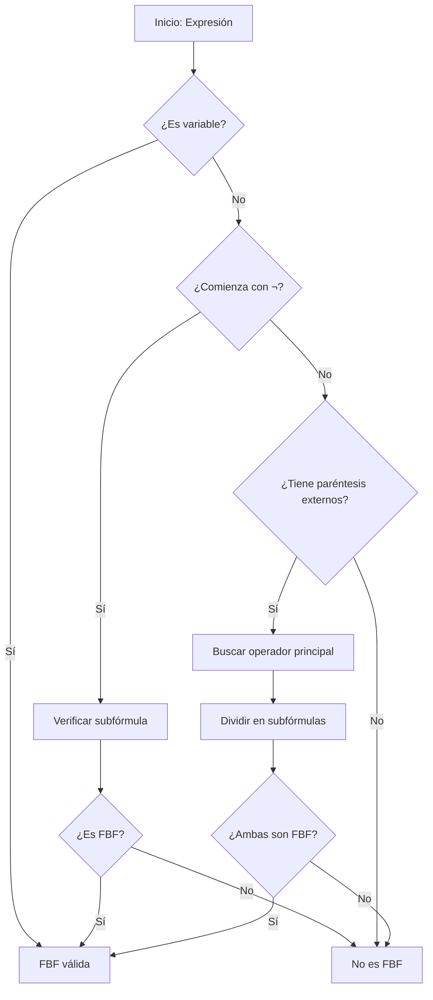

# Lógica Computacional - Lógica proposicional

## 2.1 Sintaxis: lenguaje formal, recursión e inducción estructural.

---

La **sintaxis** en lógica proposicional se refiere a las reglas formales que definen cómo se construyen correctamente las fórmulas, sin considerar su significado (semántica). Es el "esqueleto gramatical" del lenguaje lógico.

### 2. Alfabeto del Lenguaje Formal

El lenguaje formal de la lógica proposicional se construye a partir de los siguientes símbolos:

#### Símbolos básicos:

- **Variables proposicionales**: $p, q, r, s, p_1, p_2, \ldots$ (conjunto infinito numerable)
- **Conectivos lógicos**:
  - $\neg$ (negación)
  - $\land$ (conjunción)
  - $\lor$ (disyunción)
  - $\rightarrow$ (implicación)
  - $\leftrightarrow$ (bicondicional)
- **Símbolos auxiliares**: paréntesis $(, )$

### 3. Definición Recursiva de Fórmulas

Las **fórmulas bien formadas (FBF)** se definen recursivamente:

#### Base:

Toda variable proposicional es una fórmula: si $p \in \text{VAR},$ entonces $p$ es FBF.

#### Paso recursivo:

Si $\phi$ y $\psi$ son FBF, entonces:

1. $\neg\phi$ es FBF
2. $(\phi \land \psi)$ es FBF
3. $(\phi \lor \psi)$ es FBF
4. $(\phi \rightarrow \psi)$ es FBF
5. $(\phi \leftrightarrow \psi)$ es FBF

#### Clausura:

Nada más es FBF.

```python
# Implementación recursiva para verificar si una expresión es FBF
def es_fbf(expresion):
    # Caso base: variable proposicional
    if es_variable(expresion):
        return True

    # Caso negación
    if expresion.startswith('¬'):
        return es_fbf(expresion[1:])

    # Casos binarios
    if expresion.startswith('(') and expresion.endswith(')'):
        # Buscar el operador principal
        for i, char in enumerate(expresion):
            if char in ['∧', '∨', '→', '↔']:
                izquierda = expresion[1:i]
                derecha = expresion[i+1:-1]
                return es_fbf(izquierda) and es_fbf(derecha)

    return False

def es_variable(simbolo):
    return simbolo in ['p', 'q', 'r', 's', 't']  # Variables básicas
```

### 4. Inducción Estructural

La **inducción estructural** es el principio de inducción matemática aplicado a estructuras definidas recursivamente.

#### Principio de Inducción Estructural:

Para demostrar que una propiedad $P$ se cumple para todas las FBF:

1. **Caso base**: Demostrar $P(p)$ para toda variable proposicional $p$
2. **Paso inductivo**: Demostrar que si $P(\phi)$ y $P(\psi)$ se cumplen, entonces:
   - $P(\neg\phi)$ se cumple
   - $P(\phi \land \psi)$ se cumple
   - $P(\phi \lor \psi)$ se cumple
   - $P(\phi \rightarrow \psi)$ se cumple
   - $P(\phi \leftrightarrow \psi)$ se cumple

### 5. Funciones Definidas Recursivamente

#### Función de complejidad (profundidad):

$$
\begin{aligned}
\text{depth}(p) &= 0 \\
\text{depth}(\neg\phi) &= 1 + \text{depth}(\phi) \\
\text{depth}(\phi \circ \psi) &= 1 + \max(\text{depth}(\phi), \text{depth}(\psi))
\end{aligned}
$$

#### Función de tamaño (número de símbolos):

$$
\begin{aligned}
\text{size}(p) &= 1 \\
\text{size}(\neg\phi) &= 1 + \text{size}(\phi) \\
\text{size}(\phi \circ \psi) &= 1 + \text{size}(\phi) + \text{size}(\psi)
\end{aligned}
$$

### 6. Diagrama de Formación de Fórmulas



### 7. Ejemplos y Contraejemplos

#### Fórmulas bien formadas:

- $p$
- $\neg q$
- $(p \land q)$
- $(\neg p \rightarrow (q \lor r))$
- $((p \leftrightarrow q) \land \neg r)$

#### Expresiones mal formadas:

- $p \land q$ (falta paréntesis)
- $\neg$ (falta fórmula)
- $(p \land$ (incompleta)
- $p \rightarrow \rightarrow q$ (sintaxis incorrecta)

### 8. Ejercicios Propuestos

#### Ejercicio 1:

Determine cuáles de las siguientes expresiones son FBF:

1. $(p \rightarrow q)$
2. $p \land q \lor r$
3. $\neg(p)$
4. $(\neg p \rightarrow (q \land r))$
5. $p \rightarrow$

#### Ejercicio 2:

Demuestre por inducción estructural que toda FBF tiene el mismo número de paréntesis izquierdos y derechos.

#### Ejercicio 3:

Calcule la profundidad y el tamaño de las siguientes fórmulas:

1. $\neg p$
2. $(p \land q)$
3. $((p \rightarrow q) \lor \neg r)$

#### Ejercicio 4:

Escriba una función recursiva que cuente el número de conectivos en una FBF.

#### Ejercicio 5:

Demuestre que toda FBF no atómica comienza con $\neg$ o con $(.$

### 9. Soluciones a Ejercicios Selectos

#### Solución Ejercicio 2 (Demostración):

**Propiedad**: Toda FBF $\phi$ tiene igual número de '(' y ')'

**Caso base**: Para variable $p,$ tiene 0 paréntesis de cada tipo. ✓

**Paso inductivo**:

- $\neg\phi:$ Mismos paréntesis que $\phi$ ✓
- $(\phi \circ \psi):$ Añade 1 '(' y 1 ')' a los de $\phi$ y $\psi$ ✓

#### Solución Ejercicio 3:

1. $\text{depth}(\neg p) = 1,$ $\text{size}(\neg p) = 2$
2. $\text{depth}((p \land q)) = 1,$ $\text{size}((p \land q)) = 5$
3. $\text{depth}(((p \rightarrow q) \lor \neg r)) = 3,$ $\text{size} = 11$

### 10. Aplicaciones y Importancia

La definición recursiva e inducción estructural son fundamentales para:

- Demostrar propiedades de fórmulas
- Definir funciones sobre fórmulas
- Implementar algoritmos de procesamiento lógico
- Desarrollar sistemas de verificación formal

### 11. Referencias

#### Bibliografía Básica:

1. Huth M., Ryan M. (2004). _Logic in Computer Science_. Capítulo 1.
2. Nerode A., Shore R.A. (1997). _Logic for Applications_. Capítulo 2.

#### Bibliografía Complementaria:

1. Ben-Ari M. (2008). _Mathematical Logic for Computer Science_. Capítulo 2.
2. Fitting M. (1996). _First-Order Logic and Automated Theorem Proving_. Capítulo 2.

#### Recursos Adicionales:

- Notas de curso sobre inducción estructural
- Software de verificación de sintaxis lógica
- Tutoriales interactivos de construcción de fórmulas
