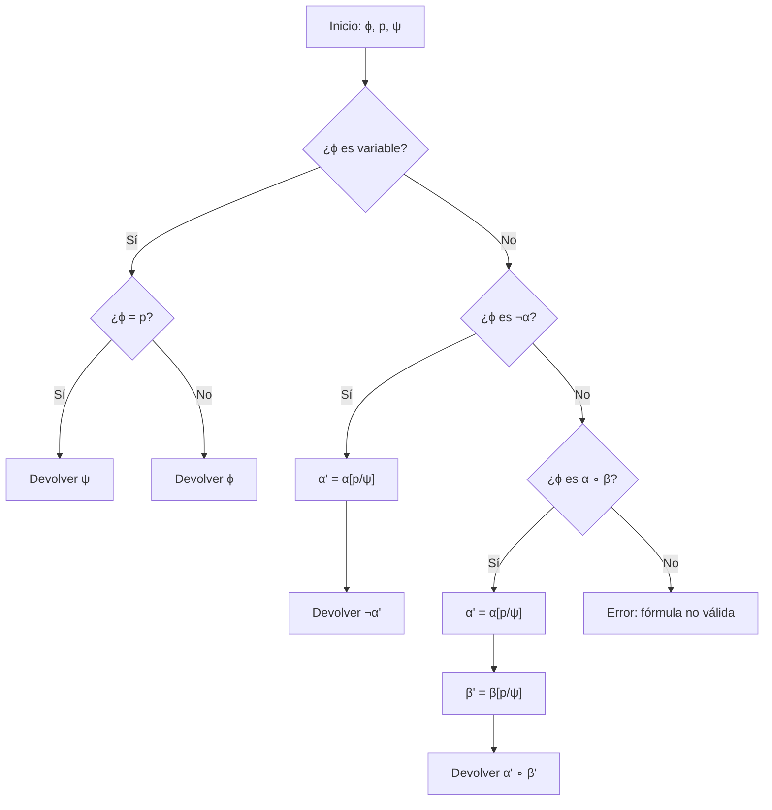

# Lógica Computacional - Lógica proposicional

## 2.2 Sustitución textual.

---

La **sustitución textual** es una operación fundamental en lógica computacional que consiste en reemplazar sistemáticamente todas las ocurrencias de una variable proposicional por una fórmula bien formada (FBF) en otra fórmula.

### 2. Definición Formal

Dada una fórmula $\phi,$ una variable proposicional $p$ y una fórmula $\psi,$ definimos la sustitución textual de $p$ por $\psi$ en $\phi,$ denotada por $\phi[p/\psi],$ como la fórmula resultante de reemplazar todas las ocurrencias de $p$ en $\phi$ por $\psi.$

#### Definición recursiva:

$$ \begin{aligned} \text{Base:} & \\\ & p[p/\psi] = \psi \\\ & q[p/\psi] = q \quad \text{para } q \neq p \\\ \\\ \text{Paso recursivo:} & \\\ & (\neg\phi)[p/\psi] = \neg(\phi[p/\psi]) \\\ & (\phi \circ \phi')[p/\psi] = (\phi[p/\psi] \circ \phi'[p/\psi]) \quad \text{para } \circ \in \{\land, \lor, \rightarrow, \leftrightarrow\} \end{aligned} $$

### 3. Propiedades de la Sustitución

#### Propiedad de preservación de estructura:

Si $\phi$ es una FBF y $\psi$ es una FBF, entonces $\phi[p/\psi]$ es una FBF.

#### Propiedad de composición:

Para fórmulas $\phi, \psi, \theta$ y variables $p, q:$

- $\phi[p/\psi][q/\theta] = \phi[q/\theta][p/\psi[q/\theta]]$ si $p \neq q$ y $p$ no aparece en $\theta$
- $\phi[p/\psi][p/\theta] = \phi[p/\psi[p/\theta]]$

### 4. Implementación de la Sustitución

```python
def sustitucion_textual(formula, variable, reemplazo):
    """
    Realiza sustitución textual de variable por reemplazo en formula
    """
    # Caso base: variable proposicional
    if es_variable_proposicional(formula):
        if formula == variable:
            return reemplazo
        else:
            return formula

    # Caso negación
    if formula[0] == '¬':
        subformula = formula[1:]
        return '¬' + sustitucion_textual(subformula, variable, reemplazo)

    # Casos binarios
    if formula[0] == '(' and formula[-1] == ')':
        # Encontrar el operador principal
        balance = 0
        for i, char in enumerate(formula[1:-1]):
            if char == '(':
                balance += 1
            elif char == ')':
                balance -= 1
            elif balance == 0 and char in ['∧', '∨', '→', '↔']:
                izquierda = formula[1:1+i]
                derecha = formula[1+i+1:-1]
                operador = char

                nueva_izquierda = sustitucion_textual(izquierda, variable, reemplazo)
                nueva_derecha = sustitucion_textual(derecha, variable, reemplazo)

                return f'({nueva_izquierda} {operador} {nueva_derecha})'

    return formula

def es_variable_proposicional(formula):
    """Verifica si la fórmula es una variable proposicional"""
    return formula in ['p', 'q', 'r', 's', 't', 'u', 'v', 'w', 'x', 'y', 'z']
```

### 5. Diagrama de Proceso de Sustitución



### 6. Ejemplos de Sustitución Textual

#### Ejemplo 1:

Sustituir $p$ por $(q \land r)$ en $(p \rightarrow \neg p)$

$$
(p \rightarrow \neg p)[p/(q \land r)] = ((q \land r) \rightarrow \neg(q \land r))
$$

#### Ejemplo 2:

Sustituir $q$ por $\neg p$ en $((p \land q) \rightarrow (q \lor r))$

$$
((p \land q) \rightarrow (q \lor r))[q/\neg p] = ((p \land \neg p) \rightarrow (\neg p \lor r))
$$

#### Ejemplo 3:

Sustitución múltiple: Primero $p$ por $q,$ luego $q$ por $r$ en $(p \land q)$

$$
((p \land q)[p/q])[q/r] = (q \land q)[q/r] = (r \land r)
$$

### 7. Sustitución Simultánea

La sustitución simultánea de múltiples variables se define como:

$$
\phi[p_1/\psi_1, \ldots, p_n/\psi_n]
$$

Donde todas las sustituciones se realizan al mismo tiempo, evitando conflictos.

#### Ejemplo:

Sustitución simultánea de $p$ por $q$ y $q$ por $p$ en $(p \land q):$

$$
(p \land q)[p/q, q/p] = (q \land p)
$$

### 8. Ejercicios Propuestos

#### Ejercicio 1:

Realice las siguientes sustituciones textuales:

1. $(p \rightarrow (q \land r))[p/\neg q]$
2. $((p \lor q) \rightarrow r)[q/(p \land s)]$
3. $\neg(p \leftrightarrow q)[p/(r \rightarrow s)]$

#### Ejercicio 2:

Demuestre por inducción estructural que para cualquier fórmula $\phi,$ variable $p$ y fórmula $\psi,$ $\phi[p/\psi]$ es una FBF.

#### Ejercicio 3:

Implemente una función que realice sustitución simultánea de múltiples variables.

#### Ejercicio 4:

Determine si las siguientes igualdades son verdaderas:

1. $(p \land q)[p/q][q/p] = (p \land q)[p/q, q/p]$
2. $(p \rightarrow q)[p/\neg p][q/\neg q] = (\neg p \rightarrow \neg q)$

#### Ejercicio 5:

Analice qué ocurre cuando sustituimos una variable por una fórmula que contiene esa misma variable, como en $(p \rightarrow q)[p/(p \land q)]$

### 9. Aplicaciones de la Sustitución Textual

1. **Instanciación de esquemas lógicos**: Aplicar reglas de inferencia
2. **Normalización de fórmulas**: Transformación a formas normales
3. **Demostración de teoremas**: Sustitución en axiomas
4. **Unificación**: En lógica de primer orden

### 10. Precauciones y Consideraciones

#### Captura de variables:

Cuando sustituimos $p$ por $\psi$ en $\phi,$ debemos asegurarnos que las variables libres en $\psi$ no se vuelvan ligadas accidentalmente en $\phi.$

#### Sustitución segura:

Una sustitución $\phi[p/\psi]$ es segura si ninguna variable libre de $\psi$ se vuelve ligada en $\phi.$

### 12. Soluciones a Ejercicios Selectos

#### Solución Ejercicio 1:

1. $(\neg q \rightarrow (q \land r))$
2. $((p \lor (p \land s)) \rightarrow r)$
3. $\neg((r \rightarrow s) \leftrightarrow q)$

#### Solución Ejercicio 2:

**Demostración por inducción estructural**:

**Caso base**: Si $\phi = q$ (variable)

- Si $q = p,$ entonces $\phi[p/\psi] = \psi$ que es FBF por hipótesis
- Si $q \neq p,$ entonces $\phi[p/\psi] = q$ que es FBF

**Paso inductivo**:

- Si $\phi = \neg\alpha,$ entonces $\phi[p/\psi] = \neg(\alpha[p/\psi])$
- Por HI, $\alpha[p/\psi]$ es FBF, luego $\neg(\alpha[p/\psi])$ es FBF

- Si $\phi = \alpha \circ \beta,$ entonces $\phi[p/\psi] = \alpha[p/\psi] \circ \beta[p/\psi]$
- Por HI, $\alpha[p/\psi]$ y $\beta[p/\psi]$ son FBF, luego su composición es FBF

#### Solución Ejercicio 4:

1. Falso:
   - $(p \land q)[p/q][q/p] = (q \land q)[q/p] = (p \land p)$
   - $(p \land q)[p/q, q/p] = (q \land p)$
2. Verdadero: $(\neg p \rightarrow \neg q)$

### 11. Referencias

#### Bibliografía Básica:

1. Huth M., Ryan M. (2004). _Logic in Computer Science_. Sección 1.4.
2. Nerode A., Shore R.A. (1997). _Logic for Applications_. Capítulo 2.3.

#### Bibliografía Complementaria:

1. Ben-Ari M. (2008). _Mathematical Logic for Computer Science_. Sección 2.3.
2. Fitting M. (1996). _First-Order Logic and Automated Theorem Proving_. Capítulo 5.
