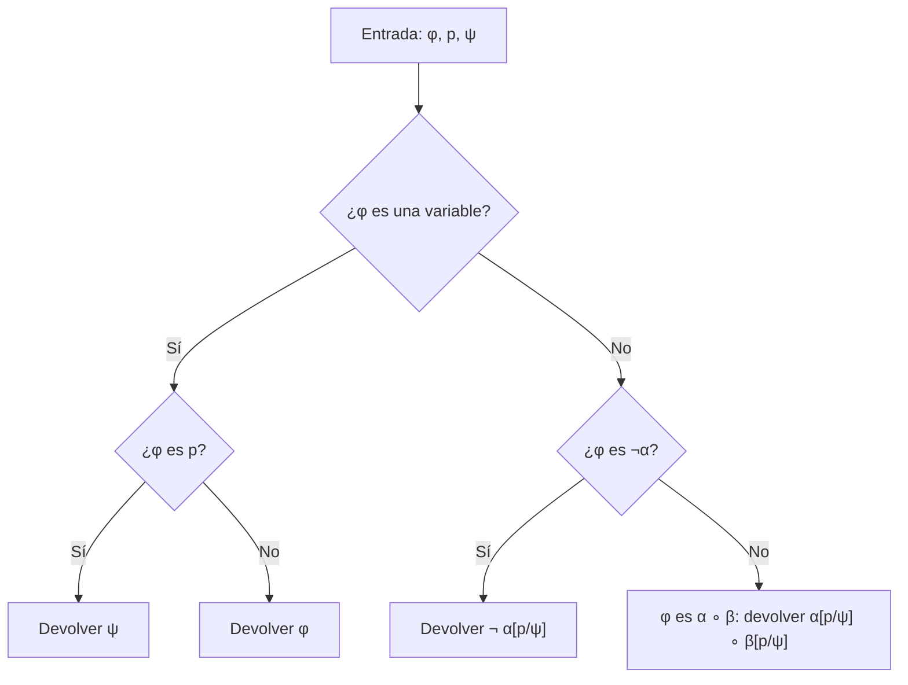

# Lógica Computacional - Lógica proposicional

## 2.2 Sustitución textual.

---

La **sustitución** reemplaza todas las apariciones de una variable por una fórmula. Es la operación que permite pasar de una ley general, como $p \lor \lnot p,$ a cualquiera de sus casos particulares, como $(q \to r) \lor \lnot (q \to r).$ En lógica proposicional es puramente **textual**, porque no hay variables ligadas que puedan capturarse; en lógica de primer orden esto cambia, y el tema 3.3 se ocupa de ese problema.

### Definición

**Definición.** Sean $\varphi$ y $\psi$ fórmulas y $p$ una variable. La fórmula $\varphi[p/\psi],$ que resulta de **sustituir** $p$ por $\psi$ en $\varphi,$ se define por recursión estructural sobre $\varphi:$

$$ \begin{aligned} p[p/\psi] &= \psi \\ q[p/\psi] &= q \quad \text{si } q \neq p \\ (\lnot \varphi)[p/\psi] &= \lnot (\varphi[p/\psi]) \\ (\varphi_1 \circ \varphi_2)[p/\psi] &= (\varphi_1[p/\psi] \circ \varphi_2[p/\psi]) \end{aligned} $$

Se reemplazan **todas** las apariciones de $p,$ y cada una por una copia completa de $\psi,$ con sus paréntesis. La notación varía según el libro: también se escribe $\varphi[\psi/p]$ o $\varphi\{p := \psi\}.$

**Ejemplos.**

$$ (p \to \lnot p)[p/(q \land r)] = ((q \land r) \to \lnot (q \land r)) $$

$$ ((p \land q) \to (q \lor r))[q/\lnot p] = ((p \land \lnot p) \to (\lnot p \lor r)) $$

En el segundo, la variable $p$ ya aparecía en la fórmula y vuelve a aparecer en el reemplazo: la sustitución no distingue entre las apariciones viejas y las nuevas, ni le importa.

**Proposición.** Si $\varphi$ y $\psi$ son fórmulas, $\varphi[p/\psi]$ es una fórmula.

**Demostración.** Por inducción estructural sobre $\varphi.$ Si $\varphi$ es la variable $p,$ el resultado es $\psi,$ una fórmula; si es otra variable $q,$ el resultado es $q.$ Si $\varphi = \lnot \varphi_1,$ por hipótesis de inducción $\varphi_1[p/\psi]$ es una fórmula, y su negación también. El caso binario es igual. $\blacksquare$

### Sustitución sucesiva y simultánea

Aplicar dos sustituciones una tras otra no es lo mismo que aplicarlas **a la vez**. La **sustitución simultánea** $\varphi[p_1/\psi_1, \ldots, p_n/\psi_n],$ con las $p_i$ distintas, reemplaza cada $p_i$ por $\psi_i$ en un solo recorrido:

$$ p_i[p_1/\psi_1, \ldots, p_n/\psi_n] = \psi_i, \qquad q[p_1/\psi_1, \ldots, p_n/\psi_n] = q \text{ si } q \notin \{p_1, \ldots, p_n\} $$

y con los conectivos se distribuye igual que la simple. Para intercambiar $p$ y $q:$

$$ (p \land q)[p/q][q/p] = (q \land q)[q/p] = (p \land p), \qquad (p \land q)[p/q, q/p] = (q \land p) $$

En la sucesiva, la segunda sustitución también afecta a las $q$ que introdujo la primera.

**Proposición (composición).** Para variables $p \neq q:$

1. $\varphi[p/\psi][p/\theta] = \varphi[p/\psi[p/\theta]].$
2. Si $p$ no aparece en $\theta,$ entonces $\varphi[p/\psi][q/\theta] = \varphi[q/\theta][p/\psi[q/\theta]].$
3. Si $p$ no aparece en $\varphi,$ entonces $\varphi[p/\psi] = \varphi.$

**Demostración de 2.** Por inducción sobre $\varphi.$ Si $\varphi = p,$ el lado izquierdo es $\psi[q/\theta]$ y el derecho es $p[p/\psi[q/\theta]] = \psi[q/\theta].$ Si $\varphi = q,$ el izquierdo es $q[q/\theta] = \theta$ y el derecho es $\theta[p/\psi[q/\theta]] = \theta,$ por el inciso 3, ya que $p$ no aparece en $\theta.$ Si $\varphi$ es otra variable, ambos lados son $\varphi.$ Los casos de los conectivos se siguen directamente de la hipótesis de inducción. $\blacksquare$

### Sustitución y significado

Aunque la semántica se estudia en el tema 2.3, conviene adelantar por qué la sustitución es importante: **respeta el significado**. Si $I$ es una asignación de valores de verdad a las variables y $I[p := b]$ es la misma asignación pero con $p$ valiendo $b,$ se cumple el **lema de sustitución**:

$$ I(\varphi[p/\psi]) = I[p := I(\psi)](\varphi) $$

Es decir, evaluar la fórmula sustituida es lo mismo que evaluar la original dándole a $p$ el valor que tiene $\psi.$ Se demuestra por inducción sobre $\varphi.$ Dos consecuencias se usan constantemente:

**Teorema (instancias de tautologías).** Si $\varphi$ es una tautología, $\varphi[p/\psi]$ también lo es, para cualquier $\psi.$

**Demostración.** Para cualquier $I,$ $I(\varphi[p/\psi]) = I[p := I(\psi)](\varphi) = V,$ porque $\varphi$ es verdadera en toda asignación. $\blacksquare$

**Teorema (reemplazo de equivalentes).** Si $\alpha \equiv \beta,$ entonces $\chi[p/\alpha] \equiv \chi[p/\beta]$ para cualquier $\chi.$

**Demostración.** Para cualquier $I,$ $I(\alpha) = I(\beta),$ así que $I(\chi[p/\alpha]) = I[p := I(\alpha)](\chi) = I[p := I(\beta)](\chi) = I(\chi[p/\beta]).$ $\blacksquare$

El primer teorema justifica que las leyes lógicas se escriban con variables y se apliquen a fórmulas cualesquiera; el segundo justifica que, al simplificar, se pueda reemplazar una subfórmula por otra equivalente dentro de una fórmula mayor. Sin ellos, la manipulación algebraica de fórmulas del tema 1.1 no estaría justificada.

### Diagrama del algoritmo



### Implementación en Python

Con las fórmulas representadas como árboles, la sustitución es una recursión estructural de tres líneas y no necesita buscar el conectivo principal en una cadena. El programa calcula los ejemplos del tema, compara la sustitución sucesiva con la simultánea y verifica el lema de sustitución y sus dos consecuencias con tablas de verdad.

```python
from itertools import product

def texto(f):
    if isinstance(f, str): return f
    if f[0] == '¬': return '¬' + texto(f[1])
    return '(' + texto(f[1]) + ' ' + f[0] + ' ' + texto(f[2]) + ')'

def sust(f, p, psi):
    """f[p/psi]: reemplaza cada aparición de la variable p por psi."""
    if isinstance(f, str):
        return psi if f == p else f
    return (f[0],) + tuple(sust(g, p, psi) for g in f[1:])

def sust_sim(f, s):
    """Sustitución simultánea f[p1/psi1, ..., pn/psin], con s = {p1: psi1, ...}."""
    if isinstance(f, str):
        return s.get(f, f)
    return (f[0],) + tuple(sust_sim(g, s) for g in f[1:])

def variables(f):
    if isinstance(f, str): return {f}
    return set().union(*(variables(g) for g in f[1:]))

def valor(f, I):
    if isinstance(f, str): return I[f]
    if f[0] == '¬': return not valor(f[1], I)
    a, b = valor(f[1], I), valor(f[2], I)
    return {'∧': a and b, '∨': a or b, '→': (not a) or b, '↔': a == b}[f[0]]

def interpretaciones(vs):
    vs = sorted(vs)
    for vals in product([True, False], repeat=len(vs)):
        yield dict(zip(vs, vals))

def tautologia(f):
    return all(valor(f, I) for I in interpretaciones(variables(f)))

def equivalentes(f, g):
    vs = variables(f) | variables(g)
    return all(valor(f, I) == valor(g, I) for I in interpretaciones(vs))

# Ejemplos del tema
f1 = ('→', 'p', ('¬', 'p'))
print(texto(sust(f1, 'p', ('∧', 'q', 'r'))))
f2 = ('→', ('∧', 'p', 'q'), ('∨', 'q', 'r'))
print(texto(sust(f2, 'q', ('¬', 'p'))))

# Sucesiva frente a simultánea
f3 = ('∧', 'p', 'q')
print('sucesiva:   ', texto(sust(sust(f3, 'p', 'q'), 'q', 'p')))
print('simultánea: ', texto(sust_sim(f3, {'p': 'q', 'q': 'p'})))

# Lema de sustitución: el valor de f[p/psi] en I es el valor de f en I con p := valor de psi
psi = ('→', 'q', 'r')
ok = all(valor(sust(f2, 'p', psi), I) == valor(f2, {**I, 'p': valor(psi, I)})
         for I in interpretaciones({'p', 'q', 'r'}))
print('lema de sustitución:', ok)

# Las instancias de una tautología son tautologías
tercero_excluido = ('∨', 'p', ('¬', 'p'))
instancia = sust(tercero_excluido, 'p', ('↔', 'q', ('∧', 'r', 's')))
print(texto(instancia), 'tautología:', tautologia(instancia))

# Reemplazo de equivalentes: si a ≡ b, entonces chi[p/a] ≡ chi[p/b]
chi = ('→', ('¬', 'p'), ('∨', 'p', 'r'))
a = ('→', 'q', 's')
b = ('∨', ('¬', 'q'), 's')
print('reemplazo de equivalentes:', equivalentes(a, b), equivalentes(sust(chi, 'p', a), sust(chi, 'p', b)))
```

Salida:

```text
((q ∧ r) → ¬(q ∧ r))
((p ∧ ¬p) → (¬p ∨ r))
sucesiva:    (p ∧ p)
simultánea:  (q ∧ p)
lema de sustitución: True
((q ↔ (r ∧ s)) ∨ ¬(q ↔ (r ∧ s))) tautología: True
reemplazo de equivalentes: True True
```

### Ejercicios Propuestos

1. **Cálculo.** Calcula $(p \to (q \land r))[p/\lnot q],$ $((p \lor q) \to r)[q/(p \land s)]$ y $(\lnot (p \leftrightarrow q))[p/(r \to s)].$

2. **Sucesiva y simultánea.** Determina si son iguales $(p \to q)[p/\lnot p][q/\lnot q]$ y $(p \to q)[p/\lnot p, q/\lnot q].$ ¿Bajo qué condición coinciden siempre $\varphi[p/\psi][q/\theta]$ y $\varphi[p/\psi, q/\theta]?$

3. **Tamaño.** Demuestra que $\text{tam}(\varphi[p/\psi]) = \text{tam}(\varphi) + n \cdot (\text{tam}(\psi) - 1),$ donde $n$ es el número de apariciones de $p$ en $\varphi.$

4. **Inciso 3.** Demuestra por inducción que si $p$ no aparece en $\varphi,$ entonces $\varphi[p/\psi] = \varphi.$

5. **Contraejemplo.** Muestra que en el inciso 2 de la composición es necesaria la hipótesis de que $p$ no aparezca en $\theta.$

6. **Instancias.** Sabiendo que $(p \to q) \leftrightarrow (\lnot q \to \lnot p)$ es una tautología, deduce sin tablas de verdad que $((r \land s) \to \lnot t) \leftrightarrow (\lnot \lnot t \to \lnot (r \land s))$ también lo es.

### Soluciones

**Ejercicio 1.**

$$ (\lnot q \to (q \land r)), \qquad ((p \lor (p \land s)) \to r), \qquad \lnot ((r \to s) \leftrightarrow q) $$

**Ejercicio 2.** Son iguales: la sucesiva da $(\lnot p \to q)$ y luego $(\lnot p \to \lnot q),$ y la simultánea también da $(\lnot p \to \lnot q),$ porque $\lnot p$ no contiene a $q.$ En general, $\varphi[p/\psi][q/\theta] = \varphi[p/\psi[q/\theta], q/\theta],$ así que coinciden siempre que $q$ no aparezca en $\psi:$ la diferencia surge solo cuando el primer reemplazo introduce una variable que la segunda sustitución vuelve a cambiar, como en el intercambio de $p$ y $q.$

**Ejercicio 3.** Por inducción sobre $\varphi,$ con $n(\varphi)$ el número de apariciones de $p.$ Si $\varphi = p,$ $\text{tam}(\psi) = 1 + 1 \cdot (\text{tam}(\psi) - 1).$ Si $\varphi = q \neq p,$ $n = 0$ y ambos lados valen 1. En el caso binario, $\text{tam}(\varphi[p/\psi]) = 1 + \text{tam}(\varphi_1) + n_1 (\text{tam}(\psi) - 1) + \text{tam}(\varphi_2) + n_2 (\text{tam}(\psi) - 1),$ que es la fórmula con $n = n_1 + n_2.$ La negación es análoga. $\blacksquare$

**Ejercicio 4.** Si $\varphi$ es una variable, es distinta de $p,$ y $\varphi[p/\psi] = \varphi.$ Si $\varphi = \lnot \varphi_1,$ $p$ no aparece en $\varphi_1,$ y por hipótesis de inducción $(\lnot \varphi_1)[p/\psi] = \lnot \varphi_1.$ El caso binario es igual. $\blacksquare$

**Ejercicio 5.** Con $\varphi = q,$ $\psi = r$ y $\theta = p:$ el lado izquierdo es $q[p/r][q/p] = q[q/p] = p,$ y el derecho es $q[q/p][p/r[q/p]] = p[p/r] = r.$ Difieren porque la $p$ introducida por $\theta$ se sustituye en el lado derecho.

**Ejercicio 6.** Es la instancia $\big((p \to q) \leftrightarrow (\lnot q \to \lnot p)\big)[p/(r \land s), q/\lnot t],$ y la sustitución simultánea también preserva las tautologías, con la misma demostración usando $I[p := I(\psi_1), q := I(\psi_2)].$

### Referencias

1. Ben-Ari, M., _Mathematical Logic for Computer Science_. Springer, 2012. Sección 2.3.
2. van Dalen, D., _Logic and Structure_. Springer, 2013. Secciones 2.2 y 2.3.
3. Huth, M., and Ryan, M., _Logic in Computer Science_. Cambridge University Press, 2004. Sección 1.4.
