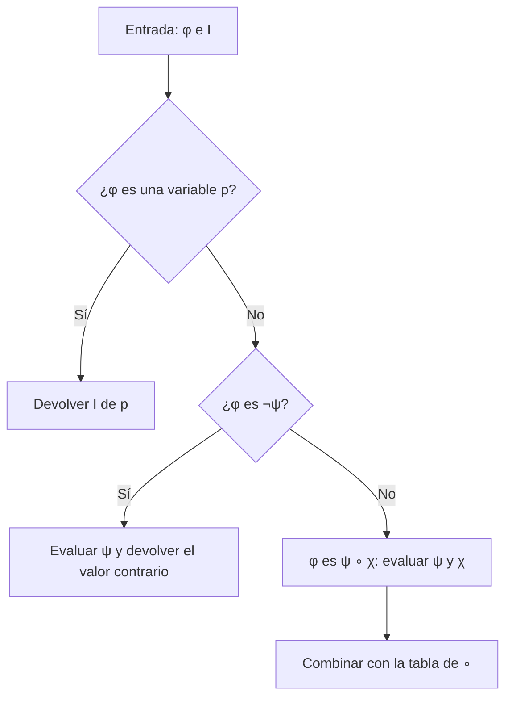

# Lógica Computacional - Lógica proposicional

## 2.3 Semántica: funciones de interpretación.

---

La sintaxis dice qué es una fórmula; la **semántica** dice qué significa. En la lógica proposicional clásica, el significado de una fórmula es su **valor de verdad**, que depende de los valores de sus variables. Una **interpretación** fija los valores de las variables y, por recursión estructural, determina el de todas las fórmulas. Con esa noción se definen los conceptos centrales del curso: tautología, satisfacibilidad, equivalencia y consecuencia lógica.

### Interpretaciones

Los **valores de verdad** son dos: verdadero y falso, que se escriben $1$ y $0;$ también se usan V y F, o $\top$ y $\bot.$ Se denota $\mathbb{B} = \{0, 1\}.$

**Definición.** Una **interpretación**, también llamada **valuación** o **asignación**, es una función $I : \text{VAR} \rightarrow \mathbb{B}.$

**Definición.** La **extensión** de $I$ a todas las fórmulas, que se escribe igual, $I : \text{FORM} \rightarrow \mathbb{B},$ se define por recursión estructural:

$$ \begin{aligned} I(\lnot \varphi) &= 1 - I(\varphi) \\ I(\varphi \land \psi) &= \min(I(\varphi), I(\psi)) \\ I(\varphi \lor \psi) &= \max(I(\varphi), I(\psi)) \\ I(\varphi \to \psi) &= \max(1 - I(\varphi), I(\psi)) \\ I(\varphi \leftrightarrow \psi) &= 1 \text{ si } I(\varphi) = I(\psi), \text{ y } 0 \text{ si no} \end{aligned} $$

Por el teorema de recursión estructural (tema 2.1), que se apoya en la lectura única, esta definición da **exactamente una** función. Otra notación frecuente es $\llbracket \varphi \rrbracket^I.$ Cuando $I(\varphi) = 1$ se dice que $I$ **satisface** a $\varphi,$ o que $I$ es un **modelo** de $\varphi,$ y se escribe $I \models \varphi.$

Las ecuaciones con $\min$ y $\max$ son una forma compacta de las tablas de verdad:

| $\varphi$ | $\psi$ | $\lnot \varphi$ | $\varphi \land \psi$ | $\varphi \lor \psi$ | $\varphi \to \psi$ | $\varphi \leftrightarrow \psi$ |
| :-: | :-: | :-: | :-: | :-: | :-: | :-: |
| 1 | 1 | 0 | 1 | 1 | 1 | 1 |
| 1 | 0 | 0 | 0 | 1 | 0 | 0 |
| 0 | 1 | 1 | 0 | 1 | 1 | 0 |
| 0 | 0 | 1 | 0 | 0 | 1 | 1 |

**Ejemplo.** Con $I(p) = 1,$ $I(q) = 0$ e $I(r) = 1:$ $I(p \land q) = 0,$ así que $I((p \land q) \to r) = 1;$ $I(q \lor r) = 1,$ así que $I(p \leftrightarrow (q \lor r)) = 1.$

### Solo importan las variables de la fórmula

Una interpretación asigna valor a **todas** las variables, que son infinitas, pero para evaluar una fórmula solo se usan las que aparecen en ella.

**Lema de coincidencia.** Si $I$ y $J$ coinciden en las variables de $\varphi,$ entonces $I(\varphi) = J(\varphi).$

**Demostración.** Por inducción sobre $\varphi.$ Si $\varphi$ es una variable, aparece en $\varphi$ y $I(\varphi) = J(\varphi)$ por hipótesis. Si $\varphi = \lnot \psi,$ las variables de $\psi$ son las de $\varphi,$ y por hipótesis de inducción $I(\psi) = J(\psi),$ así que $I(\lnot \psi) = J(\lnot \psi).$ Si $\varphi = \psi \circ \chi,$ $I$ y $J$ coinciden en las variables de $\psi$ y en las de $\chi,$ y se aplica la hipótesis de inducción a ambas. $\blacksquare$

Por eso, para una fórmula con $n$ variables basta revisar $2^n$ interpretaciones, las filas de su **tabla de verdad**.

### Conceptos semánticos

**Definición.** Una fórmula $\varphi$ es:

- **Tautología** o **válida,** si $I(\varphi) = 1$ para toda $I.$ Se escribe $\models \varphi.$
- **Satisfacible,** si $I(\varphi) = 1$ para alguna $I.$
- **Contradicción** o **insatisfacible,** si $I(\varphi) = 0$ para toda $I.$
- **Contingente,** si es satisfacible y no es tautología.

Dos fórmulas son **equivalentes,** $\varphi \equiv \psi,$ si $I(\varphi) = I(\psi)$ para toda $I.$

**Proposición.** Para toda fórmula $\varphi:$

1. $\varphi$ es tautología si y solo si $\lnot \varphi$ es insatisfacible.
2. $\varphi \equiv \psi$ si y solo si $\varphi \leftrightarrow \psi$ es tautología.

**Demostración.** (1) $I(\varphi) = 1$ para toda $I$ si y solo si $I(\lnot \varphi) = 0$ para toda $I.$ (2) $I(\varphi \leftrightarrow \psi) = 1$ si y solo si $I(\varphi) = I(\psi).$ $\blacksquare$

La primera propiedad es la base de los métodos de **refutación** (tableaux y resolución, temas 2.5 y 2.6): para demostrar que $\varphi$ es válida se demuestra que $\lnot \varphi$ no tiene modelos.

**Conjuntos de fórmulas.** Una interpretación satisface un conjunto $\Gamma$ si satisface cada una de sus fórmulas, y $\Gamma$ es satisfacible si alguna interpretación lo satisface. Por ejemplo, $\{p \to q, p, \lnot q\}$ es insatisfacible, aunque cada fórmula por separado sea satisfacible. Se dice que $\varphi$ es **consecuencia lógica** de $\Gamma,$ y se escribe $\Gamma \models \varphi,$ si todo modelo de $\Gamma$ es modelo de $\varphi.$ Este concepto se estudia en el tema 4.1.

### Funciones booleanas y completud funcional

Cada fórmula con variables $p_1, \ldots, p_n$ define una **función booleana** $\mathbb{B}^n \rightarrow \mathbb{B}.$ Hay $2^{2^n}$ funciones de $n$ argumentos: con dos variables, 16. ¿Se pueden expresar todas con los conectivos?

**Teorema (completud funcional).** Toda función booleana $f : \mathbb{B}^n \rightarrow \mathbb{B}$ es la función de alguna fórmula que solo usa $\lnot,$ $\land$ y $\lor.$

**Demostración.** Para cada fila $b = (b_1, \ldots, b_n)$ con $f(b) = 1$ se forma el término $\ell_1 \land \cdots \land \ell_n,$ donde $\ell_i = p_i$ si $b_i = 1$ y $\ell_i = \lnot p_i$ si $b_i = 0.$ Ese término es verdadero exactamente en la fila $b.$ La disyunción de todos los términos es verdadera exactamente en las filas donde $f$ vale 1. Si no hay ninguna, se usa $p_1 \land \lnot p_1.$ $\blacksquare$

La fórmula construida está en **forma normal disyuntiva** (tema 2.6). Como $\varphi \lor \psi \equiv \lnot (\lnot \varphi \land \lnot \psi),$ también bastan $\{\lnot, \land\},$ y como $\lnot \varphi \equiv \varphi \uparrow \varphi$ y $\varphi \land \psi \equiv (\varphi \uparrow \psi) \uparrow (\varphi \uparrow \psi),$ basta el conectivo NAND, $\varphi \uparrow \psi = \lnot (\varphi \land \psi).$ Por eso es posible construir un procesador completo solo con compuertas NAND.

### Diagrama del evaluador



### Implementación en Python

La función `valor` es la definición de la extensión de $I,$ traducida literalmente. Con ella el programa evalúa fórmulas, las clasifica revisando todas las interpretaciones, imprime una tabla de verdad, construye la forma normal disyuntiva de la demostración de completud funcional y comprueba que NAND basta para expresar $\lnot,$ $\land$ y $\lor.$

```python
from itertools import product

OPS = {'∧': lambda a, b: a and b, '∨': lambda a, b: a or b,
       '→': lambda a, b: (not a) or b, '↔': lambda a, b: a == b}

def valor(f, I):
    """La extensión de la interpretación I a fórmulas, por recursión estructural."""
    if isinstance(f, str):
        return I[f]
    if f[0] == '¬':
        return not valor(f[1], I)
    return OPS[f[0]](valor(f[1], I), valor(f[2], I))

def variables(f):
    if isinstance(f, str): return {f}
    return set().union(*(variables(g) for g in f[1:]))

def interpretaciones(vs):
    vs = sorted(vs)
    for vals in product([True, False], repeat=len(vs)):
        yield dict(zip(vs, vals))

def texto(f):
    if isinstance(f, str): return f
    if f[0] == '¬': return '¬' + texto(f[1])
    return '(' + texto(f[1]) + ' ' + f[0] + ' ' + texto(f[2]) + ')'

def clasificar(f):
    vals = [valor(f, I) for I in interpretaciones(variables(f))]
    if all(vals): return 'tautología'
    if not any(vals): return 'contradicción'
    return 'contingente'

def tabla(f):
    vs = sorted(variables(f))
    print(' '.join(vs), '|', texto(f))
    for I in interpretaciones(vs):
        print(' '.join('1' if I[v] else '0' for v in vs), '|', '1' if valor(f, I) else '0')

def fnd(f):
    """Forma normal disyuntiva leída de la tabla: un término por cada fila verdadera."""
    vs = sorted(variables(f))
    terminos = []
    for I in interpretaciones(vs):
        if valor(f, I):
            lits = [v if I[v] else '¬' + v for v in vs]
            terminos.append('(' + ' ∧ '.join(lits) + ')')
    return ' ∨ '.join(terminos) if terminos else '⊥'

I = {'p': True, 'q': False, 'r': True}
for f in [('→', ('∧', 'p', 'q'), 'r'), ('↔', 'p', ('∨', 'q', 'r')), ('∨', ('¬', 'p'), ('∧', 'q', ('¬', 'r')))]:
    print(texto(f), '=', valor(f, I))

for f in [('→', 'p', ('→', 'q', 'p')), ('↔', ('→', 'p', 'q'), ('→', ('¬', 'q'), ('¬', 'p'))),
          ('∧', 'p', ('¬', 'p')), ('→', 'p', 'q')]:
    print(f'{texto(f):30} {clasificar(f)}')

xor = ('¬', ('↔', 'p', 'q'))
tabla(xor)
print('FND:', fnd(xor))

# NAND basta para expresar todos los conectivos
nand = lambda a, b: not (a and b)
no = lambda a: nand(a, a)
y = lambda a, b: nand(nand(a, b), nand(a, b))
o = lambda a, b: nand(nand(a, a), nand(b, b))
print('NAND completo:', all(no(a) == (not a) and y(a, b) == (a and b) and o(a, b) == (a or b)
                            for a, b in product([True, False], repeat=2)))
print('funciones booleanas de n variables:', [2 ** 2 ** n for n in range(5)])
```

Salida:

```text
((p ∧ q) → r) = True
(p ↔ (q ∨ r)) = True
(¬p ∨ (q ∧ ¬r)) = False
(p → (q → p))                  tautología
((p → q) ↔ (¬q → ¬p))          tautología
(p ∧ ¬p)                       contradicción
(p → q)                        contingente
p q | ¬(p ↔ q)
1 1 | 0
1 0 | 1
0 1 | 1
0 0 | 0
FND: (p ∧ ¬q) ∨ (¬p ∧ q)
NAND completo: True
funciones booleanas de n variables: [2, 4, 16, 256, 65536]
```

### Ejercicios Propuestos

1. **Evaluación.** Con $I(p) = 1,$ $I(q) = 0$ e $I(r) = 1,$ evalúa $(p \land q) \to r,$ $p \leftrightarrow (q \lor r)$ y $\lnot p \lor (q \land \lnot r).$

2. **Clasificación.** Clasifica $p \to (q \to p),$ $(p \to q) \leftrightarrow (\lnot q \to \lnot p),$ $(p \land \lnot p) \to q$ y $(p \to q) \to p.$

3. **Afirmaciones.** Demuestra o refuta: (a) si $\varphi$ y $\psi$ son satisfacibles, $\varphi \land \psi$ es satisfacible; (b) si $\varphi \lor \psi$ es tautología, $\varphi$ o $\psi$ es tautología; (c) si $\varphi \to \psi$ y $\varphi$ son tautologías, $\psi$ es tautología.

4. **Forma normal disyuntiva.** Construye con el método de la demostración una fórmula para la función de mayoría de tres variables, que vale 1 cuando al menos dos argumentos valen 1, y simplifícala.

5. **Conectivos insuficientes.** Demuestra que $\{\land, \lor\}$ no es funcionalmente completo. Sugerencia: muestra por inducción que toda fórmula con solo esos conectivos vale 1 cuando todas sus variables valen 1.

6. **Interpretaciones.** Escribe una función que genere todas las interpretaciones de un conjunto de variables y úsala para decidir si $\{p \to q, q \to r, p, \lnot r\}$ es satisfacible.

### Soluciones

**Ejercicio 1.** $1,$ $1$ y $0,$ como en la primera parte de la salida del programa: $I(p \land q) = 0$ hace verdadera la implicación; $I(q \lor r) = 1 = I(p);$ y $I(\lnot p) = 0$ e $I(q \land \lnot r) = 0.$

**Ejercicio 2.** Las tres primeras son tautologías: la primera dice que lo verdadero se sigue de cualquier cosa, la segunda es la contrapositiva y la tercera dice que de una contradicción se sigue cualquier cosa. La cuarta es contingente: con $I(p) = 0$ es falsa, porque $p \to q$ vale 1 y $p$ vale 0, y con $I(p) = 1$ es verdadera.

**Ejercicio 3.** (a) Falso: $p$ y $\lnot p$ son satisfacibles, pero $p \land \lnot p$ no. (b) Falso: $p \lor \lnot p$ es tautología, pero ni $p$ ni $\lnot p$ lo son. (c) Verdadero: para toda $I,$ $I(\varphi) = 1$ e $I(\varphi \to \psi) = 1,$ y por la tabla de la implicación $I(\psi) = 1.$ Es el modus ponens.

**Ejercicio 4.** Las filas verdaderas son $111,$ $110,$ $101$ y $011:$

$$ (p \land q \land r) \lor (p \land q \land \lnot r) \lor (p \land \lnot q \land r) \lor (\lnot p \land q \land r) $$

que se simplifica a $(p \land q) \lor (p \land r) \lor (q \land r).$

**Ejercicio 5.** Si $I(v) = 1$ para toda variable $v,$ por inducción $I(\varphi) = 1$ para toda fórmula $\varphi$ con solo $\land$ y $\lor:$ en las variables es la hipótesis, y $\min$ y $\max$ de unos son 1. Entonces ninguna de esas fórmulas expresa $\lnot p,$ que vale 0 en esa interpretación. $\blacksquare$

**Ejercicio 6.** Con la función `interpretaciones` del programa, ninguna de las ocho interpretaciones satisface las cuatro fórmulas: $p$ obliga a $I(p) = 1,$ luego $p \to q$ obliga a $I(q) = 1,$ luego $q \to r$ obliga a $I(r) = 1,$ contradiciendo $\lnot r.$ El conjunto es insatisfacible.

### Referencias

1. Ben-Ari, M., _Mathematical Logic for Computer Science_. Springer, 2012. Secciones 2.2 a 2.5.
2. van Dalen, D., _Logic and Structure_. Springer, 2013. Secciones 2.2 y 2.3.
3. Enderton, H. B., _A Mathematical Introduction to Logic_. Academic Press, 2001. Secciones 1.2 y 1.5.
4. Huth, M., and Ryan, M., _Logic in Computer Science_. Cambridge University Press, 2004. Sección 1.4.
