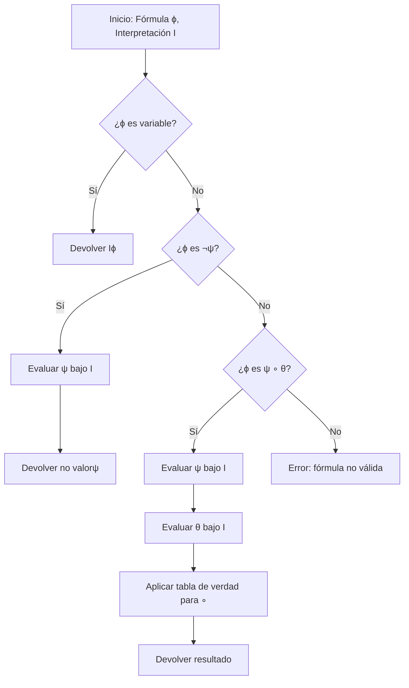

# Lógica Computacional - Lógica proposicional

## 2.3 Semántica: funciones de interpretación.

---

La **semántica** en lógica proposicional se encarga de asignar significado a las fórmulas bien formadas mediante **funciones de interpretación** que determinan su valor de verdad. Mientras la sintaxis define la estructura correcta, la semántica define el significado.

### 2. Definiciones Fundamentales

#### Valor de verdad:

En lógica proposicional clásica, existen dos valores de verdad:

- $\top$ o $1$ (verdadero)
- $\bot$ o $0$ (falso)

#### Variable proposicional:

Símbolo que representa una proposición atómica que puede ser verdadera o falsa: $p, q, r, \ldots$

#### Interpretación (valuación):

Una **interpretación** $I$ es una función que asigna a cada variable proposicional un valor de verdad:

$$I: \text{VAR} \to \{\top, \bot\}$$

donde VAR es el conjunto de todas las variables proposicionales.

### 3. Definición de la Función de Interpretación

La función de interpretación $\llbracket \cdot \rrbracket^I$ asigna a cada fórmula $\phi$ un valor de verdad basado en la interpretación $I:$

$$ \begin{aligned} \text{Base:} & \\\ &\llbracket p \rrbracket^I = I(p) \\\ \\\ \text{Paso recursivo:} & \\\ &\llbracket \neg \phi \rrbracket^I =  \begin{cases} \top & \text{si } \llbracket \phi \rrbracket^I = \bot \\\ \bot & \text{si } \llbracket \phi \rrbracket^I = \top \end{cases} \\\ \\\ &\llbracket \phi \land \psi \rrbracket^I =  \begin{cases} \top & \text{si } \llbracket \phi \rrbracket^I = \top \text{ y } \llbracket \psi \rrbracket^I = \top \\ \bot & \text{en otro caso} \end{cases} \\\ \\\ &\llbracket \phi \lor \psi \rrbracket^I =  \begin{cases} \top & \text{si } \llbracket \phi \rrbracket^I = \top \text{ o } \llbracket \psi \rrbracket^I = \top \\\ \bot & \text{en otro caso} \end{cases} \\\ \\\ &\llbracket \phi \rightarrow \psi \rrbracket^I =  \begin{cases} \bot & \text{si } \llbracket \phi \rrbracket^I = \top \text{ y } \llbracket \psi \rrbracket^I = \bot \\\ \top & \text{en otro caso} \end{cases} \\\ \\\ &\llbracket \phi \leftrightarrow \psi \rrbracket^I =  \begin{cases} \top & \text{si } \llbracket \phi \rrbracket^I = \llbracket \psi \rrbracket^I \\\ \bot & \text{en otro caso} \end{cases} \end{aligned} $$

### 4. Tablas de Verdad

Las tablas de verdad representan exhaustivamente todas las posibles interpretaciones para una fórmula:

#### Tablas de verdad para conectivos básicos:

| $p$ | $q$ | $\neg p$ | $p \land q$ | $p \lor q$ | $p \rightarrow q$ | $p \leftrightarrow q$ |
|-----|-----|----------|-------------|------------|-------------------|-----------------------|
| 0   | 0   | 1        | 0           | 0          | 1                 | 1                     |
| 0   | 1   | 1        | 0           | 1          | 1                 | 0                     |
| 1   | 0   | 0        | 0           | 1          | 0                 | 0                     |
| 1   | 1   | 0        | 1           | 1          | 1                 | 1                     |

### 5. Implementación de Funciones de Interpretación

```python
class Interpretacion:
    def __init__(self, asignaciones):
        """
        asignaciones: diccionario {variable: valor_verdad}
        """
        self.I = asignaciones

    def evaluar(self, formula):
        """
        Evalúa una fórmula bajo esta interpretación
        """
        # Caso base: variable proposicional
        if formula in self.I:
            return self.I[formula]

        # Negación
        if formula.startswith('¬'):
            subformula = formula[1:]
            return not self.evaluar(subformula)

        # Conjunción
        if '∧' in formula:
            partes = formula[1:-1].split(' ∧ ')
            return self.evaluar(partes[0]) and self.evaluar(partes[1])

        # Disyunción
        if '∨' in formula:
            partes = formula[1:-1].split(' ∨ ')
            return self.evaluar(partes[0]) or self.evaluar(partes[1])

        # Implicación
        if '→' in formula:
            partes = formula[1:-1].split(' → ')
            return not self.evaluar(partes[0]) or self.evaluar(partes[1])

        # Bicondicional
        if '↔' in formula:
            partes = formula[1:-1].split(' ↔ ')
            return self.evaluar(partes[0]) == self.evaluar(partes[1])

        return False

# Ejemplo de uso
asignaciones = {'p': True, 'q': False}
I = Interpretacion(asignaciones)
resultado = I.evaluar('(p → q)')  # Devuelve False
```

### 6. Diagrama de Proceso de Evaluación Semántica



### 7. Conceptos Semánticos Importantes

#### Tautología:
Fórmula que es verdadera bajo todas las interpretaciones:

$$\models \phi \quad \text{iff} \quad \forall I, \llbracket \phi \rrbracket^I = \top$$

#### Contradicción:
Fórmula que es falsa bajo todas las interpretaciones:

$$\forall I, \llbracket \phi \rrbracket^I = \bot$$

#### Satisfacible:
Fórmula que es verdadera bajo al menos una interpretación:

$$\exists I \text{ tal que } \llbracket \phi \rrbracket^I = \top$$

#### Contingencia:
Fórmula que no es tautología ni contradicción.

#### Equivalencia lógica:
Dos fórmulas $\phi$ y $\psi$ son equivalentes $(\phi \equiv \psi)$ si:

$$\forall I, \llbracket \phi \rrbracket^I = \llbracket \psi \rrbracket^I$$

### 8. Ejemplos de Evaluación Semántica

#### Ejemplo 1:
Para $I(p) = \top,$ $I(q) = \bot:$
- $\llbracket p \land q \rrbracket^I = \bot$
- $\llbracket p \lor q \rrbracket^I = \top$
- $\llbracket p \rightarrow q \rrbracket^I = \bot$
- $\llbracket \neg p \rightarrow q \rrbracket^I = \top$

#### Ejemplo 2:
La fórmula $p \lor \neg p$ es una tautología.

#### Ejemplo 3:
La fórmula $p \land \neg p$ es una contradicción.

### 9. Ejercicios Propuestos

#### Ejercicio 1:
Para la interpretación $I(p) = \top,$ $I(q) = \bot,$ $I(r) = \top,$ evalúe:
1. $\llbracket (p \land q) \rightarrow r \rrbracket^I$
2. $\llbracket p \leftrightarrow (q \lor r) \rrbracket^I$
3. $\llbracket \neg p \lor (q \land \neg r) \rrbracket^I$

#### Ejercicio 2:
Determine mediante tablas de verdad si las siguientes fórmulas son tautologías, contradicciones o contingentes:
1. $p \rightarrow (q \rightarrow p)$
2. $(p \rightarrow q) \leftrightarrow (\neg q \rightarrow \neg p)$
3. $(p \land \neg p) \rightarrow q$

#### Ejercicio 3:
Demuestre por inducción estructural que para cualquier fórmula $\phi$ e interpretación $I,$ $\llbracket \phi \rrbracket^I$ está bien definido y es único.

#### Ejercicio 4:
Implemente una función que genere todas las posibles interpretaciones para un conjunto de variables proposicionales.

#### Ejercicio 5:
Verifique las siguientes equivalencias lógicas:
1. $\phi \rightarrow \psi \equiv \neg \phi \lor \psi$
2. $\phi \leftrightarrow \psi \equiv (\phi \rightarrow \psi) \land (\psi \rightarrow \phi)$
3. $\neg(\phi \land \psi) \equiv \neg \phi \lor \neg \psi$ (Ley de De Morgan)

### 10. Aplicaciones de las Funciones de Interpretación

1. **Verificación de argumentos**: Determinar la validez de razonamientos
2. **Diseño de circuitos lógicos**: Análisis y simplificación de funciones booleanas
3. **Programación lógica**: Implementación de sistemas basados en reglas
4. **Inteligencia artificial**: Representación del conocimiento y razonamiento

### 11. Extensiones y Variantes

#### Lógicas multivaluadas:
Interpretaciones con más de dos valores de verdad (ej. lógica ternaria, fuzzy logic).

#### Lógicas modales:
Interpretaciones que consideran mundos posibles y relaciones de accesibilidad.

### 12. Referencias

#### Bibliografía Básica:
1. Huth M., Ryan M. (2004). *Logic in Computer Science*. Capítulo 1.
2. Nerode A., Shore R.A. (1997). *Logic for Applications*. Capítulo 2.

#### Bibliografía Complementaria:
1. Ben-Ari M. (2008). *Mathematical Logic for Computer Science*. Capítulo 2.
2. Fitting M. (1996). *First-Order Logic and Automated Theorem Proving*. Capítulo 2.

### 13. Soluciones a Ejercicios Selectos

#### Solución Ejercicio 1:
1. $\llbracket (p \land q) \rightarrow r \rrbracket^I = \llbracket \bot \rightarrow \top \rrbracket^I = \top$
2. $\llbracket p \leftrightarrow (q \lor r) \rrbracket^I = \llbracket \top \leftrightarrow (\bot \lor \top) \rrbracket^I = \top \leftrightarrow \top = \top$
3. $\llbracket \neg p \lor (q \land \neg r) \rrbracket^I = \llbracket \bot \lor (\bot \land \bot) \rrbracket^I = \bot \lor \bot = \bot$

#### Solución Ejercicio 2:
1. Tautología
2. Tautología (contrapositiva)
3. Tautología (ex falso quodlibet)

#### Solución Ejercicio 3:
**Demostración por inducción estructural**:

**Caso base**: Si $\phi = p$ (variable), entonces $\llbracket p \rrbracket^I = I(p)$ que está bien definido.

**Paso inductivo**:
- Si $\phi = \neg\psi,$ entonces $\llbracket \neg\psi \rrbracket^I = f_{\neg}(\llbracket \psi \rrbracket^I)$
- Por HI, $\llbracket \psi \rrbracket^I$ está bien definido, luego $f_{\neg}$ también.

- Si $\phi = \psi \circ \theta,$ entonces $\llbracket \psi \circ \theta \rrbracket^I = f_{\circ}(\llbracket \psi \rrbracket^I, \llbracket \theta \rrbracket^I)$
- Por HI, ambos valores están bien definidos, luego $f_{\circ}$ también.
