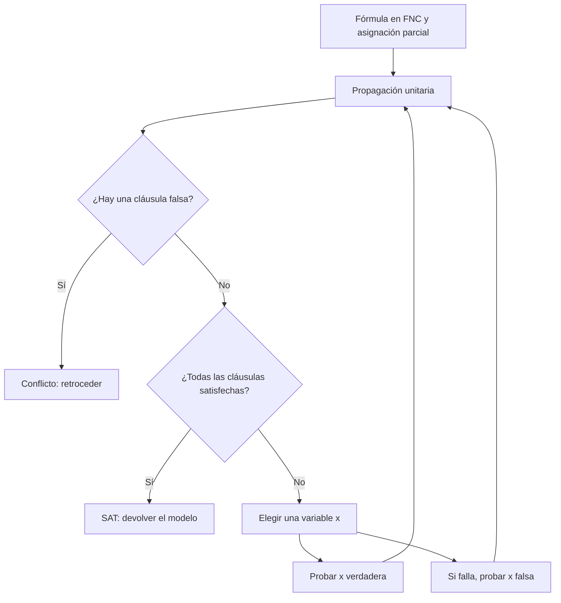

# Lógica Computacional - Lógica proposicional

## 2.4 Decidibilidad de la lógica proposicional.

---

Un problema es **decidible** si existe un algoritmo que, para cada instancia, termina y responde correctamente sí o no. La lógica proposicional es decidible: hay un algoritmo que determina si una fórmula es una tautología, si es satisfacible o si dos fórmulas son equivalentes. Esto la distingue de la lógica de primer orden, cuya validez es indecidible (tema 4.3). Pero ser decidible no significa ser fácil: el problema de la satisfacibilidad es NP-completo, y la diferencia entre lo decidible y lo eficiente es el tema de fondo de los algoritmos de SAT.

### Los problemas de decisión

Para una fórmula $\varphi$ o un conjunto finito $\Gamma,$ las preguntas básicas son:

| Problema | Pregunta | Se reduce a |
| --- | --- | --- |
| SAT | ¿Es $\varphi$ satisfacible? | |
| VALIDEZ | ¿Es $\varphi$ una tautología? | ¿es $\lnot \varphi$ insatisfacible? |
| EQUIVALENCIA | ¿Es $\varphi \equiv \psi?$ | ¿es $\lnot (\varphi \leftrightarrow \psi)$ insatisfacible? |
| CONSECUENCIA | ¿Es $\{\gamma_1, \ldots, \gamma_k\} \models \varphi?$ | ¿es $\gamma_1 \land \cdots \land \gamma_k \land \lnot \varphi$ insatisfacible? |

Todos se reducen a SAT, así que basta un algoritmo para SAT.

### El algoritmo de las tablas de verdad

**Teorema.** SAT es decidible.

**Demostración.** Sean $p_1, \ldots, p_n$ las variables de $\varphi.$ El algoritmo recorre las $2^n$ asignaciones de valores a $p_1, \ldots, p_n,$ evalúa $\varphi$ en cada una con la definición recursiva (tema 2.3) y responde sí si alguna da 1. Termina, porque el número de asignaciones es finito y cada evaluación es una recursión sobre una fórmula finita. Es correcto por el **lema de coincidencia**: el valor de $\varphi$ en cualquier interpretación solo depende de $p_1, \ldots, p_n,$ así que si alguna interpretación satisface a $\varphi,$ alguna de las $2^n$ revisadas también. $\blacksquare$

El costo es $O(2^n \cdot |\varphi|).$ Con 30 variables son mil millones de evaluaciones; con 100 son $2^{100} \approx 1.3 \times 10^{30},$ que a mil millones de evaluaciones por segundo tomarían unos $4 \times 10^{13}$ años. Un problema decidible puede ser intratable.

### Complejidad: SAT es NP-completo

**SAT está en NP.** Si $\varphi$ es satisfacible, un modelo es un **certificado** corto: verificar que una asignación satisface a $\varphi$ toma tiempo lineal.

**Teorema (Cook, 1971; Levin, 1973).** SAT es NP-completo: todo problema de NP se reduce en tiempo polinomial a SAT.

La idea de la demostración es codificar con variables proposicionales la computación de una máquina de Turing no determinista de tiempo polinomial: una variable por cada celda, estado y posición en cada instante, y cláusulas que obligan a que las configuraciones sucesivas respeten las transiciones. La fórmula es satisfacible si y solo si existe una computación de aceptación.

**Consecuencias.**

- Si existe un algoritmo polinomial para SAT, entonces P = NP, uno de los problemas abiertos más importantes de las matemáticas.
- VALIDEZ es **co-NP-completo**: $\varphi$ es válida si y solo si $\lnot \varphi$ no está en SAT. Para demostrar que una fórmula **no** es válida basta un contraejemplo; para demostrar que **sí** lo es no se conoce un certificado corto en general.
- **3-SAT,** SAT restringido a conjunciones de cláusulas de tres literales, sigue siendo NP-completo.

**Casos fáciles.** Algunas restricciones hacen el problema polinomial:

- **2-SAT** (cláusulas de a lo más dos literales): tiempo lineal, con el grafo de implicaciones; cada cláusula $\ell_1 \lor \ell_2$ da las aristas $\lnot \ell_1 \to \ell_2$ y $\lnot \ell_2 \to \ell_1,$ y la fórmula es insatisfacible si y solo si alguna variable y su negación están en la misma componente fuertemente conexa.
- **Horn-SAT** (cláusulas con a lo más un literal positivo): tiempo lineal, por propagación; es la base de la programación lógica (tema 6.1).

### Más allá de la fuerza bruta: DPLL

Los SAT solvers no recorren la tabla de verdad. El algoritmo **DPLL** (Davis, Putnam, Logemann y Loveland, 1962) trabaja con fórmulas en forma normal conjuntiva, conjunciones de cláusulas (tema 2.6), y combina búsqueda con deducción:

1. **Propagación unitaria.** Si una cláusula tiene un solo literal sin asignar y los demás son falsos, ese literal tiene que ser verdadero.
2. **Detección de conflictos.** Si una cláusula tiene todos sus literales falsos, la rama actual falla y se retrocede.
3. **Ramificación.** Si no hay deducciones, se elige una variable y se prueban sus dos valores.

En el peor caso sigue siendo exponencial, pero la propagación poda la mayor parte del árbol. Los solvers modernos añaden **aprendizaje de cláusulas** a partir de los conflictos (CDCL), heurísticas para elegir la variable y reinicios, y resuelven en la práctica instancias industriales con millones de variables.



### Compacidad

La decidibilidad habla de fórmulas finitas. Para conjuntos infinitos de fórmulas, el resultado fundamental es:

**Teorema de compacidad.** Un conjunto $\Gamma$ de fórmulas, posiblemente infinito, es satisfacible si y solo si cada subconjunto finito de $\Gamma$ es satisfacible.

**Idea de la demostración.** Se supone que las variables son $p_1, p_2, p_3, \ldots$ en ese orden. Una dirección es inmediata. Para la otra, se construye la interpretación variable por variable: se elige para $p_1$ un valor $b_1$ tal que todo subconjunto finito de $\Gamma$ siga siendo satisfacible por alguna interpretación con $p_1 = b_1.$ Alguno de los dos valores sirve: si ninguno sirviera, habría un subconjunto finito $\Delta_0$ sin modelos con $p_1 = 0$ y otro $\Delta_1$ sin modelos con $p_1 = 1,$ y $\Delta_0 \cup \Delta_1$ sería un subconjunto finito insatisfacible. Se repite con $p_2,$ con $p_3$ y así sucesivamente. Cada fórmula de $\Gamma$ menciona solo un número finito de variables, así que la interpretación límite la satisface. Es el **lema de König** sobre el árbol binario de asignaciones parciales. $\blacksquare$

Compacidad tiene consecuencias matemáticas sorprendentes: por ejemplo, un grafo infinito numerable es 3-coloreable si y solo si cada uno de sus subgrafos finitos lo es.

### Implementación en Python

El programa implementa la fuerza bruta y un DPLL con propagación unitaria, con cláusulas en el formato DIMACS de los solvers (el entero $k$ representa la variable $x_k$ y $-k$ su negación). Resuelve el ejercicio 5, compara ambos algoritmos en fórmulas 3-SAT aleatorias con 4.26 cláusulas por variable, la proporción en la que las instancias aleatorias son más difíciles, y mide DPLL en las fórmulas del principio del casillero.

```python
import random
from itertools import product

# Cláusulas como listas de enteros: 3 es la variable x3 y -3 su negación (formato DIMACS)

def fuerza_bruta(clausulas, n):
    """Revisa las 2^n interpretaciones. Devuelve (modelo o None, interpretaciones revisadas)."""
    revisadas = 0
    for vals in product([False, True], repeat=n):
        revisadas += 1
        if all(any(vals[abs(l) - 1] == (l > 0) for l in c) for c in clausulas):
            return vals, revisadas
    return None, revisadas

def dpll(clausulas, asignacion=None, nodos=None):
    """DPLL con propagación unitaria. Devuelve (modelo o None, nodos de búsqueda)."""
    asignacion = dict(asignacion or {})
    nodos = nodos if nodos is not None else [0]
    nodos[0] += 1
    while True:                                   # propagación unitaria
        simplificadas = []
        for c in clausulas:
            if any(asignacion.get(abs(l)) == (l > 0) for l in c):
                continue                          # cláusula ya satisfecha
            resto = [l for l in c if abs(l) not in asignacion]
            if not resto:
                return None, nodos[0]             # cláusula vacía: conflicto
            simplificadas.append(resto)
        clausulas = simplificadas
        unitarias = [c[0] for c in clausulas if len(c) == 1]
        if not unitarias:
            break
        asignacion[abs(unitarias[0])] = unitarias[0] > 0
    if not clausulas:
        return asignacion, nodos[0]
    x = abs(clausulas[0][0])                      # ramificar en una variable
    for b in (True, False):
        modelo, _ = dpll(clausulas, {**asignacion, x: b}, nodos)
        if modelo is not None:
            return modelo, nodos[0]
    return None, nodos[0]

# Ejercicio 5: (p ∨ q) ∧ (¬p ∨ ¬q) ∧ (p ∨ ¬q), con p = 1 y q = 2
ej = [[1, 2], [-1, -2], [1, -2]]
print('modelos:', [v for v in product([False, True], repeat=2)
                   if all(any(v[abs(l) - 1] == (l > 0) for l in c) for c in ej)])
print('DPLL:', dpll(ej)[0])

# Comparación en fórmulas 3-SAT aleatorias con 4.26 cláusulas por variable (zona difícil)
rnd = random.Random(4)
print(' n   resultado  fuerza bruta    DPLL')
for n in [8, 12, 16, 20]:
    m = round(4.26 * n)
    cl = [[rnd.choice([1, -1]) * v for v in rnd.sample(range(1, n + 1), 3)] for _ in range(m)]
    mb, rb = fuerza_bruta(cl, n)
    md, nd = dpll(cl)
    assert (mb is None) == (md is None)
    print(f'{n:2}  {"SAT  " if md else "UNSAT"}    {rb:12}  {nd:6}')

# Principio del casillero: n + 1 palomas en n agujeros es insatisfacible
def casillero(n):
    var = lambda i, j: i * n + j + 1               # paloma i en el agujero j
    cl = [[var(i, j) for j in range(n)] for i in range(n + 1)]
    cl += [[-var(i, j), -var(k, j)] for j in range(n) for i in range(n + 1) for k in range(i + 1, n + 1)]
    return cl
print('casillero, nodos DPLL:', [dpll(casillero(n))[1] for n in range(1, 7)])
```

Salida:

```text
modelos: [(True, False)]
DPLL: {1: True, 2: False}
 n   resultado  fuerza bruta    DPLL
 8  SAT                17       4
12  UNSAT            4096      19
16  UNSAT           65536      35
20  SAT             81948      19
casillero, nodos DPLL: [1, 3, 11, 47, 239, 1439]
```

En las instancias insatisfacibles la fuerza bruta revisa las $2^n$ asignaciones completas, mientras que DPLL explora unas decenas de nodos. Pero en las fórmulas del casillero, que dicen que $n + 1$ palomas caben en $n$ agujeros sin compartir, el número de nodos crece de forma factorial: se sabe (Haken, 1985) que cualquier método basado en resolución, como DPLL, necesita tiempo exponencial en ellas.

### Ejercicios Propuestos

1. **Clasificación.** Determina si son válidas, satisfacibles o contradicciones: $p \lor \lnot p,$ $p \land \lnot p,$ $(p \to q) \leftrightarrow (\lnot q \to \lnot p)$ y $(p \to q) \land p \land \lnot q.$

2. **Reducciones.** Explica cómo decidir si $\{p \to q, q \to r\} \models p \to r$ con un solo llamado a un algoritmo para SAT, y resuélvelo.

3. **Costo.** Si evaluar una fórmula toma un microsegundo, ¿cuánto tarda la tabla de verdad con 40 variables? ¿Y con 60?

4. **2-SAT.** Construye el grafo de implicaciones de $(p \lor q) \land (\lnot p \lor q) \land (p \lor \lnot q) \land (\lnot p \lor \lnot q)$ y decide si es satisfacible.

5. **DPLL.** Aplica DPLL a $(p \lor q) \land (\lnot p \lor \lnot q) \land (p \lor \lnot q)$ y encuentra todos sus modelos.

6. **Compacidad.** Usa el teorema de compacidad para demostrar que si $\Gamma \models \varphi,$ entonces existe un subconjunto finito $\Delta \subseteq \Gamma$ tal que $\Delta \models \varphi.$

### Soluciones

**Ejercicio 1.** $p \lor \lnot p$ es válida. $p \land \lnot p$ es contradicción. La contrapositiva es válida. $(p \to q) \land p \land \lnot q$ es contradicción: $p$ y $p \to q$ obligan a $q.$ Las válidas también son satisfacibles.

**Ejercicio 2.** $\Gamma \models \varphi$ si y solo si $\Gamma \cup \{\lnot \varphi\}$ es insatisfacible, así que se pregunta por $(p \to q) \land (q \to r) \land \lnot (p \to r).$ La última obliga a $p = 1$ y $r = 0;$ la primera, a $q = 1;$ la segunda falla. Es insatisfacible, así que la consecuencia es válida.

**Ejercicio 3.** $2^{40} \approx 1.1 \times 10^{12}$ microsegundos son unos 13 días. $2^{60} \approx 1.15 \times 10^{18}$ microsegundos son unos 36 500 años.

**Ejercicio 4.** Las aristas son $\lnot p \to q,$ $\lnot q \to p,$ $p \to q,$ $\lnot q \to \lnot p,$ $\lnot p \to \lnot q,$ $q \to p,$ $p \to \lnot q$ y $q \to \lnot p.$ Hay un camino $p \to q \to \lnot p$ y otro $\lnot p \to \lnot q \to p,$ así que $p$ y $\lnot p$ están en la misma componente: es insatisfacible. En efecto, las cuatro cláusulas excluyen las cuatro asignaciones.

**Ejercicio 5.** No hay cláusulas unitarias; se ramifica en $p.$ Con $p = 1,$ la primera y la tercera se satisfacen y la segunda queda como $\lnot q:$ por propagación, $q = 0,$ y todas se satisfacen. Es el único modelo: con $p = 0,$ la primera obliga a $q = 1$ y la tercera a $q = 0.$ El programa lo confirma: el único modelo es $p = 1,$ $q = 0.$

**Ejercicio 6.** $\Gamma \models \varphi$ significa que $\Gamma \cup \{\lnot \varphi\}$ es insatisfacible. Por compacidad, algún subconjunto finito es insatisfacible; se puede suponer que es de la forma $\Delta \cup \{\lnot \varphi\}$ con $\Delta \subseteq \Gamma$ finito, añadiendo $\lnot \varphi$ si no estaba. Entonces $\Delta \models \varphi.$ $\blacksquare$

### Referencias

1. Ben-Ari, M., _Mathematical Logic for Computer Science_. Springer, 2012. Capítulo 6.
2. Arora, S., and Barak, B., _Computational Complexity: A Modern Approach_. Cambridge University Press, 2009. Capítulo 2.
3. Cook, S. A. (1971). The complexity of theorem-proving procedures. _Proceedings of the 3rd ACM Symposium on Theory of Computing_, 151-158.
4. Davis, M., Logemann, G., and Loveland, D. (1962). A machine program for theorem-proving. _Communications of the ACM_, 5(7), 394-397.
5. Biere, A., Heule, M., van Maaren, H., and Walsh, T. (eds.), _Handbook of Satisfiability_. IOS Press, 2021.
