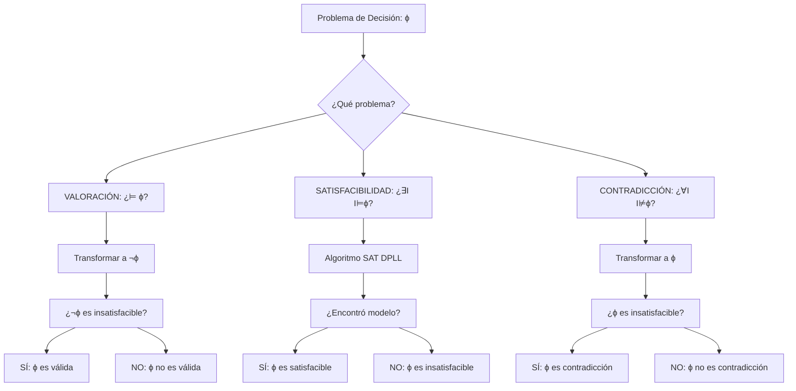

# Lógica Computacional - Lógica proposicional

## 2.4 Decidibilidad de la lógica proposicional.

---

La **decidibilidad** en lógica proposicional se refiere a la existencia de algoritmos que pueden determinar en tiempo finito si una fórmula es válida, satisfacible o una contradicción. La lógica proposicional es **decidible**, a diferencia de lógicas más expresivas como la de primer orden.

### 2. Conceptos Fundamentales

#### Problema de decisión:

Un problema es decidible si existe un algoritmo que para cualquier entrada:

- Siempara termina (es algorithmically solucionable)
- Devuelve "sí" o "no" correctamente

#### Problemas de decisión en lógica proposicional:

1. **VALORACIÓN**: Dada ϕ, ¿es ϕ válida? (¿⊨ ϕ?)
2. **SATISFACIBILIDAD**: Dada ϕ, ¿es ϕ satisfacible?
3. **CONTRADICCIÓN**: Dada ϕ, ¿es ϕ una contradicción?

### 3. Algoritmos de Decisión

#### Método de tablas de verdad:

Algoritmo exhaustivo que evalúa todas las posibles interpretaciones.

**Complejidad**: Para n variables, se evalúan $2^n$ interpretaciones.

#### Algoritmo de tabla de verdad:

```python
def es_tautologia_tabla_verdad(formula, variables):
    """
    Determina si una fórmula es tautología usando tabla de verdad
    """
    n = len(variables)
    for i in range(2**n):
        # Crear interpretación basada en el número binario i
        interpretacion = {}
        for j, var in enumerate(variables):
            # El j-ésimo bit de i determina el valor de la j-ésima variable
            interpretacion[var] = bool((i >> j) & 1)

        # Evaluar la fórmula bajo esta interpretación
        if not evaluar_formula(formula, interpretacion):
            return False  # No es tautología
    return True  # Es tautología
```

### 4. Complejidad Computacional

#### Teorema:

Los problemas de decisión en lógica proposicional son:

- **SATISFACIBILIDAD (SAT)**: NP-completo (Cook, 1971)
- **VALORACIÓN**: co-NP-completo
- **CONTRADICCIÓN**: co-NP-completo

#### Fórmula del número de interpretaciones:

Para una fórmula con $n$ variables distintas, el número de interpretaciones posibles es:

$$2^n$$

### 5. Algoritmos Avanzados para SAT

#### Algoritmo DPLL (Davis-Putnam-Logemann-Loveland):

```python
def dpll(clausulas, asignacion={}):
    """
    Algoritmo DPLL para satisfacibilidad proposicional
    """
    # Simplificación unitaria
    while True:
        clausulas_unitarias = [c for c in clausulas if len(c) == 1]
        if not clausulas_unitarias:
            break

        for clausula in clausulas_unitarias:
            literal = next(iter(clausula))
            variable = abs(literal)
            valor = literal > 0
            asignacion[variable] = valor

            # Propagación unitaria
            clausulas = propagar_unitaria(clausulas, literal)

    # Eliminación de clausulas satisfechas
    clausulas = [c for c in clausulas if not clausula_satisfecha(c, asignacion)]

    # Clausula vacía significa insatisfacible
    if any(len(c) == 0 for c in clausulas):
        return None

    # Si no hay clausulas, es satisfacible
    if not clausulas:
        return asignacion

    # Elegir variable no asignada
    variable = elegir_variable(clausulas, asignacion)

    # Intentar con verdadero
    nueva_asignacion = asignacion.copy()
    nueva_asignacion[variable] = True
    resultado = dpll(propagar(clausulas, variable, True), nueva_asignacion)
    if resultado is not None:
        return resultado

    # Intentar con falso
    nueva_asignacion[variable] = False
    return dpll(propagar(clausulas, variable, False), nueva_asignacion)
```

### 6. Diagrama del Proceso de Decisión



### 7. Teoremas de Decidibilidad

#### Teorema de decidibilidad:

La lógica proposicional es decidible. Existen algoritmos que determinan:

- Si $\models \phi$ (VALORACIÓN)
- Si $\phi$ es satisfacible (SAT)
- Si $\phi$ es una contradicción

#### Teorema de compacidad:

Un conjunto de fórmulas $\Gamma$ es satisfacible si y solo si todo subconjunto finito de $\Gamma$ es satisfacible.

### 8. Aplicaciones de la Decidibilidad

1. **Verificación de hardware**: Circuitos lógicos
2. **Verificación de software**: Especificaciones formales
3. **Inteligencia artificial**: Sistemas expertos, planificación
4. **Base de datos**: Consultas booleanas
5. **Criptografía**: Protocolos de seguridad

### 9. Limitaciones Prácticas

#### Explosión combinatoria:

Aunque decidible, los problemas pueden ser computacionalmente intratables para fórmulas grandes:

$$2^n \text{ crece exponencialmente con } n$$

#### Estrategias de optimización:

- Podado early (early termination)
- Aprendizaje de cláusulas
- Heurísticas de selección de variables

### 10. Ejercicios Propuestos

#### Ejercicio 1:

Para las siguientes fórmulas, determine usando tablas de verdad si son:
a) Válidas, b) Satisfacibles, c) Contradicciones

1. $p \lor \neg p$
2. $p \land \neg p$
3. $(p \rightarrow q) \leftrightarrow (\neg q \rightarrow \neg p)$
4. $(p \rightarrow q) \land p \land \neg q$

#### Ejercicio 2:

Implemente el algoritmo de tabla de verdad para determinar si una fórmula es satisfacible.

#### Ejercicio 3:

Demuestre que el problema de satisfacibilidad (SAT) para lógica proposicional es decidible.

#### Ejercicio 4:

Analice la complejidad computacional del algoritmo de tabla de verdad para una fórmula con n variables.

#### Ejercicio 5:

Para la fórmula $(p \lor q) \land (\neg p \lor \neg q) \land (p \lor \neg q)$:
a) Determine si es satisfacible usando DPLL
b) Encuentre un modelo si existe

### 11. Soluciones a Ejercicios Selectos

#### Solución Ejercicio 1:

1. $p \lor \neg p$: a) Válida, b) Satisfacible, c) No contradicción
2. $p \land \neg p$: a) No válida, b) No satisfacible, c) Contradicción
3. $(p \rightarrow q) \leftrightarrow (\neg q \rightarrow \neg p)$: a) Válida, b) Satisfacible, c) No contradicción
4. $(p \rightarrow q) \land p \land \neg q$: a) No válida, b) No satisfacible, c) Contradicción

#### Solución Ejercicio 3:

**Demostración**: SAT es decidible porque existe el algoritmo de tabla de verdad que:

1. Enumera todas las $2^n$ interpretaciones para n variables
2. Evalúa ϕ en cada interpretación
3. Si alguna interpretación satisface ϕ, devuelve "sí"
4. Si ninguna satisface ϕ, devuelve "no"
5. Siempre termina en tiempo finito

#### Solución Ejercicio 4:

La complejidad es $O(2^n \cdot |\phi|)$ donde:

- $2^n$ es el número de interpretaciones
- $|\phi|$ es el tamaño de la fórmula

#### Solución Ejercicio 5:

La fórmula es satisfacible. Dos modelos posibles:

- $I(p) = \top$, $I(q) = \bot$
- $I(p) = \bot$, $I(q) = \top$

### 12. Implementación Práctica

```python
# Implementación básica de verificador de tautologías
def es_tautologia(formula):
    """
    Verifica si una fórmula es tautología usando tabla de verdad
    """
    variables = extraer_variables(formula)
    n = len(variables)

    for i in range(2**n):
        interpretacion = {}
        for j, var in enumerate(variables):
            interpretacion[var] = bool((i >> j) & 1)

        if not evaluar(formula, interpretacion):
            return False

    return True

def extraer_variables(formula):
    """Extrae todas las variables de una fórmula"""
    # Implementación que extrae variables únicas
    variables = set()
    for char in formula:
        if char in 'pqrstuvwxyz' and char not in variables:
            variables.add(char)
    return sorted(list(variables))
```

### 13. Referencias

#### Bibliografía Básica:

1. Huth M., Ryan M. (2004). _Logic in Computer Science_. Capítulo 1.
2. Nerode A., Shore R.A. (1997). _Logic for Applications_. Capítulo 2.

#### Bibliografía Complementaria:

1. Ben-Ari M. (2008). _Mathematical Logic for Computer Science_. Capítulo 2.6.
2. Davis, M., Putnam, H. (1960). _A Computing Procedure for Quantification Theory_.
3. Cook, S. A. (1971). _The Complexity of Theorem-Proving Procedures_.
