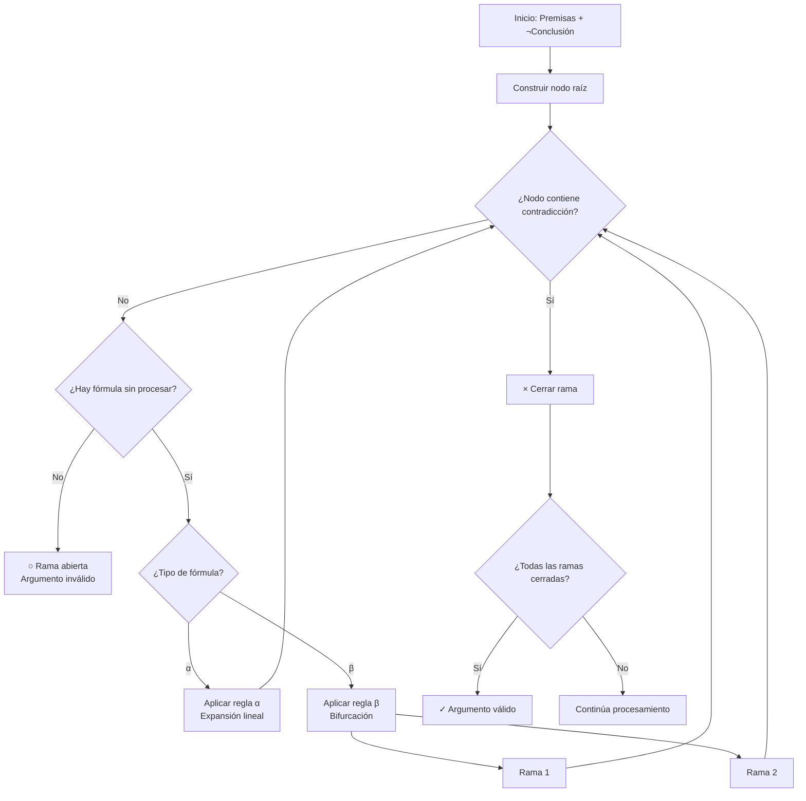

# Lógica Computacional - Lógica proposicional

## 2.5 Análisis de argumentos lógicos: interpretaciones y/o tableaux semánticos (reglas α y β).

---

### 1. Introducción a los Tableaux Semánticos

Los **tableaux semánticos** (o tablas semánticas) son un método de decisión para lógica proposicional que utiliza un enfoque de **refutación sistemática**. Fueron desarrollados por Evert Beth y Jaakko Hintikka en la década de 1950.

### 2. Conceptos Fundamentales

#### Argumento lógico válido:

Un argumento de premisas $P_1, P_2, \ldots, P_n$ y conclusión $C$ es válido si:

$$P_1 \land P_2 \land \ldots \land P_n \rightarrow C$$

es una tautología, o equivalentemente:

$$P_1 \land P_2 \land \ldots \land P_n \land \neg C$$

es una contradicción.

#### Tableau semántico:

Árbol donde cada nodo contiene fórmulas y las ramas representan interpretaciones posibles. Una rama **cerrada** (×) indica contradicción, una rama **abierta** (○) indica un modelo.

### 3. Reglas α y β para Tableaux

#### Reglas α (conjuntivas):

Fórmulas que se descomponen en una sola rama:

| Fórmula                       | Componente 1 | Componente 2 |
| ----------------------------- | ------------ | ------------ |
| $\phi \land \psi$             | $\phi$       | $\psi$       |
| $\neg(\phi \lor \psi)$        | $\neg\phi$   | $\neg\psi$   |
| $\neg(\phi \rightarrow \psi)$ | $\phi$       | $\neg\psi$   |
| $\neg\neg\phi$                | $\phi$       | $\phi$       |

#### Reglas β (disyuntivas):

Fórmulas que crean bifurcaciones:

| Fórmula                           | Rama 1                | Rama 2                |
| --------------------------------- | --------------------- | --------------------- |
| $\phi \lor \psi$                  | $\phi$                | $\psi$                |
| $\neg(\phi \land \psi)$           | $\neg\phi$            | $\neg\psi$            |
| $\phi \rightarrow \psi$           | $\neg\phi$            | $\psi$                |
| $\neg(\phi \leftrightarrow \psi)$ | $\phi \land \neg\psi$ | $\neg\phi \land \psi$ |

### 4. Algoritmo de Construcción de Tableaux

#### Pasos del algoritmo:

1. Iniciar con la negación de la conclusión junto con las premisas
2. Aplicar reglas α y β sistemáticamente
3. Marcar ramas como cerradas cuando contengan $\phi$ y $\neg\phi$
4. Si todas las ramas cierran, el argumento es válido
5. Si alguna rama queda abierta, el argumento es inválido

### 5. Implementación de Tableaux Semánticos

```python
class TableauNode:
    def __init__(self, formulas, parent=None, branch_type=None):
        self.formulas = set(formulas)  # Conjunto de fórmulas en este nodo
        self.parent = parent
        self.children = []  # Lista de nodos hijos
        self.branch_type = branch_type  # 'alpha' o 'beta'
        self.closed = False  # Si la rama está cerrada
        self.checked = False  # Si la fórmula ha sido procesada

def construir_tableau(premisas, conclusion):
    """
    Construye un tableau para verificar validez del argumento
    """
    # Iniciar con premisas y negación de la conclusión
    formulas_iniciales = premisas + ['¬' + conclusion]
    raiz = TableauNode(formulas_iniciales)

    return expandir_tableau(raiz)

def expandir_tableau(nodo):
    """
    Expande recursivamente el tableau aplicando reglas α y β
    """
    # Verificar si el nodo está cerrado
    if es_cerrado(nodo):
        nodo.closed = True
        return nodo

    # Buscar fórmula no procesada para expandir
    for formula in nodo.formulas:
        if not esta_procesada(formula, nodo):
            # Determinar tipo de fórmula (α o β)
            tipo = clasificar_formula(formula)

            if tipo == 'alpha':
                # Aplicar regla α (expansión lineal)
                componentes = aplicar_regla_alpha(formula)
                nuevo_nodo = TableauNode(nodo.formulas.union(componentes), nodo, 'alpha')
                nodo.children.append(nuevo_nodo)
                return expandir_tableau(nuevo_nodo)

            elif tipo == 'beta':
                # Aplicar regla β (bifurcación)
                componentes1, componentes2 = aplicar_regla_beta(formula)

                # Crear dos ramas
                nodo1 = TableauNode(nodo.formulas.union(componentes1), nodo, 'beta')
                nodo2 = TableauNode(nodo.formulas.union(componentes2), nodo, 'beta')

                nodo.children.extend([nodo1, nodo2])
                expandir_tableau(nodo1)
                expandir_tableau(nodo2)
                return nodo

    # Si no hay más fórmulas para expandir
    return nodo

def es_cerrado(nodo):
    """
    Verifica si un nodo contiene contradicción
    """
    formulas = list(nodo.formulas)
    for i in range(len(formulas)):
        for j in range(i+1, len(formulas)):
            if es_contradiccion(formulas[i], formulas[j]):
                return True
    return False
```

### 6. Diagrama de Proceso de Tableaux



### 7. Ejemplo de Tableau Semántico

#### Argumento: Modus Ponens

Premisas: $p \rightarrow q,$ $p$  
Conclusión: $q$

**Tableau**:

1. $p \rightarrow q$ (premisa)
2. $p$ (premisa)
3. $\neg q$ (negación de conclusión)
4. De 1: $\neg p$ (rama 1) o $q$ (rama 2) [regla β]
5. Rama 1: $\neg p$ con $p$ → × (contradicción)
6. Rama 2: $q$ con $\neg q$ → × (contradicción)
7. Todas las ramas cerradas → Argumento válido

### 8. Reglas de Tableaux en Detalle

#### Reglas α (expansion lineal):

$$ \begin{aligned} \phi \land \psi &\Rightarrow \phi, \psi \\\ \neg(\phi \lor \psi) &\Rightarrow \neg\phi, \neg\psi \\\ \neg(\phi \rightarrow \psi) &\Rightarrow \phi, \neg\psi \\\ \neg\neg\phi &\Rightarrow \phi \end{aligned} $$

#### Reglas β (bifurcación):

$$ \begin{aligned} \phi \lor \psi &\Rightarrow \phi \mid \psi \\\ \neg(\phi \land \psi) &\Rightarrow \neg\phi \mid \neg\psi \\\ \phi \rightarrow \psi &\Rightarrow \neg\phi \mid \psi \\\ \phi \leftrightarrow \psi &\Rightarrow \phi \land \psi \mid \neg\phi \land \neg\psi \\\ \neg(\phi \leftrightarrow \psi) &\Rightarrow \phi \land \neg\psi \mid \neg\phi \land \psi \end{aligned} $$

### 9. Ejercicios Propuestos

#### Ejercicio 1:

Construya tableaux semánticos para determinar la validez de:

1. Premisas: $p \rightarrow q,$ $\neg q;$ Conclusión: $\neg p$
2. Premisas: $p \lor q,$ $\neg p;$ Conclusión: $q$
3. Premisas: $p \rightarrow q,$ $q \rightarrow r;$ Conclusión: $p \rightarrow r$

#### Ejercicio 2:

Implemente las funciones `aplicar_regla_alpha` y `aplicar_regla_beta` para el código Python anterior.

#### Ejercicio 3:

Analice el siguiente argumento usando tableaux:
Premisas: $(p \land q) \rightarrow r, \neg r, p;$ Conclusión: $\neg q$

#### Ejercicio 4:

Demuestre mediante tableaux que el siguiente argumento es inválido:
Premisas: $p \rightarrow q, q;$ Conclusión: $p$

#### Ejercicio 5:

Extienda el algoritmo de tableaux para manejar equivalencias $(\leftrightarrow)$ con reglas específicas.

### 10. Aplicaciones de los Tableaux

1. **Verificación de argumentos**: Análisis de validez lógica
2. **Satisfacibilidad**: Búsqueda de modelos
3. **Enseñanza de lógica**: Método visual e intuitivo
4. **Verificación formal**: Análisis de sistemas críticos
5. **Inteligencia artificial**: Razonamiento automático

### 11. Ventajas y Limitaciones

#### Ventajas:

- Método visual e intuitivo
- Proporciona contraejemplos cuando el argumento es inválido
- Fácil de implementar computacionalmente

#### Limitaciones:

- Puede generar árboles grandes para fórmulas complejas
- No siempre el método más eficiente computacionalmente

### 12. Soluciones a Ejercicios Selectos

#### Solución Ejercicio 1:

1. **Tableau**:
   - $p \rightarrow q, \neg q, \neg\neg p$ ( ≡ $p$ )
   - De $p \rightarrow q: \neg p$ ( × con $p$ ) o $q$ ( × con $\neg q$ )
   - Ambas ramas cierran → Argumento válido

#### Solución Ejercicio 4:

**Tableau**:

- $p \rightarrow q,$ $q,$ $\neg p$
- De $p \rightarrow q:$ $\neg p$ (rama 1) o $q$ (rama 2)
- Rama 1: $\neg p$ con $\neg p$ → no contradicción (rama abierta)
- Argumento inválido, contraejemplo: $p$ falsa, $q$ verdadera

#### Implementación de reglas:

```python
def aplicar_regla_alpha(formula):
    """Aplica reglas α a una fórmula"""
    if formula.startswith('¬¬'):
        return [formula[2:]]  # Elimina doble negación

    elif '∧' in formula and not formula.startswith('¬'):
        partes = formula.split(' ∧ ')
        return [partes[0], partes[1]]

    elif formula.startswith('¬(') and '∨' in formula:
        interior = formula[2:-1]  # Remueve ¬( )
        partes = interior.split(' ∨ ')
        return ['¬' + partes[0], '¬' + partes[1]]

    elif formula.startswith('¬(') and '→' in formula:
        interior = formula[2:-1]
        partes = interior.split(' → ')
        return [partes[0], '¬' + partes[1]]

    return [formula]

def aplicar_regla_beta(formula):
    """Aplica reglas β a una fórmula, devuelve dos conjuntos"""
    if '∨' in formula and not formula.startswith('¬'):
        partes = formula.split(' ∨ ')
        return [partes[0]], [partes[1]]

    elif formula.startswith('¬(') and '∧' in formula:
        interior = formula[2:-1]
        partes = interior.split(' ∧ ')
        return ['¬' + partes[0]], ['¬' + partes[1]]

    elif '→' in formula and not formula.startswith('¬'):
        partes = formula.split(' → ')
        return ['¬' + partes[0]], [partes[1]]

    return [formula], [formula]
```

### 13. Referencias

#### Bibliografía Básica:

1. Huth M., Ryan M. (2004). _Logic in Computer Science_. Capítulo 1.
2. Nerode A., Shore R.A. (1997). _Logic for Applications_. Capítulo 2.

#### Bibliografía Complementaria:

1. Ben-Ari M. (2008). _Mathematical Logic for Computer Science_. Capítulo 2.
2. Smullyan, R. M. (1968). _First-Order Logic_. Capítulo sobre tableaux.
3. Fitting, M. (1996). _First-Order Logic and Automated Theorem Proving_. Capítulo 3.
