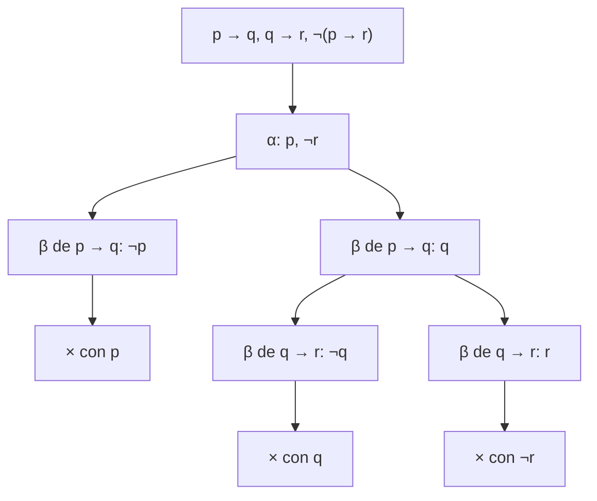

# Lógica Computacional - Lógica proposicional

## 2.5 Análisis de argumentos lógicos: interpretaciones y/o tableaux semánticos (reglas α y β).

---

Un **argumento** consta de premisas $\gamma_1, \ldots, \gamma_k$ y una conclusión $\varphi.$ Es **correcto** (o válido) si la conclusión es consecuencia lógica de las premisas: toda interpretación que hace verdaderas a todas las premisas hace verdadera a la conclusión,

$$ \gamma_1, \ldots, \gamma_k \models \varphi $$

Este tema presenta dos métodos para decidirlo. El primero revisa interpretaciones; el segundo, los **tableaux semánticos**, busca sistemáticamente un contraejemplo y, si no lo encuentra, demuestra que no existe.

### Análisis con interpretaciones

**Proposición.** Son equivalentes:

1. $\gamma_1, \ldots, \gamma_k \models \varphi.$
2. $(\gamma_1 \land \cdots \land \gamma_k) \to \varphi$ es una tautología.
3. $\{\gamma_1, \ldots, \gamma_k, \lnot \varphi\}$ es insatisfacible.

**Demostración.** (1) dice que no hay interpretación con todas las $\gamma_i$ verdaderas y $\varphi$ falsa. Eso es exactamente que la implicación de (2) nunca sea falsa, y que ninguna interpretación satisfaga al conjunto de (3). $\blacksquare$

En la tabla de verdad, solo importan las **filas críticas**, en las que todas las premisas son verdaderas: el argumento es correcto si en todas ellas la conclusión es verdadera. Una fila crítica con conclusión falsa es un **contraejemplo**.

**Ejemplo.** Para $p \to q,$ $q \;\therefore\; p$ (afirmar el consecuente):

| $p$ | $q$ | $p \to q$ | $q$ | $p$ |
| :-: | :-: | :-: | :-: | :-: |
| 1 | 1 | 1 | 1 | 1 |
| 1 | 0 | 0 | 0 | 1 |
| 0 | 1 | 1 | 1 | **0** |
| 0 | 0 | 1 | 0 | 0 |

Las filas críticas son la primera y la tercera; en la tercera la conclusión es falsa. El argumento es incorrecto, con contraejemplo $p = 0,$ $q = 1.$

El método es seguro pero revisa $2^n$ filas. Los tableaux evitan revisar filas que no pueden ser contraejemplos.

### Tableaux semánticos: la idea

Para saber si $\Gamma \models \varphi,$ se intenta construir un modelo de $\Gamma \cup \{\lnot \varphi\}.$ Se descomponen las fórmulas en otras más simples según lo que **tendría que ser verdad** para que fueran verdaderas: si $\alpha_1 \land \alpha_2$ es verdadera, ambas lo son; si $\beta_1 \lor \beta_2$ es verdadera, al menos una lo es, y hay que considerar los dos casos. El resultado es un árbol. Una rama que contiene una fórmula y su negación es imposible y se **cierra**. Si todas las ramas se cierran, no hay modelo y el argumento es correcto; una rama abierta y completa da un contraejemplo. El método se debe a Beth (1955) y Hintikka (1955), y Smullyan (1968) le dio su forma actual con la **notación uniforme**.

### Reglas α y β

Las fórmulas no literales son de dos tipos. Las **α** (conjuntivas) son verdaderas si y solo si **ambos** componentes lo son, y extienden la rama. Las **β** (disyuntivas) son verdaderas si y solo si **alguno** de los componentes lo es, y la bifurcan.

| α | $\alpha_1$ | $\alpha_2$ |
| --- | --- | --- |
| $\varphi \land \psi$ | $\varphi$ | $\psi$ |
| $\lnot (\varphi \lor \psi)$ | $\lnot \varphi$ | $\lnot \psi$ |
| $\lnot (\varphi \to \psi)$ | $\varphi$ | $\lnot \psi$ |
| $\lnot \lnot \varphi$ | $\varphi$ | |

| β | $\beta_1$ | $\beta_2$ |
| --- | --- | --- |
| $\varphi \lor \psi$ | $\varphi$ | $\psi$ |
| $\lnot (\varphi \land \psi)$ | $\lnot \varphi$ | $\lnot \psi$ |
| $\varphi \to \psi$ | $\lnot \varphi$ | $\psi$ |
| $\varphi \leftrightarrow \psi$ | $\varphi, \psi$ | $\lnot \varphi, \lnot \psi$ |
| $\lnot (\varphi \leftrightarrow \psi)$ | $\varphi, \lnot \psi$ | $\lnot \varphi, \psi$ |

Para la equivalencia, cada rama recibe **dos** fórmulas: $\varphi \leftrightarrow \psi$ es verdadera cuando ambas son verdaderas o ambas falsas.

**La propiedad clave** de las reglas: para toda interpretación $I,$ $I(\alpha) = 1$ si y solo si $I(\alpha_1) = I(\alpha_2) = 1,$ e $I(\beta) = 1$ si y solo si $I(\beta_1) = 1$ o $I(\beta_2) = 1.$ Se verifica con las tablas de verdad, una fila de las tablas por cada caso.

### El algoritmo

1. Escribir en la raíz las premisas y la **negación** de la conclusión.
2. Mientras haya una rama abierta con una fórmula no literal sin usar, elegir una, marcarla como usada y aplicarle su regla: si es α, añadir $\alpha_1$ y $\alpha_2$ al final de la rama; si es β, bifurcar la rama en una con $\beta_1$ y otra con $\beta_2.$
3. Cerrar, con $\times,$ toda rama que contenga una fórmula y su negación.
4. Si todas las ramas se cierran, el argumento es **correcto**. Si queda una rama abierta en la que ya no hay nada que aplicar, los literales de la rama dan un **contraejemplo**.

**Estrategia.** Aplicar primero las reglas α, que no bifurcan, y cerrar las ramas en cuanto sea posible. El resultado no cambia, pero el árbol puede ser mucho más pequeño.

**Ejemplo.** Para el silogismo hipotético $p \to q,$ $q \to r \;\therefore\; p \to r:$



Todas las ramas cierran: el argumento es correcto.

### Terminación, corrección y completud

**Terminación.** Cada regla reemplaza una fórmula por otras de tamaño estrictamente menor, así que una rama solo puede extenderse un número finito de veces, y el árbol, de ramificación a lo más 2, es finito (lema de König). Por eso el método es un **procedimiento de decisión**.

**Teorema (corrección).** Si el tableau de $\Gamma$ se cierra, $\Gamma$ es insatisfacible.

**Demostración.** Se demuestra que si $\Gamma$ tiene un modelo $I,$ en todo momento de la construcción hay una rama cuyas fórmulas son todas verdaderas en $I.$ Al principio, la única rama es $\Gamma.$ Si se aplica una regla α a esa rama, $\alpha_1$ y $\alpha_2$ son verdaderas en $I$ por la propiedad clave. Si se aplica una β, alguno de los $\beta_i$ es verdadero en $I$ y esa rama hija sirve. Una rama así no puede cerrarse, porque $I$ no hace verdaderas a una fórmula y su negación. $\blacksquare$

**Teorema (completud).** Si $\Gamma$ es insatisfacible, su tableau completo se cierra.

**Demostración.** Equivalentemente, si una rama completa $H$ queda abierta, $\Gamma$ es satisfacible. Una rama abierta completa es un **conjunto de Hintikka**: no contiene una variable y su negación, si contiene una α contiene a $\alpha_1$ y $\alpha_2,$ y si contiene una β contiene a $\beta_1$ o a $\beta_2.$ Sea $I(p) = 1$ si $p \in H$ y $I(p) = 0$ si no. Por inducción sobre el tamaño, toda fórmula de $H$ es verdadera en $I:$ los literales, por construcción y porque $H$ no contiene una variable y su negación; las α y las β, por hipótesis de inducción y la propiedad clave. Como $\Gamma \subseteq H,$ $I$ satisface a $\Gamma.$ $\blacksquare$

La demostración de completud dice además **cómo** leer el contraejemplo de una rama abierta: las variables que aparecen afirmadas valen 1 y las demás valen 0.

### Implementación en Python

El programa lee fórmulas con las precedencias usuales, clasifica cada fórmula como α, β o literal con la tabla de la notación uniforme y construye el tableau aplicando primero las reglas α. Imprime el árbol, con $\times$ en las ramas cerradas y los literales de cada rama abierta, y decide el argumento.

```python
import re

# ---------- Fórmulas: lectura con precedencias ¬ > ∧ > ∨ > → > ↔ ----------
def leer(s):
    toks = re.findall(r'[a-z]\d*|[¬∧∨→↔()]', s)
    pos = 0
    def ver(): return toks[pos] if pos < len(toks) else None
    def tomar():
        nonlocal pos; pos += 1; return toks[pos - 1]
    def bicond():
        f = impl()
        while ver() == '↔':
            tomar(); f = ('↔', f, impl())
        return f
    def impl():
        f = disy()
        if ver() == '→':
            tomar(); f = ('→', f, impl())        # asocia a la derecha
        return f
    def disy():
        f = conj()
        while ver() == '∨':
            tomar(); f = ('∨', f, conj())
        return f
    def conj():
        f = neg()
        while ver() == '∧':
            tomar(); f = ('∧', f, neg())
        return f
    def neg():
        if ver() == '¬':
            tomar(); return ('¬', neg())
        if ver() == '(':
            tomar(); f = bicond(); tomar(); return f
        return tomar()
    return bicond()

def texto(f):
    if isinstance(f, str): return f
    if f[0] == '¬': return '¬' + texto(f[1])
    return '(' + texto(f[1]) + ' ' + f[0] + ' ' + texto(f[2]) + ')'

# ---------- Clasificación uniforme α / β ----------
def tipo(f):
    """Devuelve ('α', [componentes]), ('β', [rama1, rama2]) o ('lit', None)."""
    if isinstance(f, str): return ('lit', None)
    if f[0] == '∧': return ('α', [f[1], f[2]])
    if f[0] == '∨': return ('β', [[f[1]], [f[2]]])
    if f[0] == '→': return ('β', [[('¬', f[1])], [f[2]]])
    if f[0] == '↔': return ('β', [[f[1], f[2]], [('¬', f[1]), ('¬', f[2])]])
    g = f[1]                                      # f es una negación
    if isinstance(g, str): return ('lit', None)
    if g[0] == '¬': return ('α', [g[1]])
    if g[0] == '∨': return ('α', [('¬', g[1]), ('¬', g[2])])
    if g[0] == '→': return ('α', [g[1], ('¬', g[2])])
    if g[0] == '∧': return ('β', [[('¬', g[1])], [('¬', g[2])]])
    if g[0] == '↔': return ('β', [[g[1], ('¬', g[2])], [('¬', g[1]), g[2]]])

def cerrada(rama):
    return any(('¬', f) in rama for f in rama)

def tableau(rama, sangria='', modelos=None):
    """Expande la rama (lista de fórmulas) e imprime el árbol. Prefiere las reglas α."""
    if cerrada(rama):
        print(sangria + '×')
        return modelos
    pendientes = [f for f in rama if tipo(f)[0] != 'lit']
    alfas = [f for f in pendientes if tipo(f)[0] == 'α']
    if not pendientes:
        modelo = sorted(f if isinstance(f, str) else '¬' + f[1] for f in rama)
        print(sangria + 'abierta: ' + ', '.join(modelo))
        modelos.append(modelo)
        return modelos
    f = alfas[0] if alfas else pendientes[0]
    t, partes = tipo(f)
    resto = [g for g in rama if g != f]
    if t == 'α':
        print(sangria + 'α ' + texto(f) + '  ⟹  ' + ', '.join(map(texto, partes)))
        return tableau(resto + [p for p in partes if p not in resto], sangria, modelos)
    print(sangria + 'β ' + texto(f))
    for parte in partes:
        print(sangria + '├ ' + ', '.join(map(texto, parte)))
        tableau(resto + [p for p in parte if p not in resto], sangria + '│ ', modelos)
    return modelos

def analizar(premisas, conclusion):
    print('Argumento:', ', '.join(premisas), '∴', conclusion)
    rama = [leer(p) for p in premisas] + [('¬', leer(conclusion))]
    modelos = tableau(rama, '  ', [])
    print('  ->', 'válido' if not modelos else 'inválido; contraejemplo: ' + ', '.join(modelos[0]))
    print()

analizar(['p → q', 'q → r'], 'p → r')
analizar(['p → q', 'q'], 'p')
analizar(['(p ∧ q) → r', '¬r', 'p'], '¬q')
analizar(['p ∨ q', 'p → r', 'q → r'], 'r')
analizar(['p ↔ q', 'q ∨ r'], 'p')
```

Salida:

```text
Argumento: p → q, q → r ∴ p → r
  α ¬(p → r)  ⟹  p, ¬r
  β (p → q)
  ├ ¬p
  │ ×
  ├ q
  │ β (q → r)
  │ ├ ¬q
  │ │ ×
  │ ├ r
  │ │ ×
  -> válido

Argumento: p → q, q ∴ p
  β (p → q)
  ├ ¬p
  │ abierta: q, ¬p
  ├ q
  │ abierta: q, ¬p
  -> inválido; contraejemplo: q, ¬p

Argumento: (p ∧ q) → r, ¬r, p ∴ ¬q
  α ¬¬q  ⟹  q
  β ((p ∧ q) → r)
  ├ ¬(p ∧ q)
  │ β ¬(p ∧ q)
  │ ├ ¬p
  │ │ ×
  │ ├ ¬q
  │ │ ×
  ├ r
  │ ×
  -> válido

Argumento: p ∨ q, p → r, q → r ∴ r
  β (p ∨ q)
  ├ p
  │ β (p → r)
  │ ├ ¬p
  │ │ ×
  │ ├ r
  │ │ ×
  ├ q
  │ β (p → r)
  │ ├ ¬p
  │ │ β (q → r)
  │ │ ├ ¬q
  │ │ │ ×
  │ │ ├ r
  │ │ │ ×
  │ ├ r
  │ │ ×
  -> válido

Argumento: p ↔ q, q ∨ r ∴ p
  β (p ↔ q)
  ├ p, q
  │ ×
  ├ ¬p, ¬q
  │ β (q ∨ r)
  │ ├ q
  │ │ ×
  │ ├ r
  │ │ abierta: r, ¬p, ¬q
  -> inválido; contraejemplo: r, ¬p, ¬q
```

En el segundo argumento ambas ramas quedan abiertas y dan el mismo contraejemplo de la tabla de verdad. En el último, la rama abierta da $r = 1,$ $p = q = 0:$ las premisas son verdaderas y la conclusión $p$ es falsa.

### Ejercicios Propuestos

1. **Tableaux.** Decide con tableaux: (a) $p \to q,$ $\lnot q \;\therefore\; \lnot p;$ (b) $p \lor q,$ $\lnot p \;\therefore\; q;$ (c) $p \to q \;\therefore\; \lnot p \to \lnot q.$

2. **Argumento con conjunción.** Decide con tableaux $(p \land q) \to r,$ $\lnot r,$ $p \;\therefore\; \lnot q,$ y compara con el árbol del programa.

3. **Tautologías.** Demuestra con un tableau que $((p \to q) \to p) \to p,$ la ley de Peirce, es una tautología.

4. **Orden.** Construye el tableau de $p \lor q,$ $p \to r,$ $q \to r \;\therefore\; r$ aplicando primero las reglas β en otro orden. ¿Cambia el número de ramas? ¿Cambia el resultado?

5. **Regla para la disyunción exclusiva.** Da las reglas de tableau para $\varphi \oplus \psi,$ que es verdadera cuando exactamente una lo es, y para su negación.

6. **Corrección.** ¿Qué parte de la demostración de corrección falla si se usa la regla incorrecta que de $\varphi \to \psi$ obtiene $\psi?$

### Soluciones

**Ejercicio 1.** (a) Correcto: de $\lnot \lnot p$ sale $p;$ la β de $p \to q$ da $\lnot p,$ que cierra con $p,$ y $q,$ que cierra con $\lnot q.$ (b) Correcto: con $\lnot p,$ $\lnot q,$ la β de $p \lor q$ da $p,$ que cierra, y $q,$ que cierra. (c) Incorrecto: la α de $\lnot (\lnot p \to \lnot q)$ da $\lnot p$ y $\lnot \lnot q,$ y luego $q;$ la β de $p \to q$ da $\lnot p,$ abierta, y $q,$ abierta. Contraejemplo: $p = 0,$ $q = 1.$ Es la falacia de negar el antecedente.

**Ejercicio 2.** Es correcto. De $\lnot \lnot q$ sale $q;$ la β de la primera premisa da $\lnot (p \land q)$ y $r;$ $r$ cierra con $\lnot r,$ y $\lnot (p \land q)$ es una β cuyas ramas $\lnot p$ y $\lnot q$ cierran con $p$ y con $q.$ Es el árbol que imprime el programa.

**Ejercicio 3.** Se niega: $\lnot (((p \to q) \to p) \to p)$ es α y da $(p \to q) \to p$ y $\lnot p.$ La β da $\lnot (p \to q)$ y $p.$ La rama con $p$ cierra con $\lnot p.$ En la otra, la α de $\lnot (p \to q)$ da $p$ y $\lnot q,$ y cierra. Es una tautología.

**Ejercicio 4.** Si se empieza por $p \to r,$ la rama $\lnot p$ sigue con $p \lor q$ y la rama $r$ cierra de inmediato con $\lnot r.$ El número de ramas cambia, pero el resultado no: el método es completo y correcto con cualquier orden.

**Ejercicio 5.** $\varphi \oplus \psi$ es β con ramas $\varphi, \lnot \psi$ y $\lnot \varphi, \psi.$ Su negación es β con ramas $\varphi, \psi$ y $\lnot \varphi, \lnot \psi:$ son las reglas de $\lnot (\varphi \leftrightarrow \psi)$ y $\varphi \leftrightarrow \psi.$

**Ejercicio 6.** La propiedad clave: no es cierto que si $I(\varphi \to \psi) = 1$ entonces $I(\psi) = 1,$ porque la implicación también es verdadera con $\varphi$ falsa. Con esa regla, $\{p \to q, \lnot q, \lnot p\},$ que es satisfacible, daría un tableau cerrado.

### Referencias

1. Smullyan, R. M., _First-Order Logic_. Dover, 1995 (original de 1968). Capítulos 1 y 2.
2. Ben-Ari, M., _Mathematical Logic for Computer Science_. Springer, 2012. Sección 2.6.
3. Fitting, M., _First-Order Logic and Automated Theorem Proving_. Springer, 1996. Sección 3.1.
4. D'Agostino, M., Gabbay, D. M., Hähnle, R., and Posegga, J. (eds.), _Handbook of Tableau Methods_. Kluwer, 1999.
