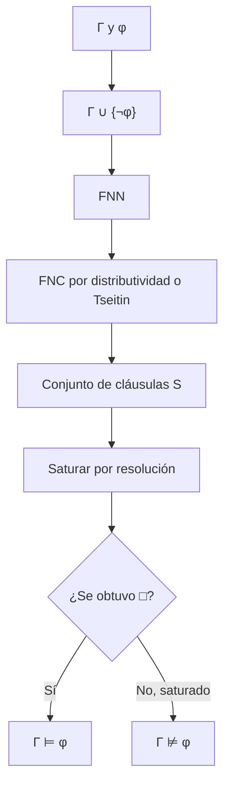

# Lógica Computacional - Lógica proposicional

## 2.6 Resolución binaria: formas normales negativa y conjuntiva, resolución binaria proposicional, algoritmos de saturación, el problema SAT.

---

La **resolución** es un método de refutación con una sola regla de inferencia, muy adecuada para las computadoras. Fue introducida por Robinson (1965) para la lógica de primer orden (tema 5.5), y su versión proposicional es la base de los SAT solvers. Trabaja con fórmulas en **forma clausular**, así que primero hay que transformar las fórmulas. Este tema presenta las formas normales, la regla de resolución, su corrección y completud, y el algoritmo de saturación.

### Forma normal negativa

Un **literal** es una variable $p$ o su negación $\lnot p.$ El **complemento** de un literal $\ell$ se escribe $\overline{\ell}:$ $\overline{p} = \lnot p$ y $\overline{\lnot p} = p.$

**Definición.** Una fórmula está en **forma normal negativa** (FNN) si solo usa $\land,$ $\lor$ y $\lnot,$ y la negación solo aparece frente a variables.

**Algoritmo.** Se aplican, de afuera hacia adentro, las equivalencias

$$ \varphi \to \psi \equiv \lnot \varphi \lor \psi, \qquad \varphi \leftrightarrow \psi \equiv (\varphi \to \psi) \land (\psi \to \varphi) $$

$$ \lnot \lnot \varphi \equiv \varphi, \qquad \lnot (\varphi \land \psi) \equiv \lnot \varphi \lor \lnot \psi, \qquad \lnot (\varphi \lor \psi) \equiv \lnot \varphi \land \lnot \psi $$

junto con $\lnot (\varphi \to \psi) \equiv \varphi \land \lnot \psi.$ Por el teorema de reemplazo de equivalentes (tema 2.2), el resultado es equivalente a la fórmula original. Sin $\leftrightarrow,$ la FNN tiene tamaño lineal; cada $\leftrightarrow$ duplica sus argumentos.

**Ejemplo.** $\lnot (p \leftrightarrow (q \land r)) \equiv (p \land (\lnot q \lor \lnot r)) \lor (\lnot p \land (q \land r)).$

### Formas normales conjuntiva y disyuntiva

Una **cláusula** es una disyunción de literales; una fórmula está en **forma normal conjuntiva** (FNC) si es una conjunción de cláusulas, y en **forma normal disyuntiva** (FND) si es una disyunción de conjunciones de literales:

$$ \text{FNC: } \bigwedge_{i=1}^{m} \bigvee_{j=1}^{k_i} \ell_{ij}, \qquad \text{FND: } \bigvee_{i=1}^{m} \bigwedge_{j=1}^{k_i} \ell_{ij} $$

**Teorema.** Toda fórmula es equivalente a una en FNC y a una en FND.

**Demostración.** Se pasa a FNN y se aplica la distributividad $\varphi \lor (\psi \land \chi) \equiv (\varphi \lor \psi) \land (\varphi \lor \chi)$ hasta que ninguna $\lor$ tenga una $\land$ debajo. Para la FND se usa la distributividad dual, o la construcción por filas de la tabla de verdad del tema 2.3. $\blacksquare$

**La FNC puede ser exponencial.** La fórmula $(a_1 \land b_1) \lor \cdots \lor (a_n \land b_n)$ tiene tamaño lineal, pero su FNC tiene $2^n$ cláusulas, una por cada forma de escoger $a_i$ o $b_i$ en cada término, y no hay una FNC equivalente más corta.

**Forma clausular.** Una cláusula se identifica con el **conjunto** de sus literales, y una FNC con el conjunto de sus cláusulas: $(p \lor \lnot q) \land r$ es $\{\{p, \lnot q\}, \{r\}\}.$ Así se eliminan repeticiones y el orden no importa. La **cláusula vacía**, $\square,$ es la disyunción de cero literales: es **insatisfacible**. Una cláusula que contiene un literal y su complemento es una tautología y se puede eliminar.

### La transformación de Tseitin

Para decidir satisfacibilidad no hace falta una FNC **equivalente**, basta una **equisatisfacible**: satisfacible si y solo si la original lo es. La transformación de **Tseitin** (1968) introduce una variable nueva $x_\psi$ por cada subfórmula no atómica $\psi$ y añade cláusulas que dicen $x_\psi \leftrightarrow (\text{su definición}).$ Para $\psi = \alpha \land \beta,$ con $a$ y $b$ las variables de $\alpha$ y $\beta:$

$$ x_\psi \leftrightarrow (a \land b) \quad \text{da las cláusulas} \quad \{\lnot x_\psi, a\},\ \{\lnot x_\psi, b\},\ \{x_\psi, \lnot a, \lnot b\} $$

y finalmente se añade la cláusula unitaria $\{x_\varphi\}.$ Cada conectivo aporta a lo más cuatro cláusulas de tres literales, así que el resultado es **lineal** en el tamaño de $\varphi.$ Todo modelo de $\varphi$ se extiende a un modelo de las cláusulas, dando a cada $x_\psi$ el valor de $\psi,$ y todo modelo de las cláusulas, restringido a las variables originales, es modelo de $\varphi.$ Así es como los SAT solvers reciben fórmulas arbitrarias.

### La regla de resolución

**Definición.** Si $C_1$ contiene un literal $\ell$ y $C_2$ contiene $\overline{\ell},$ su **resolvente** respecto a $\ell$ es

$$ \frac{C_1 \qquad C_2}{(C_1 \setminus \{\ell\}) \cup (C_2 \setminus \{\overline{\ell}\})} $$

Por ejemplo, $\{p, q, \lnot r\}$ y $\{\lnot p, s\}$ dan $\{q, \lnot r, s\};$ $\{p\}$ y $\{\lnot p\}$ dan $\square.$ La regla generaliza al modus ponens: $\{p\}$ y $\{\lnot p, q\},$ que es $p \to q,$ dan $\{q\}.$ Se resuelve respecto a **un** literal a la vez: $\{p, q\}$ y $\{\lnot p, \lnot q\}$ dan $\{q, \lnot q\}$ o $\{p, \lnot p\},$ ambas tautologías, y nunca $\square.$

**Lema (corrección de la regla).** Si $I$ satisface a $C_1$ y a $C_2,$ satisface a su resolvente.

**Demostración.** Si $I(\ell) = 1,$ entonces $I(\overline{\ell}) = 0$ y algún otro literal de $C_2$ es verdadero; está en el resolvente. Si $I(\ell) = 0,$ algún otro literal de $C_1$ es verdadero, y también está en el resolvente. $\blacksquare$

Una **refutación** de un conjunto de cláusulas $S$ es una sucesión de cláusulas que termina en $\square,$ en la que cada una está en $S$ o es resolvente de dos anteriores.

**Teorema (corrección).** Si $S$ tiene una refutación, $S$ es insatisfacible.

**Demostración.** Por el lema, todo modelo de $S$ satisface cada cláusula de la refutación, incluida $\square,$ que no tiene modelos. $\blacksquare$

**Teorema (completud refutacional).** Si $S$ es finito e insatisfacible, $S$ tiene una refutación.

**Demostración.** Por inducción sobre el número $n$ de variables de $S.$ Si $n = 0,$ las únicas cláusulas posibles son $\square,$ y como $S$ es insatisfacible, $\square \in S.$ Si $n > 0,$ se elige una variable $p.$ Sea $S_p$ el conjunto que resulta de eliminar las cláusulas que contienen $p$ y borrar $\lnot p$ de las demás; es lo que queda de $S$ al hacer $p$ verdadera, y es insatisfacible con $n - 1$ variables. Por hipótesis de inducción, $S_p$ tiene una refutación. Volviendo a poner $\lnot p$ en las cláusulas de donde se borró, la misma derivación desde $S$ termina en $\square$ o en $\{\lnot p\}.$ Del mismo modo, haciendo $p$ falsa se obtiene $\square$ o $\{p\}.$ En el peor caso se tienen $\{\lnot p\}$ y $\{p\},$ cuyo resolvente es $\square.$ $\blacksquare$

La resolución es completa **refutacionalmente**: no genera todas las consecuencias de $S,$ por ejemplo de $\{p\}$ no deriva $\{p, q\},$ pero sí refuta todo conjunto insatisfacible. Para decidir $\Gamma \models \varphi$ se refuta la forma clausular de $\Gamma \cup \{\lnot \varphi\}.$

### Algoritmos de saturación

**Algoritmo de saturación.** Repetir: calcular todos los resolventes de pares de cláusulas del conjunto y añadir los nuevos, descartando las tautologías. Parar cuando aparezca $\square$ (insatisfacible) o cuando no aparezca nada nuevo (**conjunto saturado**: satisfacible).

Termina, porque con $n$ variables solo hay $3^n$ cláusulas posibles: cada variable aparece positiva, negativa o no aparece. Es correcto por los dos teoremas anteriores. Pero el conjunto puede crecer exponencialmente; en la práctica se usan **estrategias** que limitan los pares que se resuelven y **simplificaciones**:

- **Subsunción.** Si $C \subseteq D,$ la cláusula $D$ es redundante y se elimina.
- **Resolución unitaria.** Solo se resuelve con cláusulas de un literal. Es la propagación unitaria de DPLL; es completa para cláusulas de Horn, pero no en general.
- **Eliminación de variables** (Davis y Putnam, 1960). Se eliminan las variables una por una, reemplazando las cláusulas que contienen $p$ o $\lnot p$ por todos sus resolventes respecto a $p,$ exactamente como en la demostración de completud.

### Resolución y el problema SAT

La resolución decide SAT, pero puede requerir refutaciones exponencialmente largas: Haken (1985) demostró que las fórmulas del principio del casillero solo tienen refutaciones de tamaño exponencial. Como SAT es NP-completo (tema 2.4), no se espera que ningún método sea polinomial. El algoritmo **DPLL** del tema 2.4 es, visto de otra manera, una búsqueda de refutaciones: cada rama cerrada de su árbol corresponde a una derivación por resolución. Los solvers **CDCL** modernos registran esas derivaciones como cláusulas aprendidas, y son, en esencia, buscadores de refutaciones por resolución guiados por la búsqueda de modelos.



### Implementación en Python

El programa implementa la FNN, la forma clausular por distributividad y la transformación de Tseitin, y compara el número de cláusulas que producen en la familia $(a_1 \land b_1) \lor \cdots \lor (a_n \land b_n).$ Después satura por resolución los conjuntos de los ejercicios 2 y 4, imprimiendo la refutación cuando la encuentra, y verifica que Tseitin preserva la satisfacibilidad.

```python
from itertools import product

def texto(f):
    if isinstance(f, str): return f
    if f[0] == '¬': return '¬' + texto(f[1])
    return '(' + texto(f[1]) + ' ' + f[0] + ' ' + texto(f[2]) + ')'

# ---------- Forma normal negativa ----------
def fnn(f):
    """Elimina → y ↔ y empuja las negaciones hasta las variables."""
    if isinstance(f, str): return f
    op = f[0]
    if op == '→': return ('∨', fnn(('¬', f[1])), fnn(f[2]))
    if op == '↔': return ('∧', fnn(('→', f[1], f[2])), fnn(('→', f[2], f[1])))
    if op in '∧∨': return (op, fnn(f[1]), fnn(f[2]))
    g = f[1]                                       # op == '¬'
    if isinstance(g, str): return f
    if g[0] == '¬': return fnn(g[1])
    if g[0] == '∧': return ('∨', fnn(('¬', g[1])), fnn(('¬', g[2])))
    if g[0] == '∨': return ('∧', fnn(('¬', g[1])), fnn(('¬', g[2])))
    if g[0] == '→': return ('∧', fnn(g[1]), fnn(('¬', g[2])))
    if g[0] == '↔': return ('∨', fnn(('∧', g[1], ('¬', g[2]))), fnn(('∧', ('¬', g[1]), g[2])))

# ---------- Forma clausular por distributividad ----------
def literal(f):
    return f if isinstance(f, str) else '¬' + f[1]

def fnc(f):
    """Conjunto de cláusulas (frozensets de literales) equivalente a f, sin cláusulas tautológicas."""
    g = fnn(f)
    def go(g):
        if isinstance(g, str) or g[0] == '¬':
            return {frozenset([literal(g)])}
        if g[0] == '∧':
            return go(g[1]) | go(g[2])
        return {a | b for a in go(g[1]) for b in go(g[2])}     # distributividad
    return {c for c in go(g) if not any(complemento(l) in c for l in c)}

def complemento(l):
    return l[1:] if l.startswith('¬') else '¬' + l

def mostrar(c):
    return '{' + ', '.join(sorted(c, key=lambda l: (l.lstrip('¬'), l))) + '}' if c else '□'

# ---------- Transformación de Tseitin ----------
def tseitin(f):
    """Cláusulas equisatisfacibles con f, en tiempo y tamaño lineales."""
    clausulas, contador = [], [0]
    def nombre(g):
        if isinstance(g, str): return g
        contador[0] += 1
        x = f'x{contador[0]}'
        if g[0] == '¬':
            a = nombre(g[1])
            clausulas.extend([{x, a}, {'¬' + x, complemento(a)}])          # x ↔ ¬a
        else:
            a, b = nombre(g[1]), nombre(g[2])
            na, nb, nx = complemento(a), complemento(b), '¬' + x
            if g[0] == '∧': clausulas.extend([{nx, a}, {nx, b}, {x, na, nb}])
            if g[0] == '∨': clausulas.extend([{nx, a, b}, {x, na}, {x, nb}])
            if g[0] == '→': clausulas.extend([{nx, na, b}, {x, a}, {x, nb}])
            if g[0] == '↔': clausulas.extend([{nx, na, b}, {nx, a, nb}, {x, a, b}, {x, na, nb}])
        return x
    raiz = nombre(f)
    return [{raiz}] + clausulas

# ---------- Saturación por resolución ----------
def resolventes(c1, c2):
    return [frozenset((c1 - {l}) | (c2 - {complemento(l)})) for l in sorted(c1) if complemento(l) in c2]

def saturar(clausulas, verbose=True):
    """Añade resolventes no tautológicos hasta obtener □ o saturar. Devuelve True si se obtuvo □."""
    conocidas = list(dict.fromkeys(frozenset(c) for c in clausulas))
    origen = {}
    i = 0
    while i < len(conocidas):
        for j in range(i):
            for r in resolventes(conocidas[i], conocidas[j]):
                if any(complemento(l) in r for l in r) or r in conocidas:
                    continue
                conocidas.append(r)
                origen[r] = (conocidas[j], conocidas[i])
                if not r:
                    if verbose: derivacion(r, origen)
                    return True
        i += 1
    if verbose: print(f'saturado con {len(conocidas)} cláusulas, sin □')
    return False

def derivacion(c, origen, visto=None):
    visto = visto if visto is not None else set()
    if c not in origen or c in visto: return
    visto.add(c)
    a, b = origen[c]
    derivacion(a, origen, visto); derivacion(b, origen, visto)
    print(f'  {mostrar(a):14} {mostrar(b):14} ⟹ {mostrar(c)}')

f = ('↔', 'p', ('∧', 'q', 'r'))
print('FNN:', texto(fnn(('¬', f))))
print('FNC de ¬(p ↔ q):', sorted(mostrar(c) for c in fnc(('¬', ('↔', 'p', 'q')))))

# Crecimiento exponencial de la FNC frente a Tseitin
for n in [2, 4, 6, 8]:
    g = ('∧', f'a1', f'b1')
    for i in range(2, n + 1):
        g = ('∨', g, ('∧', f'a{i}', f'b{i}'))
    print(f'n={n}: FNC {len(fnc(g)):3} cláusulas, Tseitin {len(tseitin(g)):2} cláusulas')

# Ejercicio 2: p ∨ q, ¬p ∨ r, ¬q ∨ s ⊨ r ∨ s
print('Ejercicio 2:')
saturar([{'p', 'q'}, {'¬p', 'r'}, {'¬q', 's'}, {'¬r'}, {'¬s'}])
# Ejercicio 4: (p ∨ q) ∧ (¬p ∨ ¬q) ∧ (p ∨ ¬q) es satisfacible
print('Ejercicio 4:')
saturar([{'p', 'q'}, {'¬p', '¬q'}, {'p', '¬q'}])

# Tseitin preserva la satisfacibilidad: comparación exhaustiva con fórmulas pequeñas
def satisfacible(clausulas):
    vs = sorted({l.lstrip('¬') for c in clausulas for l in c})
    for vals in product([True, False], repeat=len(vs)):
        I = dict(zip(vs, vals))
        if all(any(I[l.lstrip('¬')] != l.startswith('¬') for l in c) for c in clausulas):
            return True
    return False
pruebas = [('∧', 'p', ('¬', 'p')), ('↔', ('→', 'p', 'q'), ('¬', ('∨', 'p', 'q'))),
           ('∧', ('↔', 'p', 'q'), ('↔', 'q', ('¬', 'p'))), ('→', ('∧', 'p', 'q'), 'r')]
print('Tseitin equisatisfacible:', [satisfacible(fnc(g)) == satisfacible(tseitin(g)) for g in pruebas])
```

Salida:

```text
FNN: ((p ∧ (¬q ∨ ¬r)) ∨ (¬p ∧ (q ∧ r)))
FNC de ¬(p ↔ q): ['{p, q}', '{¬p, ¬q}']
n=2: FNC   4 cláusulas, Tseitin 10 cláusulas
n=4: FNC  16 cláusulas, Tseitin 22 cláusulas
n=6: FNC  64 cláusulas, Tseitin 34 cláusulas
n=8: FNC 256 cláusulas, Tseitin 46 cláusulas
Ejercicio 2:
  {¬q, s}        {¬s}           ⟹ {¬q}
  {p, q}         {¬p, r}        ⟹ {q, r}
  {¬r}           {q, r}         ⟹ {q}
  {¬q}           {q}            ⟹ □
Ejercicio 4:
saturado con 5 cláusulas, sin □
Tseitin equisatisfacible: [True, True, True, True]
```

La FNC por distributividad crece como $4^{n/2} = 2^n,$ y la de Tseitin crece de seis en seis cláusulas por término. En el ejercicio 4 la saturación termina sin $\square:$ el conjunto es satisfacible.

### Ejercicios Propuestos

1. **Formas normales.** Convierte a FNC: $(p \to q) \land (q \to r),$ $\lnot (p \leftrightarrow q)$ y $(p \land q) \to r.$

2. **Refutación.** Demuestra por resolución que $p \lor q,$ $\lnot p \lor r,$ $\lnot q \lor s \models r \lor s.$

3. **FND.** Convierte $(p \lor q) \land (\lnot p \lor r)$ a FND y simplifícala.

4. **Saturación.** Satura $\{\{p, q\}, \{\lnot p, \lnot q\}, \{p, \lnot q\}\}$ y encuentra un modelo.

5. **Un error común.** Un estudiante resuelve $\{p, q\}$ y $\{\lnot p, \lnot q\}$ eliminando ambos pares a la vez y obtiene $\square.$ Demuestra que la regla que usó es incorrecta.

6. **Tseitin.** Escribe las cláusulas de Tseitin para $x \leftrightarrow (a \lor b)$ y para $x \leftrightarrow \lnot a.$

### Soluciones

**Ejercicio 1.** $(\lnot p \lor q) \land (\lnot q \lor r).$ Para $\lnot (p \leftrightarrow q),$ la FNN es $(p \land \lnot q) \lor (\lnot p \land q);$ al distribuir salen $(p \lor \lnot p) \land (p \lor q) \land (\lnot q \lor \lnot p) \land (\lnot q \lor q),$ y sin las tautologías queda $(p \lor q) \land (\lnot p \lor \lnot q),$ como da el programa. Finalmente, $(p \land q) \to r \equiv \lnot p \lor \lnot q \lor r,$ una sola cláusula.

**Ejercicio 2.** La negación de $r \lor s$ da **dos** cláusulas unitarias, $\{\lnot r\}$ y $\{\lnot s\}.$ La refutación del programa:

$$ \{\lnot q, s\}, \{\lnot s\} \Rightarrow \{\lnot q\}; \quad \{p, q\}, \{\lnot p, r\} \Rightarrow \{q, r\}; \quad \{\lnot r\}, \{q, r\} \Rightarrow \{q\}; \quad \{\lnot q\}, \{q\} \Rightarrow \square $$

Un error frecuente es negar la conclusión como la cláusula $\{\lnot r, \lnot s\},$ que es $\lnot (r \land s),$ no $\lnot (r \lor s).$

**Ejercicio 3.** Distribuyendo, $(p \land \lnot p) \lor (p \land r) \lor (q \land \lnot p) \lor (q \land r).$ El primer término es contradictorio y se elimina; además $q \land r$ es redundante, porque si $p$ es verdadera vale $p \land r$ y si no, $\lnot p \land q.$ Queda $(p \land r) \lor (\lnot p \land q).$

**Ejercicio 4.** Resolventes: $\{p, q\}$ y $\{p, \lnot q\}$ dan $\{p\};$ $\{\lnot p, \lnot q\}$ y $\{p, \lnot q\}$ dan $\{\lnot q\};$ los demás pares dan tautologías o cláusulas ya presentes. El conjunto saturado tiene 5 cláusulas y no contiene $\square:$ es satisfacible, y $\{p\}$ y $\{\lnot q\}$ fijan el único modelo, $p = 1,$ $q = 0.$

**Ejercicio 5.** $\{p, q\}$ y $\{\lnot p, \lnot q\}$ son satisfacibles juntas, con $p = 1$ y $q = 0.$ Si la regla derivara $\square,$ que no tiene modelos, no sería correcta.

**Ejercicio 6.** $x \leftrightarrow (a \lor b):$ $\{\lnot x, a, b\},$ $\{x, \lnot a\},$ $\{x, \lnot b\}.$ $x \leftrightarrow \lnot a:$ $\{x, a\},$ $\{\lnot x, \lnot a\}.$

### Referencias

1. Ben-Ari, M., _Mathematical Logic for Computer Science_. Springer, 2012. Capítulo 4.
2. Robinson, J. A. (1965). A machine-oriented logic based on the resolution principle. _Journal of the ACM_, 12(1), 23-41.
3. Davis, M., and Putnam, H. (1960). A computing procedure for quantification theory. _Journal of the ACM_, 7(3), 201-215.
4. Tseitin, G. S. (1968). On the complexity of derivation in propositional calculus. En _Studies in Constructive Mathematics and Mathematical Logic_, parte 2, 115-125.
5. Haken, A. (1985). The intractability of resolution. _Theoretical Computer Science_, 39, 297-308.
