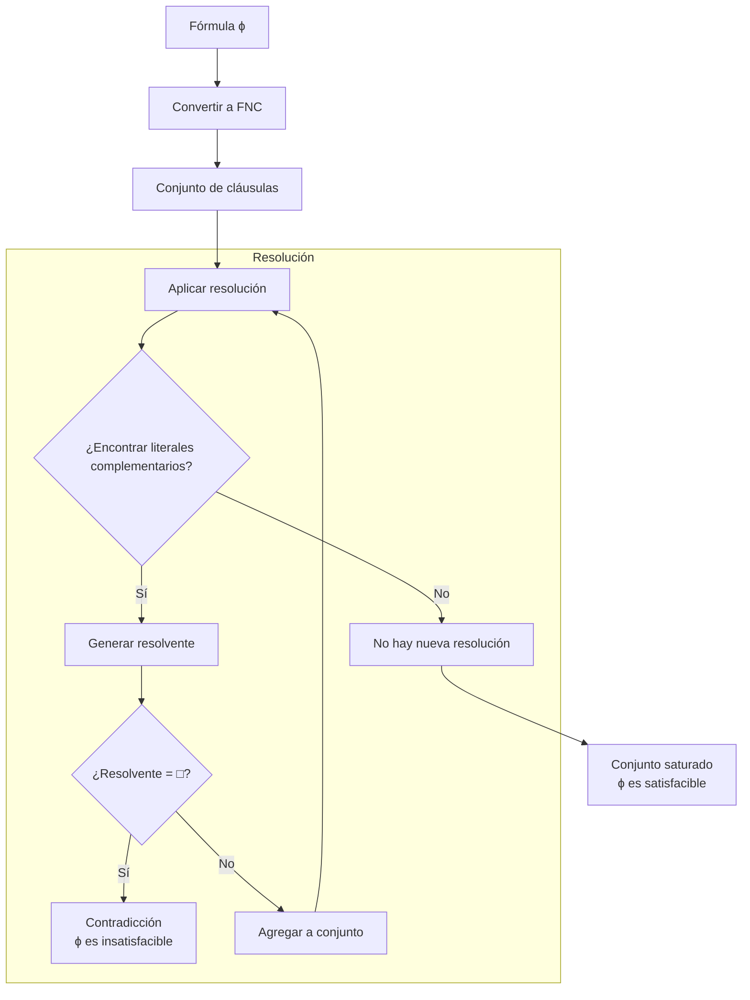

# Lógica Computacional - Lógica proposicional

## 2.6 Resolución binaria: formas normales negativa y conjuntiva, resolución binaria proposicional, algoritmos de saturación, el problema SAT.

---

### 1. Introducción al Método de Resolución

El **método de resolución** es un sistema de inferencia completo para la lógica proposicional que opera sobre fórmulas en forma normal conjuntiva. Fue introducido por J. Alan Robinson en 1965 y es fundamental en demostración automática de teoremas.

### 2. Formas Normales

#### Forma Normal Negativa (FNN):

Una fórmula está en FNN si:

- Solo contiene los conectivos $\neg$, $\land$, $\lor$
- Las negaciones solo se aplican a variables proposicionales

**Algoritmo de conversión a FNN**:

1. Eliminar $\rightarrow$ y $\leftrightarrow$ usando:
   - $\phi \rightarrow \psi \equiv \neg\phi \lor \psi$
   - $\phi \leftrightarrow \psi \equiv (\neg\phi \lor \psi) \land (\phi \lor \neg\psi)$
2. Aplicar las leyes de De Morgan:
   - $\neg(\phi \land \psi) \equiv \neg\phi \lor \neg\psi$
   - $\neg(\phi \lor \psi) \equiv \neg\phi \land \neg\psi$
3. Eliminar dobles negaciones: $\neg\neg\phi \equiv \phi$

#### Forma Normal Conjuntiva (FNC):

Una fórmula en FNN está en FNC si es una conjunción de disyunciones:

$$\bigwedge_{i=1}^n \left(\bigvee_{j=1}^{m_i} l_{ij}\right)$$

donde $l_{ij}$ son literales (variables o sus negaciones).

**Algoritmo de conversión a FNC**:

1. Convertir a FNN
2. Aplicar distributividad: $\phi \lor (\psi \land \theta) \equiv (\phi \lor \psi) \land (\phi \lor \theta)$

### 3. Cláusulas y Resolución Binaria

#### Cláusula:

Disyunción de literales: $l_1 \lor l_2 \lor \ldots \lor l_n$

- Cláusula unitaria: Un solo literal
- Cláusula vacía: $\square$ (representa contradicción)

#### Resolución binaria:

Dadas dos cláusulas que contienen literales complementarios:

$$(A \lor l) \quad \text{y} \quad (B \lor \neg l)$$

donde $A$ y $B$ son disyunciones de literales, la resolución produce:

$$A \lor B$$

**Regla de resolución**:

$$\frac{(A \lor l) \quad (B \lor \neg l)}{A \lor B}$$

### 4. Algoritmo de Saturación por Resolución

#### Refutación por resolución:

Para demostrar que $\Gamma \models \phi$:

1. Convertir $\Gamma \land \neg\phi$ a FNC
2. Aplicar resolución hasta obtener la cláusula vacía $\square$
3. Si se obtiene $\square$, el argumento es válido

```python
def resolucion(clausulas):
    """
    Algoritmo de saturación por resolución
    """
    nuevas = set()
    saturación = set(clausulas)

    while True:
        # Generar todos los resolventes posibles
        resolventes = set()
        for c1 in saturación:
            for c2 in saturación:
                if c1 != c2:
                    resolvente = resolver(c1, c2)
                    if resolvente is not None:
                        resolventes.add(resolvente)

        # Si no hay nuevos resolventes, terminar
        if not resolventes:
            return saturación

        # Si encontramos la cláusula vacía, retornar contradicción
        if frozenset() in resolventes:
            return {frozenset()}  # Cláusula vacía

        # Agregar nuevos resolventes
        saturación |= resolventes

def resolver(clausula1, clausula2):
    """
    Intenta resolver dos cláusulas
    """
    for literal in clausula1:
        complemento = obtener_complemento(literal)
        if complemento in clausula2:
            # Resolver eliminando el literal complementario
            nueva_clausula = (clausula1 - {literal}) | (clausula2 - {complemento})
            return frozenset(nueva_clausula)
    return None

def obtener_complemento(literal):
    """
    Devuelve el complemento de un literal
    """
    if literal.startswith('¬'):
        return literal[1:]
    else:
        return '¬' + literal
```

### 5. El Problema SAT

**SAT**: Problema de determinar si una fórmula en FNC es satisfacible.

- **SAT es NP-completo** (Teorema de Cook, 1971)
- **Algoritmo DPLL**: Método completo para SAT

```python
def dpll(clausulas, asignacion={}):
    """
    Algoritmo DPLL para SAT
    """
    # Simplificación unitaria
    clausulas, asignacion = propagacion_unitaria(clausulas, asignacion)

    # Eliminación de cláusulas satisfechas
    clausulas = [c for c in clausulas if not clausula_satisfecha(c, asignacion)]

    # Si hay cláusula vacía, insatisfacible
    if any(len(c) == 0 for c in clausulas):
        return None

    # Si no hay cláusulas, satisfacible
    if len(clausulas) == 0:
        return asignacion

    # Elegir variable no asignada
    variable = elegir_variable(clausulas, asignacion)

    # Intentar con True
    nueva_asignacion = asignacion.copy()
    nueva_asignacion[variable] = True
    resultado = dpll(propagar(clausulas, variable, True), nueva_asignacion)
    if resultado is not None:
        return resultado

    # Intentar con False
    nueva_asignacion[variable] = False
    return dpll(propagar(clausulas, variable, False), nueva_asignacion)
```

### 6. Diagrama del Proceso de Resolución



### 7. Teorema de Completitud de la Resolución

#### Teorema:

El método de resolución es **completo** para la lógica proposicional: si un conjunto de cláusulas es insatisfacible, entonces la resolución puede derivar la cláusula vacía.

**Demostración**: Por el lema de resolución y el teorema de compacidad.

### 8. Ejemplos de Resolución

#### Ejemplo 1: Modus Ponens

Premisas: $p \rightarrow q$, $p$  
Conclusión: $q$

1. Convertir a cláusulas:
   - $p \rightarrow q \equiv \neg p \lor q$ → Cláusula: $\{\neg p, q\}$
   - $p$ → Cláusula: $\{p\}$
   - $\neg q$ → Cláusula: $\{\neg q\}$

2. Aplicar resolución:
   - Resolver $\{p\}$ y $\{\neg p, q\}$: obtiene $\{q\}$
   - Resolver $\{q\}$ y $\{\neg q\}$: obtiene $\square$

#### Ejemplo 2: Clausula con múltiples literales

Cláusulas: $\{p, q, \neg r\}$ y $\{\neg p, s, t\}$

- Resolvente: $\{q, \neg r, s, t\}$

### 9. Ejercicios Propuestos

#### Ejercicio 1:

Convierta a FNC:

1. $(p \rightarrow q) \land (q \rightarrow r)$
2. $\neg(p \leftrightarrow q)$
3. $(p \land q) \rightarrow r$

#### Ejercicio 2:

Aplique resolución para demostrar la validez de:
Premisas: $p \lor q, \neg p \lor r, \neg q \lor s;$ Conclusión: $r \lor s$

#### Ejercicio 3:

Implemente la función `convertir_a_fnc(formula)` en Python.

#### Ejercicio 4:

Use el algoritmo DPLL para determinar la satisfacibilidad de:

$(p \lor q) \land (\neg p \lor \neg q) \land (p \lor \neg q)$

#### Ejercicio 5:

Demuestre que la resolución es correcta: si se deriva $\square$ de $\Gamma$, entonces $\Gamma$ es insatisfacible.

### 10. Optimizaciones y Variantes

#### Estrategias de resolución:

- **Resolución unitaria**: Siempre resolver con cláusulas unitarias primero
- **Resolución ordenada**: Restringir el orden de aplicación de resoluciones
- **Resolución lineal**: Mantener una cadena lineal de resoluciones

#### Aplicaciones:

- Demostración automática de teoremas
- Verificación de hardware y software
- Sistemas expertos
- Planificación en IA

### 11. Soluciones a Ejercicios Selectos

#### Solución Ejercicio 1:

1. $(p \rightarrow q) \land (q \rightarrow r) \equiv (\neg p \lor q) \land (\neg q \lor r)$
2. $\neg(p \leftrightarrow q) \equiv (p \land \neg q) \lor (\neg p \land q) \equiv (p \lor \neg p) \land (p \lor q) \land (\neg q \lor \neg p) \land (\neg q \lor q)$
3. $(p \land q) \rightarrow r \equiv \neg(p \land q) \lor r \equiv (\neg p \lor \neg q) \lor r$

#### Solución Ejercicio 2:

Cláusulas: $\{p, q\}$, $\{\neg p, r\}$, $\{\neg q, s\}$, $\{\neg r, \neg s\}$

1. Resolver $\{p, q\}$ y $\{\neg p, r\}$: $\{q, r\}$
2. Resolver $\{q, r\}$ y $\{\neg q, s\}$: $\{r, s\}$
3. Resolver $\{r, s\}$ y $\{\neg r, \neg s\}$: $\{s, \neg s\} \equiv \square$

#### Solución Ejercicio 4:

La fórmula es satisfacible. Modelos:

- $I(p) = \top$, $I(q) = \bot$
- $I(p) = \bot$, $I(q) = \top$

#### Implementación de conversión a FNC:

```python
def convertir_a_fnc(formula):
    """Convierte una fórmula a Forma Normal Conjuntiva"""
    # Eliminar implicaciones y bicondicionales
    formula = eliminar_implicaciones(formula)

    # Aplicar leyes de De Morgan y eliminar dobles negaciones
    formula = aplicar_de_morgan(formula)

    # Aplicar distributividad
    formula = aplicar_distributividad(formula)

    return formula

def eliminar_implicaciones(formula):
    """Elimina → y ↔ usando equivalencias lógicas"""
    if '→' in formula:
        partes = formula.split(' → ')
        return f"(¬{partes[0]} ∨ {partes[1]})"
    elif '↔' in formula:
        partes = formula.split(' ↔ ')
        return f"((¬{partes[0]} ∨ {partes[1]}) ∧ ({partes[0]} ∨ ¬{partes[1]}))"
    return formula
```

### 12. Referencias

#### Bibliografía Básica:

1. Huth M., Ryan M. (2004). _Logic in Computer Science_. Capítulo 1.
2. Nerode A., Shore R.A. (1997). _Logic for Applications_. Capítulo 2.

#### Bibliografía Complementaria:

1. Ben-Ari M. (2008). _Mathematical Logic for Computer Science_. Capítulo 2.
2. Robinson, J. A. (1965). _A Machine-Oriented Logic Based on the Resolution Principle_.
3. Davis, M., Putnam, H. (1960). _A Computing Procedure for Quantification Theory_.
