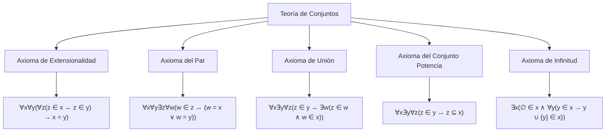
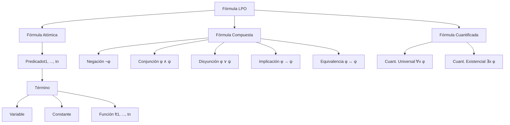

# Lógica Computacional - Lógica de predicados de primer orden

## 3.1 Sintaxis y ejemplos de especificación formal.

---

### 1. Introducción a la Lógica de Primer Orden

La **lógica de predicados de primer orden** (LPO) extiende la lógica proposicional al permitir expresar propiedades sobre objetos y relaciones entre ellos mediante cuantificadores. Es fundamental para la especificación formal de sistemas y el razonamiento automatizado.

### 2. Alfabeto y Símbolos

El alfabeto de la LPO consiste en:

#### Símbolos lógicos:

- Conectivos lógicos: ¬, ∧, ∨, →, ↔
- Cuantificadores: ∀ (universal), ∃ (existencial)
- Símbolos de igualdad: = (opcional)
- Paréntesis: (, )

#### Símbolos no lógicos:

- Variables: x, y, z, ...
- Constantes: a, b, c, ...
- Functores (símbolos de función): f, g, h, ... con aridad ≥ 1
- Relatores (símbolos de predicado): P, Q, R, ... con aridad ≥ 0

### 3. Términos y Fórmulas

#### Términos:

Los términos denotan objetos en el dominio y se definen recursivamente:

1. Toda variable es un término
2. Toda constante es un término
3. Si f es un functor n-ario y t₁, ..., tₙ son términos, entonces f(t₁, ..., tₙ) es un término

#### Fórmulas atómicas:

Si P es un relator n-ario y t₁, ..., tₙ son términos, entonces P(t₁, ..., tₙ) es una fórmula atómica.

#### Fórmulas bien formadas (FBF):

1. Toda fórmula atómica es una FBF
2. Si φ es una FBF, entonces ¬φ es una FBF
3. Si φ y ψ son FBF, entonces (φ ∧ ψ), (φ ∨ ψ), (φ → ψ), (φ ↔ ψ) son FBF
4. Si φ es una FBF y x es una variable, entonces ∀x φ y ∃x φ son FBF

### 4. Ámbito de Variables y Variables Libres/Ligadas

- **Variable libre**: Aparece en una fórmula sin estar bajo el alcance de un cuantificador
- **Variable ligada**: Está cuantificada (bajo el alcance de ∀ o ∃)

**Fórmula cerrada**: No contiene variables libres
**Fórmula abierta**: Contiene al menos una variable libre

### 5. Especificación Formal con LPO

#### Ejemplo 1: Aritmética

```
Símbolos:
  Constantes: 0
  Functores: s (sucesor, aridad 1), + (suma, aridad 2), * (producto, aridad 2)
  Relatores: = (igualdad, aridad 2), < (menor que, aridad 2)

Axiomas:
  ∀x ¬(s(x) = 0)
  ∀x∀y (s(x) = s(y) → x = y)
  ∀x (x + 0 = x)
  ∀x∀y (x + s(y) = s(x + y))
  ∀x (x * 0 = 0)
  ∀x∀y (x * s(y) = (x * y) + x)
```

#### Ejemplo 2: Teoría de Conjuntos



#### Ejemplo 3: Especificación de un Sistema de Reservas

```
Símbolos:
  Constantes: usuario1, usuario2, recursoA, recursoB
  Relatores:
    PuedeReservar(u, r)  // el usuario u puede reservar el recurso r
    Reservado(r)         // el recurso r está reservado
    EsAdmin(u)           // el usuario u es administrador

Axiomas:
  ∀u∀r (PuedeReservar(u, r) ↔ (¬Reservado(r) ∨ EsAdmin(u)))
  ∀r (Reservado(r) → ∃u ReservadoPor(r, u))
  ∀u (EsAdmin(u) → ∀r PuedeReservar(u, r))
```

### 6. Ejercicios Propuestos

#### Ejercicio 1

Formalizar en LPO: "Todo número natural es par o impar, pero no ambos"

#### Ejercicio 2

Formalizar: "Existe exactamente un elemento que cumple la propiedad P"

#### Ejercicio 3

Dada la signatura Σ = {a/0, b/0, f/1, P/2}, determinar cuáles de las siguientes son fórmulas bien formadas:

1. P(a, f(b))
2. ∀x P(x, f(x))
3. P(a, b) ∧ ∀x
4. ∃x (P(x, y) → ∀y Q(y))

#### Ejercicio 4

Especificar formalmente un sistema de biblioteca con los predicados:

- Libro(l), Usuario(u), Prestado(l, u), Disponible(l)

### 7. Código de Ejemplo: Analizador Sintáctico Simple

```python
class FirstOrderParser:
    def __init__(self):
        self.tokens = []
        self.current = 0

    def parse_term(self):
        # Implementación de análisis de términos
        pass

    def parse_formula(self):
        # Implementación de análisis de fórmulas
        pass

    def parse_quantifier(self):
        # Análisis de cuantificadores
        pass

# Ejemplo de uso
parser = FirstOrderParser()
formula = "∀x∃y (P(x, y) ∧ Q(f(x), a))"
try:
    ast = parser.parse(formula)
    print("Fórmula válida")
except SyntaxError as e:
    print(f"Error de sintaxis: {e}")
```

### 8. Diagrama: Estructura de una Fórmula LPO



### 9. Soluciones a Ejercicios Selectos

#### Solución Ejercicio 2:

"Existe exactamente un elemento que cumple P" puede formalizarse como:

$$∃x (P(x) ∧ ∀y (P(y) → y = x))$$

#### Solución Ejercicio 3:

1. ✓ Fórmula bien formada
2. ✓ Fórmula bien formada
3. ✗ Fórmula mal formada (cuantificador incompleto)
4. ✗ Fórmula mal formada (Q no definido en la signatura)

### 10. Referencias

#### Bibliografía Básica:

1. Huth M., Ryan M. (2004). _Logic in Computer Science, modelling and reasoning about systems_. 2nd Edition, Cambridge University Press. (Capítulos 1-2)
2. Nerode A., Shore R.A. (1997). _Logic for Applications_. 2nd Edition. Springer. (Capítulo 2)

#### Bibliografía Complementaria:

1. Ben-Ari M. (2008). _Mathematical Logic for Computer Science_. 2nd Edition, Springer. (Capítulo 4)
2. Fitting M. (1996). _First-Order Logic and Automated Theorem Proving_. 2nd Edition. Springer. (Capítulo 2)
3. Sperschneider V., Antoniou G. (1991). _Logic, A Foundation for Computer Science_. Addison-Wesley. (Capítulo 5)
