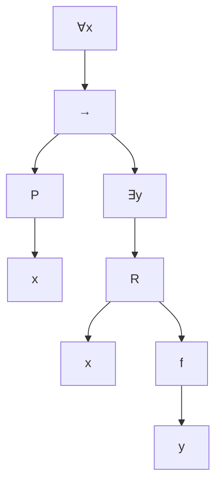

# Lógica Computacional - Lógica de predicados de primer orden

## 3.1 Sintaxis y ejemplos de especificación formal.

---

La lógica proposicional trata los enunciados como bloques indivisibles: "todo número primo mayor que 2 es impar" sería una sola variable $p,$ sin relación con "7 es impar". La **lógica de primer orden** (LPO) mira dentro de los enunciados: tiene **términos** que denotan objetos, **predicados** que expresan propiedades y relaciones, y **cuantificadores** que hablan de todos o de algunos objetos. Es el lenguaje estándar de las matemáticas y de la especificación de programas. Este tema presenta su sintaxis y cómo usarla para especificar.

### Signaturas

El vocabulario depende de lo que se quiera describir. Una **signatura** (o lenguaje) $\Sigma$ consta de:

- **Símbolos de constante,** como $0,$ $a,$ $\text{ana}.$
- **Símbolos de función,** cada uno con una **aridad** $n \geq 1,$ como $s$ (sucesor, aridad 1) o $+$ (aridad 2).
- **Símbolos de predicado,** cada uno con una aridad $n \geq 0,$ como $\text{Primo}$ (aridad 1) o $\lt$ (aridad 2). Los de aridad 0 son variables proposicionales.

Además, toda signatura comparte los **símbolos lógicos**: un conjunto infinito de variables $x, y, z, x_1, \ldots,$ los conectivos $\lnot, \land, \lor, \to, \leftrightarrow,$ los cuantificadores $\forall$ y $\exists,$ los paréntesis y, en la **lógica con igualdad**, el predicado $=,$ cuyo significado está fijo.

Las constantes pueden verse como funciones de aridad 0. Se escribe $f/n$ para indicar que $f$ tiene aridad $n;$ por ejemplo, la signatura de la aritmética es $\{0/0, s/1, +/2, \cdot/2, \lt/2\}.$

### Términos y fórmulas

**Definición.** Los **términos** sobre $\Sigma$ son el menor conjunto tal que:

1. Toda variable y toda constante es un término.
2. Si $f/n \in \Sigma$ y $t_1, \ldots, t_n$ son términos, $f(t_1, \ldots, t_n)$ es un término.

Los términos denotan **objetos**: $s(s(0)),$ $x + s(y),$ $\text{madre}(\text{ana}).$ No son verdaderos ni falsos.

**Definición.** Las **fórmulas** sobre $\Sigma$ son el menor conjunto tal que:

1. Si $P/n \in \Sigma$ y $t_1, \ldots, t_n$ son términos, $P(t_1, \ldots, t_n)$ es una fórmula **atómica**; también $t_1 = t_2$ en la lógica con igualdad.
2. Si $\varphi$ y $\psi$ son fórmulas, también lo son $\lnot \varphi$ y $(\varphi \circ \psi)$ para $\circ \in \{\land, \lor, \to, \leftrightarrow\}.$
3. Si $\varphi$ es una fórmula y $x$ una variable, $\forall x\, \varphi$ y $\exists x\, \varphi$ son fórmulas.

En BNF, con $t$ para términos:

$$ t ::= x \mid c \mid f(t, \ldots, t) \qquad \varphi ::= P(t, \ldots, t) \mid t = t \mid \lnot \varphi \mid (\varphi \circ \varphi) \mid \forall x\, \varphi \mid \exists x\, \varphi $$

**Convenciones.** Los cuantificadores ligan más que los conectivos binarios: $\forall x\, P(x) \to Q(x)$ significa $(\forall x\, P(x)) \to Q(x).$ Para que el cuantificador abarque la implicación se escribe $\forall x\, (P(x) \to Q(x)).$ Para símbolos binarios usuales se usa notación infija, $x + y$ y $x < y.$ Se abrevia $\forall x\, \forall y$ como $\forall x y.$

**Lo que no es una fórmula.** $\forall P\, P(x)$ cuantifica un predicado, lo que no está permitido en **primer** orden (lo permite la lógica de segundo orden, tema 7.3). $P(Q(x))$ aplica un predicado a una fórmula. $f(x) \land P(x)$ usa un término como fórmula.

### Variables libres y ligadas

En $\forall x\, \varphi,$ la fórmula $\varphi$ es el **alcance** del cuantificador, y las apariciones de $x$ en ella están **ligadas**. Una aparición que no está en el alcance de ningún cuantificador sobre su variable es **libre**. En

$$ \forall x\, (P(x, y) \to \exists y\, Q(y)) $$

$x$ está ligada, la primera aparición de $y$ es libre y la segunda está ligada por $\exists y.$ Una fórmula sin variables libres es un **enunciado**: su verdad depende solo de la interpretación. Una con variables libres expresa una condición sobre ellas, como $\exists y\, (x = 2 \cdot y),$ que dice que $x$ es par. El tema 3.2 define estas nociones por recursión.

### Patrones de formalización

Las formas básicas del lenguaje natural tienen traducciones fijas:

| Español | Fórmula |
| --- | --- |
| Todo $A$ es $B$ | $\forall x\, (A(x) \to B(x))$ |
| Algún $A$ es $B$ | $\exists x\, (A(x) \land B(x))$ |
| Ningún $A$ es $B$ | $\forall x\, (A(x) \to \lnot B(x))$ |
| No todo $A$ es $B$ | $\exists x\, (A(x) \land \lnot B(x))$ |
| Hay exactamente un $A$ | $\exists x\, (A(x) \land \forall y\, (A(y) \to y = x))$ |
| Hay al menos dos $A$ | $\exists x\, \exists y\, (A(x) \land A(y) \land x \neq y)$ |

**Errores frecuentes.**

- $\forall x\, (A(x) \land B(x))$ dice que **todo** es $A$ y $B,$ no que todo $A$ sea $B.$
- $\exists x\, (A(x) \to B(x))$ es casi siempre verdadera: basta un $x$ que no sea $A.$
- El orden de cuantificadores distintos importa: $\forall x\, \exists y\, \text{Madre}(y, x),$ todos tienen madre, frente a $\exists y\, \forall x\, \text{Madre}(y, x),$ alguien es madre de todos.

### Ejemplos de especificación formal

**Aritmética de Peano.** Con la signatura $\{0, s, +, \cdot\}$ y la igualdad:

$$ \forall x\, \lnot (s(x) = 0), \qquad \forall x y\, (s(x) = s(y) \to x = y) $$

$$ \forall x\, (x + 0 = x), \qquad \forall x y\, (x + s(y) = s(x + y)) $$

$$ \forall x\, (x \cdot 0 = 0), \qquad \forall x y\, (x \cdot s(y) = x \cdot y + x) $$

junto con el **esquema de inducción**: para cada fórmula $\varphi(x),$ el axioma $\varphi(0) \land \forall x\, (\varphi(x) \to \varphi(s(x))) \to \forall x\, \varphi(x).$ Con ellos se definen otras nociones; por ejemplo, $x$ divide a $y$ es $\exists z\, (x \cdot z = y)$ y $x \leq y$ es $\exists z\, (x + z = y).$

**Especificación de un programa de ordenamiento.** Con arreglos representados por una función $a$ de índices a valores y su longitud $n,$ la salida $b$ debe estar **ordenada**,

$$ \forall i\, \forall j\, (0 \leq i < j < n \to b(i) \leq b(j)) $$

y ser una **permutación** de la entrada: cada valor aparece en $b$ tantas veces como en $a.$ Sin la segunda condición, un programa que devuelve un arreglo de ceros cumpliría la especificación: es el tipo de omisión que la formalización hace visible.

**Grafos.** Con un predicado binario $E$ para las aristas: el grafo no tiene lazos, $\forall x\, \lnot E(x, x);$ es no dirigido, $\forall x y\, (E(x, y) \to E(y, x));$ todo vértice tiene un vecino, $\forall x\, \exists y\, E(x, y);$ y no tiene triángulos, $\lnot \exists x y z\, (E(x, y) \land E(y, z) \land E(z, x)).$ En cambio, "el grafo es conexo" **no** se puede expresar en primer orden, un resultado que se demuestra con compacidad.

**Un sistema de reservas.** Con $\text{Admin}/1,$ $\text{Reservado}/2,$ donde $\text{Reservado}(r, u)$ significa que el recurso $r$ está reservado por el usuario $u,$ y $\text{Puede}/2:$

$$ \forall r\, \forall u\, \forall v\, (\text{Reservado}(r, u) \land \text{Reservado}(r, v) \to u = v) $$

$$ \forall u\, \forall r\, \big(\text{Puede}(u, r) \leftrightarrow \text{Admin}(u) \lor \lnot \exists v\, \text{Reservado}(r, v)\big) $$

La primera dice que un recurso no se reserva a dos usuarios; la segunda, que se puede reservar un recurso si se es administrador o si está libre.

### Árbol de sintaxis

Como en la lógica proposicional, las fórmulas tienen árboles de sintaxis, ahora con nodos para los cuantificadores y subárboles para los términos. Para $\forall x\, (P(x) \to \exists y\, R(x, f(y))):$



### Implementación en Python

En un dominio finito, $\forall x \in D$ es `all(... for x in D)` y $\exists x \in D$ es `any(... for x in D)`, así que una especificación en LPO sobre un dominio finito se vuelve un programa que la **verifica**. El programa escribe así la especificación de ordenamiento y la usa para probar cuatro funciones con todas las listas de hasta cuatro elementos entre 0 y 2. Después evalúa una fórmula de existencia y unicidad y muestra que el orden de los cuantificadores cambia el significado.

```python
from itertools import product

# Cuantificadores acotados: ∀x ∈ D. φ(x) es all(...), ∃x ∈ D. φ(x) es any(...)

def ordenado(a):
    n = len(a)
    return all(a[i] <= a[j] for i in range(n) for j in range(n) if i < j)

def permutacion(a, b):
    # ∀x (número de apariciones de x en a = número de apariciones en b)
    return len(a) == len(b) and all(a.count(x) == b.count(x) for x in a + b)

def cumple_especificacion(ordenar, entrada):
    salida = ordenar(list(entrada))
    return ordenado(salida) and permutacion(list(entrada), salida)

candidatos = {
    'sorted': sorted,
    'quita_repetidos': lambda a: sorted(set(a)),
    'invierte': lambda a: a[::-1],
    'minimo_al_frente': lambda a: [min(a)] + a[1:] if a else a,
}
pruebas = [list(t) for n in range(5) for t in product(range(3), repeat=n)]
for nombre, f in candidatos.items():
    fallas = [e for e in pruebas if not cumple_especificacion(f, e)]
    print(f'{nombre:20}', 'cumple' if not fallas else f'falla, p. ej. con {fallas[0]}')

# Existencia y unicidad: ∃x (P(x) ∧ ∀y (P(y) → y = x))
def existe_unico(D, P):
    return any(P(x) and all((not P(y)) or y == x for y in D) for x in D)

D = range(1, 20)
print('único par primo:', existe_unico(D, lambda x: x % 2 == 0 and all(x % d for d in range(2, x))))
print('único múltiplo de 7:', existe_unico(D, lambda x: x % 7 == 0))

# El orden de los cuantificadores importa
R = lambda x, y: y == (x + 1) % 5
D5 = range(5)
print('∀x∃y R(x, y):', all(any(R(x, y) for y in D5) for x in D5))
print('∃y∀x R(x, y):', any(all(R(x, y) for x in D5) for y in D5))
```

Salida:

```text
sorted               cumple
quita_repetidos      falla, p. ej. con [0, 0]
invierte             falla, p. ej. con [0, 1]
minimo_al_frente     falla, p. ej. con [1, 0]
único par primo: True
único múltiplo de 7: False
∀x∃y R(x, y): True
∃y∀x R(x, y): False
```

Quitar repetidos produce una lista ordenada, pero no una permutación: la especificación lo detecta con $[0, 0].$ Con la relación $R(x, y)$ que dice $y = x + 1$ módulo 5, todo $x$ tiene un sucesor, pero ningún $y$ es sucesor de todos.

### Ejercicios Propuestos

1. **Traducción.** Formaliza "todo número natural es par o impar, pero no ambos", con los predicados $N,$ $\text{Par}$ e $\text{Impar}.$

2. **Exactamente dos.** Formaliza que hay exactamente dos elementos con la propiedad $P.$

3. **Reconocimiento.** Con la signatura $\{a/0, b/0, f/1, P/2\},$ decide cuáles son fórmulas: (a) $P(a, f(b));$ (b) $\forall x\, P(x, f(x));$ (c) $P(a, b) \land \forall x;$ (d) $\exists x\, (P(x, y) \to \forall y\, Q(y));$ (e) $f(P(a, b)).$

4. **Variables libres.** En la fórmula $\exists x\, (P(x, y) \to \forall y\, R(y, z)) \land Q(x),$ indica qué apariciones de variables son libres y cuáles ligadas.

5. **Biblioteca.** Con $\text{Libro}/1,$ $\text{Usuario}/1$ y $\text{Prestado}/2,$ especifica: cada libro prestado lo tiene un solo usuario; ningún usuario tiene más de dos libros; un libro está disponible si y solo si nadie lo tiene.

6. **Búsqueda binaria.** Especifica qué debe devolver una función que busca el valor $v$ en un arreglo ordenado $a$ de longitud $n:$ un índice $k$ con $a(k) = v$ si existe, y $-1$ si no.

### Soluciones

**Ejercicio 1.**

$$ \forall x\, \big(N(x) \to (\text{Par}(x) \lor \text{Impar}(x)) \land \lnot (\text{Par}(x) \land \text{Impar}(x))\big) $$

**Ejercicio 2.**

$$ \exists x\, \exists y\, \big(P(x) \land P(y) \land x \neq y \land \forall z\, (P(z) \to z = x \lor z = y)\big) $$

**Ejercicio 3.** Son fórmulas (a) y (b). (c) no lo es, porque a $\forall x$ le falta la fórmula. (d) no lo es en esta signatura, porque $Q$ no está en ella; con $Q/1$ añadida sí lo sería, con $y$ libre en $P(x, y).$ (e) no lo es: $f$ se aplica a términos, y $P(a, b)$ es una fórmula.

**Ejercicio 4.** La $x$ de $P(x, y)$ está ligada por $\exists x;$ la $y$ de $P(x, y)$ es libre; la $y$ de $R(y, z)$ está ligada por $\forall y;$ $z$ es libre; y la $x$ de $Q(x)$ es libre, porque está fuera del alcance de $\exists x,$ que solo abarca el paréntesis.

**Ejercicio 5.**

$$ \forall l\, \forall u\, \forall v\, (\text{Prestado}(l, u) \land \text{Prestado}(l, v) \to u = v) $$

$$ \forall u\, \lnot \exists l_1\, \exists l_2\, \exists l_3\, \big(\text{Prestado}(l_1, u) \land \text{Prestado}(l_2, u) \land \text{Prestado}(l_3, u) \land l_1 \neq l_2 \land l_1 \neq l_3 \land l_2 \neq l_3\big) $$

$$ \forall l\, \big(\text{Libro}(l) \to (\text{Disponible}(l) \leftrightarrow \lnot \exists u\, \text{Prestado}(l, u))\big) $$

con un predicado $\text{Disponible}/1$ añadido a la signatura.

**Ejercicio 6.** Si $k$ es el resultado:

$$ \big(\exists i\, (0 \leq i < n \land a(i) = v) \to 0 \leq k < n \land a(k) = v\big) \land \big(\lnot \exists i\, (0 \leq i < n \land a(i) = v) \to k = -1\big) $$

La precondición es que $a$ esté ordenado; sin ella, la búsqueda binaria no está obligada a cumplir la especificación.

### Referencias

1. Huth, M., and Ryan, M., _Logic in Computer Science_. Cambridge University Press, 2004. Secciones 2.1 y 2.2.
2. Ben-Ari, M., _Mathematical Logic for Computer Science_. Springer, 2012. Capítulo 7.
3. Enderton, H. B., _A Mathematical Introduction to Logic_. Academic Press, 2001. Secciones 2.1 y 2.2.
4. Barwise, J., and Etchemendy, J., _Language, Proof and Logic_. CSLI, 2002. Capítulos 9 a 11.
