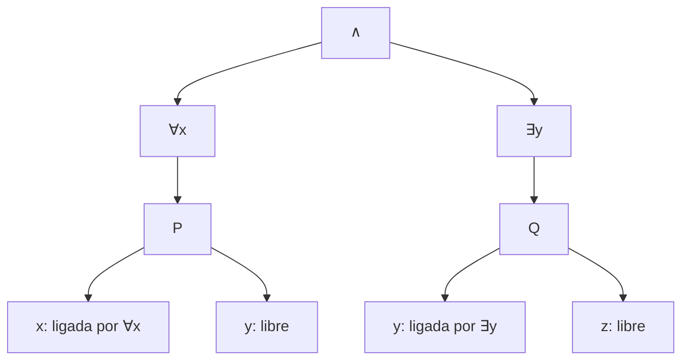

# Lógica Computacional - Lógica de predicados de primer orden

## 3.2 Conceptos sintácticos: recursion e inducción estructural en términos y fórmulas, ligado de variables.

---

Los términos y las fórmulas de la lógica de primer orden se definen recursivamente (tema 3.1), así que, igual que en la lógica proposicional, admiten **recursión** e **inducción estructural**. La novedad es que ahora hay **dos** niveles, términos y fórmulas, y que los cuantificadores **ligan** variables. Este tema formaliza ambas cosas; con ellas se define en el tema 3.3 la sustitución, la operación más delicada de la sintaxis de primer orden.

### Inducción y recursión sobre términos

**Principio de inducción para términos.** Sea $P$ una propiedad de términos. Si $P(x)$ vale para toda variable, $P(c)$ para toda constante, y $P(t_1), \ldots, P(t_n)$ implican $P(f(t_1, \ldots, t_n))$ para todo símbolo de función $f/n,$ entonces $P(t)$ vale para todo término $t.$

**Recursión sobre términos.** Una función sobre términos queda definida dando su valor en variables y constantes y, para cada $f/n,$ cómo obtener el valor en $f(t_1, \ldots, t_n)$ a partir de los valores en los $t_i.$ Por ejemplo, las **variables** de un término:

$$ \text{var}(x) = \{x\}, \qquad \text{var}(c) = \emptyset, \qquad \text{var}(f(t_1, \ldots, t_n)) = \text{var}(t_1) \cup \cdots \cup \text{var}(t_n) $$

y sus **subtérminos**, $\text{st}(x) = \{x\},$ $\text{st}(c) = \{c\}$ y $\text{st}(f(t_1, \ldots, t_n)) = \{f(t_1, \ldots, t_n)\} \cup \text{st}(t_1) \cup \cdots \cup \text{st}(t_n).$ Un término sin variables es **cerrado** o **básico**, como $s(s(0)).$

**Ejemplo.** Todo término tiene dos paréntesis por cada aparición de un símbolo de función de aridad al menos 1.

**Demostración.** Sea $\pi(t)$ el número de paréntesis y $\phi(t)$ el de apariciones de símbolos de función. Para variables y constantes, ambos son 0. Para $t = f(t_1, \ldots, t_n),$ por hipótesis de inducción $\pi(t_i) = 2\phi(t_i),$ así que

$$ \pi(t) = 2 + \sum_{i=1}^{n} \pi(t_i) = 2 + 2\sum_{i=1}^{n} \phi(t_i) = 2\Big(1 + \sum_{i=1}^{n} \phi(t_i)\Big) = 2\phi(t). \ \blacksquare $$

### Inducción y recursión sobre fórmulas

Para fórmulas hay un caso por cada regla de formación. Los casos atómicos usan las funciones ya definidas sobre términos, y hay un caso nuevo para los cuantificadores.

**Principio de inducción para fórmulas.** Si $P$ vale para las fórmulas atómicas, $P(\varphi)$ implica $P(\lnot \varphi),$ $P(\varphi)$ y $P(\psi)$ implican $P(\varphi \circ \psi),$ y $P(\varphi)$ implica $P(\forall x\, \varphi)$ y $P(\exists x\, \varphi)$ para toda variable $x,$ entonces $P$ vale para toda fórmula.

**Ejemplo de recursión: profundidad de cuantificadores.** Mide cuántos cuantificadores anidados hay, y se usa para medir la complejidad de una fórmula:

$$ \text{pc}(\varphi) = 0 \text{ si } \varphi \text{ es atómica}, \quad \text{pc}(\lnot \varphi) = \text{pc}(\varphi), \quad \text{pc}(\varphi \circ \psi) = \max(\text{pc}(\varphi), \text{pc}(\psi)), \quad \text{pc}(Q x\, \varphi) = 1 + \text{pc}(\varphi) $$

donde $Q$ es $\forall$ o $\exists.$

Como en el caso proposicional, la **lectura única** garantiza que estas definiciones dan funciones bien definidas: cada término o fórmula se descompone de una sola manera.

### Variables libres y ligadas

Una **aparición** de una variable $x$ en una fórmula es **ligada** si está dentro del alcance de un cuantificador $\forall x$ o $\exists x,$ y **libre** si no. La misma variable puede aparecer libre y ligada en una fórmula.

**Definición (variables libres).** $\text{VL}(\varphi)$ se define por recursión:

$$ \begin{aligned} \text{VL}(P(t_1, \ldots, t_n)) &= \text{var}(t_1) \cup \cdots \cup \text{var}(t_n) \\ \text{VL}(\lnot \varphi) &= \text{VL}(\varphi) \\ \text{VL}(\varphi \circ \psi) &= \text{VL}(\varphi) \cup \text{VL}(\psi) \\ \text{VL}(Q x\, \varphi) &= \text{VL}(\varphi) \setminus \{x\} \end{aligned} $$

El último caso es el que importa: el cuantificador **elimina** a $x$ de las libres.

**Definición (variables ligadas).** $\text{VG}(\varphi)$ es el conjunto de variables con alguna aparición ligada:

$$ \text{VG}(\text{atómica}) = \emptyset, \quad \text{VG}(\lnot \varphi) = \text{VG}(\varphi), \quad \text{VG}(\varphi \circ \psi) = \text{VG}(\varphi) \cup \text{VG}(\psi) $$

$$ \text{VG}(Q x\, \varphi) = \text{VG}(\varphi) \cup \{x\} \text{ si } x \text{ aparece en } \varphi, \text{ y } \text{VG}(\varphi) \text{ si no} $$

Algunos textos incluyen siempre la variable cuantificada, aunque el cuantificador sea **vacuo**, como en $\forall x\, P(a).$

**Ejemplo.** En $\forall x\, P(x, y) \land \exists y\, Q(y, z)$ hay dos alcances: $x$ y la $y$ de $Q(y, z)$ están ligadas; la $y$ de $P(x, y)$ y la $z$ son libres. Así, $\text{VL} = \{y, z\}$ y $\text{VG} = \{x, y\}.$



En el árbol de sintaxis, una aparición de $x$ está ligada si en el camino hacia la raíz hay un nodo $\forall x$ o $\exists x;$ el más cercano es el que la liga.

**Enunciados.** Una fórmula $\varphi$ es un **enunciado** (o fórmula cerrada) si $\text{VL}(\varphi) = \emptyset.$ La notación $\varphi(x_1, \ldots, x_n)$ indica que $\text{VL}(\varphi) \subseteq \{x_1, \ldots, x_n\}.$ La **cerradura universal** de $\varphi(x_1, \ldots, x_n)$ es el enunciado $\forall x_1 \cdots \forall x_n\, \varphi.$

**Proposición.** Para toda fórmula, $\text{VL}(\varphi) \cup \text{VG}(\varphi)$ es el conjunto de variables que aparecen en $\varphi$ fuera de los cuantificadores.

**Demostración.** Por inducción sobre $\varphi.$ En las atómicas, todas las variables son libres. En la negación y los conectivos, se unen los conjuntos de las subfórmulas. En $Q x\, \varphi,$ las variables de $\varphi$ distintas de $x$ conservan su condición; $x,$ si aparece en $\varphi,$ pasa a $\text{VG}$ y, aunque deja de estar en $\text{VL},$ sigue en la unión. $\blacksquare$

### Por qué importa el ligado

Las variables ligadas son **mudas**: $\forall x\, P(x)$ y $\forall y\, P(y)$ dicen lo mismo, como $\sum_{i=1}^{n} i$ y $\sum_{j=1}^{n} j$ denotan el mismo número. Las libres, en cambio, son **parámetros**: $\exists y\, (x = 2y)$ y $\exists y\, (z = 2y)$ hablan de objetos distintos. Por eso, al sustituir una variable libre por un término hay que evitar que las variables del término queden **capturadas** por un cuantificador. En $\exists y\, (x = 2y),$ que dice que $x$ es par, reemplazar ingenuamente $x$ por $y + 1$ daría $\exists y\, (y + 1 = 2y),$ que dice algo totalmente distinto. El tema 3.3 resuelve este problema.

### Implementación en Python

El programa representa términos y fórmulas como tuplas y define por recursión estructural las variables de un término, sus subtérminos, las variables libres y ligadas y la profundidad de cuantificadores. La función `apariciones` recorre la fórmula llevando la lista de variables ligadas por los cuantificadores que ya atravesó, y clasifica cada aparición.

```python
VARIABLES = set('xyzuvw')

# Términos: una variable o constante es una cadena; f(t1, ..., tn) es la tupla ('f', t1, ..., tn)
# Fórmulas: ('P', t1, ..., tn) atómica (nombre con mayúscula), ('=', t1, t2),
#           ('¬', φ), ('∧' | '∨' | '→' | '↔', φ, ψ), ('∀' | '∃', 'x', φ)

def es_atomica(f):
    return f[0] == '=' or f[0][0].isupper()

def vars_termino(t):
    if isinstance(t, str):
        return {t} if t in VARIABLES else set()
    return set().union(set(), *(vars_termino(s) for s in t[1:]))

def subterminos(t):
    if isinstance(t, str):
        return {t}
    return {t}.union(*(subterminos(s) for s in t[1:]))

def libres(f):
    if es_atomica(f):
        return set().union(set(), *(vars_termino(t) for t in f[1:]))
    if f[0] == '¬':
        return libres(f[1])
    if f[0] in '∀∃':
        return libres(f[2]) - {f[1]}
    return libres(f[1]) | libres(f[2])

def ligadas(f):
    if es_atomica(f):
        return set()
    if f[0] == '¬':
        return ligadas(f[1])
    if f[0] in '∀∃':
        return ligadas(f[2]) | ({f[1]} if f[1] in vars_todas(f[2]) else set())
    return ligadas(f[1]) | ligadas(f[2])

def vars_todas(f):
    if es_atomica(f):
        return set().union(set(), *(vars_termino(t) for t in f[1:]))
    if f[0] == '¬':
        return vars_todas(f[1])
    if f[0] in '∀∃':
        return vars_todas(f[2]) | {f[1]}
    return vars_todas(f[1]) | vars_todas(f[2])

def prof_cuant(f):
    if es_atomica(f): return 0
    if f[0] == '¬': return prof_cuant(f[1])
    if f[0] in '∀∃': return 1 + prof_cuant(f[2])
    return max(prof_cuant(f[1]), prof_cuant(f[2]))

def apariciones(f, ligadoras=()):
    """Lista de (variable, 'libre' o 'ligada') en orden de lectura."""
    if es_atomica(f):
        res = []
        def recorre(t):
            if isinstance(t, str):
                if t in VARIABLES:
                    res.append((t, 'ligada' if t in ligadoras else 'libre'))
            else:
                for s in t[1:]: recorre(s)
        for t in f[1:]: recorre(t)
        return res
    if f[0] == '¬':
        return apariciones(f[1], ligadoras)
    if f[0] in '∀∃':
        return apariciones(f[2], ligadoras + (f[1],))
    return apariciones(f[1], ligadoras) + apariciones(f[2], ligadoras)

def texto_t(t):
    if isinstance(t, str): return t
    return t[0] + '(' + ', '.join(texto_t(s) for s in t[1:]) + ')'

def texto(f):
    if f[0] == '=': return texto_t(f[1]) + ' = ' + texto_t(f[2])
    if es_atomica(f): return f[0] + '(' + ', '.join(texto_t(t) for t in f[1:]) + ')'
    if f[0] == '¬': return '¬' + texto(f[1])
    if f[0] in '∀∃': return f[0] + f[1] + ' ' + texto(f[2])
    return '(' + texto(f[1]) + ' ' + f[0] + ' ' + texto(f[2]) + ')'

ejemplos = [
    ('∧', ('∀', 'x', ('P', 'x', 'y')), ('∃', 'y', ('Q', 'y', 'z'))),
    ('∀', 'x', ('→', ('P', 'x', 'y'), ('∃', 'y', ('Q', 'y')))),
    ('∃', 'x', ('∀', 'y', ('=', ('f', 'x', 'y'), ('g', 'x')))),
    ('∀', 'x', ('P', 'a')),
]
for f in ejemplos:
    print(texto(f))
    print('   libres:', sorted(libres(f)), ' ligadas:', sorted(ligadas(f)),
          ' prof. cuantificadores:', prof_cuant(f))
    print('   apariciones:', apariciones(f))

t = ('f', ('g', 'x', 'a'), ('h', ('g', 'x', 'a')))
print(texto_t(t), 'subtérminos:', sorted(map(texto_t, subterminos(t)), key=lambda s: (len(s), s)))
```

Salida:

```text
(∀x P(x, y) ∧ ∃y Q(y, z))
   libres: ['y', 'z']  ligadas: ['x', 'y']  prof. cuantificadores: 1
   apariciones: [('x', 'ligada'), ('y', 'libre'), ('y', 'ligada'), ('z', 'libre')]
∀x (P(x, y) → ∃y Q(y))
   libres: ['y']  ligadas: ['x', 'y']  prof. cuantificadores: 2
   apariciones: [('x', 'ligada'), ('y', 'libre'), ('y', 'ligada')]
∃x ∀y f(x, y) = g(x)
   libres: []  ligadas: ['x', 'y']  prof. cuantificadores: 2
   apariciones: [('x', 'ligada'), ('y', 'ligada'), ('x', 'ligada')]
∀x P(a)
   libres: []  ligadas: []  prof. cuantificadores: 1
   apariciones: []
f(g(x, a), h(g(x, a))) subtérminos: ['a', 'x', 'g(x, a)', 'h(g(x, a))', 'f(g(x, a), h(g(x, a)))']
```

En la primera fórmula $y$ aparece libre y ligada; en la última, el cuantificador es vacuo y no liga nada. Los subtérminos de $f(g(x, a), h(g(x, a)))$ son cinco, aunque $g(x, a)$ aparezca dos veces: un conjunto no cuenta repeticiones.

### Ejercicios Propuestos

1. **Variables libres.** Calcula $\text{VL}$ y $\text{VG}$ de $\forall x\, (P(x, y) \to \exists y\, Q(y))$ y de $\exists x\, \forall y\, (f(x, y) = g(x)) \lor R(x).$

2. **Subtérminos.** Define por recursión $\text{st}(\varphi),$ el conjunto de subtérminos de una fórmula, usando $\text{st}$ sobre términos.

3. **Inducción.** Demuestra que $\text{VL}(\varphi) \subseteq \text{var}(\varphi),$ donde $\text{var}(\varphi)$ es el conjunto de todas las variables de los términos de $\varphi.$

4. **Profundidad.** Calcula $\text{pc}$ de $\forall x\, (\exists y\, P(x, y) \land \forall z\, \exists w\, R(z, w)).$

5. **Cerradura universal.** Da la cerradura universal de $P(x, y) \to \exists x\, Q(x, z).$

6. **Cuantificadores anidados.** Demuestra que si $x \notin \text{VL}(\varphi),$ entonces $\text{VL}(\forall x\, \varphi) = \text{VL}(\varphi).$

### Soluciones

**Ejercicio 1.** Para la primera, $\text{VL} = \{y\},$ por la $y$ de $P(x, y),$ y $\text{VG} = \{x, y\},$ como da el programa. Para la segunda, el $\exists x$ solo abarca hasta el paréntesis, así que la $x$ de $R(x)$ es libre: $\text{VL} = \{x\}$ y $\text{VG} = \{x, y\}.$

**Ejercicio 2.** $\text{st}(P(t_1, \ldots, t_n)) = \text{st}(t_1) \cup \cdots \cup \text{st}(t_n),$ igual para $t_1 = t_2;$ $\text{st}(\lnot \varphi) = \text{st}(\varphi);$ $\text{st}(\varphi \circ \psi) = \text{st}(\varphi) \cup \text{st}(\psi);$ $\text{st}(Q x\, \varphi) = \text{st}(\varphi).$

**Ejercicio 3.** Con $\text{var}$ definida como $\text{VL}$ pero con $\text{var}(Q x\, \varphi) = \text{var}(\varphi),$ el único caso no inmediato es el cuantificador: $\text{VL}(Q x\, \varphi) = \text{VL}(\varphi) \setminus \{x\} \subseteq \text{VL}(\varphi) \subseteq \text{var}(\varphi) = \text{var}(Q x\, \varphi).$ $\blacksquare$

**Ejercicio 4.** $\text{pc}(\exists y\, P(x, y)) = 1$ y $\text{pc}(\forall z\, \exists w\, R(z, w)) = 2;$ el máximo es 2, y con el $\forall x$ exterior queda 3.

**Ejercicio 5.** Las variables libres son $x,$ $y$ y $z$ (la $x$ de $P$ es libre, la de $Q$ no): $\forall x\, \forall y\, \forall z\, (P(x, y) \to \exists x\, Q(x, z)).$

**Ejercicio 6.** $\text{VL}(\forall x\, \varphi) = \text{VL}(\varphi) \setminus \{x\} = \text{VL}(\varphi),$ porque $x \notin \text{VL}(\varphi).$ En particular, cuantificar una variable que no es libre no cambia nada sintácticamente relevante; en el tema 3.5 se ve que tampoco cambia el significado.

### Referencias

1. van Dalen, D., _Logic and Structure_. Springer, 2013. Sección 3.3.
2. Enderton, H. B., _A Mathematical Introduction to Logic_. Academic Press, 2001. Sección 2.1.
3. Ben-Ari, M., _Mathematical Logic for Computer Science_. Springer, 2012. Sección 7.1.
4. Huth, M., and Ryan, M., _Logic in Computer Science_. Cambridge University Press, 2004. Sección 2.2.
