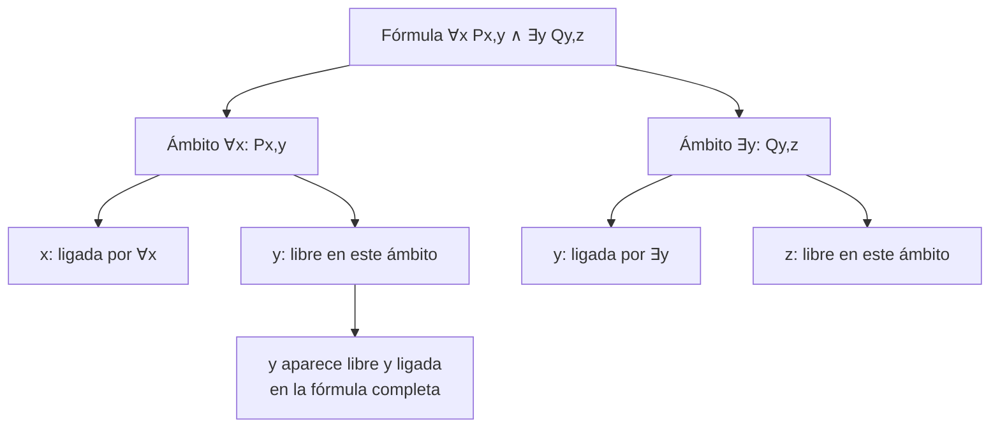
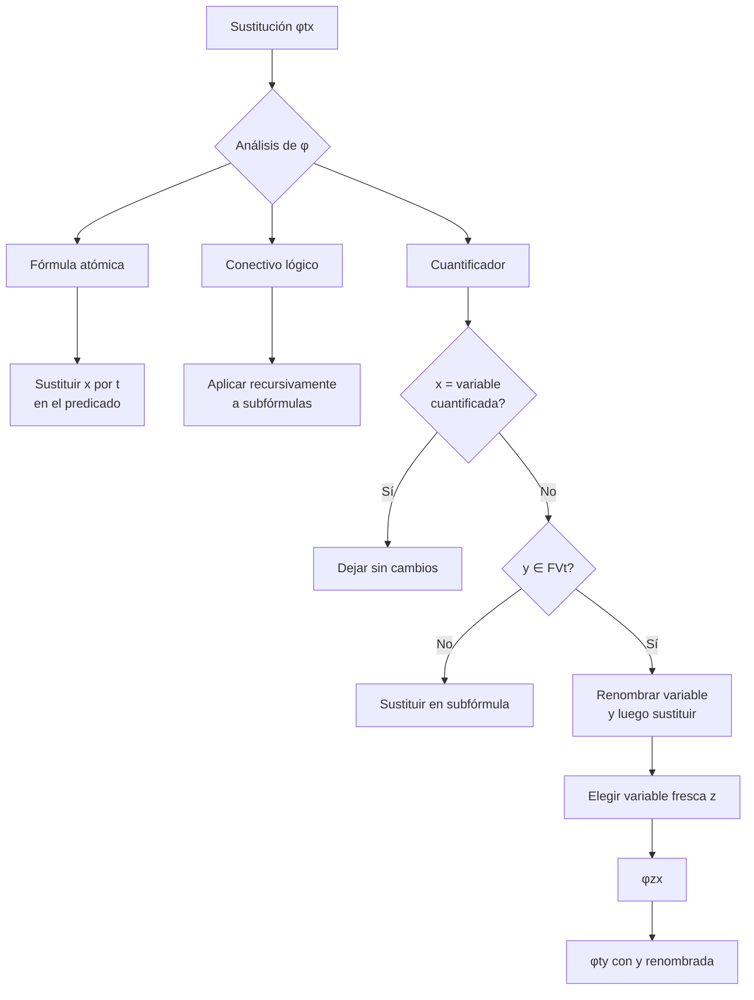

# Lógica Computacional - Lógica de predicados de primer orden

## 3.2 Conceptos sintácticos: recursion e inducción estructural en términos y fórmulas, ligado de variables.

---

### 1. Introducción

Los **conceptos sintácticos** fundamentales en lógica de primer orden incluyen mecanismos para definir y demostrar propiedades sobre términos y fórmulas mediante **recursión estructural** e **inducción estructural**. Además, el **ligado de variables** es crucial para entender el ámbito y alcance de los cuantificadores.

### 2. Recursión Estructural en Términos

La **recursión estructural** es un método para definir funciones sobre el conjunto de términos o fórmulas, explotando su estructura jerárquica.

#### Definición de función por recursión estructural sobre términos:

Sea $F$ una función que asigna a cada término un valor en algún conjunto. Definimos $F$ recursivamente:

1. **Caso base**: Para cada variable $x,$ definir $F(x)$
2. **Caso base**: Para cada constante $c,$ definir $F(c)$
3. **Paso recursivo**: Para cada functor n-ario $f$ y términos $t_1, \ldots, t_n,$ definir:

   $$F(f(t_1, \ldots, t_n)) = G(f, F(t_1), \ldots, F(t_n))$$

   donde $G$ es una función predefinida.

#### Ejemplo: Función de complejidad de términos

```python
def complejidad_termino(termino):
    if es_variable(termino) or es_constante(termino):
        return 1
    else:  # término funcional f(t1, ..., tn)
        complejidad_total = 1
        for subtermino in obtener_subterminos(termino):
            complejidad_total += complejidad_termino(subtermino)
        return complejidad_total
```

### 3. Inducción Estructural en Términos

La **inducción estructural** es el método de demostración correspondiente a la recursión estructural.

#### Principio de inducción estructural para términos:

Para demostrar que una propiedad $P$ holds para todos los términos:

1. **Caso base**: Demostrar $P(x)$ para toda variable $x$
2. **Caso base**: Demostrar $P(c)$ para toda constante $c$
3. **Paso inductivo**: Para todo functor n-ario $f$ y términos $t_1, \ldots, t_n,$ asumir $P(t_1), \ldots, P(t_n)$ (hipótesis inductivas) y demostrar $P(f(t_1, \ldots, t_n))$

### 4. Recursión e Inducción Estructural en Fórmulas

#### Definición de función por recursión estructural sobre fórmulas:

Sea $F$ una función sobre fórmulas. Definimos:

1. **Caso base atómico**: Para fórmula atómica $P(t_1, \ldots, t_n),$ definir $F(P(t_1, \ldots, t_n))$
2. **Paso conectivos**: Para fórmulas $\varphi, \psi:$
   - $F(\neg \varphi) = G_{\neg}(F(\varphi))$
   - $F(\varphi \land \psi) = G_{\land}(F(\varphi), F(\psi))$
   - (similar para otros conectivos)
3. **Paso cuantificadores**: Para fórmula $\varphi$ y variable $x:$
   - $F(\forall x \varphi) = G_{\forall}(x, F(\varphi))$
   - $F(\exists x \varphi) = G_{\exists}(x, F(\varphi))$

#### Ejemplo: Función de profundidad de cuantificadores

$$ depth(\varphi) =  \begin{cases}  0 & \text{si } \varphi \text{ es atómica} \\\ depth(\psi) & \text{si } \varphi = \neg \psi \\\ max(depth(\psi), depth(\theta)) & \text{si } \varphi = \psi \circ \theta \\\ 1 + depth(\psi) & \text{si } \varphi = Qx \psi  \end{cases} $$

### 5. Ligado de Variables

El **ligado de variables** se refiere a cómo los cuantificadores determinan el ámbito de las variables.

#### Definiciones formales:

- **Variable libre**: Una variable $x$ aparece libre en $\varphi$ si:
  - $\varphi$ es atómica y $x$ aparece en $\varphi$
  - $\varphi = \neg \psi$ y $x$ aparece libre en $\psi$
  - $\varphi = \psi \circ \theta$ y $x$ aparece libre en $\psi$ o en $\theta$
  - $\varphi = Qy \psi,$ $x$ aparece libre en $\psi$ y $x \neq y$

- **Variable ligada**: $x$ aparece ligada en $\varphi$ si:
  - $\varphi = Qx \psi$ y $x$ aparece en $\psi$
  - $\varphi = \neg \psi$ y $x$ aparece ligada en $\psi$
  - $\varphi = \psi \circ \theta$ y $x$ aparece ligada en $\psi$ o en $\theta$
  - $\varphi = Qy \psi,$ $x \neq y$ y $x$ aparece ligada en $\psi$

#### Diagrama de ligado de variables:



### 6. Algoritmo de Sustitución

La sustitución $[t/x]$ debe evitar la **captura de variables**.

#### Definición formal de sustitución:

$$ (Qy \psi)[t/x] = \begin{cases} Qy \psi & \text{si } x = y \\\ Qy (\psi[t/x]) & \text{si } x \neq y \text{ y } y \notin FV(t) \\\ Qz ((\psi[z/y])[t/x]) & \text{si } x \neq y \text{ y } y \in FV(t) \end{cases} $$

donde $z$ es una variable fresca.

### 7. Implementación de Algoritmos Estructurales

```python
class FormulaProcessor:
    def variables_libres(self, formula):
        """Calcula las variables libres de una fórmula"""
        if es_atomica(formula):
            return variables_en_formula(formula)
        elif es_negacion(formula):
            return self.variables_libres(formula.subformula)
        elif es_binaria(formula):
            return (self.variables_libres(formula.left) |
                    self.variables_libres(formula.right))
        elif es_cuantificada(formula):
            return (self.variables_libres(formula.subformula) -
                    {formula.variable})

    def sustitucion(self, formula, termino, variable):
        """Realiza sustitución evitando captura de variables"""
        if es_atomica(formula):
            return formula.sustituir_atomica(termino, variable)
        elif es_negacion(formula):
            return Negacion(self.sustitucion(
                formula.subformula, termino, variable))
        elif es_binaria(formula):
            return FormulaBinaria(
                formula.operador,
                self.sustitucion(formula.left, termino, variable),
                self.sustitucion(formula.right, termino, variable)
            )
        elif es_cuantificada(formula):
            if formula.variable == variable:
                return formula
            elif formula.variable not in termino.variables_libres():
                return FormulaCuantificada(
                    formula.cuantificador,
                    formula.variable,
                    self.sustitucion(formula.subformula, termino, variable)
                )
            else:
                # Renombramiento para evitar captura
                nueva_variable = self.variable_fresca()
                nueva_subformula = self.sustitucion(
                    formula.subformula,
                    Variable(nueva_variable),
                    formula.variable
                )
                return FormulaCuantificada(
                    formula.cuantificador,
                    nueva_variable,
                    self.sustitucion(nueva_subformula, termino, variable)
                )
```

### 8. Ejercicios Propuestos

#### Ejercicio 1

Demostrar por inducción estructural que para cualquier término $t,$ el número de paréntesis en $t$ es igual a $2 \times$ ( número de functores en $t$ ).

#### Ejercicio 2

Definir recursivamente la función $subterms(\varphi)$ que devuelve el conjunto de todos los subtérminos de una fórmula.

#### Ejercicio 3

Para la fórmula $\forall x P(x, y) \land \exists y Q(y, z):$

- Identificar variables libres y ligadas
- Realizar la sustitución $[f(a)/y]$
- Realizar la sustitución $[g(x)/z]$

#### Ejercicio 4

Demostrar que si $x$ no aparece libre en $\varphi,$ entonces $\varphi[t/x] = \varphi$ para cualquier término $t.$

### 9. Diagrama: Proceso de Sustitución



### 10. Soluciones a Ejercicios Selectos

#### Solución Ejercicio 1:

**Base**: Para variable $x$ o constante $c:$ 0 functores ⇒ 0 paréntesis ✓

**Paso inductivo**: Para $f(t_1, \ldots, t_n),$ por HI cada $t_i$ tiene $2 \times k_i$ paréntesis donde $k_i$ es el número de functores en $t_i.$ El término completo tiene $1 + \sum(2 \times k_i) = 2 \times (1 + \sum k_i)$ paréntesis ✓

#### Solución Ejercicio 3:

- Variables libres: $y,$ $z$
- Variables ligadas: $x$ (por ∀), $y$ (por ∃)
- $[f(a)/y]:$ $\forall x P(x, f(a)) \land \exists y Q(y, z)$
- $[g(x)/z]:$ $\forall x P(x, y) \land \exists y Q(y, g(x))$

### 11. Referencias

#### Bibliografía Básica:

1. **Huth & Ryan (2004)**: Capítulo 1 - Secciones 1.3-1.4 (Inducción estructural)
2. **Nerode & Shore (1997)**: Capítulo 2 - Sección 2.2 (Sintaxis y sustitución)

#### Bibliografía Complementaria:

1. **Ben-Ari (2008)**: Capítulo 4 - Sección 4.2 (Inducción estructural)
2. **Fitting (1996)**: Capítulo 2 - Secciones 2.4-2.5 (Sustitución y variables)
3. **Sperschneider & Antoniou (1991)**: Capítulo 5 - Sección 5.3 (Ligado de variables)
