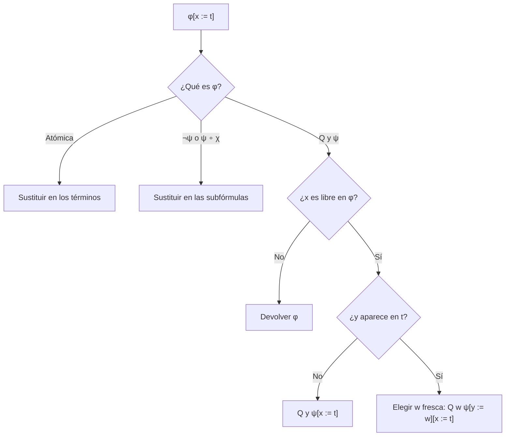

# Lógica Computacional - Lógica de predicados de primer orden

## 3.3 Sustitución: el problema de la sustitución textual y la captura de variables libres, definición y α-equivalencia, definición formal de sustitución.

---

Sustituir una variable por un término es la operación sintáctica básica de la lógica de primer orden: se usa para instanciar un enunciado universal, para aplicar reglas de inferencia y, en la resolución, para unificar. En la lógica proposicional la sustitución era puramente textual (tema 2.2). En primer orden no puede serlo, porque los cuantificadores ligan variables y un reemplazo descuidado cambia el significado de la fórmula. Este tema muestra el problema, introduce la **α-equivalencia** y da la definición correcta.

### El problema de la captura

La fórmula $\varphi(x) = \exists y\, (x = y + y)$ dice que $x$ es par. Sustituir $x$ por un término $t$ debería dar una fórmula que diga que $t$ es par. Con $t = z + 1$ funciona:

$$ \exists y\, (z + 1 = y + y) $$

Pero con $t = y + 1,$ el reemplazo textual da

$$ \exists y\, (y + 1 = y + y) $$

que dice que existe un $y$ con $y = 1:$ es verdadera, aunque $y + 1$ no siempre sea par. La $y$ del término, que era **libre** y se refería a un objeto cualquiera, quedó **capturada** por $\exists y$ y pasó a referirse al objeto cuantificado.

**Definición.** Al sustituir $x$ por $t$ en $\varphi,$ ocurre una **captura** si alguna aparición libre de $x$ en $\varphi$ está dentro del alcance de un cuantificador $Q y$ con $y \in \text{var}(t).$ Se dice entonces que $t$ **no está libre para** $x$ en $\varphi.$

Hay dos soluciones clásicas: prohibir las sustituciones con captura, o **renombrar** antes la variable ligada. La segunda es la que se usa, y se justifica con la α-equivalencia.

### α-equivalencia

Las variables ligadas son mudas: $\exists y\, (x = y + y)$ y $\exists w\, (x = w + w)$ dicen lo mismo. Renombrar una variable ligada por otra que no aparece no cambia el significado.

**Definición.** El **renombramiento** de $Q y\, \varphi$ es $Q w\, \varphi[y := w],$ con $w$ una variable que no aparece en $\varphi.$ Dos fórmulas son **α-equivalentes,** $\varphi \equiv_\alpha \psi,$ si una se obtiene de la otra con una sucesión de renombramientos de subfórmulas.

**Ejemplos.**

- $\forall x\, \exists y\, R(x, y) \equiv_\alpha \forall u\, \exists v\, R(u, v).$
- $\forall x\, P(x) \not\equiv_\alpha \forall x\, P(y):$ en la segunda $y$ es libre.
- $\forall x\, \exists y\, R(x, y) \not\equiv_\alpha \forall y\, \exists x\, R(x, y):$ en la primera el primer argumento de $R$ está ligado por el cuantificador exterior; en la segunda, por el interior.

**Caracterización.** Dos fórmulas son α-equivalentes si y solo si tienen la misma estructura y cada aparición de variable está libre en ambas con el mismo nombre, o ligada en ambas por cuantificadores en la misma posición. Esto se formaliza con los **índices de de Bruijn:** cada aparición ligada se reemplaza por el número de cuantificadores que hay entre ella y el que la liga. Así, $\forall x\, \exists y\, R(x, y)$ se convierte en $\forall\, \exists\, R(1, 0),$ y $\forall y\, \exists x\, R(x, y)$ en $\forall\, \exists\, R(0, 1).$ Dos fórmulas son α-equivalentes si y solo si tienen la misma forma de de Bruijn. Los demostradores automáticos y los compiladores de lenguajes funcionales usan esta representación precisamente para no tener que lidiar con nombres.

**Teorema.** Las fórmulas α-equivalentes tienen el mismo significado: son verdaderas exactamente en las mismas interpretaciones y asignaciones (tema 3.5).

### Definición formal de la sustitución

En **términos**, la sustitución sí es textual:

$$ x[x := t] = t, \qquad y[x := t] = y \ (y \neq x), \qquad c[x := t] = c, \qquad f(s_1, \ldots, s_n)[x := t] = f(s_1[x := t], \ldots, s_n[x := t]) $$

En **fórmulas**, se distribuye sobre las atómicas y los conectivos, y el caso de los cuantificadores tiene tres subcasos:

$$ (Q y\, \varphi)[x := t] = \begin{cases} Q y\, \varphi & \text{si } x \notin \text{VL}(Q y\, \varphi) \\ Q y\, (\varphi[x := t]) & \text{si } x \in \text{VL}(Q y\, \varphi) \text{ y } y \notin \text{var}(t) \\ Q w\, (\varphi[y := w][x := t]) & \text{si } x \in \text{VL}(Q y\, \varphi) \text{ y } y \in \text{var}(t) \end{cases} $$

donde en el tercer caso $w$ es una variable **fresca**: no aparece en $\varphi$ ni en $t$ y es distinta de $x.$

- El primer caso incluye $y = x:$ las apariciones de $x$ en el cuerpo están ligadas, no se tocan.
- El segundo es el caso sin peligro.
- El tercero renombra $y$ antes de sustituir, para que $t$ no quede capturado.

La notación varía según el libro: $\varphi[t/x],$ $\varphi[x/t],$ $\varphi\{x \mapsto t\}$ o $\varphi^x_t.$ Este tema usa $\varphi[x := t],$ que no deja dudas sobre qué reemplaza a qué.

**Bien definida.** En el tercer caso se sustituye en $\varphi[y := w],$ que no es subfórmula de $Q y\, \varphi;$ la recursión es correcta porque $\varphi[y := w]$ tiene el mismo tamaño que $\varphi,$ así que la definición es por recursión sobre el **tamaño**, no sobre la estructura. El resultado depende de qué $w$ se elija, pero todos los resultados son α-equivalentes, que es lo único que importa.

**Ejemplos.**

$$ (\forall x\, P(x, y))[y := f(a)] = \forall x\, P(x, f(a)) $$

$$ (\forall x\, P(x, y))[y := f(x)] = \forall z\, P(z, f(x)) $$

$$ (\exists y\, Q(x, y))[x := g(y)] = \exists z\, Q(g(y), z) $$

En el segundo, la sustitución textual daría $\forall x\, P(x, f(x)),$ que habla de otra cosa; en el tercero, $\exists y\, Q(g(y), y).$

### Propiedades

**Lema de sustitución (semántico).** El valor de $\varphi[x := t]$ en una interpretación con asignación $\sigma$ es el valor de $\varphi$ con la asignación que da a $x$ el valor de $t$ (tema 3.4). Es la propiedad que justifica la definición, y la que falla con la sustitución textual.

**Propiedades sintácticas.** Para $x \neq y:$

1. Si $x \notin \text{VL}(\varphi),$ entonces $\varphi[x := t] = \varphi.$
2. Si $\varphi \equiv_\alpha \psi,$ entonces $\varphi[x := t] \equiv_\alpha \psi[x := t].$
3. Si $x \notin \text{var}(s),$ entonces $\varphi[x := t][y := s] \equiv_\alpha \varphi[y := s][x := t[y := s]].$
4. $\text{VL}(\varphi[x := t]) = (\text{VL}(\varphi) \setminus \{x\}) \cup \text{var}(t)$ si $x \in \text{VL}(\varphi),$ y $\text{VL}(\varphi)$ si no.

La propiedad 4 dice que la sustitución nunca captura: las variables de $t$ siguen libres en el resultado.

**Sustitución simultánea.** $\varphi[x_1 := t_1, \ldots, x_n := t_n]$ reemplaza todas a la vez, con la misma regla de renombramiento cuando la variable ligada aparece en alguno de los $t_i.$ Es la que se usa en la unificación (tema 5.5), donde a la función $\{x_1 \mapsto t_1, \ldots, x_n \mapsto t_n\}$ se le llama simplemente una **sustitución**.



### Implementación en Python

El programa implementa la sustitución textual y la correcta, con variables frescas $z_1, z_2, \ldots,$ y las compara en los ejemplos del tema y en los ejercicios. La α-equivalencia se decide comparando las formas de de Bruijn. Al final genera mil fórmulas al azar, construye una variante α-equivalente de cada una con nombres nuevos y comprueba la propiedad 2: sustituir en ambas da resultados α-equivalentes.

```python
import random

# Términos: variable 'x', constante 'a' (cadenas); ('f', t1, ..., tn). Variables: x, y, z, u, v, w y con dígitos.
def es_var(t):
    return isinstance(t, str) and t[0] in 'xyzuvw'

def vars_t(t):
    if isinstance(t, str): return {t} if es_var(t) else set()
    return set().union(set(), *(vars_t(s) for s in t[1:]))

def es_atomica(f):
    return f[0][0].isupper() or f[0] == '='

def libres(f):
    if es_atomica(f): return set().union(set(), *(vars_t(t) for t in f[1:]))
    if f[0] == '¬': return libres(f[1])
    if f[0] in '∀∃': return libres(f[2]) - {f[1]}
    return libres(f[1]) | libres(f[2])

def todas(f):
    if es_atomica(f): return set().union(set(), *(vars_t(t) for t in f[1:]))
    if f[0] == '¬': return todas(f[1])
    if f[0] in '∀∃': return todas(f[2]) | {f[1]}
    return todas(f[1]) | todas(f[2])

def fresca(evitar):
    i = 1
    while f'z{i}' in evitar: i += 1
    return f'z{i}'

def sust_t(s, x, t):
    if isinstance(s, str): return t if s == x else s
    return (s[0],) + tuple(sust_t(r, x, t) for r in s[1:])

def textual(f, x, t):
    """Sustitución textual ingenua: reemplaza las apariciones libres de x sin cuidar la captura."""
    if es_atomica(f): return (f[0],) + tuple(sust_t(s, x, t) for s in f[1:])
    if f[0] == '¬': return ('¬', textual(f[1], x, t))
    if f[0] in '∀∃': return f if f[1] == x else (f[0], f[1], textual(f[2], x, t))
    return (f[0], textual(f[1], x, t), textual(f[2], x, t))

def sust(f, x, t):
    """Sustitución que evita la captura: φ[x := t]."""
    if es_atomica(f): return (f[0],) + tuple(sust_t(s, x, t) for s in f[1:])
    if f[0] == '¬': return ('¬', sust(f[1], x, t))
    if f[0] not in '∀∃': return (f[0], sust(f[1], x, t), sust(f[2], x, t))
    q, y, cuerpo = f
    if y == x or x not in libres(cuerpo):           # x no aparece libre: nada que hacer
        return f
    if y not in vars_t(t):                          # no hay captura
        return (q, y, sust(cuerpo, x, t))
    z = fresca(todas(cuerpo) | vars_t(t) | {x})     # renombrar la variable ligada
    return (q, z, sust(sust(cuerpo, y, z), x, t))

def debruijn(f, ligadas=()):
    """Forma sin nombres: cada variable ligada se reemplaza por la distancia a su cuantificador."""
    def tr(s):
        if isinstance(s, str):
            if s in ligadas: return ('#', ligadas[::-1].index(s))
            return s
        return (s[0],) + tuple(tr(r) for r in s[1:])
    if es_atomica(f): return (f[0],) + tuple(tr(s) for s in f[1:])
    if f[0] == '¬': return ('¬', debruijn(f[1], ligadas))
    if f[0] in '∀∃': return (f[0], debruijn(f[2], ligadas + (f[1],)))
    return (f[0], debruijn(f[1], ligadas), debruijn(f[2], ligadas))

def alfa_eq(f, g):
    return debruijn(f) == debruijn(g)

def tt(t):
    return t if isinstance(t, str) else t[0] + '(' + ', '.join(tt(s) for s in t[1:]) + ')'

def tf(f):
    if es_atomica(f): return f[0] + '(' + ', '.join(tt(s) for s in f[1:]) + ')'
    if f[0] == '¬': return '¬' + tf(f[1])
    if f[0] in '∀∃': return f[0] + f[1] + ' ' + tf(f[2])
    return '(' + tf(f[1]) + ' ' + f[0] + ' ' + tf(f[2]) + ')'

casos = [
    (('∀', 'x', ('P', 'x', 'y')), 'y', ('f', 'a')),
    (('∀', 'x', ('P', 'x', 'y')), 'y', ('f', 'x')),
    (('∃', 'y', ('Q', 'x', 'y')), 'x', ('g', 'y')),
    (('∀', 'x', ('∃', 'y', ('R', 'x', 'y', 'z'))), 'z', ('h', 'x', 'y')),
    (('∀', 'x', ('→', ('P', 'x', 'y'), ('∃', 'y', ('Q', 'x', 'y')))), 'y', ('f', 'x')),
]
for f, x, t in casos:
    print(f'{tf(f)} [{x} := {tt(t)}]')
    print('   textual:', tf(textual(f, x, t)))
    print('   correcta:', tf(sust(f, x, t)))

print('α-equivalentes:',
      alfa_eq(('∀', 'x', ('∃', 'y', ('R', 'x', 'y'))), ('∀', 'u', ('∃', 'v', ('R', 'u', 'v')))),
      alfa_eq(('∀', 'x', ('P', 'x')), ('∀', 'x', ('P', 'y'))),
      alfa_eq(('∀', 'x', ('∃', 'y', ('R', 'x', 'y'))), ('∀', 'y', ('∃', 'x', ('R', 'x', 'y')))))

# Prueba aleatoria: la sustitución respeta la α-equivalencia
rnd = random.Random(5)
V = ['x', 'y', 'z']
def termino(n):
    if n == 0 or rnd.random() < 0.4: return rnd.choice(V + ['a'])
    return ('f', termino(n - 1), termino(n - 1))
def formula(n):
    r = rnd.random()
    if n == 0 or r < 0.25: return ('R', termino(1), termino(1))
    if r < 0.6: return (rnd.choice('∀∃'), rnd.choice(V), formula(n - 1))
    return (rnd.choice('∧→'), formula(n - 1), formula(n - 1))
def renombrar(f):
    """Una variante α-equivalente: renombra cada cuantificador con una variable nueva."""
    if es_atomica(f): return f
    if f[0] == '¬': return ('¬', renombrar(f[1]))
    if f[0] in '∀∃':
        w = 'w' + str(rnd.randrange(10**6))
        return (f[0], w, renombrar(sust(f[2], f[1], w)))
    return (f[0], renombrar(f[1]), renombrar(f[2]))
ok = 0
for _ in range(1000):
    f, x, t = formula(4), rnd.choice(V), termino(2)
    g = renombrar(f)
    assert alfa_eq(f, g)
    ok += alfa_eq(sust(f, x, t), sust(g, x, t))
print('sustitución respeta α-equivalencia en', ok, 'de 1000 casos')
```

Salida:

```text
∀x P(x, y) [y := f(a)]
   textual: ∀x P(x, f(a))
   correcta: ∀x P(x, f(a))
∀x P(x, y) [y := f(x)]
   textual: ∀x P(x, f(x))
   correcta: ∀z1 P(z1, f(x))
∃y Q(x, y) [x := g(y)]
   textual: ∃y Q(g(y), y)
   correcta: ∃z1 Q(g(y), z1)
∀x ∃y R(x, y, z) [z := h(x, y)]
   textual: ∀x ∃y R(x, y, h(x, y))
   correcta: ∀z1 ∃z2 R(z1, z2, h(x, y))
∀x (P(x, y) → ∃y Q(x, y)) [y := f(x)]
   textual: ∀x (P(x, f(x)) → ∃y Q(x, y))
   correcta: ∀z1 (P(z1, f(x)) → ∃y Q(z1, y))
α-equivalentes: True False False
sustitución respeta α-equivalencia en 1000 de 1000 casos
```

En el primer caso no hay captura y ambas coinciden. En los demás, la textual captura variables del término. En el último, el $\exists y$ interior no se renombra: en su alcance $y$ no es libre, así que el primer caso de la definición lo deja intacto.

### Ejercicios Propuestos

1. **Sustituciones.** Calcula, indicando si hace falta renombrar: (a) $(\forall x\, P(x, y))[y := f(x)];$ (b) $(\exists y\, Q(x, y))[x := g(y)];$ (c) $(\forall x\, \exists y\, R(x, y, z))[z := h(x, y)].$

2. **α-equivalencia.** Decide cuáles son α-equivalentes a $\forall x\, (P(x) \to \exists y\, R(x, y)):$ (a) $\forall y\, (P(y) \to \exists x\, R(y, x));$ (b) $\forall y\, (P(y) \to \exists y\, R(y, y));$ (c) $\forall z\, (P(z) \to \exists y\, R(z, y)).$

3. **Captura.** Da un ejemplo de un enunciado verdadero $\forall x\, \varphi$ sobre los números naturales y un término $t$ tal que la sustitución textual $\varphi[x := t]$ sea falsa.

4. **Variable libre y ligada.** Para $\varphi = \forall x\, (P(x, y) \to \exists y\, Q(x, y)),$ calcula $\varphi[y := f(x)]$ y $\varphi[x := g(z)].$

5. **Propiedad 1.** Demuestra por inducción que si $x \notin \text{VL}(\varphi),$ entonces $\varphi[x := t] = \varphi.$

6. **de Bruijn.** Escribe en forma de de Bruijn $\forall x\, (P(x) \to \exists y\, (R(x, y) \land \forall x\, S(x, y))).$

### Soluciones

**Ejercicio 1.** (a) Sí: $\forall z\, P(z, f(x)).$ (b) Sí: $\exists z\, Q(g(y), z);$ la respuesta $\exists y\, Q(g(y), y)$ es incorrecta, porque la $y$ de $g(y)$ quedaría capturada. (c) Sí, ambas: $\forall u\, \exists v\, R(u, v, h(x, y)).$ Coinciden, salvo los nombres de las variables frescas, con la salida del programa.

**Ejercicio 2.** (a) Sí: es un renombramiento consistente que intercambia los nombres. (b) No: el $\exists y$ interior liga ambos argumentos de $R,$ mientras que en la original el primero lo liga el $\forall$ exterior. (c) Sí.

**Ejercicio 3.** $\forall x\, \exists y\, (y > x)$ es verdadero en los naturales. Con $\varphi = \exists y\, (y > x)$ y $t = y,$ la sustitución textual da $\exists y\, (y > y),$ que es falsa. La correcta da $\exists w\, (w > y),$ verdadera para todo valor de $y.$

**Ejercicio 4.** $\varphi[y := f(x)] = \forall z\, (P(z, f(x)) \to \exists y\, Q(z, y)),$ como da el programa: se renombra $x$ porque $f(x)$ la contiene, y el $\exists y$ no se toca. $\varphi[x := g(z)] = \varphi,$ porque $x$ no es libre en $\varphi.$

**Ejercicio 5.** Si $\varphi$ es atómica, $x$ no aparece en sus términos y la sustitución en términos no los cambia (inducción sobre términos). Los conectivos se siguen de la hipótesis de inducción. Si $\varphi = Q y\, \psi,$ como $x \notin \text{VL}(\varphi),$ se aplica el primer caso de la definición y el resultado es $\varphi.$ $\blacksquare$

**Ejercicio 6.** $\forall\, (P(0) \to \exists\, (R(1, 0) \land \forall\, S(0, 1))).$ En $R(x, y),$ $x$ está ligada un cuantificador más afuera que $y;$ en $S(x, y),$ la $x$ es la del $\forall$ interior, a distancia 0, y la $y$ la del $\exists,$ a distancia 1.

### Referencias

1. van Dalen, D., _Logic and Structure_. Springer, 2013. Sección 3.3.
2. Enderton, H. B., _A Mathematical Introduction to Logic_. Academic Press, 2001. Sección 2.4.
3. Huth, M., and Ryan, M., _Logic in Computer Science_. Cambridge University Press, 2004. Sección 2.2.4.
4. de Bruijn, N. G. (1972). Lambda calculus notation with nameless dummies. _Indagationes Mathematicae_, 34, 381-392.
5. Barendregt, H. P., _The Lambda Calculus: Its Syntax and Semantics_. North-Holland, 1984. Capítulo 2.
