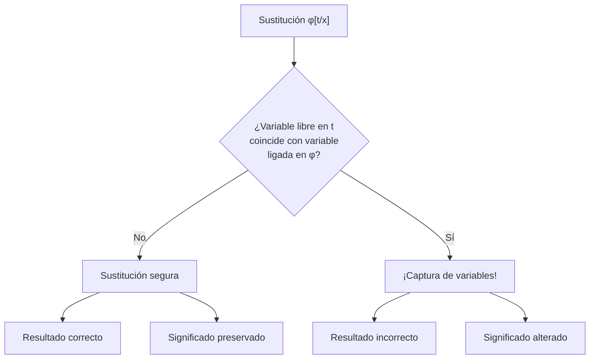
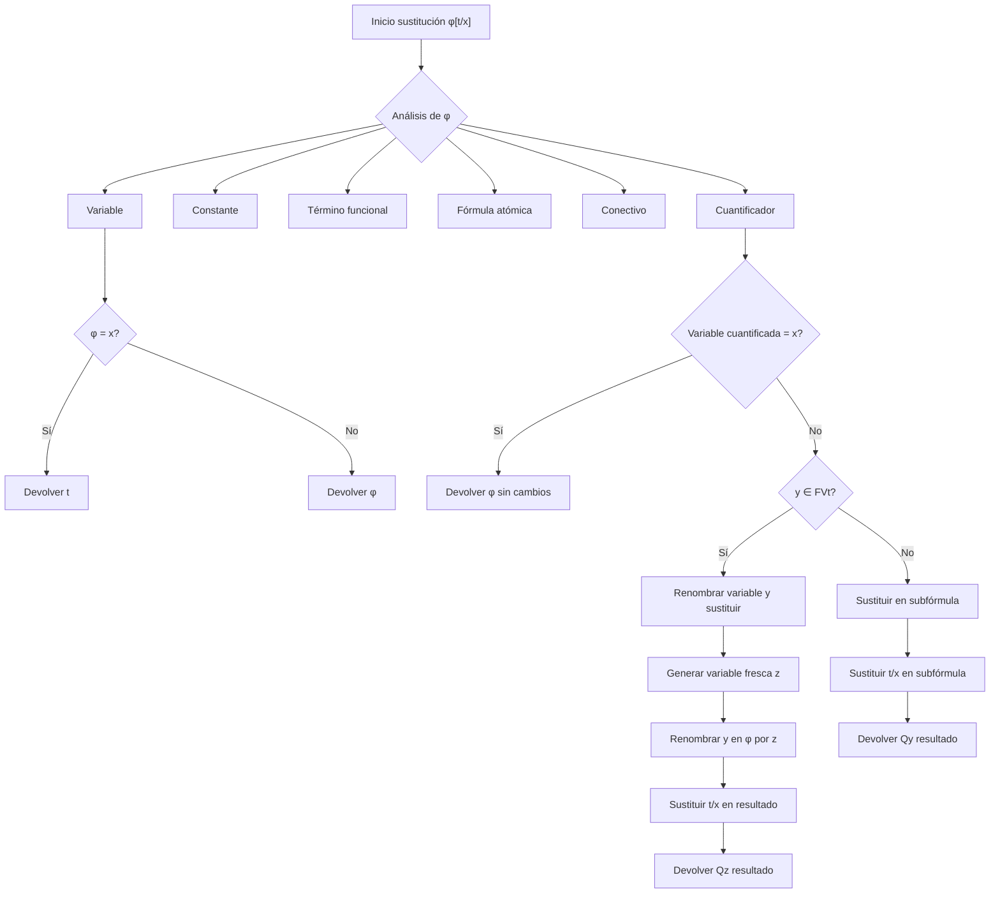

# Lógica Computacional - Lógica de predicados de primer orden

## 3.3 Sustitución: el problema de la sustitución textual y la captura de variables libres, definición y α-equivalencia, definición formal de sustitución.

---

### 1. Introducción a la Sustitución

La **sustitución** es una operación fundamental en lógica de primer orden que permite reemplazar variables por términos. Sin embargo, esta operación presenta desafíos importantes relacionados con la **captura de variables** y la necesidad de una definición formal precisa.

### 2. El Problema de la Sustitución Textual

La sustitución textual ingenua puede llevar a **captura de variables**, donde una variable libre en el término sustituido queda ligada por un cuantificador.

#### Ejemplo problemático:

Sea la fórmula: $\varphi = \forall x P(x, y)$
Sustitución textual: $\varphi[f(x)/y] = \forall x P(x, f(x))$

**Problema**: La variable $x$ en $f(x)$ queda capturada por el cuantificador $\forall x$, cambiando el significado de la fórmula.

### 3. Captura de Variables Libres

La **captura de variables** ocurre cuando una variable libre en el término de sustitución coincide con una variable ligada en el ámbito donde se realiza la sustitución.



### 4. α-Equivalencia

La **α-equivalencia** define cuando dos fórmulas son equivalentes salvo renombramiento de variables ligadas.

#### Definición formal:

Dos fórmulas $\varphi$ y $\psi$ son α-equivalentes $(\varphi \equiv_\alpha \psi)$ si:

- Se pueden obtener una de otra mediante renombramiento consistente de variables ligadas
- Preservan la estructura de ligado de variables

#### Ejemplos:

- $\forall x P(x) \equiv_\alpha \forall y P(y)$ ✓
- $\forall x P(x) \not\equiv_\alpha \forall x P(y)$ ✗
- $\forall x \exists y R(x,y) \equiv_\alpha \forall z \exists w R(z,w)$ ✓

### 5. Definición Formal de Sustitución

La sustitución formal $\varphi[t/x]$ se define recursivamente:

#### Para términos:

1. $y[t/x] = \begin{cases} t & \text{si } y = x \\ y & \text{si } y \neq x \end{cases}$
2. $c[t/x] = c$ para constantes $c$
3. $f(t_1, \ldots, t_n)[t/x] = f(t_1[t/x], \ldots, t_n[t/x])$

#### Para fórmulas atómicas:

$P(t_1, \ldots, t_n)[t/x] = P(t_1[t/x], \ldots, t_n[t/x])$

#### Para conectivos:

1. $(\neg \varphi)[t/x] = \neg (\varphi[t/x])$
2. $(\varphi \circ \psi)[t/x] = \varphi[t/x] \circ \psi[t/x]$ para $\circ \in \{\land, \lor, \rightarrow, \leftrightarrow\}$

#### Para cuantificadores (caso crucial):

Para $Q \in \{\forall, \exists\}$:

$$ (Qy \varphi)[t/x] =  \begin{cases}  Qy \varphi & \text{si } x = y \\\ Qy (\varphi[t/x]) & \text{si } x \neq y \text{ y } y \notin FV(t) \\\ Qz ((\varphi[z/y])[t/x]) & \text{si } x \neq y \text{ y } y \in FV(t) \end{cases} $$

donde $z$ es una variable fresca ( no aparece en $\varphi$ ni en $t$ ).

### 6. Implementación de Sustitución con Renombramiento

```python
class Sustitucion:
    def __init__(self):
        self.contador = 0

    def variable_fresca(self, evitando):
        """Genera una variable fresca que no esté en el conjunto evitando"""
        variables_existentes = evitando
        letras = [chr(i) for i in range(ord('a'), ord('z')+1)]

        for letra in letras:
            for i in range(10):
                var_candidata = f"{letra}{i}" if i > 0 else letra
                if var_candidata not in variables_existentes:
                    return var_candidata

        # Fallback: usar letras con prefijo
        self.contador += 1
        return f"v{self.contador}"

    def sustituir(self, formula, termino, variable):
        """Realiza sustitución formal evitando captura"""
        if es_variable(formula):
            return termino if formula == variable else formula

        elif es_constante(formula):
            return formula

        elif es_termino_funcional(formula):
            nuevo_func = formula.funcion
            nuevos_args = [self.sustituir(arg, termino, variable)
                          for arg in formula.argumentos]
            return TerminoFuncional(nuevo_func, nuevos_args)

        elif es_formula_atomica(formula):
            nuevo_pred = formula.predicado
            nuevos_args = [self.sustituir(arg, termino, variable)
                          for arg in formula.argumentos]
            return FormulaAtomica(nuevo_pred, nuevos_args)

        elif es_negacion(formula):
            return Negacion(self.sustituir(formula.subformula, termino, variable))

        elif es_conectivo_binario(formula):
            left = self.sustituir(formula.left, termino, variable)
            right = self.sustituir(formula.right, termino, variable)
            return FormulaBinaria(formula.operador, left, right)

        elif es_cuantificador(formula):
            if formula.variable == variable:
                return formula  # No sustituir variables ligadas

            vars_libres_t = variables_libres(termino)

            if formula.variable not in vars_libres_t:
                # Sustitución segura
                nueva_sub = self.sustituir(formula.subformula, termino, variable)
                return FormulaCuantificada(formula.cuantificador,
                                         formula.variable, nueva_sub)
            else:
                # Renombramiento necesario
                vars_evitar = (variables_libres(formula) |
                              vars_libres_t | {variable})
                nueva_var = self.variable_fresca(vars_evitar)

                # Renombrar la variable ligada
                sub_renombrada = self.renombrar_variable(
                    formula.subformula, formula.variable, nueva_var)

                # Sustituir en la fórmula renombrada
                nueva_sub_sust = self.sustituir(sub_renombrada, termino, variable)

                return FormulaCuantificada(formula.cuantificador,
                                         nueva_var, nueva_sub_sust)

    def renombrar_variable(self, formula, vieja_var, nueva_var):
        """Renombra consistentemente una variable ligada"""
        # Implementación similar a sustituir pero solo para renombramiento
        pass
```

### 7. Ejemplos de Sustitución Correcta

#### Ejemplo 1: Sustitución segura

$\varphi = \forall x P(x, y)$  
$\varphi[f(a)/y] = \forall x P(x, f(a))$ ✓

#### Ejemplo 2: Sustitución con renombramiento

$\varphi = \forall x P(x, y)$  
$\varphi[f(x)/y] = \forall z P(z, f(x))$ ✓ (con $z$ fresca)

#### Ejemplo 3: Sustitución múltiple

$\varphi = \forall x \exists y R(x, y, z)$  
$\varphi[f(x,y)/z] = \forall u \exists v R(u, v, f(x,y))$ ✓

### 8. Propiedades de la Sustitución

1. **Preservación de α-equivalencia**: Si $\varphi \equiv_\alpha \psi$, entonces $\varphi[t/x] \equiv_\alpha \psi[t/x]$
2. **Composición**: $(\varphi[t/x])[s/y] \equiv_\alpha \varphi[s/y][t[s/y]/x]$ (con condiciones apropiadas)
3. **Conmutación**: Si $x \neq y$ y $x \notin FV(s)$, entonces $(\varphi[t/x])[s/y] \equiv_\alpha (\varphi[s/y])[t/x]$

### 9. Ejercicios Propuestos

#### Ejercicio 1

Realizar las siguientes sustituciones, indicando si se necesita renombramiento:

1. $(\forall x P(x, y))[f(x)/y]$
2. $(\exists y Q(x, y))[g(y)/x]$
3. $(\forall x \exists y R(x, y, z))[h(x,y)/z]$

#### Ejercicio 2

Demostrar que $\forall x P(x) \equiv_\alpha \forall y P(y)$

#### Ejercicio 3

Implementar la función `variables_libres(termino)` y `variables_libres(formula)`

#### Ejercicio 4

Para la fórmula $\varphi = \forall x (P(x, y) \rightarrow \exists y Q(x, y))$:

- Identificar variables libres y ligadas
- Realizar $\varphi[f(x)/y]$
- Realizar $\varphi[g(z)/x]$

### 10. Diagrama: Algoritmo de Sustitución Completo



### 11. Soluciones a Ejercicios Selectos

#### Solución Ejercicio 1:

1. $\forall z P(z, f(x))$ (renombramiento necesario)
2. $\exists y Q(g(y), y)$ (renombramiento necesario si queremos evitar ambigüedad)
3. $\forall u \exists v R(u, v, h(x,y))$ (renombramiento necesario)

#### Solución Ejercicio 4:

- Variables libres: $y$
- Variables ligadas: $x$ (por ∀), $y$ (por ∃ en el ámbito interno)
- $\varphi[f(x)/y] = \forall z (P(z, f(x)) \rightarrow \exists w Q(z, w))$
- $\varphi[g(z)/x] = \forall x (P(x, y) \rightarrow \exists y Q(x, y))$ (x no libre)

### 12. Referencias

#### Bibliografía Básica:

1. **Huth & Ryan (2004)**: Capítulo 1 - Sección 1.4 (Sustitución y α-conversión)
2. **Nerode & Shore (1997)**: Capítulo 2 - Sección 2.2 (Sustitución y renombramiento)

#### Bibliografía Complementaria:

1. **Ben-Ari (2008)**: Capítulo 4 - Sección 4.3 (Sustitución formal)
2. **Fitting (1996)**: Capítulo 2 - Secciones 2.4-2.5 (Sustitución y captura)
3. **Sperschneider & Antoniou (1991)**: Capítulo 5 - Sección 5.4 (α-equivalencia)
