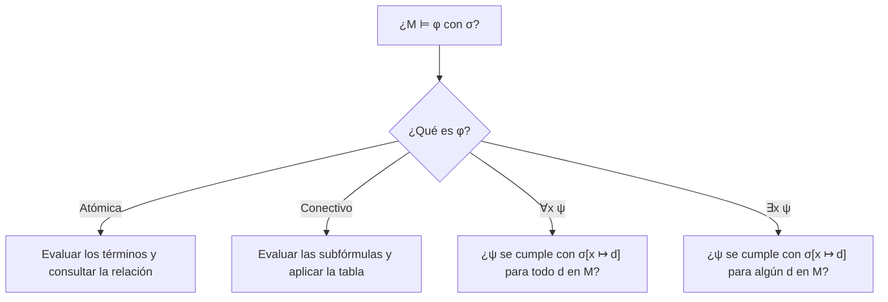

# Lógica Computacional - Lógica de predicados de primer orden

## 3.4 Semántica: introducción; interpretación de términos y fórmulas; definición de satisfacción de Tarski.

---

En la lógica proposicional, el significado de una fórmula dependía solo de los valores de sus variables. En primer orden hay más que interpretar: de qué objetos se habla, qué denota cada constante, qué función representa cada símbolo de función y qué relación cada predicado. Todo eso se reúne en una **estructura**. La definición de **satisfacción** de Tarski (1933) dice, por recursión sobre las fórmulas, cuándo una fórmula es verdadera en una estructura, y es el punto de partida de toda la teoría de modelos.

### Estructuras

**Definición.** Una **estructura** (o interpretación) $\mathcal{M}$ para una signatura $\Sigma$ consta de:

- Un conjunto **no vacío** $M,$ el **dominio** o universo.
- Para cada constante $c,$ un elemento $c^{\mathcal{M}} \in M.$
- Para cada símbolo de función $f/n,$ una función $f^{\mathcal{M}} : M^n \rightarrow M.$
- Para cada símbolo de predicado $P/n,$ una relación $P^{\mathcal{M}} \subseteq M^n.$

El símbolo $=$ se interpreta siempre como la igualdad en $M.$

**Ejemplos.** La misma signatura $\{0, +, \lt\}$ admite estructuras muy distintas:

- $\mathbb{N}$ con el cero, la suma y el orden usuales.
- $\mathbb{Z}_5 = \{0, 1, 2, 3, 4\}$ con la suma módulo 5 y cualquier relación como $\lt.$
- El conjunto de cadenas sobre $\{a, b\},$ con $0$ como la cadena vacía, $+$ como la concatenación y $\lt$ como "es prefijo propio de".

Los símbolos no tienen significado propio: $\forall x\, \exists y\, (x + y = 0)$ es falsa en $\mathbb{N}$ y verdadera en $\mathbb{Z}_5.$

### Asignaciones y valor de los términos

Para dar valor a las fórmulas con variables libres hace falta saber a qué objeto se refiere cada variable.

**Definición.** Una **asignación** en $\mathcal{M}$ es una función $\sigma$ de las variables a $M.$ La asignación $\sigma[x \mapsto d]$ coincide con $\sigma$ salvo en $x,$ a la que le asigna $d.$

**Definición.** El **valor** de un término, $t^{\mathcal{M}}[\sigma] \in M,$ se define por recursión:

$$ x^{\mathcal{M}}[\sigma] = \sigma(x), \qquad c^{\mathcal{M}}[\sigma] = c^{\mathcal{M}}, \qquad f(t_1, \ldots, t_n)^{\mathcal{M}}[\sigma] = f^{\mathcal{M}}(t_1^{\mathcal{M}}[\sigma], \ldots, t_n^{\mathcal{M}}[\sigma]) $$

Por ejemplo, en $\mathbb{N}$ con $\sigma(x) = 3,$ el término $s(x) + s(0)$ vale $4 + 1 = 5.$

### La definición de satisfacción de Tarski

**Definición.** La relación $\mathcal{M} \models \varphi[\sigma],$ que se lee $\mathcal{M}$ satisface a $\varphi$ con la asignación $\sigma,$ se define por recursión sobre $\varphi:$

$$ \begin{aligned} \mathcal{M} \models P(t_1, \ldots, t_n)[\sigma] &\iff (t_1^{\mathcal{M}}[\sigma], \ldots, t_n^{\mathcal{M}}[\sigma]) \in P^{\mathcal{M}} \\ \mathcal{M} \models (t_1 = t_2)[\sigma] &\iff t_1^{\mathcal{M}}[\sigma] = t_2^{\mathcal{M}}[\sigma] \\ \mathcal{M} \models \lnot \varphi[\sigma] &\iff \mathcal{M} \not\models \varphi[\sigma] \\ \mathcal{M} \models (\varphi \land \psi)[\sigma] &\iff \mathcal{M} \models \varphi[\sigma] \text{ y } \mathcal{M} \models \psi[\sigma] \\ \mathcal{M} \models (\varphi \to \psi)[\sigma] &\iff \mathcal{M} \not\models \varphi[\sigma] \text{ o } \mathcal{M} \models \psi[\sigma] \\ \mathcal{M} \models \forall x\, \varphi[\sigma] &\iff \mathcal{M} \models \varphi[\sigma[x \mapsto d]] \text{ para todo } d \in M \\ \mathcal{M} \models \exists x\, \varphi[\sigma] &\iff \mathcal{M} \models \varphi[\sigma[x \mapsto d]] \text{ para algún } d \in M \end{aligned} $$

y $\lor,$ $\leftrightarrow$ de manera análoga. Los conectivos se interpretan como en la lógica proposicional; la novedad son los cuantificadores, que **varían** el valor de la variable cuantificada recorriendo todo el dominio, sin tocar las demás. El "para todo" y el "existe" de la derecha son los del metalenguaje, las matemáticas usuales: la definición explica los cuantificadores de la lógica en términos de los cuantificadores que ya entendemos. Por eso Tarski la llamó una definición **materialmente adecuada**: "nieva" es verdadera si y solo si nieva.



**Ejemplo.** Sea $\mathcal{M}$ con $M = \{1, 2, 3\},$ $P^{\mathcal{M}} = \{1, 3\}$ y $Q^{\mathcal{M}} = \{(1, 2), (2, 3)\}.$ ¿Se cumple $\forall x\, (P(x) \to \exists y\, Q(x, y))?$ Hay que revisar cada $d \in M$ como valor de $x:$

- $d = 1:$ $1 \in P^{\mathcal{M}}$ y existe $y = 2$ con $(1, 2) \in Q^{\mathcal{M}}.$ Se cumple.
- $d = 2:$ $2 \notin P^{\mathcal{M}},$ así que la implicación se cumple.
- $d = 3:$ $3 \in P^{\mathcal{M}},$ pero no hay ningún par $(3, y)$ en $Q^{\mathcal{M}}.$ Falla.

La fórmula es **falsa** en $\mathcal{M},$ con $x = 3$ como contraejemplo.

### Solo importan las variables libres

**Lema de coincidencia.** Si $\sigma$ y $\tau$ coinciden en $\text{VL}(\varphi),$ entonces $\mathcal{M} \models \varphi[\sigma]$ si y solo si $\mathcal{M} \models \varphi[\tau].$

**Demostración.** Primero, por inducción sobre términos, $t^{\mathcal{M}}[\sigma] = t^{\mathcal{M}}[\tau]$ si coinciden en $\text{var}(t).$ Luego por inducción sobre $\varphi.$ El caso atómico sigue de lo anterior y los conectivos de la hipótesis de inducción. Para $\forall x\, \psi:$ $\text{VL}(\psi) \subseteq \text{VL}(\forall x\, \psi) \cup \{x\},$ y para cada $d,$ las asignaciones $\sigma[x \mapsto d]$ y $\tau[x \mapsto d]$ coinciden en ese conjunto, así que por hipótesis de inducción $\psi$ se cumple con una si y solo si se cumple con la otra. $\blacksquare$

**Consecuencia.** Para un **enunciado** la asignación es irrelevante, y se escribe simplemente $\mathcal{M} \models \varphi:$ $\varphi$ es **verdadero** en $\mathcal{M},$ o $\mathcal{M}$ es un **modelo** de $\varphi.$ Para una fórmula con variables libres $\varphi(x_1, \ldots, x_n)$ basta dar los valores de $x_1, \ldots, x_n,$ y se escribe $\mathcal{M} \models \varphi[d_1, \ldots, d_n].$ La fórmula define entonces una relación en $M:$ en $\mathbb{N},$ la fórmula $\exists y\, (y + y = x)$ define el conjunto de los pares.

**Lema de sustitución.** Si $t$ está libre para $x$ en $\varphi$ (o se usa la sustitución con renombramiento del tema 3.3), entonces

$$ \mathcal{M} \models \varphi[x := t][\sigma] \iff \mathcal{M} \models \varphi[\sigma[x \mapsto t^{\mathcal{M}}[\sigma]]] $$

Este lema es el que justifica la regla de instanciación: si $\mathcal{M} \models \forall x\, \varphi,$ entonces $\mathcal{M} \models \varphi[x := t]$ para todo término $t.$

### Dominios infinitos

La definición no da un algoritmo: en un dominio infinito, comprobar $\forall x\, \varphi$ requiere infinitas verificaciones. En $\mathbb{N},$ $\forall x\, \exists y\, (x \lt y)$ es verdadera porque para cada $n$ el número $n + 1$ sirve, un argumento matemático y no un cálculo. De hecho, el conjunto de enunciados verdaderos en $(\mathbb{N}, 0, s, +, \cdot)$ no es siquiera semidecidible, por el teorema de incompletud de Gödel. En dominios **finitos**, en cambio, la definición de Tarski es directamente un algoritmo, el **model checking** de primer orden, que tarda $O(|M|^k \cdot |\varphi|)$ si $\varphi$ tiene $k$ cuantificadores anidados.

### Implementación en Python

La función `satisface` es la definición de Tarski transcrita: los cuantificadores recorren el dominio con `all` y `any`, extendiendo la asignación con `{**s, x: d}`, que es $\sigma[x \mapsto d].$ La función `testigos` devuelve los valores que hacen verdadera una existencial o los contraejemplos de una universal. El programa evalúa los ejemplos y ejercicios del tema, la aritmética módulo 5 y módulo 6, y busca contraejemplos de una fórmula no válida en todas las estructuras de hasta tres elementos.

```python
from itertools import product

class Estructura:
    """Una estructura finita: dominio, constantes, funciones (dicts o funciones) y relaciones (conjuntos)."""
    def __init__(self, dominio, constantes=None, funciones=None, relaciones=None):
        self.D = list(dominio)
        self.c = constantes or {}
        self.f = funciones or {}
        self.R = relaciones or {}

def es_var(t):
    return isinstance(t, str) and t[0] in 'xyzuvw'

def valor_t(M, s, t):
    """El valor del término t en M con la asignación s."""
    if isinstance(t, str):
        return s[t] if es_var(t) else M.c[t]
    return M.f[t[0]](*(valor_t(M, s, r) for r in t[1:]))

def satisface(M, s, f):
    """M, s ⊨ f según la definición de Tarski."""
    op = f[0]
    if op == '=':
        return valor_t(M, s, f[1]) == valor_t(M, s, f[2])
    if op[0].isupper():
        args = tuple(valor_t(M, s, t) for t in f[1:])
        return (args[0] if len(args) == 1 else args) in M.R[op]
    if op == '¬': return not satisface(M, s, f[1])
    if op == '∧': return satisface(M, s, f[1]) and satisface(M, s, f[2])
    if op == '∨': return satisface(M, s, f[1]) or satisface(M, s, f[2])
    if op == '→': return (not satisface(M, s, f[1])) or satisface(M, s, f[2])
    if op == '↔': return satisface(M, s, f[1]) == satisface(M, s, f[2])
    x, cuerpo = f[1], f[2]
    if op == '∀': return all(satisface(M, {**s, x: d}, cuerpo) for d in M.D)
    if op == '∃': return any(satisface(M, {**s, x: d}, cuerpo) for d in M.D)

def testigos(M, s, f):
    """Para ∃x φ: los valores de x que hacen verdadera a φ. Para ∀x φ: los contraejemplos."""
    x, cuerpo = f[1], f[2]
    return [d for d in M.D if satisface(M, {**s, x: d}, cuerpo) == (f[0] == '∃')]

# Ejemplo del tema
M1 = Estructura([1, 2, 3], {'a': 1, 'b': 2}, relaciones={'P': {1, 3}, 'Q': {(1, 2), (2, 3)}})
phi = ('∀', 'x', ('→', ('P', 'x'), ('∃', 'y', ('Q', 'x', 'y'))))
print('M1 ⊨ ∀x (P(x) → ∃y Q(x, y)):', satisface(M1, {}, phi), ' contraejemplos:', testigos(M1, {}, phi))

# Ejercicio 1
M2 = Estructura([1, 2, 3], {'a': 1, 'b': 3}, relaciones={'P': {1, 2}, 'Q': {(1, 2), (3, 1)}})
e1 = ('∃', 'x', ('P', 'x'))
e2 = ('∀', 'x', ('∃', 'y', ('Q', 'x', 'y')))
e3 = ('→', ('P', 'a'), ('Q', 'a', 'b'))
print('ejercicio 1:', satisface(M2, {}, e1), satisface(M2, {}, e2), satisface(M2, {}, e3),
      ' contraejemplos de (b):', testigos(M2, {}, e2))

# Aritmética módulo 5: ∀x ∃y (x + y = 0) y ∀x ∃y (x · y = 1)
Z5 = Estructura(range(5), {'0': 0, '1': 1}, {'+': lambda a, b: (a + b) % 5, '·': lambda a, b: (a * b) % 5})
inv_suma = ('∀', 'x', ('∃', 'y', ('=', ('+', 'x', 'y'), '0')))
inv_prod = ('∀', 'x', ('∃', 'y', ('=', ('·', 'x', 'y'), '1')))
print('Z5: inverso aditivo', satisface(Z5, {}, inv_suma), ' inverso multiplicativo', satisface(Z5, {}, inv_prod),
      ' contraejemplos:', testigos(Z5, {}, inv_prod))

# Una fórmula con variable libre: su verdad depende de la asignación
par = ('∃', 'y', ('=', ('+', 'y', 'y'), 'x'))
Z6 = Estructura(range(6), {'0': 0}, {'+': lambda a, b: (a + b) % 6})
print('en Z6, x es "par" para x =', [d for d in Z6.D if satisface(Z6, {'x': d}, par)])

# Ejercicio 4: ∀x (P(x) ∨ Q(x)) → (∀x P(x) ∨ ∀x Q(x)) no es válida: buscar un contraejemplo
psi = ('→', ('∀', 'x', ('∨', ('P', 'x'), ('Q', 'x'))), ('∨', ('∀', 'x', ('P', 'x')), ('∀', 'x', ('Q', 'x'))))
def subconjuntos(D):
    return [{d for d, b in zip(D, bits) if b} for bits in product([0, 1], repeat=len(D))]
for n in range(1, 4):
    D = list(range(1, n + 1))
    contra = [(P, Q) for P in subconjuntos(D) for Q in subconjuntos(D)
              if not satisface(Estructura(D, relaciones={'P': P, 'Q': Q}), {}, psi)]
    print(f'dominio de tamaño {n}: {len(contra)} contraejemplos', contra[:1])
```

Salida:

```text
M1 ⊨ ∀x (P(x) → ∃y Q(x, y)): False  contraejemplos: [3]
ejercicio 1: True False False  contraejemplos de (b): [2]
Z5: inverso aditivo True  inverso multiplicativo False  contraejemplos: [0]
en Z6, x es "par" para x = [0, 2, 4]
dominio de tamaño 1: 0 contraejemplos []
dominio de tamaño 2: 2 contraejemplos [({2}, {1})]
dominio de tamaño 3: 12 contraejemplos [({3}, {1, 2})]
```

En $\mathbb{Z}_5$ todo elemento tiene inverso aditivo, pero el 0 no tiene inverso multiplicativo. La fórmula $\exists y\, (y + y = x),$ con $x$ libre, define en $\mathbb{Z}_6$ el conjunto $\{0, 2, 4\}.$ Y la fórmula del ejercicio 4 es verdadera en todas las estructuras de un elemento, pero no en todas las de dos: la validez no se puede comprobar revisando estructuras pequeñas.

### Ejercicios Propuestos

1. **Evaluación.** Con $M = \{1, 2, 3\},$ $P^{\mathcal{M}} = \{1, 2\},$ $Q^{\mathcal{M}} = \{(1, 2), (3, 1)\},$ $a^{\mathcal{M}} = 1$ y $b^{\mathcal{M}} = 3,$ decide si $\mathcal{M}$ satisface (a) $\exists x\, P(x);$ (b) $\forall x\, \exists y\, Q(x, y);$ (c) $P(a) \to Q(a, b).$

2. **Términos.** En $\mathbb{N}$ con $\sigma(x) = 2$ y $\sigma(y) = 5,$ calcula el valor de $s(x) \cdot (y + s(s(0))).$

3. **Definibilidad.** Escribe una fórmula $\varphi(x)$ que defina en $(\mathbb{N}, 0, s, +, \cdot)$ el conjunto de los números primos, y una $\psi(x, y)$ que defina la relación $x \leq y.$

4. **Contraejemplo.** Demuestra que $\forall x\, (P(x) \lor Q(x)) \to (\forall x\, P(x) \lor \forall x\, Q(x))$ no es válida, dando una estructura.

5. **El dominio no vacío.** Muestra que $\forall x\, P(x) \to \exists x\, P(x)$ es verdadera en toda estructura. ¿Qué pasaría si se permitieran dominios vacíos?

6. **Orden de cuantificadores.** Da una estructura en la que $\forall x\, \exists y\, R(x, y)$ sea verdadera y $\exists y\, \forall x\, R(x, y)$ sea falsa.

### Soluciones

**Ejercicio 1.** (a) Verdadera, con testigos 1 y 2. (b) Falsa: para $x = 2$ no hay ningún par $(2, y)$ en $Q^{\mathcal{M}}.$ (c) Falsa: $P(1)$ es verdadera y $(1, 3) \notin Q^{\mathcal{M}},$ así que la implicación es falsa. Coincide con la salida del programa.

**Ejercicio 2.** $s(x)$ vale 3 y $y + s(s(0))$ vale $5 + 2 = 7;$ el producto vale 21.

**Ejercicio 3.** $\varphi(x) = \lnot (x = s(0)) \land \lnot (x = 0) \land \forall y\, \forall z\, (y \cdot z = x \to y = s(0) \lor z = s(0)),$ y $\psi(x, y) = \exists z\, (x + z = y).$

**Ejercicio 4.** Con $M = \{1, 2\},$ $P^{\mathcal{M}} = \{2\}$ y $Q^{\mathcal{M}} = \{1\}:$ todo elemento está en $P$ o en $Q,$ así que el antecedente es verdadero; pero ni todos están en $P$ ni todos en $Q.$ Es el contraejemplo que encuentra el programa.

**Ejercicio 5.** Si $\mathcal{M} \models \forall x\, P(x),$ como $M$ no es vacío se toma cualquier $d \in M;$ entonces $d \in P^{\mathcal{M}}$ y $\mathcal{M} \models \exists x\, P(x).$ Con el dominio vacío, $\forall x\, P(x)$ sería verdadera (no hay nada que la contradiga) y $\exists x\, P(x)$ falsa: la fórmula dejaría de ser válida. Por eso la lógica clásica exige dominios no vacíos.

**Ejercicio 6.** En $\mathbb{N}$ con $R(x, y)$ interpretada como $x \lt y:$ todo número tiene uno mayor, pero ningún número es mayor que todos. También sirve $\mathbb{Z}_5$ con $R(x, y)$ como $y = x + 1,$ el ejemplo del tema 3.1.

### Referencias

1. Tarski, A. (1933). _Pojęcie prawdy w językach nauk dedukcyjnych_. Traducción: The concept of truth in formalized languages, en _Logic, Semantics, Metamathematics_, Hackett, 1983.
2. Enderton, H. B., _A Mathematical Introduction to Logic_. Academic Press, 2001. Sección 2.2.
3. van Dalen, D., _Logic and Structure_. Springer, 2013. Sección 3.4.
4. Ben-Ari, M., _Mathematical Logic for Computer Science_. Springer, 2012. Sección 7.2.
5. Huth, M., and Ryan, M., _Logic in Computer Science_. Cambridge University Press, 2004. Sección 2.4.
