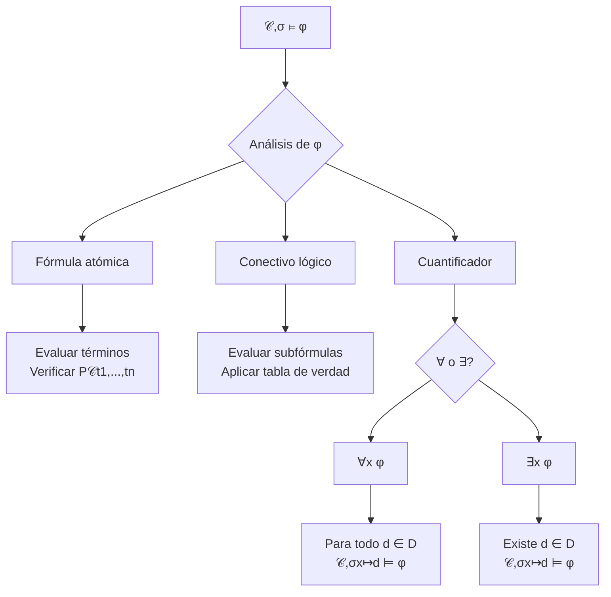
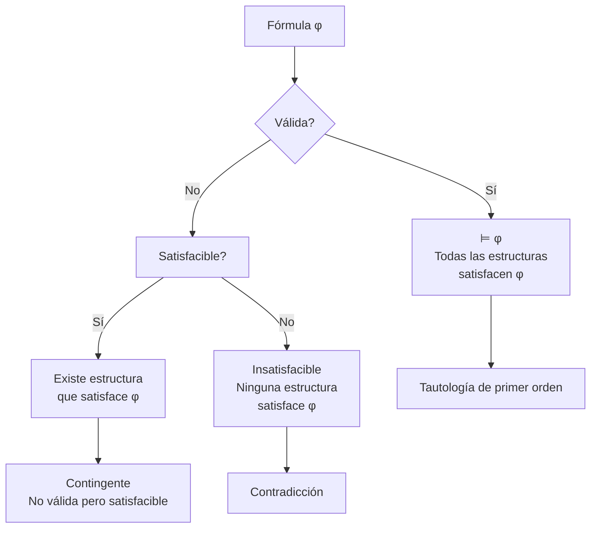

# Lógica Computacional - Lógica de predicados de primer orden

## 3.4 Semántica: introducción; interpretación de términos y fórmulas; definición de satisfacción de Tarski.

---

### 1. Introducción a la Semántica de LPO

Mientras la sintaxis se ocupa de la estructura formal de las fórmulas, la **semántica** proporciona el significado de las mismas especificando cómo se interpretan en estructuras matemáticas. La **definición de satisfacción de Tarski** establece formalmente cuándo una fórmula es verdadera en una interpretación dada.

### 2. Estructuras e Interpretaciones

Una **estructura** $\mathcal{M}$ para un lenguaje de primer orden $\mathcal{L}$ consiste en:

- Un **dominio** no vacío $D$ (conjunto de objetos)
- **Interpretación** de símbolos no lógicos:
  - Para cada constante $c:$ $c^{\mathcal{M}} \in D$
  - Para cada functor n-ario $f:$ $f^{\mathcal{M}}: D^n \to D$
  - Para cada relator n-ario $P:$ $P^{\mathcal{M}} \subseteq D^n$

#### Ejemplo: Estructura para aritmética

```python
class EstructuraAritmetica:
    def __init__(self):
        self.dominio = {0, 1, 2, 3, ...}  # números naturales
        self.interpretacion = {
            '0': 0,
            's': lambda x: x + 1,        # función sucesor
            '+': lambda x, y: x + y,     # suma
            '*': lambda x, y: x * y,     # multiplicación
            '<': lambda x, y: x < y      # relación menor que
        }
```

### 3. Asignaciones de Variables

Una **asignación** $\sigma: Vars \to D$ asigna valores del dominio a las variables.

**Notación**: $\sigma[x \mapsto d]$ es la asignación que mapea $x$ a $d$ y coincide con $\sigma$ en las demás variables.

### 4. Interpretación de Términos

La interpretación de un término $t$ en la estructura $\mathcal{M}$ bajo asignación $\sigma,$ denotada $[\![t]\!]_{\mathcal{M},\sigma},$ se define recursivamente:

1. **Variables**: $[\![x]\!]_{\mathcal{M},\sigma} = \sigma(x)$
2. **Constantes**: $[\![c]\!]_{\mathcal{M},\sigma} = c^{\mathcal{M}}$
3. **Términos funcionales**:

   $$[\![f(t_1, \ldots, t_n)]\!]_{\mathcal{M},\sigma} = f^{\mathcal{M}}([\![t_1]\!]_{\mathcal{M},\sigma}, \ldots, [\![t_n]\!]_{\mathcal{M},\sigma})$$

### 5. Satisfacción de Fórmulas (Tarski)

La relación $\mathcal{M}, \sigma \models \varphi$ ( $\varphi$ es satisfecha en $\mathcal{M}$ bajo $\sigma$ ) se define recursivamente:

#### Fórmulas atómicas:

$\mathcal{M}, \sigma \models P(t_1, \ldots, t_n)$ ssi $([\![t_1]\!]_{\mathcal{M},\sigma}, \ldots, [\![t_n]\!]_{\mathcal{M},\sigma}) \in P^{\mathcal{M}}$

#### Conectivos lógicos:

1. $\mathcal{M}, \sigma \models \neg \varphi$ ssi $\mathcal{M}, \sigma \not\models \varphi$
2. $\mathcal{M}, \sigma \models \varphi \land \psi$ ssi $\mathcal{M}, \sigma \models \varphi$ y $\mathcal{M}, \sigma \models \psi$
3. $\mathcal{M}, \sigma \models \varphi \lor \psi$ ssi $\mathcal{M}, \sigma \models \varphi$ o $\mathcal{M}, \sigma \models \psi$
4. $\mathcal{M}, \sigma \models \varphi \rightarrow \psi$ ssi $\mathcal{M}, \sigma \not\models \varphi$ o $\mathcal{M}, \sigma \models \psi$

#### Cuantificadores:

1. $\mathcal{M}, \sigma \models \forall x \varphi$ ssi para todo $d \in D,$ $\mathcal{M}, \sigma[x \mapsto d] \models \varphi$
2. $\mathcal{M}, \sigma \models \exists x \varphi$ ssi existe $d \in D$ tal que $\mathcal{M}, \sigma[x \mapsto d] \models \varphi$



### 6. Implementación de la Evaluación Semántica

```python
class EvaluadorSemantico:
    def __init__(self, estructura):
        self.estructura = estructura
        self.dominio = estructura.dominio

    def interpretar_termino(self, termino, asignacion):
        """Interpreta un término según la definición de Tarski"""
        if es_variable(termino):
            return asignacion[termino.nombre]

        elif es_constante(termino):
            return self.estructura.interpretacion[termino.nombre]

        elif es_termino_funcional(termino):
            func = self.estructura.interpretacion[termino.funcion]
            args = [self.interpretar_termino(arg, asignacion)
                   for arg in termino.argumentos]
            return func(*args)

    def evaluar_formula(self, formula, asignacion):
        """Evalúa una fórmula según la definición de satisfacción de Tarski"""
        if es_formula_atomica(formula):
            pred = self.estructura.interpretacion[formula.predicado]
            args = [self.interpretar_termino(arg, asignacion)
                   for arg in formula.argumentos]
            return tuple(args) in pred

        elif es_negacion(formula):
            return not self.evaluar_formula(formula.subformula, asignacion)

        elif es_conjuncion(formula):
            return (self.evaluar_formula(formula.left, asignacion) and
                    self.evaluar_formula(formula.right, asignacion))

        elif es_disjuncion(formula):
            return (self.evaluar_formula(formula.left, asignacion) or
                    self.evaluar_formula(formula.right, asignacion))

        elif es_implicacion(formula):
            return (not self.evaluar_formula(formula.left, asignacion) or
                    self.evaluar_formula(formula.right, asignacion))

        elif es_cuantificador_universal(formula):
            variable = formula.variable
            for valor in self.dominio:
                nueva_asignacion = asignacion.copy()
                nueva_asignacion[variable] = valor
                if not self.evaluar_formula(formula.subformula, nueva_asignacion):
                    return False
            return True

        elif es_cuantificador_existencial(formula):
            variable = formula.variable
            for valor in self.dominio:
                nueva_asignacion = asignacion.copy()
                nueva_asignacion[variable] = valor
                if self.evaluar_formula(formula.subformula, nueva_asignacion):
                    return True
            return False
```

### 7. Ejemplos de Evaluación Semántica

#### Ejemplo 1: Estructura concreta

Sea $\mathcal{M}$ con:

- $D = \{1, 2, 3\}$
- $a^{\mathcal{M}} = 1,$ $b^{\mathcal{M}} = 2$
- $P^{\mathcal{M}} = \{1, 3\},$ $Q^{\mathcal{M}} = \{(1,2), (2,3)\}$

Para $\varphi = \forall x (P(x) \rightarrow \exists y Q(x, y)):$

- $\mathcal{M} \models \varphi?$ ✓ (Se verifica para todos los elementos)

#### Ejemplo 2: Aritmética de Peano

Para $\varphi = \forall x \exists y (x < y)$ en $\mathbb{N}:$

- $\mathcal{M} \models \varphi?$ ✓ (Para todo natural existe uno mayor)

### 8. Conceptos Semánticos Importantes

- **Fórmula válida**: $\models \varphi$ si para toda $\mathcal{M}$ y toda $\sigma,$ $\mathcal{M}, \sigma \models \varphi$
- **Fórmula satisfacible**: Existe $\mathcal{M}$ y $\sigma$ tal que $\mathcal{M}, \sigma \models \varphi$
- **Fórmula insatisfacible**: No existe $\mathcal{M}$ y $\sigma$ que la satisfaga
- **Consecuencia lógica**: $\varphi \models \psi$ si para toda $\mathcal{M}$ y $\sigma$ con $\mathcal{M}, \sigma \models \varphi,$ también $\mathcal{M}, \sigma \models \psi$

### 9. Ejercicios Propuestos

#### Ejercicio 1

Sea $\mathcal{M}$ con dominio $D = \{1, 2, 3\},$ $P^{\mathcal{M}} = \{1, 2\},$ $Q^{\mathcal{M}} = \{(1,2), (3,1)\}.$ Evaluar:

1. $\mathcal{M} \models \exists x P(x)?$
2. $\mathcal{M} \models \forall x \exists y Q(x, y)?$
3. $\mathcal{M} \models P(a) \rightarrow Q(a, b)$ para $a^{\mathcal{M}} = 1,$ $b^{\mathcal{M}} = 3$

#### Ejercicio 2

Probar que $\models \forall x \varphi \rightarrow \varphi[t/x]$ si $t$ es sustituible por $x$ en $\varphi$

#### Ejercicio 3

Implementar la función `es_valida(formula)` que verifique si una fórmula es válida

#### Ejercicio 4

Para la fórmula $\varphi = \forall x (P(x) \lor Q(x)) \rightarrow (\forall x P(x) \lor \forall x Q(x)):$

- ¿Es válida?
- Encontrar un contraejemplo si no lo es

### 10. Diagrama: Relaciones Semánticas



### 11. Soluciones a Ejercicios Selectos

#### Solución Ejercicio 1:

1. ✓ $\mathcal{M} \models \exists x P(x)$ porque existen 1 y 2 en $P$
2. ✗ $\mathcal{M} \not\models \forall x \exists y Q(x, y)$ porque para $x=2,$ no existe $y$ tal que $(2,y) \in Q$
3. ✓ $\mathcal{M} \models P(1) \rightarrow Q(1, 3)$ porque $P(1)$ es true y $Q(1,3)$ es false, pero la implicación es true

#### Solución Ejercicio 4:

La fórmula no es válida. Contraejemplo:

- $D = \{1, 2\}$
- $P^{\mathcal{M}} = \{1\},$ $Q^{\mathcal{M}} = \{2\}$
- $\forall x (P(x) \lor Q(x))$ es true
- Pero $\forall x P(x) \lor \forall x Q(x)$ es false

### 12. Referencias

#### Bibliografía Básica:

1. **Huth & Ryan (2004)**: Capítulo 1 - Sección 1.3 (Semántica de lógica de primer orden)
2. **Nerode & Shore (1997)**: Capítulo 2 - Sección 2.3 (Interpretaciones y modelos)

#### Bibliografía Complementaria:

1. **Ben-Ari (2008)**: Capítulo 4 - Sección 4.4 (Semántica de Tarski)
2. **Fitting (1996)**: Capítulo 2 - Sección 2.6 (Interpretaciones y verdad)
3. **Sperschneider & Antoniou (1991)**: Capítulo 6 - Sección 6.2 (Satisfacción)
