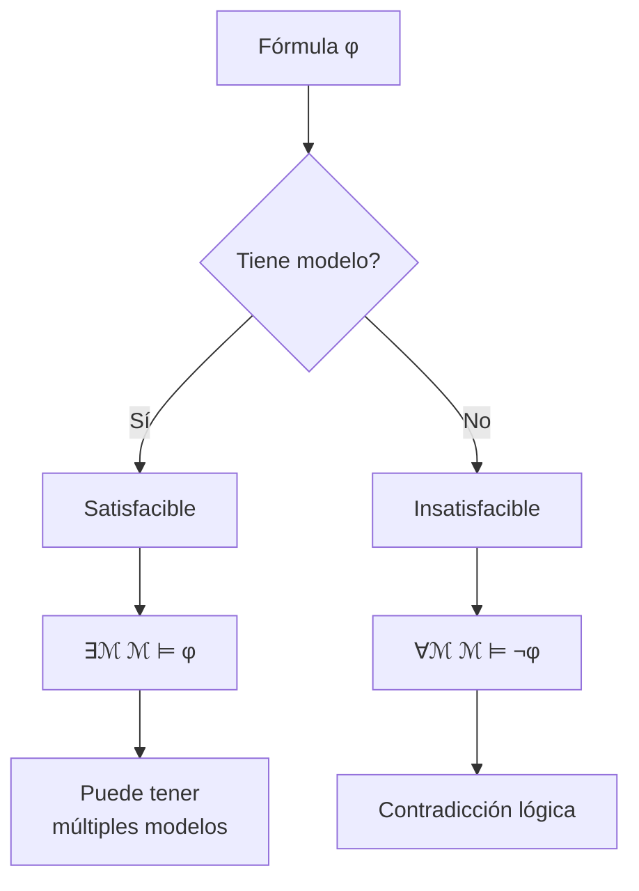
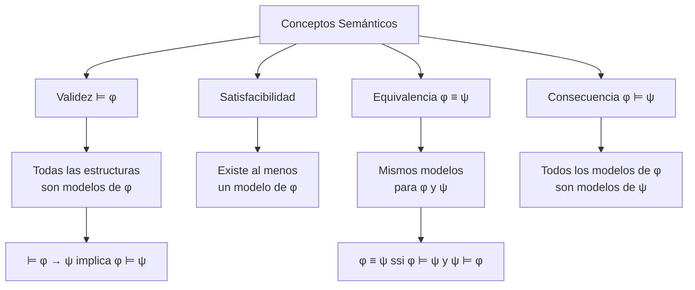

# Lógica Computacional - Lógica de predicados de primer orden

## 3.5 Conceptos semánticos: verdad, modelos, validez y equivalencia lógica.

---

### 1. Introducción a los Conceptos Semánticos

La semántica de la lógica de primer orden establece las bases para determinar el **valor de verdad** de las fórmulas en diferentes interpretaciones. Los conceptos de **modelo**, **validez** y **equivalencia lógica** son fundamentales para el razonamiento formal y la verificación de sistemas.

### 2. Verdad en una Estructura

Una fórmula $\varphi$ es **verdadera** en una estructura $\mathcal{M}$ bajo una asignación $\sigma$ ( denotado $\mathcal{M}, \sigma \models \varphi$ ) si se satisface según la definición de Tarski.

**Fórmula cerrada**: Si $\varphi$ es cerrada (sin variables libres), su verdad no depende de $\sigma.$ Escribimos $\mathcal{M} \models \varphi.$

#### Ejemplo:

Sea $\mathcal{M}$ con dominio $\mathbb{N}$ y la interpretación usual de $+$ y $=.$ Entonces:

- $\mathcal{M} \models \forall x \exists y (x + y = x)$ ✓
- $\mathcal{M} \not\models \exists x \forall y (x + y = y)$ ✗

### 3. Modelos y Satisfacibilidad

Un **modelo** de una fórmula $\varphi$ es una estructura $\mathcal{M}$ tal que $\mathcal{M} \models \varphi.$

- **Satisfacible**: $\varphi$ es satisfacible si tiene al menos un modelo
- **Insatisfacible**: $\varphi$ es insatisfacible si no tiene ningún modelo



### 4. Validez Lógica

Una fórmula $\varphi$ es **válida** ( denotado $\models \varphi$ ) si es verdadera en todas las estructuras:

$$\models \varphi \quad \text{ssi} \quad \forall \mathcal{M}, \mathcal{M} \models \varphi$$

#### Ejemplos de fórmulas válidas:

1. $\models \forall x P(x) \rightarrow P(a)$
2. $\models \exists x (P(x) \rightarrow \forall y P(y))$
3. $\models \neg \forall x P(x) \leftrightarrow \exists x \neg P(x)$

### 5. Equivalencia Lógica

Dos fórmulas $\varphi$ y $\psi$ son **lógicamente equivalentes** ( denotado $\varphi \equiv \psi$ ) si tienen los mismos modelos:

$$\varphi \equiv \psi \quad \text{ssi} \quad \forall \mathcal{M}, (\mathcal{M} \models \varphi \leftrightarrow \mathcal{M} \models \psi)$$

#### Equivalencias importantes:

1. $\neg \forall x \varphi \equiv \exists x \neg \varphi$
2. $\neg \exists x \varphi \equiv \forall x \neg \varphi$
3. $\forall x (\varphi \land \psi) \equiv \forall x \varphi \land \forall x \psi$
4. $\exists x (\varphi \lor \psi) \equiv \exists x \varphi \lor \exists x \psi$

### 6. Consecuencia Lógica

Una fórmula $\psi$ es **consecuencia lógica** de $\varphi$ ( denotado $\varphi \models \psi$ ) si todo modelo de $\varphi$ es también modelo de $\psi:$

$$\varphi \models \psi \quad \text{ssi} \quad \forall \mathcal{M}, (\mathcal{M} \models \varphi \rightarrow \mathcal{M} \models \psi)$$

### 7. Implementación de Verificación de Validez

```python
class VerificadorSemantico:
    def __init__(self, dominio_maximo=3):
        self.dominio_maximo = dominio_maximo

    def generar_estructuras(self, signature, tamaño_dominio):
        """Genera todas las estructuras posibles para un dominio finito"""
        # Implementación que genera todas las interpretaciones posibles
        # para los símbolos en la signatura sobre el dominio dado
        pass

    def es_valida(self, formula):
        """Verifica si una fórmula es válida para dominios finitos hasta tamaño máximo"""
        from itertools import product

        signatura = obtener_signatura(formula)

        for tamaño in range(1, self.dominio_maximo + 1):
            dominio = list(range(tamaño))

            # Generar todas las interpretaciones posibles
            for estructura in self.generar_estructuras(signatura, dominio):
                if not self.evaluar_en_estructura(formula, estructura):
                    return False  # Contraejemplo encontrado

        return True  # Válida para todos los dominios probados

    def son_equivalentes(self, phi, psi):
        """Verifica si dos fórmulas son equivalentes"""
        return self.es_valida(phi + ' <-> ' + psi)  # Para lógica proposicional
        # Para primer orden, se necesita verificar para todas las estructuras

    def es_consecuencia(self, premisas, conclusion):
        """Verifica si la conclusión es consecuencia lógica de las premisas"""
        # φ ⊨ ψ ssi ⊨ φ → ψ
        implicacion = '(' + ' ∧ '.join(premisas) + ') → ' + conclusion
        return self.es_valida(implicacion)
```

### 8. Ejemplos y Contraejemplos

#### Ejemplo 1: Validez

$\varphi = \forall x P(x) \rightarrow \exists x P(x)$

- (✓) Válida: Si todos los elementos tienen propiedad P, entonces existe uno que la tiene

#### Ejemplo 2: No validez

$\psi = \exists x P(x) \rightarrow \forall x P(x)$

- (X) No válida: Contraejemplo: dominio {1, 2}, P = {1}

#### Ejemplo 3: Equivalencia

$\neg \forall x P(x) \equiv \exists x \neg P(x)$

- (✓) Equivalentes: La negación de "todo" es "existe uno que no"

### 9. Diagrama: Relaciones entre Conceptos Semánticos



### 10. Ejercicios Propuestos

#### Ejercicio 1

Determinar cuáles de las siguientes fórmulas son válidas:

1. $\forall x (P(x) \lor Q(x)) \rightarrow (\forall x P(x) \lor \forall x Q(x))$
2. $(\forall x P(x) \rightarrow \forall x Q(x)) \rightarrow \forall x (P(x) \rightarrow Q(x))$
3. $\exists x (P(x) \rightarrow Q(x)) \rightarrow (\exists x P(x) \rightarrow \exists x Q(x))$

#### Ejercicio 2

Probar o encontrar contraejemplo para:

1. $\forall x (P(x) \land Q(x)) \equiv \forall x P(x) \land \forall x Q(x)$
2. $\exists x (P(x) \lor Q(x)) \equiv \exists x P(x) \lor \exists x Q(x)$

#### Ejercicio 3

Implementar una función que verifique si dos fórmulas son equivalentes para dominios finitos pequeños.

#### Ejercicio 4

Para cada par, determinar si hay relación de consecuencia:

1. $\forall x P(x) \models \exists x P(x)$
2. $\exists x P(x) \models \forall x P(x)$
3. $\forall x (P(x) \rightarrow Q(x)) \models \forall x P(x) \rightarrow \forall x Q(x)$

### 11. Teoremas de Metalogica

1. **Teorema de deducción**: $\varphi \models \psi$ ssi $\models \varphi \rightarrow \psi$
2. **Teorema de completitud**: $\varphi \models \psi$ ssi $\varphi \vdash \psi$ (para sistemas completos)
3. **Teorema de compacidad**: Un conjunto de fórmulas es satisfacible ssi todo subconjunto finito lo es

### 12. Soluciones a Ejercicios Selectos

#### Solución Ejercicio 1:

1. (X) No válida: Contraejemplo: D = {1, 2}, P = {1}, Q = {2}
2. (✓) Válida: Si whenever todo tiene P entonces todo tiene Q, entonces cada elemento que tiene P también tiene Q
3. (✓) Válida: Si existe un elemento donde P implica Q, y existe algún elemento con P, entonces existe algún elemento con Q

#### Solución Ejercicio 2:

1. (✓) Equivalentes: Ambas significan que todos los elementos tienen P y Q
2. (✓) Equivalentes: Ambas significan que existe algún elemento con P o con Q

#### Solución Ejercicio 4:

1. (✓) $\forall x P(x) \models \exists x P(x)$ (asumiendo dominio no vacío)
2. (X) $\exists x P(x) \not\models \forall x P(x)$
3. (X) $\forall x (P(x) \rightarrow Q(x)) \not\models \forall x P(x) \rightarrow \forall x Q(x)$

### 13. Referencias

#### Bibliografía Básica:

1. **Huth & Ryan (2004)**: Capítulo 1 - Secciones 1.3-1.4 (Semántica y validez)
2. **Nerode & Shore (1997)**: Capítulo 2 - Sección 2.3 (Modelos y consecuencia)

#### Bibliografía Complementaria:

1. **Ben-Ari (2008)**: Capítulo 4 - Sección 4.4 (Validez y equivalencia)
2. **Fitting (1996)**: Capítulo 2 - Sección 2.6 (Conceptos semánticos)
3. **Sperschneider & Antoniou (1991)**: Capítulo 6 - Sección 6.3 (Validez y modelos)
