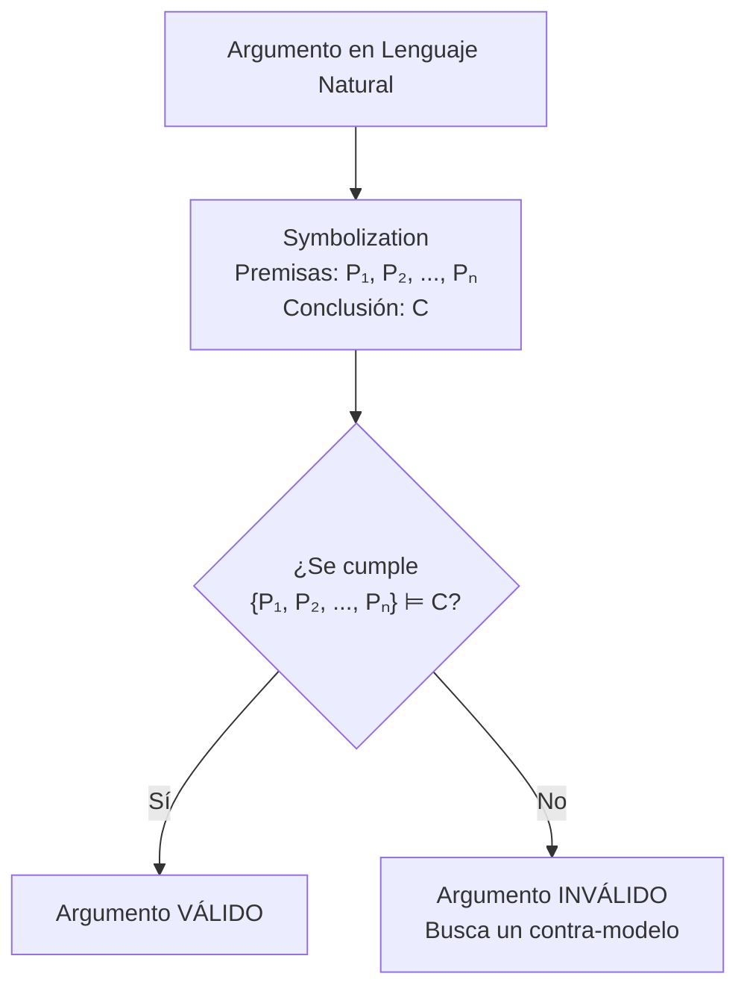

# Lógica Computacional - Análisis de argumentos

## 4.1 La noción de consecuencia lógica.

---

### 1. Introducción

El corazón de la lógica, y por extensión de la lógica computacional, es determinar la validez de los argumentos. Un argumento es válido si su conclusión se sigue necesariamente de sus premisas. Esta relación de "seguirse necesariamente" se formaliza mediante el concepto fundamental de **consecuencia lógica**.

### 2. Definición Central: Consecuencia Lógica (⊨)

Sea $\Gamma$ un conjunto de fórmulas (las premisas) y $\psi$ una fórmula (la conclusión). Decimos que **$\psi$ es consecuencia lógica de $\Gamma$**, denotado por $\Gamma \vDash \psi,$ si y sólo si **todas las interpretaciones (modelos) que satisfacen every fórmula en $\Gamma$ también satisfacen $\psi$**.

En términos más simples: **En todos los mundos (situaciones, asignaciones de valores de verdad, estructuras) donde las premisas son verdaderas, la conclusión también lo es.**

$$ \Gamma \vDash \psi \quad \text{iff} \quad \forall M \left[ \left( \forall \phi \in \Gamma, \, M \vDash \phi \right) \rightarrow M \vDash \psi \right] $$

_Donde $M$ es una interpretación o modelo._

**Nota:** Si $\Gamma$ es un conjunto finito $\{ \phi_1, \phi_2, ..., \phi_n \},$ a menudo escribimos $\phi_1, \phi_2, ..., \phi_n \vDash \psi.$

### 3. Diferencia Crucial: ⊨ vs. ⊢

Es vital distinguir entre consecuencia lógica (semántica) y derivabilidad (sintáctica).

| Concepto                    | Símbolo  | Tipo       | Definición                                                                      | Depende de                                        |
| :-------------------------- | :------- | :--------- | :------------------------------------------------------------------------------ | :------------------------------------------------ |
| **Consecuencia Lógica**     | $\vDash$ | Semántica  | Basada en interpretaciones y valores de verdad.                                 | El significado de las conectivas lógicas.         |
| **Derivabilidad / Teorema** | $\vdash$ | Sintáctica | Basada en la aplicación de reglas de inferencia en un sistema formal (cálculo). | Las reglas de un sistema de deducción específico. |

Un sistema de lógica es **correcto (sound)** si todo lo que es derivable es también consecuencia lógica ( $\vdash \psi$ implica $\vDash \psi$ ).
Es **completo (complete)** si toda consecuencia lógica es derivable ( $\vDash \psi$ implica $\vdash \psi$ ).
La Lógica Proposicional y de Primer Orden son correctas y completas.

### 4. Análisis de Argumentos mediante Consecuencia Lógica

Analizar un argumento en lenguaje natural se reduce a estos pasos:

1. **Symbolization:** Transformar las premisas ( $P_1, P_2, ..., P_n$ ) y la conclusión $(C)$ del argumento en fórmulas bien formadas de lógica ( $\phi_1, \phi_2, ..., \phi_n, \psi$ ).
2. **Análisis Lógico:** Verificar si se cumple la relación de consecuencia lógica: $\{ \phi_1, \phi_2, ..., \phi_n \} \vDash \psi.$
3. **Veredicto:** Si $\vDash$ se cumple, el argumento es **válido**. Si no, es **inválido**.

### 5. Métodos de Verificación

#### **a) Tablas de Verdad (Lógica Proposicional)**

Construye la tabla de verdad para todas las premisas y la conclusión. **Si en cada fila donde todas las premisas son V, la conclusión también es V, entonces $\vDash$ se cumple.**

**Ejemplo:** Verifica $p \rightarrow q, p \vDash q$ (Modus Ponens).

| $p$ | $q$ | $p \rightarrow q$ | $p$ | $q$ |
| :-: | :-: | :---------------: | :-: | :-: |
|  V  |  V  |         V         |  V  |  V  |
|  V  |  F  |         F         |  V  |  F  |
|  F  |  V  |         V         |  F  |  V  |
|  F  |  F  |         V         |  F  |  F  |

(✓) En la única fila donde ambas premisas ( $p \rightarrow q$ y $p$ ) son Verdaderas (fila 1), la conclusión $(q)$ también es Verdadera. Por lo tanto, $p \rightarrow q, p \vDash q.$

#### **b) Demostración por Contradicción (Refutación)**

Asume que las premisas son verdaderas pero la conclusión es falsa ( $M \vDash \Gamma$ pero $M \nvDash \psi$ ). Si esta suposición lleva a una **contradicción**, entonces la relación $\vDash$ debe ser cierta.

**Ejemplo:** Verifica $\neg p \rightarrow \neg q, q \vDash p.$

1. _Asume_ un modelo $M$ donde $M \vDash \neg p \rightarrow \neg q$ y $M \vDash q,$ pero $M \nvDash p$ ( i.e., $M \vDash \neg p$ ).
2. De $M \vDash q$ se sigue que $M \nvDash \neg q.$
3. De $M \vDash \neg p$ y $M \vDash \neg p \rightarrow \neg q$ (por Modus Ponens), se sigue que $M \vDash \neg q.$
4. Los pasos 2 y 3 son contradictorios ( $M \vDash \neg q$ y $M \nvDash \neg q$ ).
5. La suposición inicial es imposible. Por lo tanto, $\neg p \rightarrow \neg q, q \vDash p.$

### 6. Ejercicios Propuestos

1. **Verifica usando tablas de verdad:** $(p \rightarrow q) \land (q \rightarrow r), \neg r \vDash \neg p$
2. **Verifica por contradicción:** $p \lor q, \neg p \vDash q$
3. **¿Es válido el siguiente argumento?** "Si es mediodía, entonces estoy hambriento. O no es mediodía o estoy hambriento. Por lo tanto, estoy hambriento." (Symbolize primero: $m:$ "es mediodía", $h:$ "estoy hambriento")
4. **Basado en Nerode & Shore (1997):** Demuestra que $\vDash (A \rightarrow B) \rightarrow (\neg B \rightarrow \neg A)$ es una tautología ( consecuencia lógica de un conjunto vacío de premisas, $\varnothing \vDash \psi$ ). ¿Qué método es más eficiente aquí?
5. **Basado en Huth & Ryan (2004):** Explica por qué la relación $\Gamma \vDash \psi$ es **monotónica**. Es decir, si $\Gamma \vDash \psi,$ entonces para cualquier conjunto de fórmulas $\Delta,$ se cumple que $\Gamma \cup \Delta \vDash \psi.$

### 7. Diagrama: Proceso de Análisis de un Argumento



### 8. Código (Python) - Verificador Básico de Consecuencia Lógica (Proposicional)

Este código simple usa tablas de verdad para verificar $\Gamma \vDash \psi$ para un número pequeño de variables atómicas.

```python
import itertools

def implica_logicamente(premisas, conclusion):
    """
    Verifica si la conclusión es consecuencia lógica de las premisas.
    premisas: lista de fórmulas como strings lambda, e.g., ['p and q', 'not p']
    conclusion: string de una fórmula lambda, e.g., 'q'
    Las variables deben ser letras individuales.
    """
    # 1. Encuentra todas las variables atómicas
    variables = set()
    for formula in premisas + [conclusion]:
        for char in formula:
            if char.isalpha() and char not in 'andornot':
                variables.add(char)
    variables = sorted(variables)  # e.g., ['p', 'q']

    # 2. Genera todas las interpretaciones (tabla de verdad)
    n = len(variables)
    valores_posibles = itertools.product([True, False], repeat=n)

    # 3. Evalúa cada interpretación
    for valores in valores_posibles:
        # Crea el contexto para eval()
        contexto = dict(zip(variables, valores))

        # Evalúa todas las premisas bajo esta interpretación
        premisas_verdaderas = True
        for formula in premisas:
            # NOTA DE SEGURIDAD: Usar 'eval' es peligroso con input no confiable.
            # Esto es solo para fines educativos.
            if not eval(formula, {}, contexto):
                premisas_verdaderas = False
                break # Una premisa es falsa, no need to check the others

        # Si todas las premisas son V, check the conclusion
        if premisas_verdaderas:
            conclusion_verdadera = eval(conclusion, {}, contexto)
            if not conclusion_verdadera:
                print(f"¡Contra-ejemplo encontrado! {contexto}")
                return False
    return True

# Ejemplo: Verifica Modus Ponens: p → q, p ⊨ q
premisas_ej = ['not p or q', 'p'] # p → q es equivalente a ¬p ∨ q
conclusion_ej = 'q'
resultado = implica_logicamente(premisas_ej, conclusion_ej)
print(f"¿Las premisas implican lógicamente la conclusión? {resultado}")
```

### 9. Referencias

- **Huth, M., Ryan, M. (2004).** _Logic in Computer Science._ Capítulo 1. La definición semántica central se presenta aquí.
- **Nerode, A., Shore, R.A. (1997).** _Logic for Applications._ Capítulo 1. Ofrece una excelente exposición sobre la relación entre sintaxis y semántica.
- **Ben-Ari, M. (2008).** _Mathematical Logic for Computer Science._ Capítulo 2. Muy claro en los métodos semánticos para lógica proposicional.
- **Fitting, M. (1996).** _First-Order Logic and Automated Theorem Proving._ Capítulo 2. Profundiza en las propiedades formales de la relación $\vDash.$
