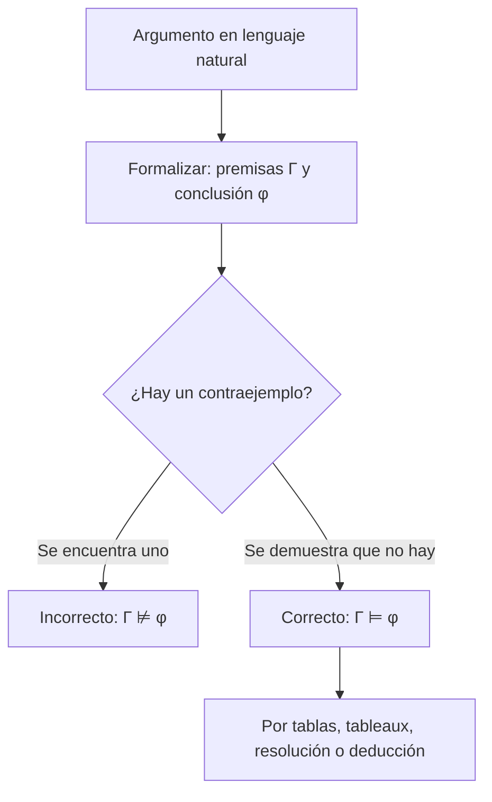

# Lógica Computacional - Análisis de argumentos

## 4.1 La noción de consecuencia lógica.

---

Un argumento es correcto cuando su conclusión **se sigue necesariamente** de sus premisas: no puede ocurrir que las premisas sean verdaderas y la conclusión falsa. La **consecuencia lógica** convierte esa idea intuitiva en una definición precisa, que depende de la **forma** del argumento y no de su contenido. Es el concepto central de la lógica: los sistemas deductivos del tema 5 son intentos de capturarla con reglas sintácticas.

### Definición

**Definición.** Sea $\Gamma$ un conjunto de fórmulas y $\varphi$ una fórmula. $\varphi$ es **consecuencia lógica** de $\Gamma,$ y se escribe $\Gamma \models \varphi,$ si toda interpretación que satisface a todas las fórmulas de $\Gamma$ satisface a $\varphi.$

- En lógica proposicional, las interpretaciones son asignaciones de valores de verdad (tema 2.3).
- En lógica de primer orden, son pares $(\mathcal{M}, \sigma)$ de una estructura y una asignación (tema 3.5).

Un argumento con premisas $\gamma_1, \ldots, \gamma_k$ y conclusión $\varphi$ es **correcto** (o válido) si $\gamma_1, \ldots, \gamma_k \models \varphi.$ Un **contraejemplo** es una interpretación que hace verdaderas las premisas y falsa la conclusión; el argumento es correcto si y solo si no tiene contraejemplos.

**Casos particulares.**

- $\emptyset \models \varphi,$ que se escribe $\models \varphi,$ significa que $\varphi$ es **válida**.
- $\Gamma \models \bot$ significa que $\Gamma$ es **insatisfacible**.

**Validez no es verdad.** Un argumento correcto puede tener premisas falsas y conclusión falsa: "todos los peces vuelan; los gatos son peces; por lo tanto, los gatos vuelan" es correcto. Y un argumento incorrecto puede tener premisas y conclusión verdaderas: "algunos números son pares; 4 es un número; por lo tanto, 4 es par". La corrección garantiza solo que la verdad se **transmite** de las premisas a la conclusión. Un argumento correcto con premisas verdaderas se llama **sólido**.

### Reducción a satisfacibilidad y validez

**Teorema.** Para un conjunto finito $\Gamma = \{\gamma_1, \ldots, \gamma_k\}$ de enunciados y un enunciado $\varphi,$ son equivalentes:

1. $\Gamma \models \varphi.$
2. $\models (\gamma_1 \land \cdots \land \gamma_k) \to \varphi.$
3. $\Gamma \cup \{\lnot \varphi\}$ es insatisfacible.

**Demostración.** Una interpretación es contraejemplo de (1) exactamente cuando hace falsa la implicación de (2) y cuando satisface al conjunto de (3). Así que las tres afirmaciones dicen que no hay contraejemplos. $\blacksquare$

La equivalencia con (3) es la base de los métodos de **refutación**, tableaux y resolución: para demostrar una consecuencia se demuestra que las premisas junto con la negación de la conclusión no tienen modelos.

### Propiedades de la consecuencia lógica

Para conjuntos $\Gamma,$ $\Delta$ y fórmulas $\varphi,$ $\psi:$

1. **Reflexividad.** Si $\varphi \in \Gamma,$ entonces $\Gamma \models \varphi.$
2. **Monotonía.** Si $\Gamma \models \varphi$ y $\Gamma \subseteq \Delta,$ entonces $\Delta \models \varphi.$
3. **Corte (transitividad).** Si $\Gamma \models \psi$ y $\Gamma \cup \{\psi\} \models \varphi,$ entonces $\Gamma \models \varphi.$
4. **Deducción.** $\Gamma \cup \{\psi\} \models \varphi$ si y solo si $\Gamma \models \psi \to \varphi.$
5. **Explosión.** Si $\Gamma$ es insatisfacible, $\Gamma \models \varphi$ para toda $\varphi.$
6. **Compacidad.** Si $\Gamma \models \varphi,$ existe un $\Gamma_0 \subseteq \Gamma$ finito con $\Gamma_0 \models \varphi.$

**Demostración de 2.** Todo modelo de $\Delta$ es modelo de $\Gamma,$ y por hipótesis, de $\varphi.$ $\blacksquare$

**Demostración de 4.** Supongamos $\Gamma \cup \{\psi\} \models \varphi$ y sea $I$ un modelo de $\Gamma.$ Si $I(\psi) = 0,$ la implicación es verdadera. Si $I(\psi) = 1,$ $I$ es modelo de $\Gamma \cup \{\psi\}$ y $I(\varphi) = 1.$ En ambos casos $I(\psi \to \varphi) = 1.$ Al revés, si $I$ es modelo de $\Gamma \cup \{\psi\},$ entonces $I(\psi \to \varphi) = 1$ e $I(\psi) = 1,$ así que $I(\varphi) = 1.$ $\blacksquare$

**Demostración de 5.** Como $\Gamma$ no tiene modelos, no hay contraejemplos. $\blacksquare$

La monotonía dice que añadir información nunca invalida una conclusión. Es una propiedad de la lógica clásica que el razonamiento cotidiano no tiene ("los pájaros vuelan; Tweety es un pájaro"; pero Tweety es un pingüino), y que estudian las lógicas **no monótonas** de la inteligencia artificial. La compacidad, en primer orden, es un teorema profundo que se sigue del teorema de completud (tema 5.3).

### Consecuencia semántica y derivabilidad

| | Consecuencia lógica | Derivabilidad |
| --- | --- | --- |
| Notación | $\Gamma \models \varphi$ | $\Gamma \vdash \varphi$ |
| Naturaleza | semántica | sintáctica |
| Se define con | interpretaciones | reglas de inferencia |
| Se demuestra con | un argumento sobre todos los modelos | una derivación finita |
| Se refuta con | un contraejemplo | (no hay un objeto equivalente) |

Un sistema deductivo es **correcto** si $\Gamma \vdash \varphi$ implica $\Gamma \models \varphi,$ y **completo** si $\Gamma \models \varphi$ implica $\Gamma \vdash \varphi.$ Para la lógica proposicional y la de primer orden existen sistemas correctos y completos: los tableaux, la deducción natural y la resolución refutacional (tema 5). Que ambas nociones coincidan, para primer orden, es el **teorema de completud de Gödel** (1930).

### Métodos para decidir la consecuencia

- **Lógica proposicional:** revisar las $2^n$ interpretaciones (tablas de verdad), tableaux (tema 2.5), resolución (tema 2.6) o un SAT solver aplicado a $\Gamma \cup \{\lnot \varphi\}.$ Todos son procedimientos de decisión.
- **Lógica de primer orden:** para demostrar $\Gamma \models \varphi$ se usa un sistema deductivo o un razonamiento sobre estructuras arbitrarias; para refutarla, se construye un **modelo contraejemplo** (tema 4.2). No hay un procedimiento que decida siempre (tema 4.3).



**Ejemplo.** $\lnot p \to \lnot q,$ $q \models p.$ Por contradicción: si una interpretación hiciera verdaderas las premisas y falsa a $p,$ entonces $\lnot p$ sería verdadera, y por la primera premisa también $\lnot q,$ contradiciendo la segunda. No hay contraejemplos.

**Ejemplo en primer orden.** "Todos los humanos son mortales; Sócrates es humano; por lo tanto, Sócrates es mortal":

$$ \forall x\, (H(x) \to M(x)),\ H(s) \models M(s) $$

Sea $\mathcal{M}$ un modelo de las premisas. Por la primera, para todo $d,$ si $d \in H^{\mathcal{M}}$ entonces $d \in M^{\mathcal{M}};$ con $d = s^{\mathcal{M}},$ que está en $H^{\mathcal{M}}$ por la segunda, se obtiene $s^{\mathcal{M}} \in M^{\mathcal{M}}.$ En cambio, de $\forall x\, (H(x) \to M(x))$ y $M(s)$ no se sigue $H(s):$ una estructura con $M^{\mathcal{M}} = \{s^{\mathcal{M}}\}$ y $H^{\mathcal{M}} = \emptyset$ es contraejemplo.

### Implementación en Python

El programa decide la consecuencia lógica proposicional revisando todas las interpretaciones y, cuando no se cumple, devuelve el contraejemplo. Lee fórmulas con las precedencias usuales con el mismo analizador del tema 2.5, analiza los argumentos de los ejemplos y ejercicios, y verifica una instancia del teorema de la deducción.

```python
import re

# ---------- Fórmulas: lectura con precedencias ¬ > ∧ > ∨ > → > ↔ ----------
def leer(s):
    toks = re.findall(r'[a-z]\d*|[¬∧∨→↔()]', s)
    pos = 0
    def ver(): return toks[pos] if pos < len(toks) else None
    def tomar():
        nonlocal pos; pos += 1; return toks[pos - 1]
    def bicond():
        f = impl()
        while ver() == '↔':
            tomar(); f = ('↔', f, impl())
        return f
    def impl():
        f = disy()
        if ver() == '→':
            tomar(); f = ('→', f, impl())        # asocia a la derecha
        return f
    def disy():
        f = conj()
        while ver() == '∨':
            tomar(); f = ('∨', f, conj())
        return f
    def conj():
        f = neg()
        while ver() == '∧':
            tomar(); f = ('∧', f, neg())
        return f
    def neg():
        if ver() == '¬':
            tomar(); return ('¬', neg())
        if ver() == '(':
            tomar(); f = bicond(); tomar(); return f
        return tomar()
    return bicond()

from itertools import product

def valor(f, I):
    if isinstance(f, str): return I[f]
    if f[0] == '¬': return not valor(f[1], I)
    a, b = valor(f[1], I), valor(f[2], I)
    return {'∧': a and b, '∨': a or b, '→': (not a) or b, '↔': a == b}[f[0]]

def variables(f):
    if isinstance(f, str): return {f}
    return set().union(*(variables(g) for g in f[1:]))

def consecuencia(premisas, conclusion):
    """Γ ⊨ φ: devuelve (True, None) o (False, contraejemplo)."""
    fs = [leer(p) for p in premisas]
    c = leer(conclusion)
    vs = sorted(set().union(variables(c), *map(variables, fs)))
    for vals in product([True, False], repeat=len(vs)):
        I = dict(zip(vs, vals))
        if all(valor(f, I) for f in fs) and not valor(c, I):
            return False, {v: int(b) for v, b in I.items()}
    return True, None

argumentos = [
    (['p → q', 'p'], 'q'),
    (['¬p → ¬q', 'q'], 'p'),
    (['(p → q) ∧ (q → r)', '¬r'], '¬p'),
    (['p ∨ q', '¬p'], 'q'),
    (['m → h', '¬m ∨ h'], 'h'),
    ([], '(a → b) → (¬b → ¬a)'),
    (['p', '¬p'], 'q'),
]
for prem, concl in argumentos:
    ok, contra = consecuencia(prem, concl)
    print(f"{', '.join(prem) or '∅':24} ⊨ {concl:22} {'sí' if ok else 'no, contraejemplo ' + str(contra)}")

# Teorema de la deducción: Γ ∪ {φ} ⊨ ψ  si y solo si  Γ ⊨ φ → ψ
G, phi, psi = ['p ∨ q', 'q → r'], '¬p', 'r'
print('deducción:', consecuencia(G + [phi], psi)[0], consecuencia(G, f'({phi}) → ({psi})')[0])
```

Salida:

```text
p → q, p                 ⊨ q                      sí
¬p → ¬q, q               ⊨ p                      sí
(p → q) ∧ (q → r), ¬r    ⊨ ¬p                     sí
p ∨ q, ¬p                ⊨ q                      sí
m → h, ¬m ∨ h            ⊨ h                      no, contraejemplo {'h': 0, 'm': 0}
∅                        ⊨ (a → b) → (¬b → ¬a)    sí
p, ¬p                    ⊨ q                      sí
deducción: True True
```

El último argumento ilustra la explosión: de premisas contradictorias se sigue cualquier cosa, incluso $q,$ que no aparece en ellas.

### Ejercicios Propuestos

1. **Tablas de verdad.** Verifica $(p \to q) \land (q \to r),$ $\lnot r \models \lnot p.$

2. **Por contradicción.** Demuestra $p \lor q,$ $\lnot p \models q$ suponiendo un contraejemplo.

3. **Lenguaje natural.** ¿Es correcto el argumento "si es mediodía, tengo hambre; o no es mediodía o tengo hambre; por lo tanto, tengo hambre"? Usa $m$ y $h.$

4. **Validez.** Demuestra que $\models (a \to b) \to (\lnot b \to \lnot a).$

5. **Monotonía.** Demuestra que si $\Gamma \models \varphi$ y $\Delta \models \psi,$ entonces $\Gamma \cup \Delta \models \varphi \land \psi.$

6. **Primer orden.** Decide si $\exists x\, (P(x) \land Q(x)) \models \exists x\, P(x) \land \exists x\, Q(x)$ y si vale el recíproco.

### Soluciones

**Ejercicio 1.** Las premisas son verdaderas solo si $r = 0;$ entonces $q \to r$ obliga a $q = 0,$ y $p \to q$ obliga a $p = 0.$ En la única fila crítica, $\lnot p$ es verdadera. Es correcto.

**Ejercicio 2.** Si $I$ satisface $p \lor q$ y $\lnot p,$ e $I(q) = 0,$ entonces $I(p) = 0$ y $I(p \lor q) = 0,$ contradicción. Es correcto.

**Ejercicio 3.** No: con $m = 0$ y $h = 0$ ambas premisas son verdaderas y la conclusión falsa, como encuentra el programa. Además, las dos premisas son equivalentes, porque $m \to h \equiv \lnot m \lor h,$ así que el argumento solo tiene una premisa repetida.

**Ejercicio 4.** Por el teorema de la deducción, dos veces, basta ver $a \to b,$ $\lnot b \models \lnot a,$ que es el modus tollens: si $a$ fuera verdadera, $b$ también, contra $\lnot b.$

**Ejercicio 5.** Por monotonía, $\Gamma \cup \Delta \models \varphi$ y $\Gamma \cup \Delta \models \psi;$ todo modelo de $\Gamma \cup \Delta$ satisface ambas, y por tanto su conjunción.

**Ejercicio 6.** Sí: si $d$ está en $P$ y en $Q,$ es testigo de ambas existenciales. El recíproco no vale: con $M = \{1, 2\},$ $P = \{1\}$ y $Q = \{2\}$ se cumplen $\exists x\, P(x)$ y $\exists x\, Q(x),$ pero ningún elemento está en ambos (tema 3.5).

### Referencias

1. Ben-Ari, M., _Mathematical Logic for Computer Science_. Springer, 2012. Secciones 2.5 y 7.3.
2. Enderton, H. B., _A Mathematical Introduction to Logic_. Academic Press, 2001. Secciones 1.2 y 2.2.
3. Huth, M., and Ryan, M., _Logic in Computer Science_. Cambridge University Press, 2004. Secciones 1.4 y 2.4.
4. Etchemendy, J., _The Concept of Logical Consequence_. Harvard University Press, 1990.
