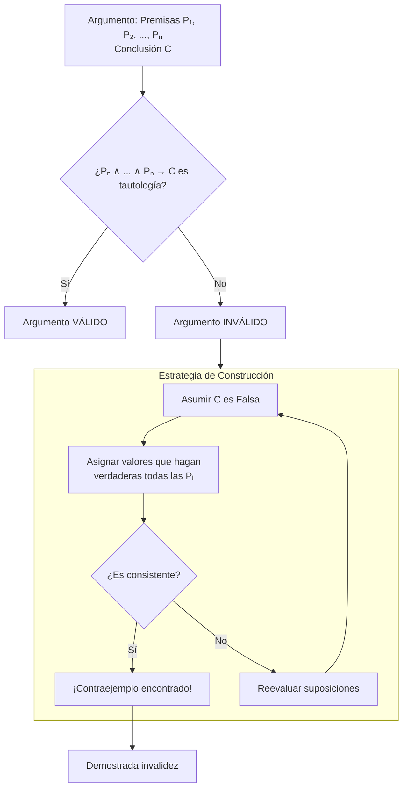

# Lógica Computacional - Análisis de argumentos

## 4.2 Argumentos incorrectos: construcción de modelos contraejemplo.

---

### **1. Introducción**

No todos los argumentos son válidos. Un argumento es **inválido** cuando es posible que sus premisas sean verdaderas y su conclusión falsa. La herramienta fundamental para demostrar la invalidez de un argumento es la construcción de un **contraejemplo** o **contra-modelo**: una interpretación específica donde todas las premisas son verdaderas pero la conclusión es falsa.

### **2. Definición Formal de Contraejemplo**

Sea $\Gamma = \{\phi_1, \phi_2, ..., \phi_n\}$ un conjunto de premisas y $\psi$ una conclusión. Un **modelo contraejemplo** $M$ es una interpretación (asignación de valores de verdad en lógica proposicional, o una estructura en lógica de primer orden) tal que:

$$ M \vDash \phi_i \quad \text{para toda } \phi_i \in \Gamma, \quad \text{pero} \quad M \nvDash \psi $$

La existencia de un solo contraejemplo $M$ es suficiente para demostrar que **NO** se cumple la relación de consecuencia lógica:

$$ \Gamma \nvDash \psi $$

### **3. Método para Construir Contraejemplos**

El proceso para encontrar un contraejemplo sigue una lógica sistemática:



### **4. Ejemplos Detallados**

#### **Ejemplo 1: Lógica Proposicional**

**Argumento:** "Si llueve, la calle se moja. La calle está mojada. Por lo tanto, está lloviendo."

- **Symbolization:**
  - $p$: "Llueve"
  - $q$: "La calle se moja"
  - Premisas: $p \rightarrow q$, $q$
  - Conclusión: $p$

- **Construcción del contraejemplo:**
  1. Para invalidar el argumento, hacemos la conclusión falsa: $p = F$
  2. Hacemos las premisas verdaderas:
     - $q$ debe ser $V$ (segunda premisa)
     - $p \rightarrow q$ es $F \rightarrow V = V$ (primera premisa)
  3. **Contraejemplo:** $p = F$, $q = V$
  4. Interpretación: "No llueve $(p=F)$ pero la calle está mojada $(q=V)$ porque quizás pasó un camión lavacalles.

#### **Ejemplo 2: Lógica de Primer Orden**

**Argumento:** "Todos los gatos son mamíferos. algunos animales son mamíferos. Por lo tanto, algunos gatos son animales."

- **Symbolization:**
  - $G(x)$: "x es un gato"
  - $M(x)$: "x es un mamífero"
  - $A(x)$: "x es un animal"
  - Premisas:
    1. $\forall x(G(x) \rightarrow M(x))$
    2. $\exists x(A(x) \land M(x))$
  - Conclusión: $\exists x(A(x) \land G(x))$

- **Construcción del contraejemplo:**
  - Dominio: {a, b}
  - Interpretación:
    - $G(a) = F$, $G(b) = F$ (ningún elemento es gato)
    - $M(a) = V$, $M(b) = V$ (todos son mamíferos)
    - $A(a) = V$, $A(b) = V$ (todos son animales)
  - Verificación:
    - Premisa 1: $\forall x(G(x) \rightarrow M(x))$ ≡ $(F→V) ∧ (F→V)$ ≡ $V ∧ V$ ≡ $V$
    - Premisa 2: $\exists x(A(x) \land M(x))$ ≡ $(V∧V) ∨ (V∧V)$ ≡ $V$
    - Conclusión: $\exists x(A(x) \land G(x))$ ≡ $(V∧F) ∨ (V∧F)$ ≡ $F$
  - **Contraejemplo:** Un universo donde los únicos mamíferos son perros y vacas.

### **5. Ejercicios Propuestos**

1. **Para cada argumento, muestra un contraejemplo:**
   - $p \lor q \vDash p \land q$
   - $\forall x P(x) \vDash \exists x P(x)$ (considera dominio vacío)
   - $p \rightarrow q, \neg p \vDash \neg q$

2. **Argumento en lenguaje natural:**
   "Todos los programadores saben Python. Algunos ingenieros son programadores. Por lo tanto, todos los ingenieros saben Python."
   - Define predicados y construye un contraejemplo.

3. **Basado en Huth & Ryan (2004):**
   Demuestra que el siguiente argumento es inválido encontrando un contraejemplo:
   
   $ \forall x (P(x) \lor Q(x)) \vDash \forall x P(x) \lor \forall x Q(x) $

4. **Basado en Nerode & Shore (1997):**
   Considera el argumento: $\exists x P(x), \exists x Q(x) \vDash \exists x (P(x) \land Q(x))$
   ¿Es válido? Si no, exhibe un contraejemplo.

### **6. Código Python: Generador de Contraejemplos**

```python
import itertools

def encontrar_contraejemplo(premisas, conclusion, variables):
    """
    Encuentra un contraejemplo para un argumento proposicional.

    Args:
        premisas: Lista de strings con las fórmulas de las premisas
        conclusion: String con la fórmula de la conclusión
        variables: Lista de caracteres con las variables proposicionales

    Returns:
        Dict con la asignación de valores que forma el contraejemplo, o None si es válido.
    """
    n = len(variables)
    # Generar todas las posibles interpretaciones
    for valores in itertools.product([True, False], repeat=n):
        contexto = dict(zip(variables, valores))

        # Verificar si todas las premisas son verdaderas
        premisas_verdaderas = all(eval(p, {}, contexto) for p in premisas)

        # Verificar si la conclusión es falsa
        conclusion_falsa = not eval(conclusion, {}, contexto)

        # Si se cumple ambas, tenemos un contraejemplo
        if premisas_verdaderas and conclusion_falsa:
            return contexto

    return None  # No se encontró contraejemplo (argumento válido)

# Ejemplo 1: Falacia de afirmar el consecuente
premisas = ['not p or q', 'q']  # p → q, y q
conclusion = 'p'
variables = ['p', 'q']

contraejemplo = encontrar_contraejemplo(premisas, conclusion, variables)

if contraejemplo:
    print("¡Argumento inválido! Contraejemplo encontrado:")
    for var, val in contraejemplo.items():
        print(f"{var} = {val}")
else:
    print("El argumento es válido (no se encontró contraejemplo)")

# Ejemplo 2: Distributividad incorrecta
print("\nProbando: p ∨ q ⊨ p ∧ q")
premisas2 = ['p or q']
conclusion2 = 'p and q'
contraejemplo2 = encontrar_contraejemplo(premisas2, conclusion2, variables)

if contraejemplo2:
    print("¡Argumento inválido! Contraejemplo:")
    for var, val in contraejemplo2.items():
        print(f"{var} = {val}")
```

### **7. Tipos Comunes de Falacias con Contraejemplos**

| Falacia                       | Forma Lógica                       | Contraejemplo                  |
| :---------------------------- | :--------------------------------- | :----------------------------- |
| **Afirmar el consecuente**    | $p→q, q \vDash p$                  | $p=F, q=V$                     |
| **Negar el antecedente**      | $p→q, \neg p \vDash \neg q$        | $p=F, q=V$                     |
| **Generalización apresurada** | $P(a), P(b) \vDash \forall x P(x)$ | Dominio con $c$ donde $P(c)=F$ |

### **8. Referencias**

- **Huth, M., Ryan, M. (2004).** _Logic in Computer Science._ Sección 1.4. Explica cómo los contraejemplos demuestran la invalidez de fórmulas.
- **Nerode, A., Shore, R.A. (1997).** _Logic for Applications._ Capítulo 2. Proporciona técnicas para construir modelos contraejemplo en lógica de primer orden.
- **Ben-Ari, M. (2008).** _Mathematical Logic for Computer Science._ Sección 2.4.2. Excelente para entender la relación entre contraejemplos y tablas de verdad.
- **Fitting, M. (1996).** _First-Order Logic and Automated Theorem Proving._ Capítulo 2. Discute la construcción de contraejemplos en el contexto de demostraciones de invalidez.

### **9. Consejos para la Construcción de Contraejemplos**

1. **Empieza por la conclusión:** Hazla falsa primero.
2. **Satisface las premisas:** Asigna valores que hagan verdaderas todas las premisas.
3. **Mantén la consistencia:** No asignes valores contradictorios a las mismas variables.
4. **En lógica de predicados:** Considera dominios pequeños (1-3 elementos) primero.
5. **Verifica:** Asegúrate de que en tu modelo todas las premisas sean realmente verdaderas y la conclusión falsa.

> La habilidad de construir contraejemplos efectivos es crucial no solo en lógica, sino también en ciencias de la computación para verificar especificaciones, encontrar bugs en software, y refutar conjecturas incorrectas.
