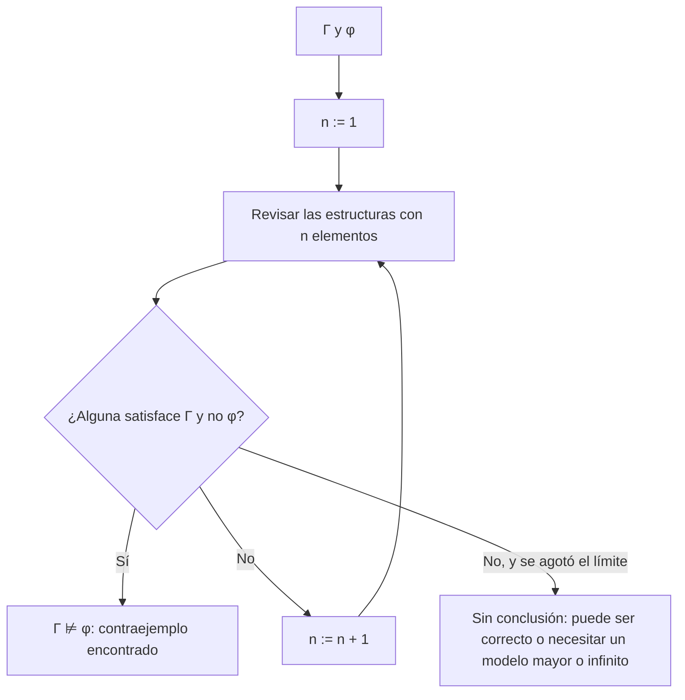

# Lógica Computacional - Análisis de argumentos

## 4.2 Argumentos incorrectos: construcción de modelos contraejemplo.

---

Para demostrar que un argumento es correcto hay que razonar sobre **todas** las interpretaciones. Para demostrar que es incorrecto basta **una**: un **modelo contraejemplo**, que hace verdaderas las premisas y falsa la conclusión. Es la forma más directa y convincente de refutar un argumento, y la misma idea aparece en computación como el caso de prueba que hace fallar un programa o la traza que viola una especificación. Este tema muestra cómo construir contraejemplos en lógica proposicional y de primer orden, y sus límites.

### Definición

**Definición.** Un **contraejemplo** del argumento $\gamma_1, \ldots, \gamma_k \;\therefore\; \varphi$ es una interpretación $\mathcal{M}$ (una asignación en lógica proposicional, una estructura con asignación en primer orden) tal que

$$ \mathcal{M} \models \gamma_i \text{ para } i = 1, \ldots, k \qquad \text{y} \qquad \mathcal{M} \not\models \varphi $$

Por definición de consecuencia lógica (tema 4.1), $\gamma_1, \ldots, \gamma_k \not\models \varphi$ si y solo si existe un contraejemplo. Equivalentemente, un contraejemplo es un modelo de $\{\gamma_1, \ldots, \gamma_k, \lnot \varphi\}.$

### Contraejemplos en lógica proposicional

**Método.** Se trabaja hacia atrás: se impone que la conclusión sea falsa, lo que fija algunos valores, y luego se intenta hacer verdaderas las premisas con los valores restantes. Si en algún punto todas las opciones llevan a contradicción, no hay contraejemplo y el argumento es correcto; este razonamiento es exactamente un tableau (tema 2.5).

**Ejemplo (afirmar el consecuente).** "Si llueve, la calle se moja. La calle está mojada. Por lo tanto, llueve": $p \to q,$ $q \;\therefore\; p.$ La conclusión falsa exige $p = 0;$ la segunda premisa, $q = 1;$ y entonces $p \to q$ es verdadera. El contraejemplo es $p = 0,$ $q = 1:$ la calle puede estar mojada por otra causa.

**Falacias formales comunes.**

| Falacia | Forma | Contraejemplo |
| --- | --- | --- |
| Afirmar el consecuente | $p \to q,\ q \;\therefore\; p$ | $p = 0,$ $q = 1$ |
| Negar el antecedente | $p \to q,\ \lnot p \;\therefore\; \lnot q$ | $p = 0,$ $q = 1$ |
| Conversión de la implicación | $p \to q \;\therefore\; q \to p$ | $p = 0,$ $q = 1$ |
| Confundir disyunción con conjunción | $p \lor q \;\therefore\; p \land q$ | $p = 1,$ $q = 0$ |

### Contraejemplos en lógica de primer orden

Ahora un contraejemplo es una **estructura**: hay que elegir un dominio y las interpretaciones de los símbolos.

**Estrategia.**

1. **Empezar con dominios pequeños.** Muchos contraejemplos tienen uno, dos o tres elementos.
2. **Hacer falsa la conclusión.** Una universal falsa necesita un elemento que la viole; una existencial falsa obliga a que **ningún** elemento la cumpla.
3. **Hacer verdaderas las premisas.** Las existenciales piden testigos, que pueden ser elementos nuevos; las universales restringen a todos los elementos.
4. **Verificar** con la definición de Tarski, elemento por elemento.

**Ejemplo.** "Todos los gatos son mamíferos. Algunos animales son mamíferos. Por lo tanto, algunos animales son gatos":

$$ \forall x\, (G(x) \to M(x)),\ \exists x\, (A(x) \land M(x)) \;\therefore\; \exists x\, (A(x) \land G(x)) $$

Para que la conclusión sea falsa, ningún animal puede ser gato; lo más simple es que no haya gatos, $G^{\mathcal{M}} = \emptyset.$ Entonces la primera premisa es verdadera sin más. La segunda pide un animal mamífero. Con $M = \{1\},$ $A^{\mathcal{M}} = M^{\mathcal{M}} = \{1\}$ y $G^{\mathcal{M}} = \emptyset$ se tiene el contraejemplo: un mundo con un perro y sin gatos. Que en el mundo real los gatos sean animales es irrelevante: el argumento no lo usa como premisa.

**Ejemplo.** "Todos los programadores saben Python. Algunos ingenieros son programadores. Por lo tanto, todos los ingenieros saben Python." Se necesita un ingeniero que no sepa Python, y por tanto no sea programador, y otro que sea programador: con $M = \{1, 2\},$ $I = \{1, 2\},$ $P = \{2\}$ y $S = \{2\},$ el ingeniero 1 es el contraejemplo.

**Contraejemplos con constantes.** El dominio no tiene que dar un elemento distinto a cada constante. De $P(a),$ $P(b)$ no se sigue $\forall x\, P(x):$ basta $M = \{1, 2\}$ con $a^{\mathcal{M}} = b^{\mathcal{M}} = 1$ y $P^{\mathcal{M}} = \{1\}$ (generalización apresurada). La lógica no supone que nombres distintos denoten objetos distintos.

### Cuando los contraejemplos finitos no bastan

En lógica proposicional, si hay contraejemplo hay uno entre las $2^n$ asignaciones. En primer orden no siempre hay un contraejemplo **finito**. Considera las premisas

$$ \forall x\, \lnot R(x, x), \qquad \forall x\, \forall y\, \forall z\, (R(x, y) \land R(y, z) \to R(x, z)), \qquad \forall x\, \exists y\, R(x, y) $$

y la conclusión $\exists x\, R(x, x).$ El argumento es incorrecto: $(\mathbb{N}, \lt)$ es un contraejemplo, porque $\lt$ es irreflexiva, transitiva y todo número tiene uno mayor. Pero **no hay contraejemplos finitos**: en un dominio finito, empezando en cualquier $d_0$ y tomando sucesores $d_0 \mathrel{R} d_1 \mathrel{R} d_2 \cdots,$ algún elemento se repite, $d_i = d_j$ con $i \lt j,$ y por transitividad $R(d_i, d_i),$ contra la irreflexividad. Así que las premisas no tienen ningún modelo finito, y menos uno que sea contraejemplo.

Por eso la búsqueda de contraejemplos en dominios finitos es un **semialgoritmo** para refutar argumentos: si encuentra uno, el argumento es incorrecto; si no lo encuentra, no se puede concluir nada. Herramientas como **Mace4** o **Alloy** hacen esta búsqueda con SAT solvers, y son muy útiles para encontrar errores en especificaciones. El tema 4.3 muestra que no se puede hacer mejor en general.



### Implementación en Python

El programa es un buscador de modelos finitos: para un argumento, recorre todas las estructuras con dominio $\{1, \ldots, n\},$ con $n \leq 3,$ asignando valores a las constantes y relaciones a los predicados, y devuelve la primera que es contraejemplo. Prueba los argumentos del tema, uno correcto y el que solo tiene contraejemplos infinitos.

```python
from itertools import product

def es_var(t):
    return t[0] in 'xyzuvw'

def sat(D, I, s, f):
    """Tarski para fórmulas con predicados y constantes. I asigna constantes y relaciones."""
    op = f[0]
    if op[0].isupper():
        args = tuple(s[t] if es_var(t) else I[t] for t in f[1:])
        return (args[0] if len(args) == 1 else args) in I[op]
    if op == '¬': return not sat(D, I, s, f[1])
    if op == '∧': return sat(D, I, s, f[1]) and sat(D, I, s, f[2])
    if op == '∨': return sat(D, I, s, f[1]) or sat(D, I, s, f[2])
    if op == '→': return (not sat(D, I, s, f[1])) or sat(D, I, s, f[2])
    if op == '∀': return all(sat(D, I, {**s, f[1]: d}, f[2]) for d in D)
    if op == '∃': return any(sat(D, I, {**s, f[1]: d}, f[2]) for d in D)

def simbolos(f, preds, consts):
    if f[0][0].isupper():
        preds[f[0]] = len(f) - 1
        consts.update(t for t in f[1:] if not es_var(t))
    elif f[0] in '∀∃':
        simbolos(f[2], preds, consts)
    else:
        for g in f[1:]: simbolos(g, preds, consts)

def contramodelo(premisas, conclusion, tam_max):
    """Busca la estructura más pequeña (dominio {1..n}, n ≤ tam_max) que sea contraejemplo."""
    preds, consts = {}, set()
    for f in premisas + [conclusion]:
        simbolos(f, preds, consts)
    preds, consts = sorted(preds.items()), sorted(consts)
    for n in range(1, tam_max + 1):
        D = list(range(1, n + 1))
        opciones = [[(c, d) for d in D] for c in consts]
        for P, k in preds:
            tuplas = [t[0] if k == 1 else t for t in product(D, repeat=k)]
            opciones.append([(P, frozenset(t for t, b in zip(tuplas, bits) if b))
                             for bits in product([0, 1], repeat=len(tuplas))])
        for eleccion in product(*opciones):
            I = dict(eleccion)
            if all(sat(D, I, {}, p) for p in premisas) and not sat(D, I, {}, conclusion):
                return D, I
    return None

def mostrar(r):
    if r is None: return 'ninguno'
    D, I = r
    partes = [f'D = {D}'] + [f'{k} = {sorted(v) if isinstance(v, frozenset) else v}' for k, v in sorted(I.items())]
    return ', '.join(partes)

A = lambda x, f: ('∀', x, f)
E = lambda x, f: ('∃', x, f)
imp = lambda a, b: ('→', a, b)
y_ = lambda a, b: ('∧', a, b)

casos = {
    'gatos': ([A('x', imp(('G', 'x'), ('M', 'x'))), E('x', y_(('A', 'x'), ('M', 'x')))],
              E('x', y_(('A', 'x'), ('G', 'x')))),
    'python': ([A('x', imp(('P', 'x'), ('S', 'x'))), E('x', y_(('I', 'x'), ('P', 'x')))],
               A('x', imp(('I', 'x'), ('S', 'x')))),
    'apresurada': ([('P', 'a'), ('P', 'b')], A('x', ('P', 'x'))),
    'existenciales': ([E('x', ('P', 'x')), E('x', ('Q', 'x'))], E('x', y_(('P', 'x'), ('Q', 'x')))),
    'serial': ([A('x', E('y', ('R', 'x', 'y')))], E('y', A('x', ('R', 'x', 'y')))),
    'válido': ([A('x', imp(('H', 'x'), ('M', 'x'))), ('H', 's')], ('M', 's')),
}
for nombre, (prem, concl) in casos.items():
    print(f'{nombre:14}', mostrar(contramodelo(prem, concl, 3)))

# Un argumento incorrecto sin contraejemplos finitos: orden estricto sin máximo ⊨ ∃x R(x, x)?
orden = [A('x', ('¬', ('R', 'x', 'x'))),
         A('x', A('y', A('z', imp(y_(('R', 'x', 'y'), ('R', 'y', 'z')), ('R', 'x', 'z'))))),
         A('x', E('y', ('R', 'x', 'y')))]
print(f'{"infinito":14}', mostrar(contramodelo(orden, E('x', ('R', 'x', 'x')), 3)))
```

Salida:

```text
gatos          D = [1], A = [1], G = [], M = [1]
python         D = [1, 2], I = [1, 2], P = [2], S = [2]
apresurada     D = [1, 2], P = [1], a = 1, b = 1
existenciales  D = [1, 2], P = [2], Q = [1]
serial         D = [1, 2], R = [(1, 2), (2, 1)]
válido         ninguno
infinito       ninguno
```

Para el argumento correcto (el silogismo de Sócrates) y para el que necesita un modelo infinito, la respuesta es la misma, "ninguno": desde fuera, el buscador no puede distinguirlos.

### Ejercicios Propuestos

1. **Proposicionales.** Da contraejemplos de $p \lor q \;\therefore\; p \land q$ y de $p \to q,$ $\lnot p \;\therefore\; \lnot q.$

2. **Dominio vacío.** ¿Tiene contraejemplo $\forall x\, P(x) \;\therefore\; \exists x\, P(x)?$ ¿Y si se admitieran dominios vacíos?

3. **Distribución.** Construye un contraejemplo de $\forall x\, (P(x) \lor Q(x)) \;\therefore\; \forall x\, P(x) \lor \forall x\, Q(x).$

4. **Existenciales.** ¿Es correcto $\exists x\, P(x),$ $\exists x\, Q(x) \;\therefore\; \exists x\, (P(x) \land Q(x))?$

5. **Intercambio de cuantificadores.** Da un contraejemplo finito y uno en $\mathbb{N}$ de $\forall x\, \exists y\, R(x, y) \;\therefore\; \exists y\, \forall x\, R(x, y).$

6. **Modelos infinitos.** Demuestra que las tres premisas del ejemplo de este tema no tienen modelos finitos, y da otro modelo infinito distinto de $(\mathbb{N}, \lt).$

### Soluciones

**Ejercicio 1.** $p = 1,$ $q = 0$ para el primero; $p = 0,$ $q = 1$ para el segundo.

**Ejercicio 2.** No: en lógica clásica el dominio no es vacío, y si todo elemento está en $P,$ cualquiera de ellos es testigo de $\exists x\, P(x).$ El argumento es correcto. Con el dominio vacío, la premisa sería verdadera (vacuamente) y la conclusión falsa, así que sería un contraejemplo.

**Ejercicio 3.** $M = \{1, 2\},$ $P = \{1\},$ $Q = \{2\}:$ cada elemento está en $P$ o en $Q,$ pero ni todos están en $P$ ni todos en $Q.$

**Ejercicio 4.** No. El programa encuentra $M = \{1, 2\},$ $P = \{2\},$ $Q = \{1\}.$

**Ejercicio 5.** Finito: $M = \{1, 2\}$ con $R = \{(1, 2), (2, 1)\},$ el que encuentra el programa. En $\mathbb{N}$ con $R(x, y)$ como $x \lt y,$ todo número tiene uno mayor, pero ninguno es mayor que todos.

**Ejercicio 6.** El argumento del texto: en un dominio finito, la sucesión de sucesores según $R$ repite un elemento y la transitividad da $R(d, d).$ Otro modelo es $(\mathbb{Q}, \lt),$ o $(\mathbb{Z}, \lt).$ También sirve $(\mathbb{N}, \gt)$ si se cambia la tercera premisa por "todo elemento tiene un menor"; con la premisa tal como está, $(\mathbb{N}, \gt)$ no es modelo porque el 0 no tiene un $y$ con $0 \gt y.$

### Referencias

1. Ben-Ari, M., _Mathematical Logic for Computer Science_. Springer, 2012. Secciones 2.5 y 7.3.
2. Barwise, J., and Etchemendy, J., _Language, Proof and Logic_. CSLI, 2002. Capítulos 2 y 11.
3. McCune, W., _Prover9 and Mace4_. 2005-2010. Documentación en cs.unm.edu/~mccune/prover9.
4. Jackson, D., _Software Abstractions: Logic, Language, and Analysis_. MIT Press, 2012.
