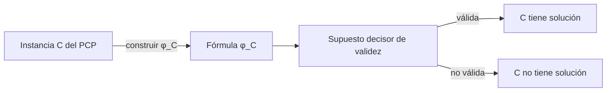

# Lógica Computacional - Análisis de argumentos

## 4.3 El teorema de indecidibilidad de Church.

---

En 1928 Hilbert y Ackermann plantearon el **Entscheidungsproblem**: encontrar un procedimiento mecánico que decida si una fórmula de primer orden es válida. Para la lógica proposicional existe (tema 2.4). En 1936, Church, con el cálculo lambda, y Turing, con sus máquinas, demostraron de forma independiente que para la lógica de primer orden **no existe**. Este tema presenta el teorema, una demostración completa por reducción del problema de correspondencia de Post, y sus consecuencias para el análisis de argumentos.

### Enunciado

**Teorema (Church, 1936; Turing, 1936).** El conjunto de las fórmulas válidas de la lógica de primer orden no es decidible. Esto vale ya para una signatura con una constante, dos símbolos de función unarios y un predicado binario.

Como $\Gamma \models \varphi$ para $\Gamma$ finito equivale a la validez de $(\bigwedge \Gamma) \to \varphi,$ y $\varphi$ es válida si y solo si $\lnot \varphi$ es insatisfacible, también son indecidibles la consecuencia lógica y la satisfacibilidad de primer orden. En particular, **no hay un algoritmo que decida si un argumento de primer orden es correcto**.

### La validez es semidecidible

El teorema no dice que no se pueda hacer nada.

**Teorema.** El conjunto de fórmulas válidas es **recursivamente enumerable**: hay un procedimiento que, dada $\varphi,$ termina y responde sí si $\varphi$ es válida, y no termina si no lo es.

**Demostración.** Por el teorema de completud de Gödel (tema 5.3), $\varphi$ es válida si y solo si tiene una demostración en un sistema deductivo como la deducción natural o la resolución. Las demostraciones son cadenas finitas, verificables mecánicamente, así que se pueden enumerar todas y comprobar una por una. Si $\varphi$ es válida, alguna demostración aparece. $\blacksquare$

**Corolario.** La satisfacibilidad no es semidecidible. Si lo fuera, la validez sería decidible: con $\varphi,$ se correrían en paralelo la búsqueda de una demostración de $\varphi$ y el semialgoritmo para la satisfacibilidad de $\lnot \varphi;$ uno de los dos termina.

| Problema | Lógica proposicional | Lógica de primer orden |
| --- | --- | --- |
| Validez | decidible (co-NP-completo) | semidecidible, no decidible |
| Satisfacibilidad | decidible (NP-completo) | ni siquiera semidecidible |
| Correcto un argumento | decidible | semidecidible, no decidible |
| Incorrecto un argumento | decidible | ni siquiera semidecidible |

Por eso un demostrador automático de primer orden puede responder "sí, es válida" o seguir buscando indefinidamente, y el buscador de contraejemplos finitos del tema 4.2 puede encontrar un contraejemplo o no terminar. No puede existir una herramienta que siempre responda.

### La demostración: reducción del PCP

Se reduce un problema indecidible conocido a la validez. El más cómodo es el **problema de correspondencia de Post** (PCP): dada una lista de pares de cadenas binarias $(s_1, t_1), \ldots, (s_k, t_k),$ ¿existe una sucesión no vacía de índices $i_1, \ldots, i_m$ con $s_{i_1} \cdots s_{i_m} = t_{i_1} \cdots t_{i_m}?$ El PCP es indecidible (Post, 1946), porque una solución puede codificar una computación de una máquina de Turing que se detiene.

**La codificación.** Se usa una constante $e,$ dos funciones unarias $f_0$ y $f_1$ y un predicado binario $P.$ Una cadena $b_1 \cdots b_n$ se codifica aplicando funciones a un término: $f_{b_1 \cdots b_n}(t) = f_{b_n}(\cdots f_{b_1}(t) \cdots).$ Así, $f_{01}(e) = f_1(f_0(e))$ representa la cadena $01,$ y concatenar es componer: $f_{uv}(e) = f_v(f_u(e)).$ La idea es que $P(x, y)$ signifique que $x$ e $y$ son las filas de arriba y de abajo de alguna sucesión de fichas. Para una instancia $C,$ sea

$$ \varphi_C = \Big( \bigwedge_{i=1}^{k} P(f_{s_i}(e), f_{t_i}(e)) \land \forall v\, \forall w\, \big(P(v, w) \to \bigwedge_{i=1}^{k} P(f_{s_i}(v), f_{t_i}(w))\big) \Big) \to \exists z\, P(z, z) $$

La primera parte dice que cada ficha sola es una sucesión; la segunda, que añadir una ficha a una sucesión da otra; la conclusión, que alguna sucesión tiene las dos filas iguales.

**Teorema.** $\varphi_C$ es válida si y solo si la instancia $C$ tiene solución.

**Demostración.** Si hay solución, $\varphi_C$ es válida. Sea $i_1, \ldots, i_m$ una solución y $\mathcal{M}$ una estructura que satisface el antecedente. Por inducción sobre $j,$ el par formado por los valores de $f_{s_{i_1} \cdots s_{i_j}}(e)$ y $f_{t_{i_1} \cdots t_{i_j}}(e)$ está en $P^{\mathcal{M}}:$ para $j = 1$ por la primera parte, y para pasar de $j$ a $j + 1$ por la segunda, con $v$ y $w$ los valores anteriores. Para $j = m,$ ambas cadenas son la misma, $u,$ así que el valor de $f_u(e)$ es testigo de $\exists z\, P(z, z).$

Si $\varphi_C$ es válida, hay solución, porque $\varphi_C$ es verdadera en la siguiente estructura $\mathcal{M}:$ el dominio son las cadenas binarias, $e^{\mathcal{M}}$ es la cadena vacía, $f_0^{\mathcal{M}}(x) = x0,$ $f_1^{\mathcal{M}}(x) = x1,$ y $P^{\mathcal{M}}$ es el conjunto de pares $(s_{i_1} \cdots s_{i_m}, t_{i_1} \cdots t_{i_m})$ con $m \geq 1.$ Aquí $f_u(e)$ vale exactamente $u,$ y el antecedente es verdadero por construcción. Entonces existe $z$ con $(z, z) \in P^{\mathcal{M}},$ es decir, una sucesión con ambas filas iguales: una solución. $\blacksquare$

La construcción de $\varphi_C$ a partir de $C$ es claramente computable. Si la validez fuera decidible, el PCP también lo sería. Por lo tanto, la validez es indecidible. $\blacksquare$



### Fragmentos decidibles

La indecidibilidad requiere cierta expresividad. Restringiendo la sintaxis se obtienen clases decidibles, que se usan en verificación y bases de conocimiento:

- **Lógica monádica** (solo predicados unarios, sin funciones): si una fórmula con $k$ predicados es satisfacible, tiene un modelo con a lo más $2^k$ elementos; con igualdad, la cota se multiplica por el número de variables. Es la base del procedimiento de decisión del tema 3.5.
- **Clase de Bernays-Schönfinkel**: enunciados $\exists x_1 \cdots \exists x_n\, \forall y_1 \cdots \forall y_m\, \psi,$ sin funciones y con $\psi$ sin cuantificadores. Se reduce a SAT, y es la lógica de Datalog y de muchos problemas de planificación.
- **Lógica con dos variables**: fórmulas que solo usan dos nombres de variable, reutilizándolos (Mortimer, 1975). Incluye a muchas lógicas descriptivas, como las de la web semántica.

En cambio, basta un predicado binario sin funciones para que la validez sea indecidible (Kalmár, 1936).

### Relación con otros resultados

- **Teorema de completud de Gödel (1930).** La validez coincide con la demostrabilidad: es semidecidible. Completud no implica decidibilidad.
- **Teorema de incompletud de Gödel (1931).** Ninguna teoría recursivamente axiomatizada y consistente que contenga la aritmética demuestra todas las verdades de $\mathbb{N}.$ Habla de una estructura en particular, no de la validez en todas; pero ambos usan la misma idea de codificar computaciones con fórmulas.
- **Teorema de Trakhtenbrot (1950).** La validez restringida a estructuras **finitas** no es siquiera semidecidible. El teorema de completud no tiene análogo para modelos finitos, lo que afecta a las bases de datos, cuyos modelos son finitos.

### Implementación en Python

El programa construye la fórmula $\varphi_C$ para una instancia del PCP, busca una solución en anchura (el semialgoritmo, que solo termina con certeza si hay solución) y, a partir de la solución, escribe los átomos que las premisas obligan a ser verdaderos en **cualquier** modelo, siguiendo la primera mitad de la demostración: el último tiene los dos argumentos iguales.

```python
from collections import deque

def termino(bits, base):
    """f_{b1 ... bk}(t) = f_bk(... f_b1(t)): se aplica primero el primer símbolo."""
    for b in bits:
        base = f'f{b}({base})'
    return base

def formula_church(fichas):
    """La fórmula de Huth y Ryan: es válida si y solo si la instancia del PCP tiene solución."""
    base = ' ∧ '.join(f'P({termino(s, "e")}, {termino(t, "e")})' for s, t in fichas)
    paso = ' ∧ '.join(f'P({termino(s, "v")}, {termino(t, "w")})' for s, t in fichas)
    return f'(({base}) ∧ ∀v ∀w (P(v, w) → ({paso}))) → ∃z P(z, z)'

def buscar_solucion(fichas, max_long=40):
    """Semidecisión del PCP: búsqueda en anchura de una sucesión de fichas con arriba = abajo."""
    cola = deque([(i,) for i in range(len(fichas))])
    vistos = set()
    while cola:
        seq = cola.popleft()
        arriba = ''.join(fichas[i][0] for i in seq)
        abajo = ''.join(fichas[i][1] for i in seq)
        if arriba == abajo:
            return seq
        if not (arriba.startswith(abajo) or abajo.startswith(arriba)):
            continue
        if max(len(arriba), len(abajo)) > max_long:
            continue
        clave = (arriba[len(abajo):], abajo[len(arriba):])   # lo que una fila lleva de ventaja
        if clave in vistos:
            continue
        vistos.add(clave)
        cola.extend(seq + (i,) for i in range(len(fichas)))
    return None

def derivacion(fichas, seq):
    """Los átomos P(s, t) que las premisas obligan a ser verdaderos, siguiendo la solución."""
    s, t = fichas[seq[0]]
    pasos = [f'P({termino(s, "e")}, {termino(t, "e")})   por la ficha {seq[0] + 1}']
    for i in seq[1:]:
        s, t = s + fichas[i][0], t + fichas[i][1]
        pasos.append(f'P({termino(s, "e")}, {termino(t, "e")})   por el axioma de paso con la ficha {i + 1}')
    return pasos

con_solucion = [('1', '101'), ('10', '00'), ('011', '11')]
print(formula_church(con_solucion))
sol = buscar_solucion(con_solucion)
print('solución:', [i + 1 for i in sol])
for linea in derivacion(con_solucion, sol):
    print('  ', linea)
print('   la última tiene los dos argumentos iguales: es el testigo de ∃z P(z, z)')

sin_solucion = [('10', '1'), ('011', '01')]   # arriba siempre es más larga que abajo
print('instancia sin solución:', buscar_solucion(sin_solucion), '(se agotó el límite)')
```

Salida:

```text
((P(f1(e), f1(f0(f1(e)))) ∧ P(f0(f1(e)), f0(f0(e))) ∧ P(f1(f1(f0(e))), f1(f1(e)))) ∧ ∀v ∀w (P(v, w) → (P(f1(v), f1(f0(f1(w)))) ∧ P(f0(f1(v)), f0(f0(w))) ∧ P(f1(f1(f0(v))), f1(f1(w)))))) → ∃z P(z, z)
solución: [1, 3, 2, 3]
   P(f1(e), f1(f0(f1(e))))   por la ficha 1
   P(f1(f1(f0(f1(e)))), f1(f1(f1(f0(f1(e))))))   por el axioma de paso con la ficha 3
   P(f0(f1(f1(f1(f0(f1(e)))))), f0(f0(f1(f1(f1(f0(f1(e))))))))   por el axioma de paso con la ficha 2
   P(f1(f1(f0(f0(f1(f1(f1(f0(f1(e))))))))), f1(f1(f0(f0(f1(f1(f1(f0(f1(e))))))))))   por el axioma de paso con la ficha 3
   la última tiene los dos argumentos iguales: es el testigo de ∃z P(z, z)
instancia sin solución: None (se agotó el límite)
```

En la instancia sin solución, la fila de arriba siempre es más larga que la de abajo y la búsqueda se detiene por el límite de longitud; en una instancia arbitraria no hay forma de saber si aumentar el límite serviría.

### Ejercicios Propuestos

1. **Consecuencia.** Explica por qué el teorema de Church implica que la consecuencia lógica $\Gamma \models \varphi$ con $\Gamma$ finito es indecidible, y por qué el caso $\Gamma = \emptyset$ no es más fácil.

2. **Proposicional frente a primer orden.** ¿Qué propiedad de la lógica proposicional falla en primer orden y hace posible la indecidibilidad?

3. **Codificación.** Escribe $\varphi_C$ para la instancia $C = ((0, 01), (10, 0))$ y decide si es válida.

4. **Semidecidibilidad.** Si alguien afirma haber escrito un programa que decide la satisfacibilidad de las fórmulas de primer orden, ¿qué fórmula le pedirías que analizara para hacerlo fallar?

5. **Fragmentos.** Explica por qué la validez de enunciados de la forma $\forall y_1 \cdots \forall y_m\, \psi,$ sin funciones y con constantes $c_1, \ldots, c_n,$ se puede decidir revisando un número finito de casos.

### Soluciones

**Ejercicio 1.** $\varphi$ es válida si y solo si $\emptyset \models \varphi,$ así que un algoritmo para la consecuencia con $\Gamma$ finito decidiría en particular la validez. El caso $\Gamma = \emptyset$ es justamente el que el teorema declara indecidible; no es más fácil que el general, porque el general se reduce a él con $(\bigwedge \Gamma) \to \varphi.$

**Ejercicio 2.** El número finito de interpretaciones relevantes: en proposicional, el lema de coincidencia reduce todo a $2^n$ asignaciones. En primer orden hay estructuras de todos los tamaños, incluso infinitas, y algunas fórmulas solo son falsas en estructuras infinitas (tema 4.2), así que no hay una cota de cuántas revisar.

**Ejercicio 3.**

$$ \big(P(f_0(e), f_1(f_0(e))) \land P(f_0(f_1(e)), f_0(e)) \land \forall v\, \forall w\, (P(v, w) \to P(f_0(v), f_1(f_0(w))) \land P(f_0(f_1(v)), f_0(w)))\big) \to \exists z\, P(z, z) $$

La instancia tiene solución $1, 2:$ arriba $0 \cdot 10 = 010,$ abajo $01 \cdot 0 = 010.$ Por el teorema, la fórmula es válida.

**Ejercicio 4.** Para cualquier instancia $C$ del PCP sin solución conocida, $\lnot \varphi_C$ es satisfacible si y solo si $C$ no tiene solución. Un decisor de satisfacibilidad resolvería el PCP; por el teorema, falla en alguna instancia, respondiendo mal o sin terminar.

**Ejercicio 5.** Su negación equivale a $\exists y_1 \cdots \exists y_m\, \lnot \psi,$ que es satisfacible si y solo si lo es en una estructura cuyo dominio son las constantes y los testigos de los existenciales: a lo más $n + m$ elementos, porque sin funciones no se pueden construir más términos. Basta revisar las estructuras de ese tamaño, un número finito. Es el caso más simple de la clase de Bernays-Schönfinkel.

### Referencias

1. Church, A. (1936). A note on the Entscheidungsproblem. _Journal of Symbolic Logic_, 1(1), 40-41.
2. Turing, A. M. (1936). On computable numbers, with an application to the Entscheidungsproblem. _Proceedings of the London Mathematical Society_, 2(42), 230-265.
3. Huth, M., and Ryan, M., _Logic in Computer Science_. Cambridge University Press, 2004. Sección 2.5.
4. Börger, E., Grädel, E., and Gurevich, Y., _The Classical Decision Problem_. Springer, 1997.
5. Boolos, G., Burgess, J., and Jeffrey, R., _Computability and Logic_. Cambridge University Press, 2007. Capítulo 11.
