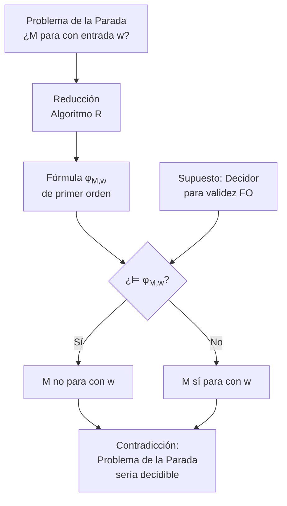

# Lógica Computacional - Análisis de argumentos

## 4.3 El teorema de indecidibilidad de Church.

---

### **1. Introducción Histórica**

El **Teorema de Indecidibilidad de Church**, demostrado por Alonzo Church en 1936, establece que **no existe un algoritmo general que pueda decidir la validez de todas las fórmulas de la lógica de primer orden**. Este resultado fundamental muestra las limitaciones inherentes de los sistemas formales y tiene profundas implicaciones en matemáticas, lógica y ciencias de la computación.

### **2. Conceptos Preliminares Clave**

#### **Decidibilidad**

Un conjunto $S$ es **decidible** si existe un algoritmo que, para cualquier entrada $x$, termina y responde correctamente "sí" si $x \in S$, y "no" si $x \notin S$.

#### **Validez en Lógica de Primer Orden**

Una fórmula $\phi$ es válida $(\vDash \phi)$ si es verdadera en todas las interpretaciones posibles. El conjunto de fórmulas válidas se denota:

$$ \text{VAL} = \{\phi \in \mathcal{L} \mid \vDash \phi\} $$

donde $\mathcal{L}$ es el lenguaje de la lógica de primer orden.

### **3. Enunciado Formal del Teorema**

**Teorema de Church (1936):** El conjunto VAL de fórmulas válidas de la lógica de primer orden **es indecidible**.

No existe un algoritmo (máquina de Turing) que pueda determinar para cualquier fórmula $\phi$ de primer orden si $\vDash \phi$.

$$ \nexists A \text{ tal que } \forall \phi \in \mathcal{L}, A(\phi) = \begin{cases} 1 & \text{si } \vDash \phi \\\ 0 & \text{si } \nvDash \phi \end{cases} $$

### **4. Esquema de la Demostración**

La demostración se basa en reducir el **Problema de la Parada** (halting problem) de Turing al problema de la validez en lógica de primer orden.



Si existiera un algoritmo para decidir la validez, entonces podríamos decidir el problema de la parada, lo que contradice el teorema de Turing.

### **5. Construcción de la Reducción**

La clave está en que para toda máquina de Turing $M$ y entrada $w$, podemos construir una fórmula $\phi_{M,w}$ de primer orden tal que:

$$ \vDash \phi_{M,w} \quad \text{si y solo si} \quad M \text{ no se detiene con entrada } w $$

La fórmula $\phi_{M,w}$ describe:

- La configuración de la máquina en cada paso de cómputo
- Las transiciones entre configuraciones
- La condición de que la máquina **no** se detiene

### **6. Consecuencias e Implicaciones**

#### **Consecuencias Inmediatas:**

1. **La lógica de primer orden es semidecidible:** Existen procedimientos efectivos (como tableaux o resolución) que enumeran todas las fórmulas válidas, pero no las inválidas.
2. **Completitud ≠ Decidibilidad:** Aunque el cálculo de predicados es completo ( $\vdash \phi$ sii $\vDash \phi$ ), esto no implica decidibilidad.
3. **Limitaciones de los verificadores formales:** No puede existir una herramienta automática que verifique completamente cualquier especificación en primer orden.

#### **Implicaciones Prácticas:**

- Los verificadores de teoremas automáticos deben **divergir** en algunos casos
- El análisis estático de programas tiene límites fundamentales
- La verificación formal requiere guidance humana para casos difíciles

### **7. Ejercicios Propuestos**

1. **Problema de Decisión:** Explica por qué el problema de determinar si $\Gamma \vDash \phi$ para $\Gamma$ finito es indecidible en general, pero decidible cuando $\Gamma = \emptyset$.

2. **Reducción:** Bosqueja cómo se podría codificar una máquina de Turing simple con sólo dos estados en una fórmula de primer orden.

3. **Lógica Proposicional vs Primer Orden:** ¿Por qué la lógica proposicional ES decidible pero la de primer orden NO? Explica la diferencia crucial.

4. **Consecuencias:** Supón que el teorema de Church fuera falso. ¿Qué implicaría tener un algoritmo que decidiera cualquier fórmula de primer orden? Menciona al menos tres consecuencias.

5. **Basado en Huth & Ryan (2004):** Explica la relación entre el teorema de Church y el teorema de incompletitud de Gödel.

### **8. Código Python: Simulación de Indecidibilidad**

```python
def verificador_validez(formula):
    """
    Simula un verificador de validez que diverge para fórmulas inválidas.
    NOTA: Esto es una simulación educativa, no un verificador real.
    """
    # En la práctica, aquí iría un algoritmo semidecidible como tableaux
    # Para esta simulación, asumimos algunas fórmulas específicas

    # Fórmulas que sabemos que son válidas
    formulas_validas = [
        '∀x(P(x) → P(x))',
        '∃xP(x) → ¬∀x¬P(x)',
        '(∀xP(x)) → P(a)'
    ]

    # Fórmulas que sabemos que son inválidas
    formulas_invalidas = [
        'P(a) → ∀xP(x)',
        '∃xP(x) → ∀xP(x)'
    ]

    if formula in formulas_validas:
        return True
    elif formula in formulas_invalidas:
        return False
    else:
        # Simula la indecidibilidad: diverge para fórmulas no catalogadas
        print(f"Analizando fórmula: {formula}")
        print("Esta fórmula podría ser indecidible...")
        while True:  # Bucle infinito - simula la indecidibilidad
            pass
        return None  # Nunca llega aquí

# Ejemplos de uso
if __name__ == "__main__":
    # Fórmula válida
    print("∀x(P(x) → P(x)) es válida?", verificador_validez('∀x(P(x) → P(x))'))

    # Fórmula inválida
    print("P(a) → ∀xP(x) es válida?", verificador_validez('P(a) → ∀xP(x)'))

    # Fórmula potencialmente indecidible (hará que el programa se cuelgue)
    # print("∃x∀y(P(x) ∧ ¬P(y)) es válida?", verificador_validez('∃x∀y(P(x) ∧ ¬P(y))'))
```

### **9. Referencias Críticas**

- **Huth, M., Ryan, M. (2004).** _Logic in Computer Science._ Capítulo 2.7. Explica elegantemente la reducción del problema de la parada a la validez lógica.
- **Nerode, A., Shore, R.A. (1997).** _Logic for Applications._ Capítulo 6. Proporciona una demostración detallada usando teoría de modelos.
- **Ben-Ari, M. (2008).** _Mathematical Logic for Computer Science._ Capítulo 9.4. Ofrece una explicación accesible con ejemplos concretos.
- **Fitting, M. (1996).** _First-Order Logic and Automated Theorem Proving._ Capítulo 8. Discute las implicaciones para los demostradores de teoremas automáticos.

### **10. Extensiones y Temas Relacionados**

1. **Fragmentos Decidibles:** Algunos subconjuntos de la lógica de primer orden SÍ son decidibles:
   - Lógica monádica de primer orden
   - Teoría de números reales cerrados (Tarski)
   - Lógica de primer orden sin igualdad y con sólo predicados unarios

2. **Teorema de Church-Turing:** Establece la equivalencia entre la noción de función computable de Church (λ-cálculo) y la de Turing (máquinas de Turing).

3. **Teoremas de Incompletitud de Gödel:** Relacionados pero distintos - tratan sobre la incompletitud de sistemas axiomáticos, mientras que Church trata sobre indecidibilidad algorítmica.

> El teorema de Church marca uno de los límites fundamentales de lo que puede lograrse mediante métodos computacionales formales, estableciendo una frontera permanente entre lo decidible y lo indecidible en el razonamiento lógico.
