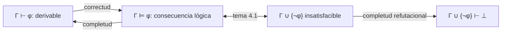

# Lógica Computacional - Sistemas deductivos

## 5.1 Generalidades: reglas de inferencia; correctud, completud y completud refutacional.

---

La consecuencia lógica $\Gamma \models \varphi$ habla de **todas** las interpretaciones, algo que en primer orden no se puede revisar. Un **sistema deductivo** ofrece otro camino: reglas puramente sintácticas que transforman fórmulas en fórmulas, de manera que una demostración sea un objeto **finito** y **verificable mecánicamente**. La pregunta central es si las reglas capturan exactamente la consecuencia lógica: si todo lo demostrable es consecuencia (**correctud**) y si toda consecuencia es demostrable (**completud**). Este tema fija esos conceptos; los siguientes estudian cuatro sistemas concretos: tableaux, deducción natural, y resolución sobre formas normales.

### Reglas de inferencia y derivaciones

Una **regla de inferencia** es un esquema

$$ \frac{\varphi_1 \quad \cdots \quad \varphi_n}{\psi} $$

que permite obtener la **conclusión** $\psi$ cuando se tienen las **premisas** $\varphi_1, \ldots, \varphi_n.$ Las letras griegas son **metavariables**: la regla se aplica a cualquier fórmula que tenga esa forma. Una regla sin premisas es un **axioma**. Ejemplos:

$$ \frac{\varphi \quad \varphi \to \psi}{\psi}\ \text{(modus ponens)} \qquad \frac{\varphi \to \psi \quad \lnot \psi}{\lnot \varphi}\ \text{(modus tollens)} \qquad \frac{\varphi \land \psi}{\varphi}\ \text{(eliminación de} \land) $$

**Definición.** Una **derivación** de $\varphi$ a partir de un conjunto $\Gamma$ es una sucesión finita de fórmulas $\psi_1, \ldots, \psi_n = \varphi$ en la que cada $\psi_i$ es un elemento de $\Gamma,$ un axioma, o la conclusión de una regla cuyas premisas aparecen antes en la sucesión. Si existe, se escribe $\Gamma \vdash \varphi.$ Si $\Gamma$ es vacío, $\vdash \varphi$ y $\varphi$ es un **teorema** del sistema.

Las derivaciones también se representan como **árboles**, con la conclusión en la raíz y las premisas en las hojas. Lo esencial es que verificar si algo es una derivación es un proceso mecánico: basta revisar cada paso.

### Un sistema de Hilbert

Los sistemas de estilo **Hilbert** tienen muchos axiomas y pocas reglas. Para la lógica proposicional con $\lnot$ y $\to$ basta (Łukasiewicz):

$$ \begin{aligned} &\text{A1:} \quad \varphi \to (\psi \to \varphi) \\ &\text{A2:} \quad (\varphi \to (\psi \to \chi)) \to ((\varphi \to \psi) \to (\varphi \to \chi)) \\ &\text{A3:} \quad (\lnot \psi \to \lnot \varphi) \to (\varphi \to \psi) \end{aligned} $$

con modus ponens como única regla. Los demás conectivos se definen: $\varphi \lor \psi$ como $\lnot \varphi \to \psi,$ y $\varphi \land \psi$ como $\lnot (\varphi \to \lnot \psi).$

**Ejemplo.** $\vdash p \to p.$

1. $(p \to ((p \to p) \to p)) \to ((p \to (p \to p)) \to (p \to p)),$ por A2.
2. $p \to ((p \to p) \to p),$ por A1.
3. $(p \to (p \to p)) \to (p \to p),$ por MP de 2 y 1.
4. $p \to (p \to p),$ por A1.
5. $p \to p,$ por MP de 4 y 3.

Una verdad trivial requiere una demostración poco intuitiva: los sistemas de Hilbert son cómodos para demostrar propiedades **del** sistema, no para demostrar **en** él. La deducción natural (tema 5.3) y los tableaux (tema 5.2) se diseñaron para lo segundo.

**Teorema de la deducción.** $\Gamma \cup \{\varphi\} \vdash \psi$ si y solo si $\Gamma \vdash \varphi \to \psi.$

**Demostración.** De derecha a izquierda, se añade $\varphi$ y se aplica MP. De izquierda a derecha, por inducción sobre la derivación $\psi_1, \ldots, \psi_n$ de $\psi$ se demuestra $\Gamma \vdash \varphi \to \psi_i$ para cada $i.$ Si $\psi_i$ es un axioma o está en $\Gamma,$ de $\psi_i$ y la instancia de A1 $\psi_i \to (\varphi \to \psi_i)$ se obtiene $\varphi \to \psi_i.$ Si $\psi_i = \varphi,$ se usa la derivación de $\varphi \to \varphi$ del ejemplo. Si $\psi_i$ se obtuvo por MP de $\psi_j$ y $\psi_k = \psi_j \to \psi_i,$ por hipótesis de inducción se tienen $\varphi \to \psi_j$ y $\varphi \to (\psi_j \to \psi_i),$ y con A2 y dos aplicaciones de MP se obtiene $\varphi \to \psi_i.$ $\blacksquare$

El teorema de la deducción es la versión sintáctica de la propiedad semántica del tema 4.1, y justifica la estrategia de "suponer el antecedente para demostrar una implicación".

### Correctud

**Definición.** Un sistema es **correcto** si $\Gamma \vdash \varphi$ implica $\Gamma \models \varphi.$

**Teorema.** El sistema de Hilbert anterior es correcto.

**Demostración.** Por inducción sobre la longitud de la derivación, toda fórmula $\psi_i$ es consecuencia lógica de $\Gamma.$ Las de $\Gamma$ lo son trivialmente. Los axiomas son tautologías, lo que se verifica con tablas de verdad, y por el teorema de instancias (tema 2.2) también sus instancias. Y si $\Gamma \models \psi_j$ y $\Gamma \models \psi_j \to \psi_i,$ todo modelo de $\Gamma$ hace verdaderas a ambas, y por la tabla de la implicación, a $\psi_i.$ $\blacksquare$

El esquema es general: un sistema es correcto si sus axiomas son válidos y sus reglas **preservan la verdad**. Una regla incorrecta, como la que de $\varphi \to \psi$ y $\psi$ obtiene $\varphi,$ que es afirmar el consecuente, arruina el sistema: permitiría derivar conclusiones falsas de premisas verdaderas.

### Completud

**Definición.** Un sistema es **completo** si $\Gamma \models \varphi$ implica $\Gamma \vdash \varphi.$

**Teorema.** El sistema de Hilbert es completo para la lógica proposicional (Post, 1921, para teoremas), y los sistemas de Hilbert usuales para primer orden son completos (**Gödel, 1930**).

La completud es mucho más difícil que la correctud: hay que demostrar que **existe** una derivación cada vez que hay consecuencia. La técnica usual, de Henkin (1949), demuestra la contrapositiva: si $\Gamma \nvdash \varphi,$ entonces $\Gamma \cup \{\lnot \varphi\}$ es **consistente** (no deriva una contradicción), y todo conjunto consistente tiene un modelo, que se construye a partir de la propia sintaxis. El tema 5.3 lo retoma.

**Consecuencias de correctud más completud:**

- $\vdash$ y $\models$ coinciden: demostrar es lo mismo que razonar sobre todos los modelos.
- **Compacidad:** si $\Gamma \models \varphi,$ como una derivación usa un número finito de premisas, un subconjunto finito de $\Gamma$ basta.
- **Semidecidibilidad:** enumerando derivaciones se encuentran todas las fórmulas válidas (tema 4.3).

### Completud refutacional

Los métodos automáticos no suelen derivar $\varphi$ directamente, sino que refutan $\Gamma \cup \{\lnot \varphi\}.$

**Definición.** Un sistema es **refutacionalmente completo** si de todo conjunto insatisfacible deriva una contradicción: $\bot,$ un tableau cerrado o la cláusula vacía.

Como $\Gamma \models \varphi$ si y solo si $\Gamma \cup \{\lnot \varphi\}$ es insatisfacible, un sistema correcto y refutacionalmente completo basta para decidir (o semidecidir) la consecuencia. Pero es una propiedad **más débil** que la completud: la resolución es refutacionalmente completa y no es completa en el sentido directo. Por ejemplo, $p \models p \lor q,$ pero desde la cláusula $\{p\}$ la resolución no deriva $\{p, q\}$ (no hay ningún par de literales complementarios). En cambio, refuta $\{\{p\}, \{\lnot p\}, \{\lnot q\}\},$ que es la forma clausular de $\{p, \lnot (p \lor q)\}.$

| Propiedad | Afirmación | Ejemplos |
| --- | --- | --- |
| Correctud | $\Gamma \vdash \varphi \Rightarrow \Gamma \models \varphi$ | todos los sistemas que se usan |
| Completud | $\Gamma \models \varphi \Rightarrow \Gamma \vdash \varphi$ | Hilbert, deducción natural |
| Completud refutacional | $\Gamma$ insatisfacible $\Rightarrow$ $\Gamma \vdash \bot$ | tableaux, resolución |



### Implementación en Python

Un **verificador de demostraciones** es mucho más sencillo que un buscador: solo revisa que cada línea sea legal. El programa reconoce instancias de los esquemas A1 a A3 empatando la fórmula con el esquema, revisa las aplicaciones de modus ponens, y verifica la derivación de $p \to p$ del tema y una del silogismo hipotético. Detecta una derivación con un paso ilegal y, como parte de la demostración de correctud, comprueba con tablas de verdad que 648 instancias de los axiomas son tautologías. Así funcionan, a gran escala, los asistentes de demostración como Lean o Coq: el **núcleo** que verifica es pequeño y confiable, aunque las demostraciones se busquen con métodos complicados.

```python
import re

# ---------- Fórmulas: lectura con precedencias ¬ > ∧ > ∨ > → > ↔ ----------
def leer(s):
    toks = re.findall(r'[A-Za-z]\d*|[¬∧∨→↔()⊥]', s)
    pos = 0
    def ver(): return toks[pos] if pos < len(toks) else None
    def tomar():
        nonlocal pos; pos += 1; return toks[pos - 1]
    def bicond():
        f = impl()
        while ver() == '↔':
            tomar(); f = ('↔', f, impl())
        return f
    def impl():
        f = disy()
        if ver() == '→':
            tomar(); f = ('→', f, impl())        # asocia a la derecha
        return f
    def disy():
        f = conj()
        while ver() == '∨':
            tomar(); f = ('∨', f, conj())
        return f
    def conj():
        f = neg()
        while ver() == '∧':
            tomar(); f = ('∧', f, neg())
        return f
    def neg():
        if ver() == '¬':
            tomar(); return ('¬', neg())
        if ver() == '(':
            tomar(); f = bicond(); tomar(); return f
        return tomar()
    return bicond()

from itertools import product

# Sistema de Hilbert para {¬, →}: tres esquemas de axioma y modus ponens
ESQUEMAS = {
    'A1': leer('A → (B → A)'),
    'A2': leer('(A → (B → C)) → ((A → B) → (A → C))'),
    'A3': leer('(¬B → ¬A) → (A → B)'),
}

def empatar(esquema, f, sust):
    """¿Es f una instancia del esquema? Las metavariables son A, B, C."""
    if isinstance(esquema, str) and esquema in 'ABC':
        if esquema in sust:
            return sust[esquema] == f
        sust[esquema] = f
        return True
    if isinstance(esquema, str) or isinstance(f, str):
        return esquema == f
    return (esquema[0] == f[0] and len(esquema) == len(f)
            and all(empatar(e, g, sust) for e, g in zip(esquema[1:], f[1:])))

def verificar(prueba, premisas=()):
    """Cada línea es (fórmula, justificación). Justificación: 'A1', 'A2', 'A3', 'premisa' o ('MP', i, j)."""
    hechas = []
    for n, (texto_f, just) in enumerate(prueba, 1):
        f = leer(texto_f)
        if just == 'premisa':
            ok = f in [leer(p) for p in premisas]
        elif just in ESQUEMAS:
            ok = empatar(ESQUEMAS[just], f, {})
        else:
            _, i, j = just                               # de la línea i (φ) y la j (φ → ψ) se obtiene ψ
            ok = i < n and j < n and hechas[j - 1] == ('→', hechas[i - 1], f)
        if not ok:
            return f'error en la línea {n}'
        hechas.append(f)
    return 'prueba correcta de ' + prueba[-1][0]

# ⊢ p → p
identidad = [
    ('(p → ((p → p) → p)) → ((p → (p → p)) → (p → p))', 'A2'),
    ('p → ((p → p) → p)', 'A1'),
    ('(p → (p → p)) → (p → p)', ('MP', 2, 1)),
    ('p → (p → p)', 'A1'),
    ('p → p', ('MP', 4, 3)),
]
print(verificar(identidad))

# p → q, q → r ⊢ p → r
silogismo = [
    ('q → r', 'premisa'),
    ('(q → r) → (p → (q → r))', 'A1'),
    ('p → (q → r)', ('MP', 1, 2)),
    ('(p → (q → r)) → ((p → q) → (p → r))', 'A2'),
    ('(p → q) → (p → r)', ('MP', 3, 4)),
    ('p → q', 'premisa'),
    ('p → r', ('MP', 6, 5)),
]
print(verificar(silogismo, ['p → q', 'q → r']))

# Una prueba con un error: modus ponens aplicado al revés (afirmar el consecuente)
mala = [('p → q', 'premisa'), ('q', 'premisa'), ('p', ('MP', 2, 1))]
print(verificar(mala, ['p → q', 'q']))

# Correctud: toda instancia de los axiomas es tautología (se prueba con instancias sobre p, q, r)
def valor(f, I):
    if isinstance(f, str): return I[f]
    if f[0] == '¬': return not valor(f[1], I)
    return (not valor(f[1], I)) or valor(f[2], I)
def instancia(e, s):
    if isinstance(e, str): return s.get(e, e)
    return (e[0],) + tuple(instancia(g, s) for g in e[1:])
candidatos = [leer(x) for x in ['p', 'q', '¬p', 'p → q', '¬(q → r)', '(p → q) → r']]
total = 0
for nombre, e in ESQUEMAS.items():
    for a, b, c in product(candidatos, repeat=3):
        f = instancia(e, {'A': a, 'B': b, 'C': c})
        assert all(valor(f, dict(zip('pqr', v))) for v in product([True, False], repeat=3))
        total += 1
print('instancias de axiomas revisadas, todas tautologías:', total)
```

Salida:

```text
prueba correcta de p → p
prueba correcta de p → r
error en la línea 3
instancias de axiomas revisadas, todas tautologías: 648
```

### Ejercicios Propuestos

1. **Derivación con reglas.** Usando modus ponens y eliminación de la conjunción, deriva $r$ a partir de $p \to (q \to r)$ y $p \land q.$

2. **Correctud de una regla.** Demuestra que el modus tollens preserva la verdad.

3. **Refutación.** Muestra que $\{p \to q, \lnot q, p\}$ es insatisfacible, derivando una contradicción con modus ponens.

4. **Hilbert.** Con el teorema de la deducción, demuestra que en el sistema de Hilbert $\vdash (p \to q) \to ((q \to r) \to (p \to r)).$

5. **Una regla incorrecta.** Si se añade al sistema la regla que de $\varphi \lor \psi$ obtiene $\varphi,$ ¿qué propiedad se pierde? Da un ejemplo.

6. **Completud refutacional.** Explica por qué un sistema correcto y refutacionalmente completo permite decidir $\Gamma \models \varphi$ en lógica proposicional, aunque no sea completo.

### Soluciones

**Ejercicio 1.** 1. $p \land q,$ premisa. 2. $p,$ eliminación de $\land$ en 1. 3. $q,$ eliminación de $\land$ en 1. 4. $p \to (q \to r),$ premisa. 5. $q \to r,$ MP de 2 y 4. 6. $r,$ MP de 3 y 5.

**Ejercicio 2.** Si $I(\varphi \to \psi) = 1$ e $I(\lnot \psi) = 1,$ entonces $I(\psi) = 0,$ y por la tabla de la implicación $I(\varphi) = 0,$ es decir, $I(\lnot \varphi) = 1.$

**Ejercicio 3.** De $p$ y $p \to q,$ por MP, $q;$ junto con $\lnot q$ se tiene una contradicción. Por correctud, ninguna interpretación satisface al conjunto.

**Ejercicio 4.** El programa verifica $p \to q,$ $q \to r \vdash p \to r.$ Aplicando el teorema de la deducción dos veces: $p \to q \vdash (q \to r) \to (p \to r),$ y luego $\vdash (p \to q) \to ((q \to r) \to (p \to r)).$

**Ejercicio 5.** Se pierde la correctud. En un sistema que tenga la introducción de la disyunción, de $q$ se obtiene $p \lor q,$ y la regla nueva da $p.$ Así $q \vdash p,$ aunque $q \not\models p:$ la interpretación con $q = 1$ y $p = 0$ es un contraejemplo.

**Ejercicio 6.** Para decidir $\Gamma \models \varphi$ se pregunta si $\Gamma \cup \{\lnot \varphi\}$ es insatisfacible. Si lo es, la completud refutacional garantiza una refutación; si no, la correctud garantiza que no la hay. En lógica proposicional el espacio de derivaciones relevantes es finito (por ejemplo, la saturación por resolución termina), así que el proceso termina.

### Referencias

1. Ben-Ari, M., _Mathematical Logic for Computer Science_. Springer, 2012. Capítulo 3.
2. Enderton, H. B., _A Mathematical Introduction to Logic_. Academic Press, 2001. Secciones 1.7, 2.4 y 2.5.
3. Mendelson, E., _Introduction to Mathematical Logic_. CRC Press, 2015. Sección 1.4.
4. Fitting, M., _First-Order Logic and Automated Theorem Proving_. Springer, 1996. Capítulos 3 y 4.
