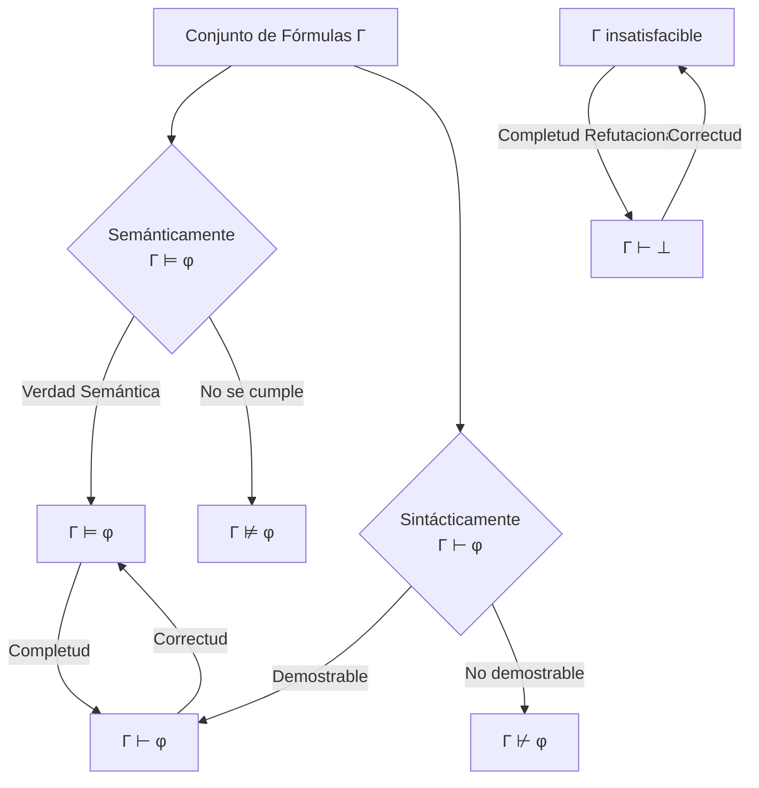
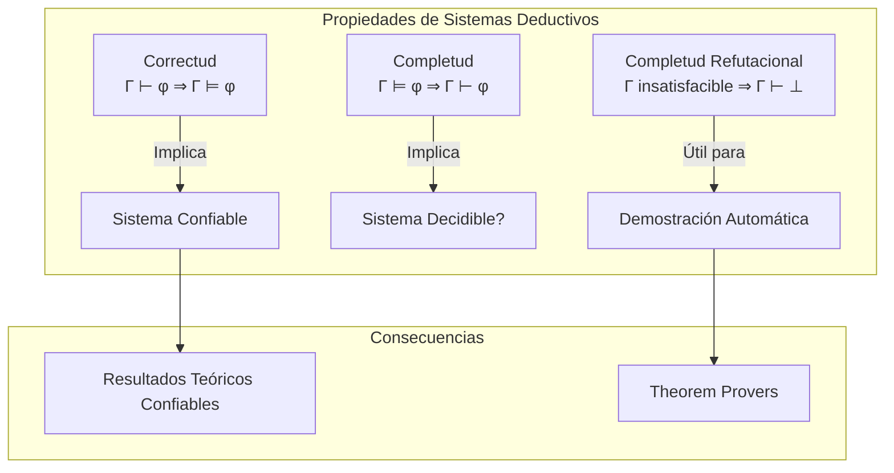

# Lógica Computacional - Sistemas deductivos

## 5.1 Generalidades: reglas de inferencia; correctud, completud y completud refutacional.

---

Los sistemas deductivos son mecanismos formales para derivar conclusiones a partir de premisas mediante la aplicación de reglas de inferencia. Constituyen la base de la demostración automática de teoremas y el razonamiento formal en ciencias de la computación.

### Definiciones Fundamentales

#### Sistema Deductivo

Un sistema deductivo $\mathcal{D}$ es una tripleta $\langle \mathcal{L}, \mathcal{A}, \mathcal{R} \rangle$ donde:

- $\mathcal{L}$ es un lenguaje formal
- $\mathcal{A}$ es un conjunto de axiomas (fórmulas que se aceptan como verdaderas)
- $\mathcal{R}$ es un conjunto de reglas de inferencia

#### Regla de Inferencia

Una regla de inferencia es un esquema que permite derivar una conclusión a partir de un conjunto de premisas. Se denota:

$$\frac{P_1 \quad P_2 \quad \cdots \quad P_n}{C}$$

Donde $P_1, \ldots, P_n$ son las premisas y $C$ es la conclusión.

### Principales Reglas de Inferencia

#### 1. Modus Ponens (MP)

$$\frac{A \rightarrow B \quad A}{B}$$

#### 2. Modus Tollens (MT)

$$\frac{A \rightarrow B \quad \neg B}{\neg A}$$

#### 3. Introducción de la Conjunción (∧I)

$$\frac{A \quad B}{A \land B}$$

#### 4. Eliminación de la Conjunción (∧E)

$$\frac{A \land B}{A} \quad \frac{A \land B}{B}$$

#### 5. Introducción de la Disyunción (∨I)

$$\frac{A}{A \lor B} \quad \frac{B}{A \lor B}$$

#### 6. Silogismo Hipotético (SH)

$$\frac{A \rightarrow B \quad B \rightarrow C}{A \rightarrow C}$$

### Derivación y Demostración

**Derivación**: Secuencia finita de fórmulas donde cada una es un axioma o se obtiene de anteriores por aplicación de reglas.

**Demostración de φ desde Γ**: Derivación donde la última fórmula es φ y todas las suposiciones están en Γ.

$$Γ \vdash_{\mathcal{D}} φ$$

### (✓) Propiedades Fundamentales

#### Correctud (Soundness)

Un sistema deductivo es **correcto** si todo lo que puede demostrarse es semánticamente verdadero:

$$Si\ Γ \vdash φ\ entonces\ Γ \vDash φ$$

**Teorema de Correctud**: Para el cálculo proposicional clásico:

$$Si\ Γ \vdash φ\ entonces\ Γ \vDash φ$$

#### Completud (Completeness)

Un sistema deductivo es **completo** si todo lo que es semánticamente verdadero puede demostrarse:

$$Si\ Γ \vDash φ\ entonces\ Γ \vdash φ$$

**Teorema de Completud** (Gödel, 1929):

$$Si\ Γ \vDash φ\ entonces\ Γ \vdash φ$$

#### Completud Refutacional

Un sistema es **refutacionalmente completo** si para todo conjunto de fórmulas Γ:

$$Si\ Γ\ es\ insatisfacible\ entonces\ Γ \vdash \bot$$



### Ejemplos de Demostraciones

#### Ejemplo 1: Demostración Directa

**Probar**: $P \rightarrow Q, Q \rightarrow R \vdash P \rightarrow R$

```
1. P → Q         [Premisa]
2. Q → R         [Premisa]
3. | P           [Suposición temporal]
4. | Q           [MP: 1,3]
5. | R           [MP: 2,4]
6. P → R         [Introducción →: 3-5]
```

#### Ejemplo 2: Demostración por Contradicción

**Probar**: $\neg(P \land \neg P)$

```
1. | P ∧ ¬P      [Suposición para RAA]
2. | P           [∧E: 1]
3. | ¬P          [∧E: 1]
4. | ⊥           [Contradicción: 2,3]
5. ¬(P ∧ ¬P)     [RAA: 1-4]
```

### Ejercicios Propuestos

#### Ejercicio 1

Demuestre usando las reglas de inferencia:

$$P \rightarrow (Q \rightarrow R), P \land Q \vdash R$$

#### Ejercicio 2

Pruebe la correctud del Modus Ponens:

$$Si\ v(A \rightarrow B) = V\ y\ v(A) = V\ entonces\ v(B) = V$$

#### Ejercicio 3

Demuestre usando completud refutacional que el siguiente conjunto es insatisfacible:

$$\{P \rightarrow Q, \neg Q, P\}$$

#### Ejercicio 4

Implemente en Python una función que verifique la aplicación correcta del Modus Ponens:

```python
def modus_ponens(premise1, premise2):
    """
    Verifica si se puede aplicar Modus Ponens
    premise1: fórmula de la forma A → B
    premise2: fórmula A
    Returns: B si es aplicable, None en caso contrario
    """
    if isinstance(premise1, Implication) and premise1.antecedent == premise2:
        return premise1.consequent
    return None

class Implication:
    def __init__(self, ant, cons):
        self.antecedent = ant
        self.consequent = cons
```

### Diagrama de Relaciones entre Propiedades



### Referencias y Bibliografía

#### Bibliografía Básica

1. **Huth M., Ryan M.** (2004) - Capítulo 1: lógica proposicional, secciones 1.2-1.4 sobre sistemas deductivos
2. **Nerode A., Shore R.A.** (1997) - Capítulo 2: sistemas de demostración, teoremas de correctud y completud

#### Bibliografía Complementaria

3. **Ben-Ari M.** (2008) - Capítulo 2: sistemas deductivos para lógica proposicional
4. **Fitting M.** (1996) - Capítulo 3: propiedades de sistemas formales
5. **Socher-Ambrosius R., Johann P.** (1997) - Capítulo 1: fundamentos de sistemas de deducción

### Aplicaciones Prácticas

1. **Verificación de software**: Los sistemas deductivos se usan para verificar la correctud de programas
2. **Inteligencia Artificial**: Sistemas expertos y reasoning engines
3. **Bases de datos**: Verificación de integridad de datos y consultas
4. **Seguridad**: Verificación de protocolos criptográficos

### Resumen de Conceptos Clave

| Concepto                   | Definición               | Importancia                                  |
| -------------------------- | ------------------------ | -------------------------------------------- |
| **Correctud**              | Si ⊢ φ entonces ⊨ φ      | Garantiza que las demostraciones son válidas |
| **Completud**              | Si ⊨ φ entonces ⊢ φ      | Todo lo verdadero puede demostrarse          |
| **Completud Refutacional** | Γ insatisfacible ⇒ Γ ⊢ ⊥ | Base de los demostradores automáticos        |
| **Reglas de Inferencia**   | Esquemas de derivación   | Mecanismo básico de deducción                |
