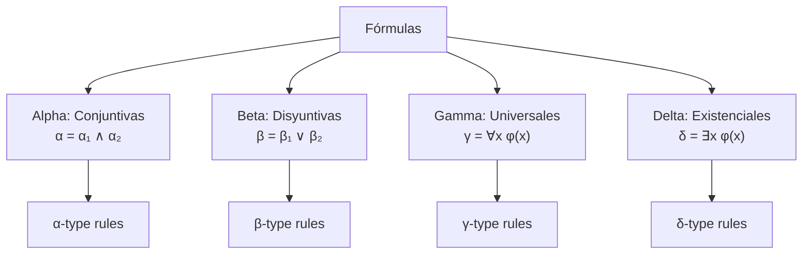
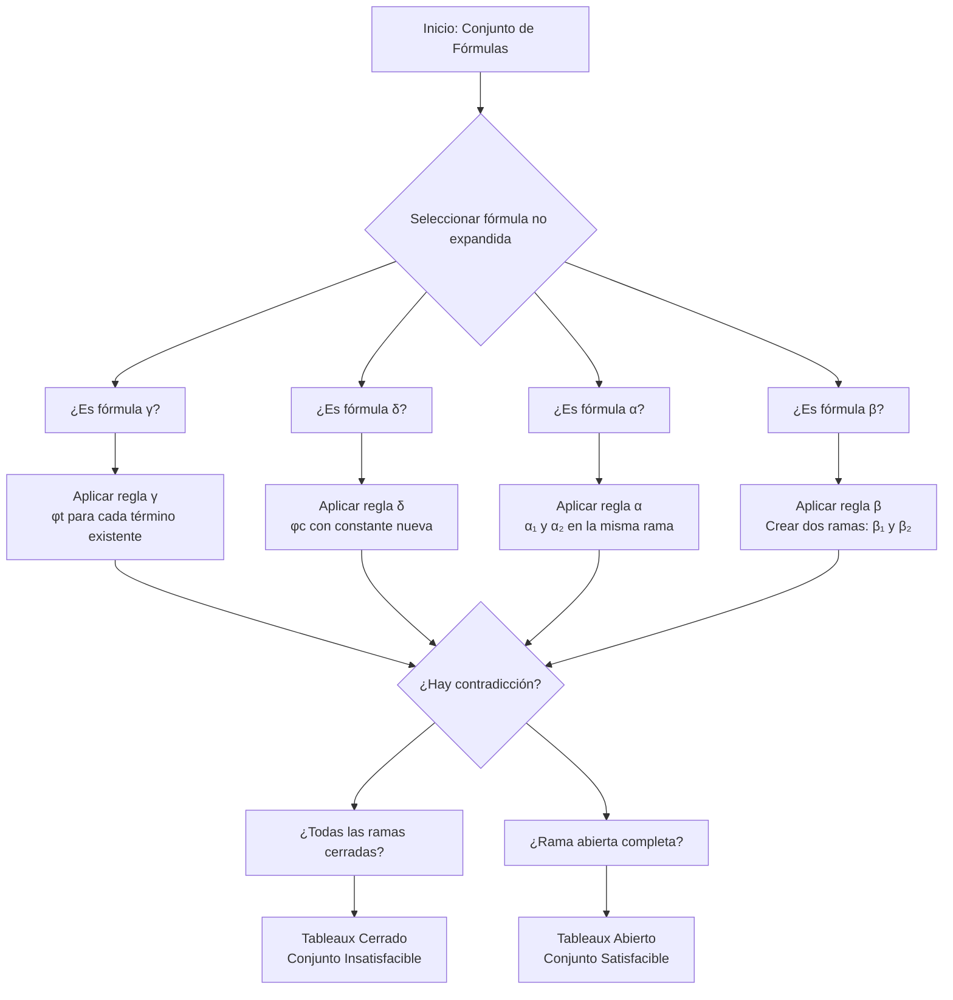

# Lógica Computacional - Sistemas deductivos

## 5.2 Tableaux semánticos: reglas γ y δ

---

Los tableaux semánticos son un sistema deductivo que utiliza un método de refutación para determinar la validez de un argumento. Se basan en la descomposición sistemática de fórmulas mediante reglas de expansión.

#### Definición Formal

Un tableaux semántico es un árbol donde:

- Los nodos están etiquetados con fórmulas
- Las ramas representan interpretaciones posibles
- Una rama cerrada (×) indica contradicción
- Un tableaux cerrado significa que el conjunto es insatisfacible

### Reglas de Expansión para Cuantificadores

#### Reglas γ (Universales)

Para fórmulas universales de la forma $∀x φ(x):$

$$\frac{∀x φ(x)}{φ(t)}$$

Donde $t$ es cualquier término ground (sin variables libres) que aparezca previamente en la rama, o una constante nueva si no hay términos disponibles.

#### Reglas δ (Existenciales)

Para fórmulas existenciales de la forma $∃x φ(x):$

$$\frac{∃x φ(x)}{φ(c)}$$

Donde $c$ es una constante **nueva** que no aparece previamente en la rama.

### Clasificación de Fórmulas según Smullyan



### Reglas de Expansión Completas

#### Reglas Proposicionales (α y β)

| Tipo | Fórmula | Componentes          |
| ---- | ------- | -------------------- |
| α    | $¬¬A$   | $A$                  |
| α    | $A ∧ B$ | $A,$ $B$             |
| β    | $A ∨ B$ | $A$ \| $B$           |
| β    | $A → B$ | $¬A$ \| $B$          |
| β    | $A ↔ B$ | $A ∧ B$ \| $¬A ∧ ¬B$ |

#### Reglas de Cuantificadores (γ y δ)

| Tipo | Fórmula    | Expansión | Restricción           |
| ---- | ---------- | --------- | --------------------- |
| γ    | $∀x φ(x)$  | $φ(t)$    | $t$ término existente |
| γ    | $¬∃x φ(x)$ | $¬φ(t)$   | $t$ término existente |
| δ    | $∃x φ(x)$  | $φ(c)$    | $c$ constante nueva   |
| δ    | $¬∀x φ(x)$ | $¬φ(c)$   | $c$ constante nueva   |

### Ejemplo Paso a Paso

#### Ejemplo: Demostrar que $∀x P(x) ⊢ ¬∃x ¬P(x)$

**Paso 1**: Negar la conclusión

$$ \begin{array}{l} 1.\ ∀x P(x) \\\ 2.\ ¬¬∃x ¬P(x) \quad \text{(Negación de la conclusión)} \end{array} $$

**Paso 2**: Aplicar regla α a la línea 2

$$ \begin{array}{l} 3.\ ∃x ¬P(x) \quad \lparen \text{de 2 por }\alpha \rparen \end{array} $$

**Paso 3**: Aplicar regla δ a la línea 3 (introducir constante nueva)

$$ \begin{array}{l} 4.\ ¬P(a) \quad \lparen \text{de 3 por }\delta \text{, a nueva} \rparen \end{array} $$

**Paso 4**: Aplicar regla γ a la línea 1 (usar término existente)

$$ \begin{array}{l} 5.\ P(a) \quad  \lparen \text{de 1 por }\gamma \text{, usando a}\rparen \end{array} $$

**Paso 5**: Cerrar la rama por contradicción

$$ \begin{array}{l} 6.\ × \quad \text{(de 4 y 5, contradicción)} \end{array} $$

### Implementación de Tableaux Semánticos

```python
class TableauxNode:
    def __init__(self, formula, arrived_by=None, used_constants=None):
        self.formula = formula
        self.children = []
        self.arrived_by = arrived_by  # γ, δ, α, β
        self.used_constants = used_constants or set()

class SemanticTableaux:
    def __init__(self):
        self.constants = set()
        self.next_constant = 0

    def get_new_constant(self):
        constant = f"c{self.next_constant}"
        self.next_constant += 1
        self.constants.add(constant)
        return constant

    def gamma_rule(self, formula, existing_terms):
        """Aplica regla γ a fórmula universal"""
        # ∀x φ(x) → φ(t) para cada término t existente
        expansions = []
        for term in existing_terms:
            new_formula = self.instantiate(formula, term)
            expansions.append(new_formula)
        return expansions

    def delta_rule(self, formula):
        """Aplica regla δ a fórmula existencial"""
        # ∃x φ(x) → φ(c) donde c es nueva constante
        new_constant = self.get_new_constant()
        return [self.instantiate(formula, new_constant)]

    def instantiate(self, quantified_formula, term):
        """Instancia una fórmula cuantificada con un término"""
        # Implementaría la sustitución propera
        # ∀x P(x) con término 'a' → P(a)
        pass
```

### Ejercicios Propuestos

#### Ejercicio 1

Construya el tableaux semántico para demostrar:

$$∀x (P(x) → Q(x)), ∀x P(x) ⊢ ∀x Q(x)$$

#### Ejercicio 2

Aplique las reglas γ y δ al siguiente conjunto:

$$\{∀x ∃y R(x, y), ¬∃y ∀x R(x, y)\}$$

#### Ejercicio 3

Demuestre usando tableaux semánticos:

$$∃x ∀y P(x, y) → ∀y ∃x P(x, y)$$

#### Ejercicio 4

Identifique el tipo de cada fórmula (α, β, γ, δ):

1. $∀x (P(x) ∧ Q(x))$
2. $∃x (P(x) ∨ Q(x))$
3. $¬∀x P(x)$
4. $¬∃x Q(x)$

### Diagrama de Proceso de Tableaux



### Referencias Bibliográficas

#### Bibliografía Básica

1. **Huth M., Ryan M.** (2004) - Capítulo 2: "Predicate Logic", sección 2.3 sobre tableaux semánticos
2. **Nerode A., Shore R.A.** (1997) - Capítulo 3: "First-Order Logic", sección 3.2 sobre sistemas de tableaux

#### Bibliografía Complementaria

3. **Fitting M.** (1996) - Capítulo 5: "First-Order Semantic Tableaux"
4. **Ben-Ari M.** (2008) - Capítulo 5: "First-Order Logic: Semantic Tableaux"

### Estrategias de Aplicación

#### Para fórmulas γ (universales):

1. Aplique la regla γ repetidamente con todos los términos disponibles
2. Use primero constantes existentes antes de introducir nuevas
3. Aplique γ a todas las instancias posibles antes de pasar a otras fórmulas

#### Para fórmulas δ (existenciales):

1. Introduzca siempre una constante nueva
2. Aplique δ solo cuando sea necesario para el cierre
3. Use la misma constante para múltiples δ si corresponden al mismo cuantificador

### Consejos para la Construcción de Tableaux

1. **Prioridad de expansión**: δ antes que γ (para obtener términos)
2. **Estrategia**: Expandir fórmulas no analíticas primero
3. **Cierre**: Cerrar ramas tan pronto como sea posible
4. **Reglas γ**: Aplicar con todos los términos disponibles cada vez

### Ejemplo de Tableaux Completo

**Probar**: $∀x (P(x) → Q(x)), ∃x P(x) ⊢ ∃x Q(x)$

```
1. ∀x (P(x) → Q(x))    [Premisa]
2. ∃x P(x)             [Premisa]
3. ¬∃x Q(x)            [Negación conclusión]

4. P(a)                [δ de 2, a nueva]
5. ¬Q(a)               [γ de 3 equivalente a ∀x ¬Q(x)]
6. P(a) → Q(a)         [γ de 1 con término a]
   /               \
7. ¬P(a)           8. Q(a)     [β de 6]
   ×                   ×        [4 con 7, 5 con 8]
```

**Tableaux cerrado**: el argumento es válido.
