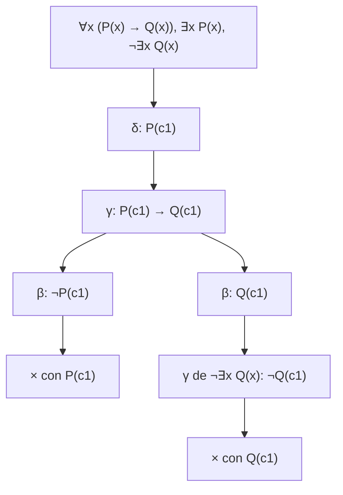

# Lógica Computacional - Sistemas deductivos

## 5.2 Tableaux semánticos: reglas γ y δ

---

Los tableaux proposicionales del tema 2.5 descomponen fórmulas con las reglas α y β hasta llegar a literales. Para la lógica de primer orden hacen falta dos clases más de reglas, para los cuantificadores: las **γ**, universales, que instancian una fórmula con cualquier término, y las **δ**, existenciales, que la instancian con un **testigo nuevo**. Con ellas el método sigue siendo correcto y completo, pero deja de terminar siempre: es un **semialgoritmo**, como debe ser por el teorema de Church (tema 4.3).

### Notación uniforme

Las fórmulas cuantificadas, y sus negaciones, se clasifican en dos tipos, igual que las proposicionales se clasifican en α y β (Smullyan, 1968):

| γ (universales) | instancia $\gamma(t)$ | δ (existenciales) | instancia $\delta(c)$ |
| --- | --- | --- | --- |
| $\forall x\, \varphi$ | $\varphi[x := t]$ | $\exists x\, \varphi$ | $\varphi[x := c]$ |
| $\lnot \exists x\, \varphi$ | $\lnot \varphi[x := t]$ | $\lnot \forall x\, \varphi$ | $\lnot \varphi[x := c]$ |

**Regla γ.** De una fórmula γ se puede añadir a la rama $\gamma(t)$ para **cualquier** término cerrado $t.$ La fórmula γ **no se marca como usada**: puede volver a necesitarse con otros términos.

**Regla δ.** De una fórmula δ se añade $\delta(c),$ donde $c$ es una constante **nueva**, que no aparece en la rama. Cada fórmula δ se usa una sola vez.

$$ \frac{\gamma}{\gamma(t)}\ \ (t \text{ cualquier término cerrado}) \qquad \frac{\delta}{\delta(c)}\ \ (c \text{ nueva en la rama}) $$

**Por qué la constante debe ser nueva.** $\exists x\, P(x)$ dice que algo cumple $P,$ pero no **qué**. Si en la rama ya está $\lnot P(a),$ instanciar con $a$ produciría $P(a)$ y cerraría la rama sin razón: $\{\exists x\, P(x), \lnot P(a)\}$ es satisfacible. Con una constante nueva, $c$ es un nombre para el objeto que cumple $P,$ del que no se sabe nada más.

**Por qué γ se reutiliza.** $\forall x\, P(x)$ habla de todos los objetos, y pueden aparecer nombres nuevos después, por reglas δ, que también deben cumplir $P.$

### Ejemplos

**Ejemplo 1.** $\forall x\, P(x) \models \lnot \exists x\, \lnot P(x).$ Se niega la conclusión:

1. $\forall x\, P(x),$ premisa.
2. $\lnot \lnot \exists x\, \lnot P(x),$ conclusión negada.
3. $\exists x\, \lnot P(x),$ por α de 2.
4. $\lnot P(c_1),$ por δ de 3, con $c_1$ nueva.
5. $P(c_1),$ por γ de 1 con $c_1.$
6. Se cierra con 4 y 5.

**Ejemplo 2.** $\forall x\, (P(x) \to Q(x)),$ $\exists x\, P(x) \models \exists x\, Q(x).$



**Estrategia.** Aplicar α primero, después δ (que introducen los términos), después β, y al final γ con los términos que ya hay en la rama. Instanciar una γ con un término que no aparece rara vez ayuda; solo si no hay ninguna constante se usa una cualquiera, porque el dominio no es vacío.

### Corrección

**Teorema.** Si el tableau de $\Gamma$ se cierra, $\Gamma$ es insatisfacible.

**Demostración.** Como en el caso proposicional, se demuestra que las reglas preservan la **satisfacibilidad** de alguna rama: si las fórmulas de una rama son satisfacibles, las de alguna de sus extensiones también. Para α, β y γ, la misma estructura sirve, porque si $\mathcal{M} \models \forall x\, \varphi$ entonces $\mathcal{M} \models \varphi[x := t]$ para todo $t.$ Para δ hay que **cambiar** la estructura: si $\mathcal{M} \models \exists x\, \varphi,$ hay un $d$ con $\mathcal{M} \models \varphi[\sigma[x \mapsto d]];$ como $c$ es nueva, se puede reinterpretar como $c^{\mathcal{M}'} = d$ sin cambiar el valor de ninguna otra fórmula de la rama, y $\mathcal{M}' \models \varphi[x := c].$ Una rama satisfacible no puede cerrarse. $\blacksquare$

La regla δ no preserva la **verdad** en una estructura fija, solo la satisfacibilidad; por eso la condición de constante nueva es esencial.

### Completud y no terminación

**Teorema.** Si $\Gamma$ es insatisfacible, existe un tableau cerrado para $\Gamma.$ Más aún, cualquier construcción **justa**, que tarde o temprano aplica cada regla δ y cada γ con cada término de la rama, se cierra.

**Idea de la demostración.** Si una rama de una construcción justa nunca se cierra, sus fórmulas forman un **conjunto de Hintikka** de primer orden: con las condiciones α y β del caso proposicional, más que contiene $\delta(c)$ para alguna $c$ si contiene δ, y $\gamma(t)$ para **todo** término cerrado $t$ de la rama si contiene γ. Se construye entonces un modelo cuyo dominio son los términos cerrados de la rama (el **universo de Herbrand** de la rama), interpretando cada predicado por los átomos de la rama. Por inducción, todas las fórmulas de la rama son verdaderas, así que $\Gamma$ es satisfacible. $\blacksquare$

La rama abierta puede ser **infinita**. Para $\forall x\, \exists y\, R(x, y)$ y $\lnot \exists x\, R(x, x),$ cada γ produce una δ, que crea una constante nueva, que obliga a otra γ:

$$ R(c_0, c_1),\ R(c_1, c_2),\ R(c_2, c_3),\ \ldots $$

El conjunto es satisfacible y el tableau nunca termina. Es satisfacible incluso en un dominio finito, con $\{1, 2\}$ y $R = \{(1, 2), (2, 1)\},$ pero los tableaux construyen el modelo de Herbrand, que aquí es infinito. Este comportamiento no es un defecto de la estrategia: si todo tableau terminara, la validez sería decidible.

| Resultado del tableau | Conclusión sobre $\Gamma \models \varphi$ |
| --- | --- |
| Se cierra | válido |
| Una rama abierta y saturada (finita) | inválido; la rama describe un contraejemplo |
| No termina | inválido, pero no se puede saber observando la construcción |

### Tableaux con variables libres

En la práctica, elegir el término de cada γ es el problema principal. Los **tableaux con variables libres** posponen la elección: la regla γ introduce una variable $X$ y la regla δ introduce un término de Skolem $f(X)$ que depende de las variables de la rama. Las ramas se cierran **unificando** átomos (tema 5.5), y la unificación encuentra los términos adecuados. Es la base de demostradores como leanTAP, un demostrador completo de primer orden en unas pocas líneas de Prolog.

### Implementación en Python

El programa construye tableaux de primer orden para fórmulas sin símbolos de función. Aplica las reglas en el orden α, δ, β, γ, con constantes nuevas $c_1, c_2, \ldots$ para las δ, y recorre las constantes en orden para que la aplicación de las γ sea justa. Un presupuesto limita las instancias γ, porque el método no siempre termina. Imprime la construcción y la decisión.

```python
# Tableaux de primer orden sin símbolos de función. Átomos: ('P', t1, ...); variables x, y, z; constantes a, b, c1, ...

def sust(f, x, c):
    if f[0][0].isupper(): return (f[0],) + tuple(c if t == x else t for t in f[1:])
    if f[0] == '¬': return ('¬', sust(f[1], x, c))
    if f[0] in '∀∃': return f if f[1] == x else (f[0], f[1], sust(f[2], x, c))
    return (f[0], sust(f[1], x, c), sust(f[2], x, c))

def tipo(f):
    """Notación uniforme: ('α', [...]), ('β', [[...], [...]]), ('γ', (x, cuerpo)), ('δ', (x, cuerpo)) o ('lit', None)."""
    op = f[0]
    if op[0].isupper(): return ('lit', None)
    if op == '∧': return ('α', [f[1], f[2]])
    if op == '∨': return ('β', [[f[1]], [f[2]]])
    if op == '→': return ('β', [[('¬', f[1])], [f[2]]])
    if op == '∀': return ('γ', (f[1], f[2]))
    if op == '∃': return ('δ', (f[1], f[2]))
    g = f[1]
    if g[0][0].isupper(): return ('lit', None)
    if g[0] == '¬': return ('α', [g[1]])
    if g[0] == '∨': return ('α', [('¬', g[1]), ('¬', g[2])])
    if g[0] == '→': return ('α', [g[1], ('¬', g[2])])
    if g[0] == '∧': return ('β', [[('¬', g[1])], [('¬', g[2])]])
    if g[0] == '∃': return ('γ', (g[1], ('¬', g[2])))
    if g[0] == '∀': return ('δ', (g[1], ('¬', g[2])))

def constantes(f):
    if f[0][0].isupper(): return {t for t in f[1:] if t[0] not in 'xyz'}
    if f[0] in '∀∃': return constantes(f[2])
    return set().union(*(constantes(g) for g in f[1:]))

def texto(f):
    if f[0][0].isupper(): return f[0] + '(' + ', '.join(f[1:]) + ')'
    if f[0] == '¬': return '¬' + texto(f[1])
    if f[0] in '∀∃': return f[0] + f[1] + ' ' + texto(f[2])
    return '(' + texto(f[1]) + ' ' + f[0] + ' ' + texto(f[2]) + ')'

contador = [0]
def tableau(rama, usadas, instancias, presupuesto, sangria, traza):
    """Devuelve 'cerrado', 'abierto' (rama saturada) o 'límite'."""
    if any(('¬', f) in rama for f in rama):
        traza.append(sangria + '×')
        return 'cerrado'
    pendientes = [f for f in rama if f not in usadas]
    for clase in ('α', 'δ', 'β'):                      # primero α, luego δ, luego β
        for f in pendientes:
            t, partes = tipo(f)
            if t != clase: continue
            usadas = usadas | {f}
            if t == 'α':
                nuevas = [p for p in partes if p not in rama]
                traza.append(sangria + 'α: ' + ', '.join(map(texto, nuevas)))
                return tableau(rama + nuevas, usadas, instancias, presupuesto, sangria, traza)
            if t == 'δ':
                contador[0] += 1
                c = f'c{contador[0]}'
                g = sust(partes[1], partes[0], c)
                traza.append(sangria + f'δ: {texto(g)}   ({c} nueva)')
                return tableau(rama + [g], usadas, instancias, presupuesto, sangria, traza)
            resultados = []
            for k, rama_b in enumerate(partes):
                traza.append(sangria + ('├ ' if k == 0 else '└ ') + 'β: ' + ', '.join(map(texto, rama_b)))
                resultados.append(tableau(rama + rama_b, usadas, instancias, presupuesto,
                                          sangria + '│ ', traza))
            if all(r == 'cerrado' for r in resultados): return 'cerrado'
            return 'abierto' if 'abierto' in resultados else 'límite'
    # γ: instanciar cada universal con cada constante de la rama (o una nueva si no hay)
    cs = sorted(set().union(*map(constantes, rama)), key=lambda c: (len(c), c)) or ['c0']
    for c in cs:                                       # estrategia justa: constantes en orden
        for f in rama:
            t, partes = tipo(f)
            if t != 'γ' or (f, c) in instancias: continue
            if presupuesto == 0:
                traza.append(sangria + '... límite de instancias γ')
                return 'límite'
            g = sust(partes[1], partes[0], c)
            traza.append(sangria + f'γ: {texto(g)}')
            return tableau(rama + ([g] if g not in rama else []), usadas, instancias | {(f, c)},
                           presupuesto - 1, sangria, traza)
    lits = sorted(texto(f) for f in rama if tipo(f)[0] == 'lit')
    traza.append(sangria + 'abierta y saturada: ' + ', '.join(lits))
    return 'abierto'

def probar(nombre, premisas, conclusion, presupuesto=12):
    contador[0] = 0
    traza = []
    r = tableau(premisas + [('¬', conclusion)], frozenset(), frozenset(), presupuesto, '  ', traza)
    print(f'{nombre}: ' + {'cerrado': 'válido', 'abierto': 'inválido', 'límite': 'sin decidir'}[r])
    print('\n'.join(traza))

P = lambda t: ('P', t)
Q = lambda t: ('Q', t)
R = lambda s, t: ('R', s, t)
A = lambda x, f: ('∀', x, f)
E = lambda x, f: ('∃', x, f)
imp = lambda a, b: ('→', a, b)

probar('ejemplo 1', [A('x', P('x'))], ('¬', E('x', ('¬', P('x')))))
probar('ejemplo 2', [A('x', imp(P('x'), Q('x'))), E('x', P('x'))], E('x', Q('x')))
probar('ejercicio 3', [], imp(E('x', A('y', R('x', 'y'))), A('y', E('x', R('x', 'y')))))
probar('inválido', [E('x', P('x')), E('x', Q('x'))], E('x', ('∧', P('x'), Q('x'))))
probar('sin fin', [A('x', E('y', R('x', 'y')))], E('x', R('x', 'x')), presupuesto=6)
```

Salida:

```text
ejemplo 1: válido
  α: ∃x ¬P(x)
  δ: ¬P(c1)   (c1 nueva)
  γ: P(c1)
  ×
ejemplo 2: válido
  δ: P(c1)   (c1 nueva)
  γ: (P(c1) → Q(c1))
  ├ β: ¬P(c1)
  │ ×
  └ β: Q(c1)
  │ γ: ¬Q(c1)
  │ ×
ejercicio 3: válido
  α: ∃x ∀y R(x, y), ¬∀y ∃x R(x, y)
  δ: ∀y R(c1, y)   (c1 nueva)
  δ: ¬∃x R(x, c2)   (c2 nueva)
  γ: R(c1, c1)
  γ: ¬R(c1, c2)
  γ: R(c1, c2)
  ×
inválido: inválido
  δ: P(c1)   (c1 nueva)
  δ: Q(c2)   (c2 nueva)
  γ: ¬(P(c1) ∧ Q(c1))
  ├ β: ¬P(c1)
  │ ×
  └ β: ¬Q(c1)
  │ γ: ¬(P(c2) ∧ Q(c2))
  │ ├ β: ¬P(c2)
  │ │ abierta y saturada: P(c1), Q(c2), ¬P(c2), ¬Q(c1)
  │ └ β: ¬Q(c2)
  │ │ ×
sin fin: sin decidir
  γ: ∃y R(c0, y)
  δ: R(c0, c1)   (c1 nueva)
  γ: ¬R(c0, c0)
  γ: ∃y R(c1, y)
  δ: R(c1, c2)   (c2 nueva)
  γ: ¬R(c1, c1)
  γ: ∃y R(c2, y)
  δ: R(c2, c3)   (c3 nueva)
  γ: ¬R(c2, c2)
  ... límite de instancias γ
```

En el argumento inválido, la rama abierta da el contraejemplo $P = \{c_1\},$ $Q = \{c_2\}$ con dominio $\{c_1, c_2\}.$ En el último, la construcción crea una constante tras otra y se detiene solo por el presupuesto.

### Ejercicios Propuestos

1. **Validez.** Demuestra con tableaux $\forall x\, (P(x) \to Q(x)),$ $\forall x\, P(x) \models \forall x\, Q(x).$

2. **Intercambio.** Demuestra con tableaux que $\exists x\, \forall y\, R(x, y) \to \forall y\, \exists x\, R(x, y)$ es válida.

3. **El recíproco.** Construye el tableau de $\lnot (\forall y\, \exists x\, R(x, y) \to \exists x\, \forall y\, R(x, y))$ y explica por qué no se cierra.

4. **Clasificación.** Indica el tipo (α, β, γ o δ) de: $\forall x\, (P(x) \land Q(x)),$ $\exists x\, (P(x) \lor Q(x)),$ $\lnot \forall x\, P(x),$ $\lnot \exists x\, Q(x)$ y $\lnot (\exists x\, P(x) \lor Q(a)).$

5. **Constante vieja.** Muestra que si la regla δ permitiera usar una constante ya presente, el tableau de $\{\exists x\, P(x), \lnot P(a)\}$ se cerraría, aunque el conjunto es satisfacible.

6. **Paradoja del bebedor.** Demuestra con tableaux que $\exists x\, (P(x) \to \forall y\, P(y))$ es válida. ¿Cuántas veces se usa la regla γ?

### Soluciones

**Ejercicio 1.** La conclusión negada $\lnot \forall x\, Q(x)$ es δ: $\lnot Q(c_1).$ Con γ en las premisas: $P(c_1) \to Q(c_1)$ y $P(c_1).$ La β da $\lnot P(c_1),$ que cierra con $P(c_1),$ y $Q(c_1),$ que cierra con $\lnot Q(c_1).$

**Ejercicio 2.** Es el tercer tableau del programa. La α separa $\exists x\, \forall y\, R(x, y)$ y $\lnot \forall y\, \exists x\, R(x, y).$ Las dos δ dan $\forall y\, R(c_1, y)$ y $\lnot \exists x\, R(x, c_2).$ Las γ con $c_2$ y $c_1$ dan $R(c_1, c_2)$ y $\lnot R(c_1, c_2):$ se cierra.

**Ejercicio 3.** La α da $\forall y\, \exists x\, R(x, y)$ y $\lnot \exists x\, \forall y\, R(x, y),$ ambas γ. Instanciar la segunda con $c$ da $\lnot \forall y\, R(c, y),$ una δ que introduce $d$ con $\lnot R(c, d);$ la primera con $d$ da $\exists x\, R(x, d),$ otra δ que introduce $e$ con $R(e, d).$ Cada paso genera constantes nuevas, y los átomos positivos y negativos nunca coinciden, porque los testigos siempre son distintos. El tableau no se cierra: la fórmula no es válida, como muestra el contraejemplo del tema 3.5.

**Ejercicio 4.** γ, δ, δ, γ y α. La última es la negación de una disyunción, con componentes $\lnot \exists x\, P(x)$ y $\lnot Q(a).$

**Ejercicio 5.** Con la regla incorrecta, de $\exists x\, P(x)$ se obtendría $P(a),$ que cierra con $\lnot P(a).$ Pero la estructura con $M = \{1, 2\},$ $a = 1$ y $P = \{2\}$ satisface ambas fórmulas. La regla sería incorrecta.

**Ejercicio 6.** La negación $\lnot \exists x\, (P(x) \to \forall y\, P(y))$ es γ. Con $c_0$ (no hay constantes): $\lnot (P(c_0) \to \forall y\, P(y)),$ α, que da $P(c_0)$ y $\lnot \forall y\, P(y);$ esta es δ: $\lnot P(c_1).$ Se usa γ **otra vez** con $c_1:$ $\lnot (P(c_1) \to \forall y\, P(y)),$ que da $P(c_1),$ y la rama se cierra con $\lnot P(c_1).$ La γ se usa dos veces: es un ejemplo de por qué no se marca como usada.

### Referencias

1. Smullyan, R. M., _First-Order Logic_. Dover, 1995. Capítulos 5 y 6.
2. Fitting, M., _First-Order Logic and Automated Theorem Proving_. Springer, 1996. Capítulos 6 y 7.
3. Ben-Ari, M., _Mathematical Logic for Computer Science_. Springer, 2012. Capítulo 8.
4. Beckert, B., and Posegga, J. (1995). leanTAP: Lean tableau-based deduction. _Journal of Automated Reasoning_, 15(3), 339-358.
