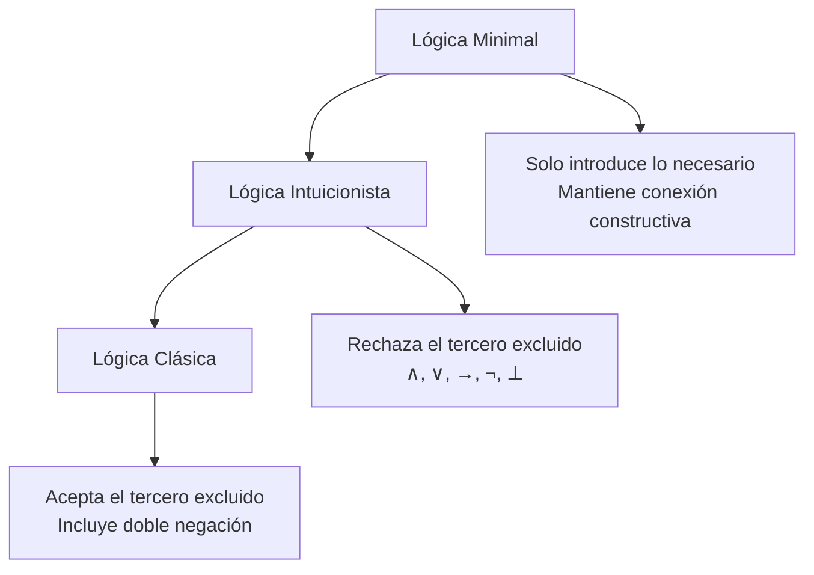
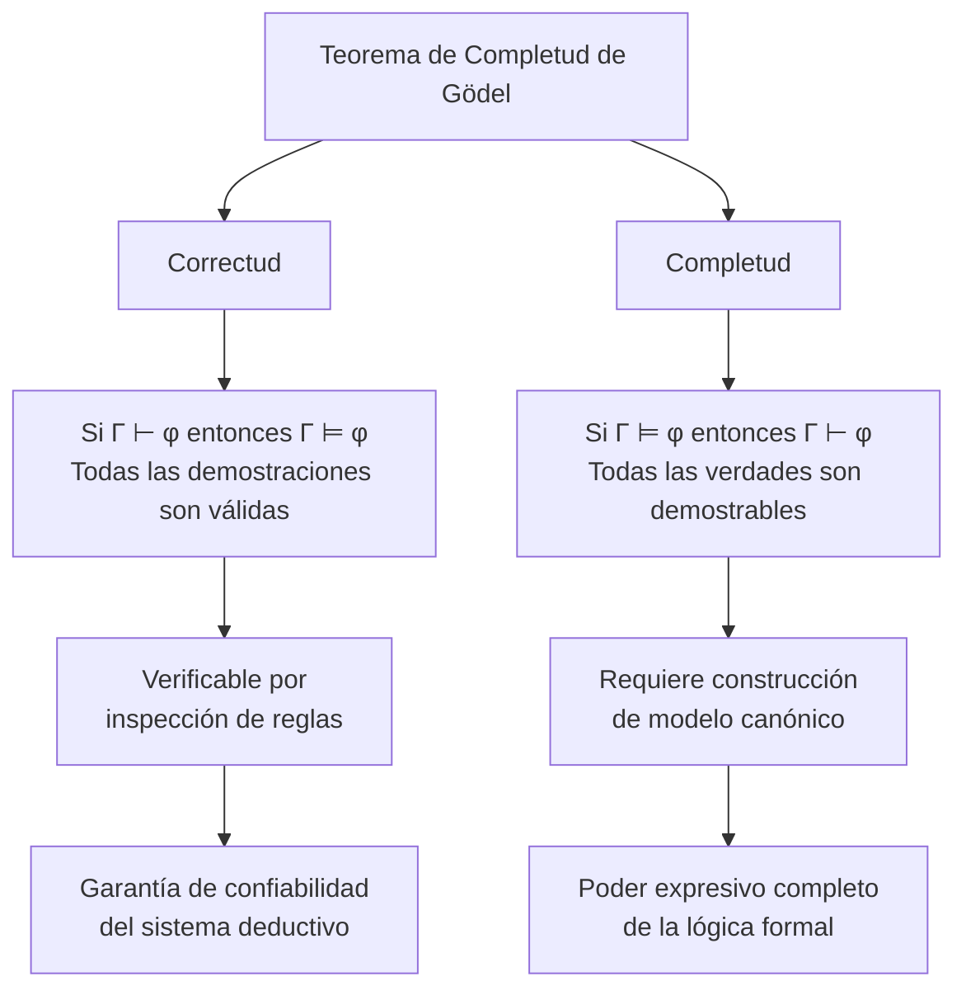

# Lógica Computacional - Sistemas deductivos

## 5.3 Deducción natural: uso de contextos; lógica minimal, intuicionista y clásica; el teorema de completud de Gödel.

---

La deducción natural es un sistema formal de razonamiento lógico que utiliza reglas de inferencia para derivar conclusiones a partir de premisas. Fue desarrollado independientemente por Gerhard Gentzen y Stanisław Jaśkowski en la década de 1930.

#### Definición Formal

Un sistema de deducción natural es una tripleta $\langle \mathcal{L}, \mathcal{R}, \Gamma \rangle$ donde:

- $\mathcal{L}$ es un lenguaje formal
- $\mathcal{R}$ es un conjunto de reglas de inferencia
- $\Gamma$ es un conjunto de premisas o hipótesis

### Uso de Contextos en Deducción Natural

En deducción natural, los **contextos** representan el conjunto de suposiciones activas en un punto dado de la demostración.

#### Estructura de una Demostración

```
Γ ⊢ φ   (Bajo el contexto Γ, podemos demostrar φ)
```

#### Reglas de Introducción y Eliminación

| Conectivo | Introducción                                     | Eliminación                                                  |
| --------- | ------------------------------------------------ | ------------------------------------------------------------ |
| ∧         | $\frac{A \quad B}{A ∧ B}$ (∧I)                   | $\frac{A ∧ B}{A}$ (∧E₁), $\frac{A ∧ B}{B}$ (∧E₂)             |
| →         | $\frac{[A] \cdots B}{A → B}$ (→I)                | $\frac{A → B \quad A}{B}$ (→E)                               |
| ∨         | $\frac{A}{A ∨ B}$ (∨I₁), $\frac{B}{A ∨ B}$ (∨I₂) | $\frac{A ∨ B \quad [A] \cdots C \quad [B] \cdots C}{C}$ (∨E) |
| ¬         | $\frac{[A] \cdots \perp }{¬A}$ (¬I)              | $\frac{A \quad ¬A}{ \perp }$ (¬E)                            |

### Lógicas: Minimal, Intuicionista y Clásica



#### Lógica Minimal

Solo introduce conectivos cuando son necesarios para la demostración:

- No incluye la regla ex falso quodlibet $(\frac{\perp}{A})$
- Más restrictiva que la intuicionista

#### Lógica Intuicionista

Desarrollada por L.E.J. Brouwer, rechaza:

- El principio del tercero excluido $(A ∨ ¬A)$
- La eliminación de doble negación $(¬¬A → A)$

**Regla ex falso**: $\frac{\perp}{A}$ (ex falso quodlibet)

#### Lógica Clásica

Incluye todas las reglas estándar:

- Principio del tercero excluido
- Eliminación de doble negación: $\frac{¬¬A}{A}$
- Prueba por contradicción

### El Teorema de Completud de Gödel

#### Teorema de Completud (Gödel, 1929)

Para la lógica de primer orden:

$$Si\ \Gamma \vDash \varphi\ entonces\ \Gamma \vdash \varphi$$

#### Teorema de Correctud

$$Si\ \Gamma \vdash \varphi\ entonces\ \Gamma \vDash \varphi$$

#### Equivalencia Semántica-Sintáctica

$$\Gamma \vdash \varphi\ si\ y\ solo\ si\ \Gamma \vDash \varphi$$

### Ejemplos de Demostraciones

#### Ejemplo 1: Lógica Intuicionista

**Demostrar**: $A → ¬¬A$

```
1. | A          [Suposición]
2. | | ¬A       [Suposición]
3. | | ⊥        [¬E: 1,2]
4. | ¬¬A        [¬I: 2-3]
5. A → ¬¬A      [→I: 1-4]
```

#### Ejemplo 2: Lógica Clásica

**Demostrar**: $¬¬A → A$ (no válido en intuicionista)

```
1. | ¬¬A        [Suposición]
2. | | ¬A       [Suposición para RAA]
3. | | ⊥        [¬E: 1,2]
4. | A          [RAA: 2-3]
5. ¬¬A → A      [→I: 1-4]
```

### Implementación de Deducción Natural

```python
class NaturalDeduction:
    def __init__(self):
        self.proof = []
        self.context = []

    def assumption(self, formula):
        """Introduce una suposición"""
        self.context.append(formula)
        self.proof.append(('Assumption', formula, len(self.context)))
        return len(self.context) - 1

    def implication_intro(self, start_index, conclusion):
        """Introducción de implicación"""
        if start_index < 0 or start_index >= len(self.context):
            raise ValueError("Índice de contexto inválido")

        # Eliminar las suposiciones desde start_index
        discharged_assumption = self.context[start_index]
        self.context = self.context[:start_index]

        new_formula = f"{discharged_assumption} → {conclusion}"
        self.proof.append(('→I', new_formula, (start_index, conclusion)))
        return new_formula

    def implication_elim(self, impl, antecedent):
        """Eliminación de implicación (Modus Ponens)"""
        if not impl.endswith(f"→ {antecedent}"):
            # Verificar pattern matching adecuado
            pass
        consequent = impl.split(" → ")[1]
        self.proof.append(('→E', consequent, (impl, antecedent)))
        return consequent

# Ejemplo de uso
nd = NaturalDeduction()
assump_index = nd.assumption("A")
nd.assumption("B")
result = nd.implication_intro(assump_index, "C")
```

### Ejercicios Propuestos

#### Ejercicio 1

Demuestre en deducción natural: $(A → B) → (¬B → ¬A)$

#### Ejercicio 2

Identifique en qué lógica es válida cada fórmula:

1. $¬¬A → A$
2. $(A → B) ∨ (B → A)$
3. $A ∨ ¬A$

#### Ejercicio 3

Demuestre usando el teorema de completud que si $\Gamma \vDash \varphi$, entonces existe una demostración formal.

#### Ejercicio 4

Implemente la regla de eliminación de la conjunción en Python.

### Diagrama del Teorema de Completud



### Referencias Bibliográficas

#### Bibliografía Básica

1. **Huth M., Ryan M.** (2004) - Capítulo 1: "Propositional Logic", sección 1.2 sobre deducción natural
2. **Nerode A., Shore R.A.** (1997) - Capítulo 2: "Proof Systems", sección 2.3 sobre completud

#### Bibliografía Complementaria

3. **Ben-Ari M.** (2008) - Capítulo 2: "Propositional Calculus: Deductive Systems"
4. **Fitting M.** (1996) - Capítulo 4: "First-Order Logic: Completeness"
5. **Van Dalen, D.** (2013) - "Logic and Structure": Capítulo sobre completud

### Estrategias de Demostración

#### Para Implicaciones:

1. Asumir el antecedente
2. Derivar el consecuente
3. Aplicar →I

#### Para Negaciones:

1. Asumir la fórmula positiva
2. Derivar contradicción
3. Aplicar ¬I

#### Para Disyunciones:

1. Considerar cada caso por separado
2. Mostrar que ambos llevan a la conclusión
3. Aplicar ∨E

### Consejos para Deducción Natural

1. **Estrategia descendente**: Trabajar de la conclusión hacia las premisas
2. **Gestión de contexto**: Mantener registro de suposiciones activas
3. **Elección de reglas**: Seleccionar reglas que descompongan conectivos principales
4. **Prueba por contradicción**: Usar cuando no haya otro camino evidente

### Comparación de Lógicas

| Propiedad          | Minimal | Intuicionista | Clásica |
| ------------------ | ------- | ------------- | ------- |
| Ex falso quodlibet | No      | Sí            | Sí      |
| Tertio excluso     | No      | No            | Sí      |
| ¬¬A → A            | No      | No            | Sí      |
| Construc           |
