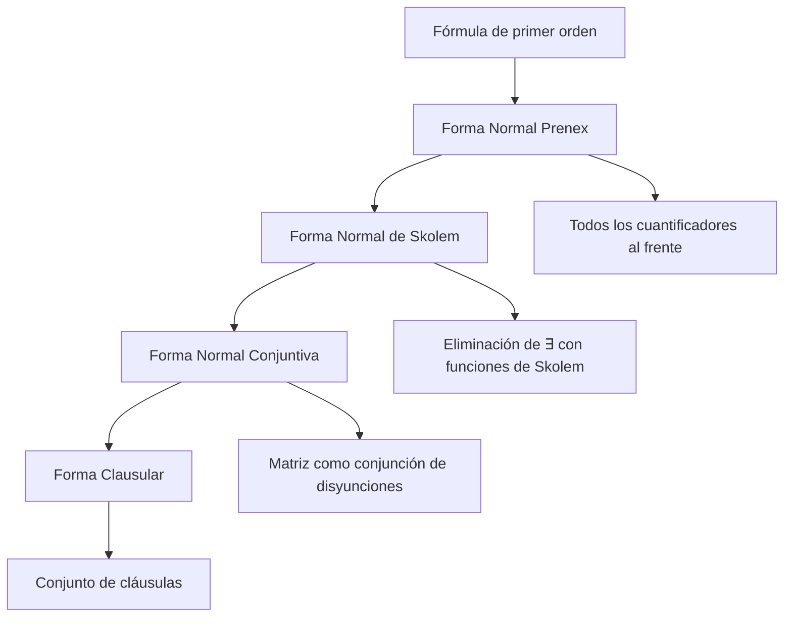
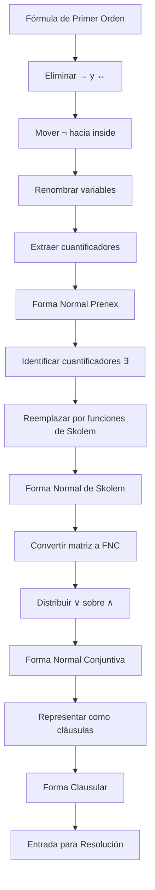

# Lógica Computacional - Sistemas deductivos

## 5.4 Formas normales: prenex, de Skolem, forma clausular.

---

Las formas normales son representaciones estandarizadas de fórmulas lógicas que facilitan el razonamiento automático, la demostración de teoremas y el procesamiento computacional. Son esenciales para algoritmos de resolución y verificación formal.

### Forma Normal Prenex (FNP)

#### Definición

Una fórmula está en **forma normal prenex** si todos sus cuantificadores aparecen al principio de la fórmula:

$$Q_1x_1 Q_2x_2 \cdots Q_nx_n M$$

Donde:

- $Q_i$ son cuantificadores (∀ o ∃)
- $x_i$ son variables
- $M$ es una fórmula sin cuantificadores (la **matriz**)

#### Algoritmo de Conversión a FNP

1. Eliminar bicondicionales (↔) y condicionales (→)
2. Mover las negaciones (¬) hacia dentro usando las leyes de De Morgan
3. Renombrar variables cuantificadas para evitar conflictos
4. Extraer cuantificadores hacia el frente preservando el orden

#### Reglas de Extracción

| Situación    | Regla                           |
| ------------ | ------------------------------- |
| $(∀x φ) ∧ ψ$ | $∀x (φ ∧ ψ)$ si x no libre en ψ |
| $(∀x φ) ∨ ψ$ | $∀x (φ ∨ ψ)$ si x no libre en ψ |
| $(∃x φ) ∧ ψ$ | $∃x (φ ∧ ψ)$ si x no libre en ψ |
| $(∃x φ) ∨ ψ$ | $∃x (φ ∨ ψ)$ si x no libre en ψ |

### Forma Normal de Skolem

#### Definición

La **forma normal de Skolem** es una forma normal prenex donde:

- Todos los cuantificadores existenciales (∃) han sido eliminados
- Se introducen **funciones de Skolem** para reemplazar variables existenciales

#### Proceso de Skolemización

Para cada cuantificador existencial $∃y$ en el ámbito de $∀x_1, ∀x_2, \ldots, ∀x_n:$

- Reemplazar $y$ por $f(x_1, x_2, \ldots, x_n)$ donde $f$ es un **símbolo de función nuevo** (función de Skolem)
- Si no hay cuantificadores universales previos, usar una **constante de Skolem**

#### Teorema de Skolem

Para toda fórmula φ en forma normal prenex, existe una fórmula ψ en forma normal de Skolem tal que φ es satisfacible si y solo si ψ es satisfacible.

### Forma Clausular

#### Definición

La **forma clausular** es una forma normal donde:

- La fórmula está en forma normal de Skolem
- La matriz está en forma normal conjuntiva (FNC)
- Se representa como un conjunto de cláusulas

#### Clausula

Una **cláusula** es una disyunción de literales:

$$L_1 ∨ L_2 ∨ \cdots ∨ L_n$$

Donde cada $L_i$ es un literal (átomo o negación de átomo).

#### Conversión a Forma Clausular

1. Convertir a forma normal prenex
2. Aplicar skolemización
3. Convertir la matriz a forma normal conjuntiva
4. Representar como conjunto de cláusulas



### Ejemplos Paso a Paso

#### Ejemplo 1: Conversión a Forma Normal Prenex

**Fórmula original**: $∀x P(x) → ∃y Q(y)$

**Paso 1**: Eliminar →  $¬∀x P(x) ∨ ∃y Q(y)$

**Paso 2**: Mover negación hacia dentro   $∃x ¬P(x) ∨ ∃y Q(y)$

**Paso 3**: Extraer cuantificadores   $∃x ∃y (¬P(x) ∨ Q(y))$

#### Ejemplo 2: Skolemización

**Fórmula prenex**: $∀x ∃y ∀z ∃w R(x, y, z, w)$

**Paso 1**: Skolemizar primer ∃y (depende de x)   $∀x ∀z ∃w R(x, f(x), z, w)$

**Paso 2**: Skolemizar ∃w (depende de x y z)    $∀x ∀z R(x, f(x), z, g(x, z))$

#### Ejemplo 3: Forma Clausular

**Fórmula**: $∀x (P(x) → (Q(x) ∨ R(x)))$

**Paso 1**: Eliminar →    $∀x (¬P(x) ∨ Q(x) ∨ R(x))$

**Paso 2**: Ya está en FNP y Skolem (solo ∀)
**Paso 3**: Matriz en FNC (ya es una disyunción)
**Paso 4**: Forma clausular:    $\{¬P(x) ∨ Q(x) ∨ R(x)\}$

### Implementación de Algoritmos

```python
class NormalFormConverter:
    def __init__(self):
        self.skolem_counter = 0
        self.skolem_functions = {}

    def to_prenex(self, formula):
        """Convierte una fórmula a forma normal prenex"""
        # Implementación recursiva que extrae cuantificadores
        pass

    def skolemize(self, prenex_formula):
        """Aplica skolemización a una fórmula prenex"""
        quantifiers = []
        matrix = prenex_formula

        # Extraer cuantificadores
        while isinstance(matrix, QuantifiedFormula):
            quantifiers.append((matrix.quantifier, matrix.variable))
            matrix = matrix.formula

        # Procesar para skolemización
        universal_vars = []
        new_quantifiers = []

        for quantifier, var in quantifiers:
            if quantifier == '∀':
                universal_vars.append(var)
                new_quantifiers.append(('∀', var))
            else:  # ∃
                # Reemplazar por función de Skolem
                skolem_func = self.get_skolem_function(universal_vars)
                matrix = matrix.substitute(var, skolem_func)

        # Reconstruir fórmula
        result = matrix
        for quantifier, var in reversed(new_quantifiers):
            result = QuantifiedFormula(quantifier, var, result)

        return result

    def get_skolem_function(self, variables):
        """Genera una función de Skolem"""
        if not variables:
            # Constante de Skolem
            return f"sk{self.skolem_counter++}"
        else:
            # Función de Skolem con arguments
            return f"sk{self.skolem_counter++}({', '.join(variables)})"

    def to_clausal_form(self, formula):
        """Convierte a forma clausular"""
        prenex = self.to_prenex(formula)
        skolemized = self.skolemize(prenex)
        cnf = self.to_cnf(skolemized.matrix)
        return self.extract_clauses(cnf)
```

### Ejercicios Propuestos

#### Ejercicio 1

Convierta a forma normal prenex:

$$∀x P(x) → (∃y Q(y) ∨ ∀z R(z))$$

#### Ejercicio 2

Aplique skolemización a:

$$∃x ∀y ∃z ∀w ∃u P(x, y, z, w, u)$$

#### Ejercicio 3

Convierta a forma clausular:

$$∀x (P(x) ∧ Q(x) → ∃y R(x, y))$$

#### Ejercicio 4

Implemente en Python la función para detectar variables libres en una fórmula.

### Diagrama de Proceso Completo



### Referencias Bibliográficas

#### Bibliografía Básica

1. **Huth M., Ryan M.** (2004) - Capítulo 2: "Predicate Logic", sección 2.3 sobre formas normales
2. **Nerode A., Shore R.A.** (1997) - Capítulo 3: "First-Order Logic", sección 3.4 sobre skolemización

#### Bibliografía Complementaria

3. **Fitting M.** (1996) - Capítulo 5: "Normal Forms and Herbrand's Theorem"
4. **Ben-Ari M.** (2008) - Capítulo 5: "First-Order Logic: Normal Forms"
5. **Chang, C.L.** & **Lee, R.C.T.** (1973) - "Symbolic Logic and Mechanical Theorem Proving"

### Aplicaciones Prácticas

#### Resolución Automática

La forma clausular es esencial para el algoritmo de resolución en demostración automática de teoremas.

#### Bases de Datos Deductivas

Las formas normales permiten optimizar consultas y razonamiento en sistemas de bases de datos deductivas.

#### Verificación Formal

En verificación de software y hardware, las formas normales facilitan el análisis automatizado.

#### Programación Lógica

Sistemas como Prolog utilizan variantes de la forma clausular para su ejecución.

### Consejos para la Conversión

1. **Renombrar variables**: Evitar conflictos antes de extraer cuantificadores
2. **Preservar equivalencia**: Algunas transformaciones preservan equivalencia, otras solo equisatisfacibilidad
3. **Orden de cuantificadores**: Mantener el orden original al extraer
4. **Funciones de Skolem**: Usar funciones diferentes para diferentes cuantificadores existenciales

### Comparación de Formas Normales

| Forma Normal | Cuantificadores | Cuantificadores ∃ | Matriz          | Equivalencia     |
| ------------ | --------------- | ----------------- | --------------- | ---------------- |
| Prenex       | Todos al frente | Preservados       | Cualquier forma | Equivalente      |
| Skolem       | Solo ∀          | Eliminados        | Cualquier forma | Equisatisfacible |
| Clausular    | Solo ∀          | Eliminados        | FNC             | Equisatisfacible |
