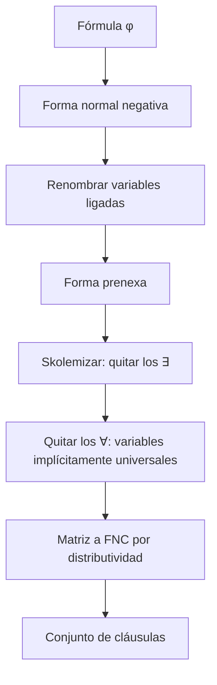

# Lógica Computacional - Sistemas deductivos

## 5.4 Formas normales: prenex, de Skolem, forma clausular.

---

La resolución de primer orden (tema 5.5) trabaja con **cláusulas**: disyunciones de literales cuyas variables se entienden cuantificadas universalmente. Para aplicarla a una fórmula cualquiera hay que transformarla en un conjunto de cláusulas. La transformación tiene tres etapas: llevar los cuantificadores al principio (**forma prenexa**), eliminar los existenciales con funciones nuevas (**skolemización**) y poner la parte sin cuantificadores en forma normal conjuntiva. La primera etapa preserva la equivalencia; la segunda solo la **satisfacibilidad**, que es lo que necesita un método de refutación.

### Forma normal prenexa

**Definición.** Una fórmula está en **forma prenexa** si es de la forma

$$ Q_1 x_1\, Q_2 x_2 \cdots Q_n x_n\, M $$

con cada $Q_i \in \{\forall, \exists\}$ y $M$ sin cuantificadores. La sucesión $Q_1 x_1 \cdots Q_n x_n$ es el **prefijo** y $M$ la **matriz**.

**Teorema.** Toda fórmula es lógicamente equivalente a una en forma prenexa.

**Algoritmo.**

1. **Forma normal negativa.** Eliminar $\to$ y $\leftrightarrow$ y llevar las negaciones a los átomos, con las leyes de De Morgan proposicionales y las de los cuantificadores, $\lnot \forall x\, \varphi \equiv \exists x\, \lnot \varphi$ y $\lnot \exists x\, \varphi \equiv \forall x\, \lnot \varphi.$
2. **Renombrar.** Cambiar los nombres de las variables ligadas para que cada cuantificador tenga una variable distinta y ninguna coincida con una libre. Es una α-conversión (tema 3.3) y no cambia el significado.
3. **Extraer** los cuantificadores con las equivalencias, válidas si $x$ no es libre en $\psi:$

$$ (\forall x\, \varphi) \land \psi \equiv \forall x\, (\varphi \land \psi), \quad (\forall x\, \varphi) \lor \psi \equiv \forall x\, (\varphi \lor \psi), \quad (\exists x\, \varphi) \land \psi \equiv \exists x\, (\varphi \land \psi), \quad (\exists x\, \varphi) \lor \psi \equiv \exists x\, (\varphi \lor \psi) $$

y sus simétricas. Gracias al paso 2, la condición siempre se cumple.

**Ejemplo.** $\forall x\, P(x) \to \exists y\, Q(y)$ pasa a FNN como $\exists x\, \lnot P(x) \lor \exists y\, Q(y)$ y a forma prenexa como $\exists x\, \exists y\, (\lnot P(x) \lor Q(y)).$

**Por qué hay que renombrar.** En $\forall x\, P(x) \lor Q(x),$ la segunda $x$ es libre. Extraer sin renombrar daría $\forall x\, (P(x) \lor Q(x)),$ que liga la $x$ de $Q$ y cambia el significado. Renombrando, $\forall z\, (P(z) \lor Q(x))$ es correcto.

La forma prenexa no es única: en $\forall x\, P(x) \lor \exists y\, Q(y)$ se puede extraer primero cualquiera de los dos cuantificadores. El orden importa para el paso siguiente.

### Skolemización

Un enunciado $\forall x\, \exists y\, \varphi(x, y)$ dice que para cada $x$ hay un $y.$ Si se elige uno para cada $x,$ se obtiene una **función** $f$ con $\varphi(x, f(x)).$ La skolemización (Skolem, 1920) introduce esa función como un símbolo nuevo.

**Definición.** Sea $\forall x_1 \cdots \forall x_k\, \exists y\, \psi$ en forma prenexa, donde $\forall x_1 \cdots \forall x_k$ son los universales que preceden a $\exists y.$ Se reemplaza por

$$ \forall x_1 \cdots \forall x_k\, \psi[y := f(x_1, \ldots, x_k)] $$

con $f$ un símbolo de función **nuevo**, la **función de Skolem**. Si $k = 0,$ $f$ es una **constante de Skolem**. Se repite hasta eliminar todos los existenciales; el resultado es la **forma de Skolem**, con solo cuantificadores universales.

**Ejemplo.** $\forall x\, \exists y\, \forall z\, \exists w\, R(x, y, z, w)$ se convierte en $\forall x\, \forall z\, R(x, f(x), z, g(x, z)):$ $y$ depende solo de $x,$ y $w$ de $x$ y $z.$

**Teorema.** $\varphi$ es satisfacible si y solo si su forma de Skolem $\varphi^S$ es satisfacible.

**Demostración.** Basta un paso. Si $\mathcal{M} \models \forall \vec{x}\, \exists y\, \psi,$ para cada tupla $\vec{d}$ existe algún $e$ con $\psi;$ eligiendo uno para cada $\vec{d}$ (axioma de elección) se define $f^{\mathcal{M}}(\vec{d}) = e,$ y la estructura ampliada satisface $\forall \vec{x}\, \psi[y := f(\vec{x})].$ Al revés, si $\mathcal{M} \models \forall \vec{x}\, \psi[y := f(\vec{x})],$ entonces para cada $\vec{d}$ el valor $f^{\mathcal{M}}(\vec{d})$ es testigo de $\exists y\, \psi.$ $\blacksquare$

**No es equivalencia.** $\exists y\, P(y)$ y $P(a)$ no son equivalentes: en una estructura con $P = \{1\}$ y $a = 2,$ la primera es verdadera y la segunda falsa. Pero ambas son satisfacibles o no a la vez. Por eso la skolemización se aplica a $\Gamma \cup \{\lnot \varphi\},$ el conjunto que se quiere refutar, y **no** directamente a la conclusión $\varphi.$

**Skolemización interna.** Aplicada directamente a la FNN, sin pasar por la forma prenexa, cada existencial depende solo de los universales **en cuyo alcance está**. En $\forall x\, P(x) \lor \exists y\, Q(y),$ prenexar extrayendo primero $\forall x$ y luego skolemizar da $P(x) \lor Q(f(x)),$ mientras que la skolemización interna da $P(x) \lor Q(a).$ Ambas son correctas, pero funciones con menos argumentos hacen más fácil la resolución.

### Forma clausular

**Definición.** Un **literal** es un átomo o su negación; una **cláusula** es una disyunción de literales, representada como conjunto. Una fórmula está en **forma clausular** si es de la forma $\forall x_1 \cdots \forall x_n\, (C_1 \land \cdots \land C_m)$ con cada $C_i$ una cláusula. Como todos los cuantificadores son universales y $\forall$ distribuye sobre $\land,$ se escribe simplemente como el conjunto $\{C_1, \ldots, C_m\},$ entendiendo que cada cláusula tiene sus variables cuantificadas universalmente. Las variables de cláusulas distintas son independientes, y se pueden renombrar por separado.

**Algoritmo completo.**



| Etapa | Resultado | Relación con la original |
| --- | --- | --- |
| FNN, renombramiento, forma prenexa | prefijo y matriz | equivalente |
| Skolemización | solo cuantificadores $\forall$ | equisatisfacible |
| FNC de la matriz | conjunto de cláusulas | equivalente a la forma de Skolem |

**Ejemplo.** $\forall x\, (P(x) \land Q(x) \to \exists y\, R(x, y)):$ la FNN es $\forall x\, (\lnot P(x) \lor \lnot Q(x) \lor \exists y\, R(x, y)),$ la forma prenexa $\forall x\, \exists y\, (\lnot P(x) \lor \lnot Q(x) \lor R(x, y)),$ la forma de Skolem $\forall x\, (\lnot P(x) \lor \lnot Q(x) \lor R(x, f(x))),$ y la forma clausular una sola cláusula: $\{\lnot P(x), \lnot Q(x), R(x, f(x))\}.$

### Implementación en Python

El programa implementa las cinco etapas: FNN, renombramiento con variables $x_1, x_2, \ldots,$ extracción de cuantificadores de izquierda a derecha, skolemización con constantes $a, b, \ldots$ y funciones $f, g, \ldots,$ y distribución para obtener las cláusulas. Convierte los ejemplos y ejercicios del tema y compara la skolemización de la forma prenexa con la interna.

```python
import itertools

def es_var(t): return isinstance(t, str) and t[0] in 'xyzuvw'

def tt(t):
    return t if isinstance(t, str) else t[0] + '(' + ', '.join(map(tt, t[1:])) + ')'

def tf(f):
    if f[0][0].isupper(): return f[0] + '(' + ', '.join(map(tt, f[1:])) + ')'
    if f[0] == '¬': return '¬' + tf(f[1])
    if f[0] in '∀∃': return f[0] + f[1] + ' ' + tf(f[2])
    return '(' + tf(f[1]) + ' ' + f[0] + ' ' + tf(f[2]) + ')'

def sust_t(t, s):
    if isinstance(t, str): return s.get(t, t)
    return (t[0],) + tuple(sust_t(r, s) for r in t[1:])

def sust(f, s):
    """Sustitución de variables libres (las ligadas ya son todas distintas tras renombrar)."""
    if f[0][0].isupper(): return (f[0],) + tuple(sust_t(t, s) for t in f[1:])
    if f[0] == '¬': return ('¬', sust(f[1], s))
    if f[0] in '∀∃':
        s2 = {k: v for k, v in s.items() if k != f[1]}
        return (f[0], f[1], sust(f[2], s2))
    return (f[0], sust(f[1], s), sust(f[2], s))

# 1. Forma normal negativa
def fnn(f, neg=False):
    op = f[0]
    if op[0].isupper(): return ('¬', f) if neg else f
    if op == '¬': return fnn(f[1], not neg)
    if op == '→': return fnn(('∨', ('¬', f[1]), f[2]), neg)
    if op == '↔': return fnn(('∧', ('→', f[1], f[2]), ('→', f[2], f[1])), neg)
    if op in '∧∨':
        nuevo = {'∧': '∨', '∨': '∧'}[op] if neg else op
        return (nuevo, fnn(f[1], neg), fnn(f[2], neg))
    nuevo = {'∀': '∃', '∃': '∀'}[op] if neg else op
    return (nuevo, f[1], fnn(f[2], neg))

# 2. Renombrar: cada cuantificador recibe una variable distinta
def renombrar(f, s=None, contador=None):
    s, contador = s or {}, contador or itertools.count(1)
    if f[0][0].isupper() or f[0] == '¬': return sust(f, s)
    if f[0] in '∀∃':
        v = f'x{next(contador)}'
        return (f[0], v, renombrar(f[2], {**s, f[1]: v}, contador))
    return (f[0], renombrar(f[1], s, contador), renombrar(f[2], s, contador))

# 3. Forma prenexa: extraer los cuantificadores de izquierda a derecha
def prenexa(f):
    if f[0][0].isupper() or f[0] == '¬': return [], f
    if f[0] in '∀∃':
        pref, m = prenexa(f[2])
        return [(f[0], f[1])] + pref, m
    p1, m1 = prenexa(f[1]); p2, m2 = prenexa(f[2])
    return p1 + p2, (f[0], m1, m2)

def texto_prenexa(pref, m):
    return ''.join(q + v + ' ' for q, v in pref) + tf(m)

# 4. Skolemización de la forma prenexa
def skolem(pref, m, nombres):
    universales, s = [], {}
    for q, v in pref:
        if q == '∀':
            universales.append(v)
        else:
            s[v] = (next(nombres[1]),) + tuple(universales) if universales else next(nombres[0])
    return universales, sust(m, s)

# Skolemización interna: sobre la FNN, cada ∃ depende solo de los ∀ en cuyo alcance está
def skolem_interna(f, universales, nombres):
    if f[0][0].isupper() or f[0] == '¬': return f
    if f[0] == '∀': return ('∀', f[1], skolem_interna(f[2], universales + [f[1]], nombres))
    if f[0] == '∃':
        t = (next(nombres[1]),) + tuple(universales) if universales else next(nombres[0])
        return skolem_interna(sust(f[2], {f[1]: t}), universales, nombres)
    return (f[0], skolem_interna(f[1], universales, nombres), skolem_interna(f[2], universales, nombres))

def quitar_forall(f):
    if f[0] == '∀': return quitar_forall(f[2])
    if f[0] in '∧∨': return (f[0], quitar_forall(f[1]), quitar_forall(f[2]))
    return f

# 5. Forma clausular: FNC de la matriz
def clausulas(m):
    if m[0] == '∧': return clausulas(m[1]) + clausulas(m[2])
    if m[0] == '∨': return [a + b for a in clausulas(m[1]) for b in clausulas(m[2])]
    return [[tf(m)]]

def convertir(nombre, f):
    nombres = (iter('abcde'), iter('fghk'))   # constantes y funciones de Skolem
    print(f'{nombre}: {tf(f)}')
    n = fnn(f); print('   FNN:      ', tf(n))
    r = renombrar(n)
    pref, m = prenexa(r); print('   prenexa:  ', texto_prenexa(pref, m))
    univ, ms = skolem(pref, m, nombres)
    print('   Skolem:   ', ''.join('∀' + v + ' ' for v in univ) + tf(ms))
    print('   cláusulas:', ', '.join('{' + ', '.join(c) + '}' for c in clausulas(ms)))

P = lambda *t: ('P',) + t
convertir('ejemplo 1', ('→', ('∀', 'x', ('P', 'x')), ('∃', 'y', ('Q', 'y'))))
convertir('ejemplo 2', ('∀', 'x', ('∃', 'y', ('∀', 'z', ('∃', 'w', ('R', 'x', 'y', 'z', 'w'))))))
convertir('ejercicio 1', ('→', ('∀', 'x', ('P', 'x')), ('∨', ('∃', 'y', ('Q', 'y')), ('∀', 'z', ('R', 'z')))))
convertir('ejercicio 2', ('∃', 'x', ('∀', 'y', ('∃', 'z', ('∀', 'w', ('∃', 'u', ('P', 'x', 'y', 'z', 'w', 'u')))))))
convertir('ejercicio 3', ('∀', 'x', ('→', ('∧', ('P', 'x'), ('Q', 'x')), ('∃', 'y', ('R', 'x', 'y')))))
convertir('ejercicio 5', ('∀', 'x', ('↔', ('P', 'x'), ('∃', 'y', ('R', 'x', 'y')))))

# Prenexa frente a skolemización interna
g = ('∨', ('∀', 'x', ('P', 'x')), ('∃', 'y', ('Q', 'y')))
pref, m = prenexa(renombrar(fnn(g)))
print('prenexa y luego Skolem:', tf(skolem(pref, m, (iter('ab'), iter('fg')))[1]))
print('Skolem interna:        ', tf(quitar_forall(skolem_interna(renombrar(fnn(g)), [], (iter('ab'), iter('fg'))))))
```

Salida:

```text
ejemplo 1: (∀x P(x) → ∃y Q(y))
   FNN:       (∃x ¬P(x) ∨ ∃y Q(y))
   prenexa:   ∃x1 ∃x2 (¬P(x1) ∨ Q(x2))
   Skolem:    (¬P(a) ∨ Q(b))
   cláusulas: {¬P(a), Q(b)}
ejemplo 2: ∀x ∃y ∀z ∃w R(x, y, z, w)
   FNN:       ∀x ∃y ∀z ∃w R(x, y, z, w)
   prenexa:   ∀x1 ∃x2 ∀x3 ∃x4 R(x1, x2, x3, x4)
   Skolem:    ∀x1 ∀x3 R(x1, f(x1), x3, g(x1, x3))
   cláusulas: {R(x1, f(x1), x3, g(x1, x3))}
ejercicio 1: (∀x P(x) → (∃y Q(y) ∨ ∀z R(z)))
   FNN:       (∃x ¬P(x) ∨ (∃y Q(y) ∨ ∀z R(z)))
   prenexa:   ∃x1 ∃x2 ∀x3 (¬P(x1) ∨ (Q(x2) ∨ R(x3)))
   Skolem:    ∀x3 (¬P(a) ∨ (Q(b) ∨ R(x3)))
   cláusulas: {¬P(a), Q(b), R(x3)}
ejercicio 2: ∃x ∀y ∃z ∀w ∃u P(x, y, z, w, u)
   FNN:       ∃x ∀y ∃z ∀w ∃u P(x, y, z, w, u)
   prenexa:   ∃x1 ∀x2 ∃x3 ∀x4 ∃x5 P(x1, x2, x3, x4, x5)
   Skolem:    ∀x2 ∀x4 P(a, x2, f(x2), x4, g(x2, x4))
   cláusulas: {P(a, x2, f(x2), x4, g(x2, x4))}
ejercicio 3: ∀x ((P(x) ∧ Q(x)) → ∃y R(x, y))
   FNN:       ∀x ((¬P(x) ∨ ¬Q(x)) ∨ ∃y R(x, y))
   prenexa:   ∀x1 ∃x2 ((¬P(x1) ∨ ¬Q(x1)) ∨ R(x1, x2))
   Skolem:    ∀x1 ((¬P(x1) ∨ ¬Q(x1)) ∨ R(x1, f(x1)))
   cláusulas: {¬P(x1), ¬Q(x1), R(x1, f(x1))}
ejercicio 5: ∀x (P(x) ↔ ∃y R(x, y))
   FNN:       ∀x ((¬P(x) ∨ ∃y R(x, y)) ∧ (∀y ¬R(x, y) ∨ P(x)))
   prenexa:   ∀x1 ∃x2 ∀x3 ((¬P(x1) ∨ R(x1, x2)) ∧ (¬R(x1, x3) ∨ P(x1)))
   Skolem:    ∀x1 ∀x3 ((¬P(x1) ∨ R(x1, f(x1))) ∧ (¬R(x1, x3) ∨ P(x1)))
   cláusulas: {¬P(x1), R(x1, f(x1))}, {¬R(x1, x3), P(x1)}
prenexa y luego Skolem: (P(x1) ∨ Q(f(x1)))
Skolem interna:         (P(x1) ∨ Q(a))
```

En el último ejemplo, la skolemización de la forma prenexa introduce una dependencia de $x_1$ que no existe en la fórmula original; la interna la evita.

### Ejercicios Propuestos

1. **Prenexa.** Convierte a forma prenexa $\forall x\, P(x) \to (\exists y\, Q(y) \lor \forall z\, R(z)).$

2. **Skolemización.** Skolemiza $\exists x\, \forall y\, \exists z\, \forall w\, \exists u\, P(x, y, z, w, u).$

3. **Forma clausular.** Convierte a forma clausular $\forall x\, (P(x) \land Q(x) \to \exists y\, R(x, y)).$

4. **Renombrar.** Explica qué sale mal si se convierte $\forall x\, P(x) \land \exists x\, Q(x)$ a forma prenexa sin renombrar.

5. **Equivalencia.** Convierte a forma clausular $\forall x\, (P(x) \leftrightarrow \exists y\, R(x, y)).$ ¿Cuántas cláusulas resultan?

6. **Refutación.** Para demostrar $\forall x\, P(x) \models \exists x\, P(x)$ por refutación, ¿qué conjunto de cláusulas se obtiene? ¿Por qué no hace falta skolemizar nada?

### Soluciones

**Ejercicio 1.** La FNN es $\exists x\, \lnot P(x) \lor \exists y\, Q(y) \lor \forall z\, R(z),$ y una forma prenexa es $\exists x\, \exists y\, \forall z\, (\lnot P(x) \lor Q(y) \lor R(z)).$

**Ejercicio 2.** $\forall y\, \forall w\, P(a, y, f(y), w, g(y, w)):$ $x$ no depende de nada y es una constante; $z$ depende de $y;$ $u$ de $y$ y $w.$

**Ejercicio 3.** $\{\lnot P(x), \lnot Q(x), R(x, f(x))\},$ como en el ejemplo del tema.

**Ejercicio 4.** Sin renombrar, extraer ambos daría $\forall x\, \exists x\, (P(x) \land Q(x)),$ donde el $\forall x$ es vacuo y $P$ queda ligada por $\exists x:$ dice que algo es $P$ y $Q$ a la vez, que no es lo mismo. Con renombramiento, $\forall x\, \exists y\, (P(x) \land Q(y)).$

**Ejercicio 5.** El bicondicional se divide en dos implicaciones. La de izquierda a derecha da $\lnot P(x) \lor R(x, f(x));$ la de derecha a izquierda, $\exists y\, R(x, y) \to P(x),$ que en FNN es $\forall y\, \lnot R(x, y) \lor P(x),$ con un universal: no hay que skolemizar nada. Resultan dos cláusulas: $\{\lnot P(x), R(x, f(x))\}$ y $\{\lnot R(x, y), P(x)\}.$

**Ejercicio 6.** Se refuta $\{\forall x\, P(x), \lnot \exists x\, P(x)\}.$ La segunda en FNN es $\forall x\, \lnot P(x).$ Ambas son universales, así que no hay existenciales que skolemizar: las cláusulas son $\{P(x)\}$ y $\{\lnot P(y)\}.$ La resolución (tema 5.5) las refuta unificando $x$ con $y.$

### Referencias

1. Ben-Ari, M., _Mathematical Logic for Computer Science_. Springer, 2012. Secciones 9.1 a 9.3.
2. Fitting, M., _First-Order Logic and Automated Theorem Proving_. Springer, 1996. Secciones 8.1 a 8.3.
3. Chang, C.-L., and Lee, R. C.-T., _Symbolic Logic and Mechanical Theorem Proving_. Academic Press, 1973. Capítulo 4.
4. Nonnengart, A., and Weidenbach, C. (2001). Computing small clause normal forms. En _Handbook of Automated Reasoning_, Elsevier, 335-367.
