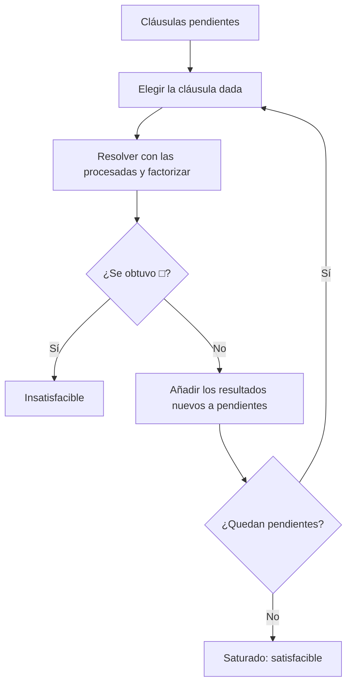

# Lógica Computacional - Sistemas deductivos

## 5.5 Resolución binaria: cláusulas cerradas; unificación: unificadores más generales, algoritmo de Martelli-Montanari; algoritmos de saturación; estrategias de derivación (resolución lineal, resolución unitaria, conjunto de soporte).

---

La resolución proposicional (tema 2.6) refuta conjuntos de cláusulas sin variables. Robinson (1965) la extendió a primer orden con una idea clave: en lugar de adivinar qué instancias de las cláusulas usar, se calculan las **mínimas necesarias** para que dos literales choquen, por medio de la **unificación**. El resultado es un sistema con una sola regla (más la factorización), correcto y refutacionalmente completo, que sigue siendo la base de los demostradores automáticos y de Prolog.

### Cláusulas cerradas y el teorema de Herbrand

Una cláusula es **cerrada** (o básica) si no tiene variables, como $\{P(a), \lnot Q(f(b))\}.$ La resolución entre cláusulas cerradas es exactamente la proposicional, tratando cada átomo cerrado como una variable proposicional:

$$ \frac{\{P(a), Q(b)\} \qquad \{\lnot P(a), R(c)\}}{\{Q(b), R(c)\}} $$

Una cláusula con variables $C$ representa todas sus **instancias cerradas** $C\sigma,$ obtenidas reemplazando las variables por términos cerrados. El **universo de Herbrand** de un conjunto de cláusulas es el conjunto de términos cerrados que se pueden formar con sus símbolos (con una constante añadida si no hay ninguna).

**Teorema de Herbrand.** Un conjunto finito $S$ de cláusulas es insatisfacible si y solo si algún conjunto **finito** de instancias cerradas de sus cláusulas, con términos del universo de Herbrand, es insatisfacible proposicionalmente.

Esto da un semialgoritmo: generar instancias cerradas y aplicarles resolución proposicional. Pero el universo de Herbrand suele ser infinito, como $\{a, f(a), f(f(a)), \ldots\},$ y adivinar las instancias correctas es muy costoso. La unificación lo evita.

### Sustituciones y unificadores

Una **sustitución** $\sigma = \{x_1 \mapsto t_1, \ldots, x_n \mapsto t_n\}$ reemplaza simultáneamente cada $x_i$ por $t_i$ (tema 3.3); $t\sigma$ es el resultado de aplicarla a $t.$ La **composición** $\sigma\tau$ aplica primero $\sigma$ y luego $\tau.$

**Definición.** Un **unificador** de dos expresiones $s$ y $t$ es una sustitución $\sigma$ con $s\sigma = t\sigma.$ Un unificador $\theta$ es **más general** (umg) si todo otro unificador $\sigma$ se obtiene de él especializando: $\sigma = \theta\tau$ para alguna $\tau.$

**Ejemplo.** $P(x, f(y))$ y $P(a, z)$ tienen como umg $\{x \mapsto a, z \mapsto f(y)\}.$ También las unifica $\{x \mapsto a, y \mapsto b, z \mapsto f(b)\},$ pero es menos general: se obtiene del umg aplicando después $\{y \mapsto b\}.$

**Teorema (Robinson, 1965).** Si dos expresiones son unificables, tienen un umg, único salvo renombramiento de variables.

### El algoritmo de Martelli-Montanari

Martelli y Montanari (1982) presentaron la unificación como la resolución de un **sistema de ecuaciones** $\{s_1 \doteq t_1, \ldots, s_n \doteq t_n\},$ transformado por reglas hasta llegar a una **forma resuelta** $\{x_1 \doteq t_1, \ldots, x_k \doteq t_k\},$ con variables $x_i$ distintas que no aparecen en ningún $t_j.$ La forma resuelta es el umg.

| Regla | Ecuación | Acción |
| --- | --- | --- |
| Eliminación trivial | $t \doteq t$ | se elimina |
| Descomposición | $f(s_1, \ldots, s_n) \doteq f(t_1, \ldots, t_n)$ | se reemplaza por $s_1 \doteq t_1, \ldots, s_n \doteq t_n$ |
| Choque | $f(\ldots) \doteq g(\ldots)$ con $f \neq g$ o distinta aridad | falla |
| Orientación | $t \doteq x,$ con $t$ no variable | se reemplaza por $x \doteq t$ |
| Verificación de ocurrencia | $x \doteq t,$ con $x$ en $t$ y $t \neq x$ | falla |
| Eliminación de variable | $x \doteq t,$ con $x$ no en $t$ | se sustituye $x$ por $t$ en las demás ecuaciones |

**Ejemplo.** $P(f(x), y) \doteq P(z, g(z)).$ Descomposición: $f(x) \doteq z$ y $y \doteq g(z).$ Orientación y eliminación de $z:$ $z \doteq f(x),$ $y \doteq g(f(x)).$ Forma resuelta: $\{z \mapsto f(x), y \mapsto g(f(x))\}.$

**Verificación de ocurrencia.** $x \doteq f(x)$ no tiene solución entre los términos finitos: cualquier sustitución hace $f(x)$ más largo que $x.$ Por eficiencia, Prolog omite esta verificación, y puede producir respuestas incorrectas o términos cíclicos.

**Terminación.** Cada regla disminuye, en orden lexicográfico, el número de variables no resueltas, el tamaño total y el número de ecuaciones orientadas al revés; por eso el algoritmo termina, y es correcto porque cada regla preserva el conjunto de unificadores.

### La regla de resolución binaria y la factorización

**Resolución binaria.** Sean $C_1 \cup \{L_1\}$ y $C_2 \cup \{\lnot L_2\}$ dos cláusulas **sin variables en común** (se renombran si hace falta), y $\theta$ un umg de $L_1$ y $L_2.$ Su resolvente es

$$ \frac{C_1 \cup \{L_1\} \qquad C_2 \cup \{\lnot L_2\}}{(C_1 \cup C_2)\theta} $$

**Factorización.** Si dos literales $L, L'$ de una cláusula $C$ tienen umg $\theta,$ el **factor** de $C$ es $C\theta,$ en el que esos dos literales se vuelven uno.

**Ejemplo.** $\{P(x, f(x)), Q(x)\}$ y $\{\lnot P(a, y), R(y)\}:$ el umg de $P(x, f(x))$ y $P(a, y)$ es $\{x \mapsto a, y \mapsto f(a)\},$ y el resolvente es $\{Q(a), R(f(a))\}.$

**La factorización es necesaria.** El conjunto $\{\{P(x), P(y)\}, \{\lnot P(u), \lnot P(v)\}\}$ es insatisfacible, pero todo resolvente binario tiene dos literales, así que sin factorizar nunca aparece $\square.$ Con factorización, $\{P(x)\}$ y $\{\lnot P(u)\}$ se resuelven en un paso.

**Teorema (Robinson).** La resolución binaria con factorización es correcta y refutacionalmente completa: un conjunto de cláusulas es insatisfacible si y solo si de él se deriva $\square.$

La corrección es como en el caso proposicional, porque una cláusula implica todas sus instancias. La completud se obtiene del teorema de Herbrand y del **lema de elevación**: toda resolución entre instancias cerradas $C_1\sigma_1$ y $C_2\sigma_2$ es instancia de una resolución, con umg, entre $C_1$ y $C_2$ (posiblemente factorizadas). Así, la refutación proposicional que garantiza Herbrand se "eleva" a una refutación de primer orden.

### Algoritmos de saturación

La saturación genera resolventes y factores hasta encontrar $\square.$ En primer orden puede no terminar, porque el conjunto de cláusulas derivables puede ser infinito, como $\{P(a)\},$ $\{\lnot P(x), P(f(x))\}$ que genera $P(f(a)),$ $P(f(f(a))),$ y así sucesivamente. Los demostradores usan el **algoritmo de la cláusula dada**:

1. Dividir las cláusulas en **procesadas** (al principio vacío) y **pendientes**.
2. Mientras haya pendientes: elegir una, la **cláusula dada**, con una heurística (por ejemplo, la más corta); calcular sus resolventes con las procesadas y consigo misma, y sus factores; pasarla a procesadas; añadir a pendientes los resultados nuevos.
3. Responder "insatisfacible" al obtener $\square,$ y "satisfacible" si no quedan pendientes.

Para que sea completo, la elección debe ser **justa**: ninguna cláusula pendiente se pospone para siempre. Además, se eliminan las cláusulas **subsumidas**: si $C\sigma \subseteq D$ para alguna $\sigma,$ la cláusula $D$ es redundante.



### Estrategias de derivación

Restringir qué pares se resuelven reduce enormemente la búsqueda, a veces sin perder completud.

- **Conjunto de soporte** (Wos, Robinson y Carson, 1965). Se separa un subconjunto $T,$ normalmente la negación de la conclusión, y solo se permiten resoluciones en las que al menos una cláusula provenga de $T$ o de sus descendientes. Los resolventes se añaden al soporte. Es **completa** si el complemento $S \setminus T$ es satisfacible, lo que ocurre cuando las premisas son consistentes. Dirige la búsqueda hacia la meta.
- **Resolución lineal.** Cada paso resuelve la cláusula derivada en el paso anterior con una cláusula original o con una derivada antes en la misma cadena. Es completa. Su caso particular **SLD**, para cláusulas de Horn, es el mecanismo de ejecución de Prolog (tema 6.1).
- **Resolución unitaria.** Cada resolución usa al menos una cláusula de un solo literal. Es eficiente, porque los resolventes se acortan, pero es **incompleta** en general; es completa para cláusulas de Horn. Por ejemplo, $\{\{P, Q\}, \{\lnot P, Q\}, \{P, \lnot Q\}, \{\lnot P, \lnot Q\}\}$ es insatisfacible y no tiene cláusulas unitarias, así que la resolución unitaria no puede empezar.

| Estrategia | Completa | Idea |
| --- | --- | --- |
| Saturación sin restricciones | sí | todos los pares |
| Conjunto de soporte | sí, si las premisas son consistentes | usar siempre la meta o sus descendientes |
| Lineal | sí | una cadena que parte de una cláusula |
| Unitaria | no (sí para Horn) | siempre una cláusula unitaria |

### Implementación en Python

El programa implementa el algoritmo de Martelli-Montanari con la traza de las ecuaciones, y un demostrador por resolución binaria con factorización, renombrado de variables, el algoritmo de la cláusula dada (eligiendo la más corta) y, opcionalmente, conjunto de soporte. Para cada refutación imprime los pasos que llevan a $\square.$

```python
import itertools

def es_var(t): return isinstance(t, str) and t[0] in 'xyzuvw'

def tt(t):
    return t if isinstance(t, str) else t[0] + '(' + ', '.join(map(tt, t[1:])) + ')'

def aplicar(t, s):
    if isinstance(t, str):
        return aplicar(s[t], s) if t in s else t
    return (t[0],) + tuple(aplicar(r, s) for r in t[1:])

def aparece(x, t):
    return t == x if isinstance(t, str) else any(aparece(x, r) for r in t[1:])

def martelli_montanari(ecuaciones, traza=None):
    """Transforma un conjunto de ecuaciones en forma resuelta. Devuelve el umg o None."""
    E = list(ecuaciones)
    s = {}
    while E:
        a, b = E.pop(0)
        a, b = aplicar(a, s), aplicar(b, s)
        if traza is not None: traza.append(f'{tt(a)} = {tt(b)}')
        if a == b:
            continue                                   # eliminar
        if not es_var(a) and es_var(b):
            a, b = b, a                                # orientar
        if es_var(a):
            if aparece(a, b):
                if traza is not None: traza.append(f'   falla: {a} aparece en {tt(b)}')
                return None                            # verificación de ocurrencia
            s = {k: aplicar(v, {a: b}) for k, v in s.items()}
            s[a] = b                                   # eliminar la variable
            continue
        if isinstance(a, str) or isinstance(b, str) or a[0] != b[0] or len(a) != len(b):
            if traza is not None: traza.append(f'   falla: choque entre {tt(a)} y {tt(b)}')
            return None                                # choque de símbolos
        E = list(zip(a[1:], b[1:])) + E                # descomponer
    return s

def umg(a, b, traza=None):
    return martelli_montanari([(a, b)], traza)

def texto_s(s):
    return '{' + ', '.join(f'{k} ↦ {tt(v)}' for k, v in sorted(s.items())) + '}'

for a, b in [(('P', ('f', 'x'), 'y'), ('P', 'z', ('g', 'z'))),
             (('Q', 'a', 'x', ('f', 'x')), ('Q', 'a', 'b', 'y')),
             (('P', 'x', ('f', 'x')), ('P', ('f', 'y'), 'y')),
             (('R', 'x', 'a'), ('R', 'b', 'x'))]:
    traza = []
    s = umg(a, b, traza)
    print(f'{tt(a)} ≐ {tt(b)}:', texto_s(s) if s is not None else 'no unificables')
    print('   ' + ' ; '.join(traza))

# ---------- Resolución con factorización ----------
# Literal: (signo, átomo), signo True para positivo. Cláusula: frozenset de literales.
def lit(s):
    neg = s.startswith('¬')
    return (not neg, leer_atomo(s.lstrip('¬')))

def leer_atomo(s):
    s = s.replace(' ', '')
    def termino(i):
        j = i
        while j < len(s) and s[j].isalnum(): j += 1
        nombre = s[i:j]
        if j < len(s) and s[j] == '(':
            args, j = [], j + 1
            while True:
                t, j = termino(j); args.append(t)
                if s[j] == ',': j += 1; continue
                return (nombre,) + tuple(args), j + 1
        return nombre, j
    return termino(0)[0]

def tl(l): return ('' if l[0] else '¬') + tt(l[1])
def tc(c): return '□' if not c else ' ∨ '.join(sorted(map(tl, c)))

contador = itertools.count(1)
def separar(c):
    """Renombra las variables de una cláusula con nombres frescos."""
    vs = sorted({v for _, a in c for v in variables(a)})
    s = {v: f'{v[0]}{next(contador)}' for v in vs}
    return frozenset((sg, aplicar(a, s)) for sg, a in c)

def variables(t):
    if isinstance(t, str): return {t} if es_var(t) else set()
    return set().union(*(variables(r) for r in t[1:]))

def normalizar(c):
    """Renombra variables a x1, x2, ... en orden para detectar cláusulas repetidas."""
    vs = sorted({v for _, a in c for v in variables(a)})
    s = {v: f'v{i}' for i, v in enumerate(vs)}
    return frozenset((sg, aplicar(a, s)) for sg, a in c)

def resolventes(c1, c2):
    c2 = separar(c2)
    res = []
    for l1 in c1:
        for l2 in c2:
            if l1[0] != l2[0]:
                s = umg(l1[1], l2[1])
                if s is not None:
                    r = frozenset((sg, aplicar(a, s)) for sg, a in (c1 - {l1}) | (c2 - {l2}))
                    res.append(r)
    return res

def factores(c):
    """Factorización: unificar dos literales del mismo signo de una cláusula."""
    res = []
    for l1, l2 in itertools.combinations(sorted(c, key=tl), 2):
        if l1[0] == l2[0]:
            s = umg(l1[1], l2[1])
            if s is not None:
                res.append(frozenset((sg, aplicar(a, s)) for sg, a in c))
    return res

def refutar(clausulas, soporte=None, factorizar=True, max_pasos=200):
    """Saturación con cláusula dada. Con soporte, solo se resuelve si una cláusula viene del soporte."""
    usables = [frozenset(map(lit, c)) for c in clausulas]
    sop = [frozenset(map(lit, c)) for c in soporte] if soporte is not None else None
    procesadas, pendientes = ([], usables + (sop or [])) if sop is None else (list(usables), list(sop))
    vistas = {normalizar(c) for c in pendientes + procesadas}
    origen = {}
    for paso in range(max_pasos):
        if not pendientes:
            return False, paso
        dada = min(pendientes, key=lambda c: (len(c), tc(c)))   # la más corta primero
        pendientes.remove(dada)
        nuevas = []
        for otra in procesadas + [dada]:
            for r in resolventes(dada, otra):
                nuevas.append((r, (dada, otra)))
        if factorizar:
            nuevas += [(f, (dada,)) for f in factores(dada)]
        procesadas.append(dada)
        for r, padres in nuevas:
            if not r:
                origen[r] = padres
                return True, paso + 1, origen
            if normalizar(r) not in vistas:
                vistas.add(normalizar(r)); origen[r] = padres
                pendientes.append(r)
    return None, max_pasos

def mostrar(r, origen, hechas=None):
    hechas = set() if hechas is None else hechas
    if r not in origen or r in hechas: return
    hechas.add(r)
    for p in origen[r]: mostrar(p, origen, hechas)
    print('   ' + ('factor de ' if len(origen[r]) == 1 else '') + '  y  '.join(tc(p) for p in origen[r]) + '  ⟹  ' + tc(r))

def caso(nombre, clausulas, **kw):
    global contador
    contador = itertools.count(1)
    res = refutar(clausulas, **kw)
    if res[0]:
        print(f'{nombre}: refutado en {res[1]} pasos'); mostrar(frozenset(), res[2])
    else:
        print(f'{nombre}:', 'saturado sin □' if res[0] is False else 'sin decidir (límite)')

caso('Sócrates', [['¬H(x)', 'M(x)'], ['H(s)'], ['¬M(s)']])
caso('ejercicio 2', [['P(a)', 'Q(b)'], ['¬P(a)', 'R(c)'], ['¬Q(b)'], ['¬R(c)']])
caso('factorización', [['P(x)', 'P(y)'], ['¬P(u)', '¬P(v)']])
caso('sin factorizar', [['P(x)', 'P(y)'], ['¬P(u)', '¬P(v)']], factorizar=False, max_pasos=30)
# Transitividad: R(a,b), R(b,c), R(c,d), ∀xyz (R(x,y) ∧ R(y,z) → R(x,z)) ⊨ R(a,d), con soporte en la negación
caso('soporte', [['R(a, b)'], ['R(b, c)'], ['R(c, d)'], ['¬R(x, y)', '¬R(y, z)', 'R(x, z)']],
     soporte=[['¬R(a, d)']])
```

Salida:

```text
P(f(x), y) ≐ P(z, g(z)): {y ↦ g(f(x)), z ↦ f(x)}
   P(f(x), y) = P(z, g(z)) ; f(x) = z ; y = g(f(x))
Q(a, x, f(x)) ≐ Q(a, b, y): {x ↦ b, y ↦ f(b)}
   Q(a, x, f(x)) = Q(a, b, y) ; a = a ; x = b ; f(b) = y
P(x, f(x)) ≐ P(f(y), y): no unificables
   P(x, f(x)) = P(f(y), y) ; x = f(y) ; f(f(y)) = y ;    falla: y aparece en f(f(y))
R(x, a) ≐ R(b, x): no unificables
   R(x, a) = R(b, x) ; x = b ; a = b ;    falla: choque entre a y b
Sócrates: refutado en 4 pasos
   M(x) ∨ ¬H(x)  y  H(s)  ⟹  M(s)
   M(s)  y  ¬M(s)  ⟹  □
ejercicio 2: refutado en 6 pasos
   P(a) ∨ Q(b)  y  ¬Q(b)  ⟹  P(a)
   R(c) ∨ ¬P(a)  y  P(a)  ⟹  R(c)
   R(c)  y  ¬R(c)  ⟹  □
factorización: refutado en 4 pasos
   factor de P(x) ∨ P(y)  ⟹  P(y)
   ¬P(u) ∨ ¬P(v)  y  P(y)  ⟹  ¬P(u)
   ¬P(u)  y  P(y)  ⟹  □
sin factorizar: saturado sin □
soporte: refutado en 6 pasos
   ¬R(a, d)  y  R(x, z) ∨ ¬R(x, y) ∨ ¬R(y, z)  ⟹  ¬R(a, y2) ∨ ¬R(y2, d)
   ¬R(a, y2) ∨ ¬R(y2, d)  y  R(c, d)  ⟹  ¬R(a, c)
   ¬R(a, c)  y  R(x, z) ∨ ¬R(x, y) ∨ ¬R(y, z)  ⟹  ¬R(a, y9) ∨ ¬R(y9, c)
   ¬R(a, y9) ∨ ¬R(y9, c)  y  R(b, c)  ⟹  ¬R(a, b)
   ¬R(a, b)  y  R(a, b)  ⟹  □
```

Sin factorización, el ejemplo $\{P(x), P(y)\},$ $\{\lnot P(u), \lnot P(v)\}$ se satura sin llegar a $\square,$ a pesar de ser insatisfacible. En el último caso, con la negación de la conclusión como soporte, cada paso parte de la meta y retrocede por la cadena $a,$ $b,$ $c,$ $d,$ sin generar consecuencias irrelevantes de la transitividad.

### Ejercicios Propuestos

1. **Unificación.** Encuentra el umg, si existe: (a) $P(f(x), y)$ y $P(z, g(z));$ (b) $Q(a, x, f(x))$ y $Q(a, b, y);$ (c) $P(x, f(x))$ y $P(f(y), y);$ (d) $R(x, a)$ y $R(b, x).$

2. **Resolución cerrada.** Refuta $\{\{P(a), Q(b)\}, \{\lnot P(a), R(c)\}, \{\lnot Q(b)\}, \{\lnot R(c)\}\}.$

3. **Más general.** Muestra que $\{x \mapsto a, y \mapsto a\}$ unifica $P(x, y)$ y $P(y, x),$ pero no es el umg. ¿Cuál es?

4. **Demostración.** Demuestra por resolución que $\forall x\, (H(x) \to M(x)),$ $H(s) \models M(s).$

5. **Unitaria.** Explica por qué la resolución unitaria no refuta $\{\{P, Q\}, \{\lnot P, Q\}, \{P, \lnot Q\}, \{\lnot P, \lnot Q\}\}$ y por qué la resolución general sí.

6. **Saturación infinita.** Muestra que la saturación de $\{\{P(a)\}, \{\lnot P(x), P(f(x))\}\}$ no termina y explica por qué no contradice la completud.

### Soluciones

**Ejercicio 1.** (a) $\{z \mapsto f(x), y \mapsto g(f(x))\}.$ (b) $\{x \mapsto b, y \mapsto f(b)\}.$ (c) No: tras $x \doteq f(y)$ queda $f(f(y)) \doteq y,$ que falla por la verificación de ocurrencia. (d) No: $x \doteq b$ y luego $a \doteq b,$ un choque. Coinciden con las trazas del programa.

**Ejercicio 2.** $\{P(a), Q(b)\}$ y $\{\lnot Q(b)\}$ dan $\{P(a)\};$ con $\{\lnot P(a), R(c)\}$ da $\{R(c)\};$ con $\{\lnot R(c)\}$ da $\square.$

**Ejercicio 3.** La sustitución hace ambos lados $P(a, a).$ El umg es $\{x \mapsto y\},$ o igualmente $\{y \mapsto x\},$ que da $P(y, y),$ y la anterior se obtiene componiéndolo con $\{y \mapsto a\}.$

**Ejercicio 4.** Las cláusulas son $\{\lnot H(x), M(x)\},$ $\{H(s)\}$ y $\{\lnot M(s)\}.$ Con $\{x \mapsto s\},$ las dos primeras dan $\{M(s)\},$ que con la tercera da $\square.$

**Ejercicio 5.** No hay cláusulas unitarias, así que no se puede dar el primer paso. La resolución general resuelve $\{P, Q\}$ con $\{\lnot P, Q\}$ y obtiene $\{Q\},$ $\{P, \lnot Q\}$ con $\{\lnot P, \lnot Q\}$ y obtiene $\{\lnot Q\},$ y de ellas $\square.$

**Ejercicio 6.** Se derivan $P(f(a)),$ $P(f(f(a))),$ y así sucesivamente, cláusulas siempre nuevas. El conjunto es satisfacible (en el modelo de Herbrand todos los $P(f^n(a))$ son verdaderos), y la completud solo garantiza llegar a $\square$ cuando el conjunto es insatisfacible; para los satisfacibles el procedimiento puede no terminar, como exige el teorema de Church.

### Referencias

1. Robinson, J. A. (1965). A machine-oriented logic based on the resolution principle. _Journal of the ACM_, 12(1), 23-41.
2. Martelli, A., and Montanari, U. (1982). An efficient unification algorithm. _ACM Transactions on Programming Languages and Systems_, 4(2), 258-282.
3. Wos, L., Robinson, G. A., and Carson, D. F. (1965). Efficiency and completeness of the set of support strategy in theorem proving. _Journal of the ACM_, 12(4), 536-541.
4. Ben-Ari, M., _Mathematical Logic for Computer Science_. Springer, 2012. Capítulos 10 y 11.
5. Chang, C.-L., and Lee, R. C.-T., _Symbolic Logic and Mechanical Theorem Proving_. Academic Press, 1973. Capítulos 5 y 7.
