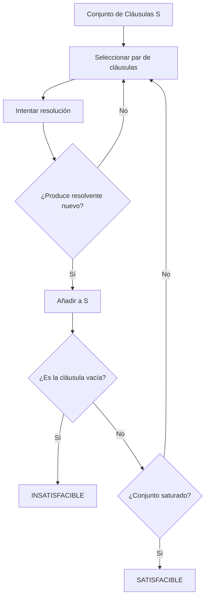

# Lógica Computacional - Sistemas deductivos

## 5.5 Resolución binaria: cláusulas cerradas; unificación: unificadores más generales, algoritmo de Martelli-Montanari; algoritmos de saturación; estrategias de derivación (resolución lineal, resolución unitaria, conjunto de soporte).

---

La resolución binaria es un método de inferencia mecánica fundamental en lógica computacional, desarrollado por John Alan Robinson en 1965. Es completo para la lógica de primer orden cuando se combina con la unificación.

#### Principio de Resolución

Dadas dos cláusulas conteniendo literales complementarios unificables, podemos inferir una nueva cláusula:

$$\frac{C_1 ∨ L_1 \quad C_2 ∨ ¬L_2}{(C_1 ∨ C_2)\theta}$$

Donde $\theta$ es el unificador más general de $L_1$ y $L_2$.

### Unificación y Unificadores Más Generales (MGU)

#### Definición de Unificación

Dos términos $t_1$ y $t_2$ son unificables si existe una sustitución $\theta$ tal que $t_1\theta = t_2\theta$.

#### Unificador Más General (MGU)

Un unificador $\theta$ es el **más general** si para cualquier otro unificador $\sigma$, existe una sustitución $\lambda$ tal que $\sigma = \theta\lambda$.

#### Algoritmo de Martelli-Montanari

Algoritmo basado en resolución de ecuaciones para encontrar el MGU:

```python
def martelli_montanari(equations):
    """Algoritmo de unificación de Martelli-Montanari"""
    solution = {}
    while equations:
        s, t = equations.pop(0)
        if s == t:
            continue
        elif is_variable(s) and s not in t:
            solution[s] = t
            equations = [substitute(eq, s, t) for eq in equations]
        elif is_variable(t) and t not in s:
            solution[t] = s
            equations = [substitute(eq, t, s) for eq in equations]
        elif is_compound(s) and is_compound(t):
            if s.functor != t.functor or len(s.args) != len(t.args):
                return None  # Fallo
            equations.extend(zip(s.args, t.args))
        else:
            return None  # Fallo
    return solution
```

### Resolución Binaria para Cláusulas Cerradas

#### Cláusula Cerrada

Una cláusula que no contiene variables libres. Para cláusulas cerradas, la resolución se simplifica:

$$\frac{C_1 ∨ L \quad C_2 ∨ ¬L}{C_1 ∨ C_2}$$

#### Ejemplo de Resolución Binaria

**Cláusula 1**: $P(a) ∨ Q(b)$  
**Cláusula 2**: $¬P(a) ∨ R(c)$  
**Resolvente**: $Q(b) ∨ R(c)$

### Algoritmos de Saturación

Los algoritmos de saturación aplican repetidamente la regla de resolución hasta encontrar la cláusula vacía o saturar el conjunto.



### Estrategias de Derivación

#### Resolución Lineal

Mantiene una cláusula "central" y siempre resuelve con la última cláusula derivada:

```python
def linear_resolution(clauses, goal):
    """Algoritmo de resolución lineal"""
    current = goal
    trail = [goal]

    while current != empty_clause:
        partner = find_resolvable(clauses, current)
        if partner is None:
            return False  # No se puede refutar

        resolvent = resolve(current, partner)
        trail.append(resolvent)
        current = resolvent

    return True  # Refutación encontrada
```

#### Resolución Unitaria

Prefiere resolver con cláusulas unitarias (que contienen un solo literal):

$$\frac{L \quad ¬L ∨ C}{C}$$

**Ventaja**: Más eficiente pero **incompleta** para lógica de primer orden.

#### Conjunto de Soporte

Divide las cláusulas en:

1. **Conjunto de soporte**: Cláusulas que se quieren refutar
2. **Conjunto auxiliar**: Cláusulas de apoyo

Solo se permite resolución entre cláusulas de diferente conjunto:

```python
def support_set_resolution(support_set, auxiliary_set):
    """Resolución con conjunto de soporte"""
    new_clauses = set()

    for s_clause in support_set:
        for a_clause in auxiliary_set:
            resolvents = try_resolution(s_clause, a_clause)
            new_clauses.update(resolvents)

    return new_clauses
```

### Ejemplos de Resolución

#### Ejemplo 1: Unificación

**Unificar**: $P(x, f(y))$ y $P(a, z)$  
**MGU**: $\theta = \{x/a, z/f(y)\}$

#### Ejemplo 2: Resolución con Unificación

**Cláusula 1**: $P(x, f(x)) ∨ Q(x)$  
**Cláusula 2**: $¬P(a, y) ∨ R(y)$  
**Unificador**: $\theta = \{x/a, y/f(a)\}$  
**Resolvente**: $Q(a) ∨ R(f(a))$

#### Ejemplo 3: Refutación por Resolución

**Probar**: $∀x P(x) ⊢ P(a)$

1. $¬P(a)$ (negación de la conclusión)
2. $P(x)$ (de la premisa)
3. $\square$ ( resolución de 1 y 2 con $\{x/a\}$ )

### Implementación de Resolución

```python
class ResolutionProver:
    def __init__(self):
        self.clauses = set()

    def add_clause(self, clause):
        """Añadir una cláusula al conjunto"""
        self.clauses.add(clause.normalize())

    def resolve(self, clause1, clause2):
        """Intentar resolución entre dos cláusulas"""
        resolvents = set()

        for lit1 in clause1.literals:
            for lit2 in clause2.literals:
                if lit1.complementary(lit2):
                    # Intentar unificación
                    mgu = self.unify(lit1.atom, lit2.atom)
                    if mgu is not None:
                        # Crear resolvente
                        new_clause = self.merge_clauses(clause1, clause2, lit1, lit2)
                        new_clause = new_clause.apply_substitution(mgu)
                        resolvents.add(new_clause)

        return resolvents

    def unify(self, term1, term2, subst=None):
        """Algoritmo de unificación recursivo"""
        if subst is None:
            subst = {}

        # Implementación recursiva del algoritmo de unificación
        # ...

    def saturation(self):
        """Algoritmo de saturación por resolución"""
        new = set(self.clauses)
        processed = set()

        while new:
            clause = new.pop()
            processed.add(clause)

            # Resolver con todas las cláusulas procesadas
            for other in processed:
                resolvents = self.resolve(clause, other)
                for resolvent in resolvents:
                    if resolvent.is_empty():
                        return True  # Insatisfacible
                    if resolvent not in processed and resolvent not in new:
                        new.add(resolvent)

        return False  # Satisfacible
```

### Ejercicios Propuestos

#### Ejercicio 1

Encuentre el MGU para los siguientes pares:

1. $P(f(x), y)$ y $P(z, g(z))$
2. $Q(a, x, f(x))$ y $Q(a, b, y)$

#### Ejercicio 2

Aplique resolución para refutar:

$$\{P(a) ∨ Q(b), ¬P(a) ∨ R(c), ¬Q(b), ¬R(c)\}$$

#### Ejercicio 3

Implemente el algoritmo de unificación para términos simples.

#### Ejercicio 4

Compare la eficiencia de resolución unitaria vs. resolución lineal para:

$$\{P ∨ Q, ¬P ∨ Q, P ∨ ¬Q, ¬P ∨ ¬Q\}$$

### Referencias Bibliográficas

#### Bibliografía Básica

1. **Huth M., Ryan M.** (2004) - Capítulo 2: "Predicate Logic", sección 2.5 sobre resolución
2. **Nerode A., Shore R.A.** (1997) - Capítulo 3: "First-Order Logic", sección 3.5 sobre unificación

#### Bibliografía Complementaria

3. **Robinson, J.A.** (1965) - "A Machine-Oriented Logic Based on the Resolution Principle"
4. **Martelli, A.** & **Montanari, U.** (1982) - "An Efficient Unification Algorithm"
5. **Chang, C.L.** & **Lee, R.C.T.** (1973) - "Symbolic Logic and Mechanical Theorem Proving"

### Aplicaciones Prácticas

#### Demostradores de Teoremas

Sistemas como Prover9, Vampire y E utilizan variantes de resolución.

#### Programación Lógica

Prolog usa resolución SLD (resolución lineal para cláusulas definidas).

#### Verificación Formal

Herramientas de verificación usan resolución para análisis de propiedades.

#### Sistemas Expertos

Mecanismos de inferencia basados en resolución.

### Comparación de Estrategias

| Estrategia          | Completa | Ventajas                   | Desventajas                    |
| ------------------- | -------- | -------------------------- | ------------------------------ |
| Resolución Completa | Sí       | Garantiza encontrar prueba | Muy ineficiente                |
| Resolución Lineal   | Sí       | Más eficiente              | Puede repetir trabajo          |
| Resolución Unitaria | No       | Muy eficiente              | Incompleta                     |
| Conjunto de Soporte | Sí       | Dirigida a meta            | Requiere buen conjunto inicial |
