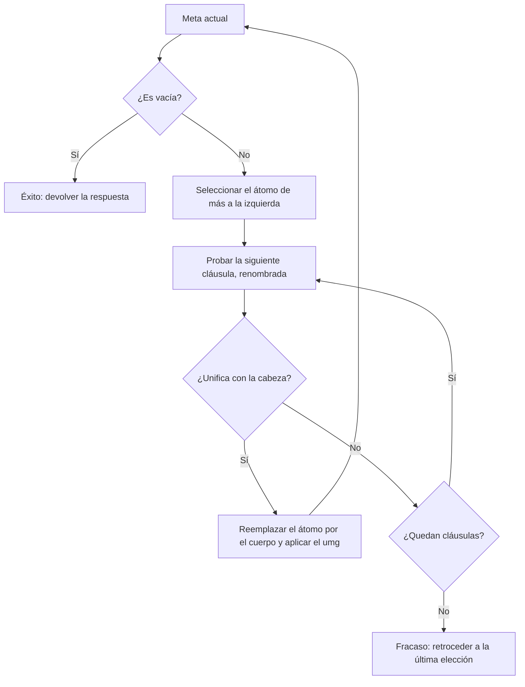

# Lógica Computacional - El paradigma de programación lógica

## 6.1 Resolución SLD: cláusulas de Horn y programas lógicos.

---

La **programación lógica** toma en serio la idea de que demostrar es calcular. Un programa es un conjunto de fórmulas, una consulta es una fórmula que se quiere demostrar, y la ejecución es la búsqueda de una demostración por resolución; los valores que la demostración asigna a las variables son la respuesta. Para que esto sea eficiente se restringe la lógica a las **cláusulas de Horn** y la resolución a la **resolución SLD**. Kowalski (1974) resumió el paradigma así: algoritmo = lógica + control.

### Cláusulas de Horn

**Definición.** Una **cláusula de Horn** es una cláusula con a lo más un literal positivo. Hay tres tipos:

| Tipo | Cláusula | Lectura | En Prolog |
| --- | --- | --- | --- |
| Hecho | $\{A\}$ | $A$ es verdadero | `a.` |
| Regla | $\{A, \lnot B_1, \ldots, \lnot B_n\}$ | $B_1 \land \cdots \land B_n \to A$ | `a :- b1, ..., bn.` |
| Meta | $\{\lnot B_1, \ldots, \lnot B_n\}$ | $\lnot (B_1 \land \cdots \land B_n)$ | consulta `?- b1, ..., bn.` |

Los hechos y las reglas son **cláusulas definidas** (exactamente un literal positivo, la **cabeza**; los negativos forman el **cuerpo**). Un **programa lógico definido** es un conjunto finito de cláusulas definidas. Todas las variables se entienden cuantificadas universalmente: la regla `abuelo(X, Y) :- padre(X, Z), padre(Z, Y)` significa

$$ \forall x\, \forall y\, \forall z\, (\text{padre}(x, z) \land \text{padre}(z, y) \to \text{abuelo}(x, y)) $$

**Las consultas son refutaciones.** Para preguntar si existe $Y$ con $\text{abuelo}(\text{juan}, Y),$ se añade al programa la negación, $\forall y\, \lnot \text{abuelo}(\text{juan}, y),$ que es la meta $\{\lnot \text{abuelo}(\text{juan}, Y)\},$ y se busca una refutación. Si se encuentra, las sustituciones usadas dicen **qué** $Y$ la produjo.

**Expresividad.** Las cláusulas de Horn no pueden expresar disyunciones como $P \lor Q,$ pero bastan para cualquier cómputo: todo programa con máquinas de Turing se puede escribir como un programa lógico definido (Tärnlund, 1977). Y tienen una propiedad que la lógica general no tiene: todo programa definido tiene un **modelo mínimo** (tema 6.2).

### Resolución SLD

**Definición.** Sea $P$ un programa y $G = \leftarrow A_1, \ldots, A_n$ una meta. Un **paso SLD** consiste en:

1. **Seleccionar** un átomo $A_i$ de la meta, según una **regla de selección**.
2. Tomar una cláusula de $P,$ con sus variables **renombradas** para que sean nuevas: $B \leftarrow B_1, \ldots, B_m.$
3. Calcular un umg $\theta$ de $A_i$ y $B$ (tema 5.5).
4. La nueva meta es $\leftarrow (A_1, \ldots, A_{i-1}, B_1, \ldots, B_m, A_{i+1}, \ldots, A_n)\theta.$

Una **derivación SLD** es una sucesión de pasos. Si termina en la meta vacía $\square,$ es una **refutación**, y la composición de los umg restringida a las variables de la consulta es la **respuesta computada**. El nombre viene de **S**elección, resolución **L**ineal y cláusulas **D**efinidas: es la resolución lineal (tema 5.5) en la que siempre se resuelve la meta actual con una cláusula del programa.

**Ejemplo.** Con el programa

```prolog
padre(juan, pedro).
padre(pedro, maria).
padre(pedro, carlos).
abuelo(X, Y) :- padre(X, Z), padre(Z, Y).
```

la consulta $\leftarrow \text{abuelo}(\text{juan}, A)$ se resuelve así:

1. Con la regla, renombrada, $\theta_1 = \{X_1 \mapsto \text{juan}, Y_1 \mapsto A\}:$ nueva meta $\leftarrow \text{padre}(\text{juan}, Z_1), \text{padre}(Z_1, A).$
2. Con el primer hecho, $\theta_2 = \{Z_1 \mapsto \text{pedro}\}:$ $\leftarrow \text{padre}(\text{pedro}, A).$
3. Con el segundo hecho, $\theta_3 = \{A \mapsto \text{maria}\}:$ meta vacía.

La respuesta computada es $A = \text{maria}.$ Usando el tercer hecho en el paso 3 se obtiene $A = \text{carlos}.$

### Corrección y completud

**Teorema (corrección).** Si $\theta$ es una respuesta computada para $P$ y $\leftarrow A_1, \ldots, A_n,$ entonces $P \models \forall\, (A_1 \land \cdots \land A_n)\theta.$

Se sigue de la corrección de la resolución: cada paso es una resolución binaria.

**Teorema (completud, Clark, 1979).** Si $P \models \forall\, (A_1 \land \cdots \land A_n)\sigma,$ existe una refutación SLD con respuesta computada $\theta$ más general que $\sigma:$ $\sigma = \theta\tau$ para alguna $\tau.$ Además, esto vale **para cualquier regla de selección**.

La independencia de la regla de selección es lo que permite a Prolog elegir siempre el átomo de más a la izquierda. Lo que **no** es indiferente es el orden en que se prueban las cláusulas.

### Árboles SLD y la estrategia de Prolog

Fijada una regla de selección, el **árbol SLD** de una consulta tiene la consulta en la raíz y, como hijos de cada meta, las metas obtenidas resolviendo el átomo seleccionado con **cada** cláusula aplicable. Sus ramas pueden terminar en $\square$ (éxito), en una meta sin cláusulas aplicables (fracaso) o ser infinitas. Por el teorema de completud, toda respuesta correcta está, salvo generalidad, en alguna rama de éxito del árbol.

**Prolog** recorre el árbol **en profundidad**, probando las cláusulas en el orden en que están escritas y retrocediendo (**backtracking**) cuando una rama fracasa. Es eficiente en memoria, pero **incompleto**: si una rama infinita está a la izquierda de una de éxito, nunca llega a esta. Con

```prolog
arista(a, b).
arista(b, c).
camino(X, Y) :- camino(X, Z), arista(Z, Y).
camino(X, Y) :- arista(X, Y).
```

la consulta `camino(a, Y)` hace que Prolog se llame a sí mismo con `camino(a, Z)` indefinidamente, sin dar ninguna respuesta, hasta agotar la memoria, aunque el programa tiene como consecuencias lógicas `camino(a, b)` y `camino(a, c)`. Poniendo la cláusula base primero y la recursión a la derecha, `camino(X, Y) :- arista(X, Z), camino(Z, Y)`, el mismo significado lógico se ejecuta sin problemas. Una búsqueda en anchura sería completa, pero Prolog prefiere la profundidad por eficiencia: el programador debe ocuparse del **control**.



### Implementación en Python

El programa es un intérprete de programas definidos: lee cláusulas en sintaxis de Prolog, renombra las variables en cada paso, unifica con verificación de ocurrencia y recorre el árbol SLD en profundidad con la regla de selección izquierda, como Prolog. Las respuestas se generan con `yield`, lo que imita el retroceso. La traza muestra la meta después de cada paso. Para el programa con recursión a la izquierda se pone un límite de profundidad.

```python
import re, itertools

# ---------- Términos al estilo Prolog: variables con mayúscula, compuestos como tuplas ----------
def es_var(t): return isinstance(t, str) and (t[0].isupper() or t[0] == '_')

def leer_termino(s):
    toks = re.findall(r"[A-Za-z_][A-Za-z0-9_]*|\d+|[(),\[\]|]", s)
    pos = [0]
    def ver(): return toks[pos[0]] if pos[0] < len(toks) else None
    def tomar(): pos[0] += 1; return toks[pos[0] - 1]
    def termino():
        if ver() == '[':
            tomar()
            if ver() == ']': tomar(); return '[]'
            elems = [termino()]
            while ver() == ',': tomar(); elems.append(termino())
            cola = '[]'
            if ver() == '|': tomar(); cola = termino()
            tomar()
            for e in reversed(elems): cola = ('.', e, cola)
            return cola
        nombre = tomar()
        if ver() == '(':
            tomar(); args = [termino()]
            while ver() == ',': tomar(); args.append(termino())
            tomar()
            return (nombre,) + tuple(args)
        return nombre
    return termino()

def dividir(s):
    """Divide por comas de primer nivel."""
    partes, nivel, actual = [], 0, ''
    for ch in s:
        if ch in '([': nivel += 1
        if ch in ')]': nivel -= 1
        if ch == ',' and nivel == 0: partes.append(actual); actual = ''
        else: actual += ch
    return partes + [actual]

def leer_programa(texto):
    clausulas = []
    for c in re.split(r'\.\s*(?:\n|$)', texto.strip()):
        c = re.sub(r'%.*', '', c).strip()
        if not c: continue
        if ':-' in c:
            cabeza, cuerpo = c.split(':-')
            clausulas.append((leer_termino(cabeza), [leer_termino(b) for b in dividir(cuerpo)]))
        else:
            clausulas.append((leer_termino(c), []))
    return clausulas

def tt(t):
    if isinstance(t, str): return t
    if t[0] == '.':
        elems = []
        while isinstance(t, tuple) and t[0] == '.': elems.append(tt(t[1])); t = t[2]
        return '[' + ', '.join(elems) + ('' if t == '[]' else '|' + tt(t)) + ']'
    return t[0] + '(' + ', '.join(map(tt, t[1:])) + ')'

# ---------- Unificación ----------
def resolver(t, s):
    while es_var(t) and t in s: t = s[t]
    return t

def aplicar(t, s):
    t = resolver(t, s)
    if isinstance(t, str): return t
    return (t[0],) + tuple(aplicar(r, s) for r in t[1:])

def aparece(x, t, s):
    t = resolver(t, s)
    if t == x: return True
    return isinstance(t, tuple) and any(aparece(x, r, s) for r in t[1:])

def unificar(a, b, s):
    a, b = resolver(a, s), resolver(b, s)
    if a == b: return s
    if es_var(a): return None if aparece(a, b, s) else {**s, a: b}
    if es_var(b): return unificar(b, a, s)
    if isinstance(a, str) or isinstance(b, str) or a[0] != b[0] or len(a) != len(b): return None
    for x, y in zip(a[1:], b[1:]):
        s = unificar(x, y, s)
        if s is None: return None
    return s

def renombrar(clausula, n):
    def r(t):
        if es_var(t): return f'{t}_{n}'
        if isinstance(t, str): return t
        return (t[0],) + tuple(r(x) for x in t[1:])
    cabeza, cuerpo = clausula
    return r(cabeza), [r(b) for b in cuerpo]

# ---------- Resolución SLD: regla de selección izquierda, búsqueda en profundidad ----------
def sld(programa, metas, s=None, prof=0, contador=None, traza=None, max_prof=30):
    s = s or {}
    contador = contador or itertools.count(1)
    if not metas:
        yield s
        return
    if prof >= max_prof:
        if traza is not None: traza.append('  ' * prof + '... profundidad máxima')
        return
    seleccionada, resto = metas[0], metas[1:]
    for clausula in programa:
        cabeza, cuerpo = renombrar(clausula, next(contador))
        s2 = unificar(seleccionada, cabeza, s)
        if s2 is None: continue
        nuevas = cuerpo + resto
        if traza is not None:
            traza.append('  ' * prof + f'← {", ".join(tt(aplicar(m, s2)) for m in nuevas) or "□"}')
        yield from sld(programa, nuevas, s2, prof + 1, contador, traza, max_prof)

def respuestas(programa, consulta, n=10, traza=None, max_prof=30):
    metas = [leer_termino(m) for m in dividir(consulta)]
    vs = sorted({v for m in metas for v in variables(m)})
    res = []
    for s in sld(programa, metas, traza=traza, max_prof=max_prof):
        res.append(', '.join(f'{v} = {tt(aplicar(v, s))}' for v in vs) or 'sí')
        if len(res) >= n: break
    return res

def variables(t):
    if es_var(t): return {t}
    if isinstance(t, str): return set()
    return set().union(*(variables(r) for r in t[1:]))

familia = leer_programa("""
padre(juan, pedro).
padre(pedro, maria).
padre(pedro, carlos).
abuelo(X, Y) :- padre(X, Z), padre(Z, Y).
""")
traza = []
print('?- abuelo(juan, A):', respuestas(familia, 'abuelo(juan, A)', traza=traza))
print('\n'.join(traza))

suma = leer_programa("""
suma(0, Y, Y).
suma(s(X), Y, s(Z)) :- suma(X, Y, Z).
""")
traza = []
print('?- suma(s(s(0)), s(0), R):', respuestas(suma, 'suma(s(s(0)), s(0), R)', traza=traza))
print('\n'.join(traza))
print('?- suma(X, Y, s(s(0))):', respuestas(suma, 'suma(X, Y, s(s(0)))'))

# El orden de las cláusulas y de las metas importa para Prolog, no para la lógica
camino_bien = leer_programa("""
arista(a, b).
arista(b, c).
camino(X, Y) :- arista(X, Y).
camino(X, Y) :- arista(X, Z), camino(Z, Y).
""")
camino_mal = leer_programa("""
arista(a, b).
arista(b, c).
camino(X, Y) :- camino(X, Z), arista(Z, Y).
camino(X, Y) :- arista(X, Y).
""")
print('recursión a la derecha:', respuestas(camino_bien, 'camino(a, Y)'))
traza = []
print('recursión a la izquierda:', respuestas(camino_mal, 'camino(a, Y)', traza=traza, max_prof=6))
print('\n'.join(traza[:7]))
```

Salida:

```text
?- abuelo(juan, A): ['A = maria', 'A = carlos']
← padre(juan, Z_4), padre(Z_4, Y_4)
  ← padre(pedro, Y_4)
    ← □
    ← □
?- suma(s(s(0)), s(0), R): ['R = s(s(s(0)))']
← suma(s(0), s(0), Z_2)
  ← suma(0, s(0), Z_4)
    ← □
?- suma(X, Y, s(s(0))): ['X = 0, Y = s(s(0))', 'X = s(0), Y = s(0)', 'X = s(s(0)), Y = 0']
recursión a la derecha: ['Y = b', 'Y = c']
recursión a la izquierda: ['Y = c', 'Y = b']
← camino(a, Z_3), arista(Z_3, Y_3)
  ← camino(a, Z_6), arista(Z_6, Y_6), arista(Y_6, Y_3)
    ← camino(a, Z_9), arista(Z_9, Y_9), arista(Y_9, Y_6), arista(Y_6, Y_3)
      ← camino(a, Z_12), arista(Z_12, Y_12), arista(Y_12, Y_9), arista(Y_9, Y_6), arista(Y_6, Y_3)
        ← camino(a, Z_15), arista(Z_15, Y_15), arista(Y_15, Y_12), arista(Y_12, Y_9), arista(Y_9, Y_6), arista(Y_6, Y_3)
          ← camino(a, Z_18), arista(Z_18, Y_18), arista(Y_18, Y_15), arista(Y_15, Y_12), arista(Y_12, Y_9), arista(Y_9, Y_6), arista(Y_6, Y_3)
            ... profundidad máxima
```

La consulta `suma(X, Y, s(s(0)))` muestra que un programa lógico no tiene entradas y salidas fijas: la misma definición de la suma sirve para restar o para enumerar las descomposiciones de un número. En el programa con recursión a la izquierda, el límite de profundidad corta la rama infinita y permite al intérprete retroceder y encontrar respuestas; Prolog real no tiene ese límite y agota la memoria sin responder.

### Ejercicios Propuestos

1. **Familia.** Con `padre(juan, maria)`, `padre(juan, carlos)`, `padre(carlos, ana)` y la regla `hermano(X, Y) :- padre(Z, X), padre(Z, Y), X \= Y`, construye el árbol SLD de `hermano(maria, H)`.

2. **Suma.** Escribe la derivación SLD de `suma(s(s(0)), s(0), R)` indicando cada umg.

3. **Listas.** Con `miembro(X, [X|_])` y `miembro(X, [_|Ys]) :- miembro(X, Ys)`, ¿cuántas ramas de éxito tiene el árbol SLD de `miembro(X, [1, 2, 3])`? ¿Y el de `miembro(2, [1, 2, 3])`?

4. **Horn.** ¿Cuáles son cláusulas de Horn? $\{P, \lnot Q\},$ $\{P, Q\},$ $\{\lnot P, \lnot Q\},$ $\{P\}.$ Escribe en Prolog las que sean definidas.

5. **Orden.** Explica por qué `camino(X, Y) :- arista(X, Z), camino(Z, Y)` termina en grafos acíclicos y no en grafos con ciclos.

### Soluciones

**Ejercicio 1.** La meta $\leftarrow \text{hermano}(\text{maria}, H)$ se resuelve con la regla y da $\leftarrow \text{padre}(Z, \text{maria}), \text{padre}(Z, H), \text{maria} \neq H.$ Solo `padre(juan, maria)` unifica con el primer átomo: $Z = \text{juan}.$ Para $\text{padre}(\text{juan}, H)$ hay dos ramas: $H = \text{maria},$ que fracasa en la desigualdad, y $H = \text{carlos},$ que tiene éxito. La única respuesta es $H = \text{carlos}.$

**Ejercicio 2.** Con la segunda cláusula renombrada, $\{X_1 \mapsto s(0), Y_1 \mapsto s(0), R \mapsto s(Z_1)\}:$ $\leftarrow \text{suma}(s(0), s(0), Z_1).$ Otra vez la segunda, $\{X_2 \mapsto 0, Y_2 \mapsto s(0), Z_1 \mapsto s(Z_2)\}:$ $\leftarrow \text{suma}(0, s(0), Z_2).$ Con la primera, $\{Y_3 \mapsto s(0), Z_2 \mapsto s(0)\}:$ $\square.$ Componiendo, $R = s(Z_1) = s(s(Z_2)) = s(s(s(0))),$ como da el programa.

**Ejercicio 3.** `miembro(X, [1, 2, 3])` tiene tres ramas de éxito, con $X = 1,$ $2$ y $3,$ y una de fracaso al llegar a la lista vacía. `miembro(2, [1, 2, 3])` tiene una sola: la primera cláusula falla con 1, la segunda pasa a `miembro(2, [2, 3])`, donde la primera tiene éxito; la segunda rama sigue con `[3]` y luego con `[]` y fracasa.

**Ejercicio 4.** Son de Horn $\{P, \lnot Q\}$ (regla `p :- q.`), $\{\lnot P, \lnot Q\}$ (meta) y $\{P\}$ (hecho `p.`). $\{P, Q\}$ no lo es: tiene dos literales positivos.

**Ejercicio 5.** Cada llamada recursiva avanza una arista. En un grafo acíclico finito los caminos tienen longitud acotada, así que el árbol SLD es finito. Con un ciclo, `camino(a, Y)` puede recorrer el ciclo indefinidamente, y el árbol tiene una rama infinita; si está antes de ramas de éxito, Prolog no las alcanza, y en todo caso no termina de enumerar las respuestas. Se resuelve llevando la lista de nodos visitados, o con la tabulación de algunos Prolog.

### Referencias

1. Lloyd, J. W., _Foundations of Logic Programming_. Springer, 1987. Capítulos 1 y 2.
2. Kowalski, R. (1974). Predicate logic as programming language. _Proceedings of IFIP Congress_, 569-574.
3. Apt, K. R., _From Logic Programming to Prolog_. Prentice Hall, 1997. Capítulos 3 y 4.
4. Ben-Ari, M., _Mathematical Logic for Computer Science_. Springer, 2012. Capítulo 11.
5. Sterling, L., and Shapiro, E., _The Art of Prolog_. MIT Press, 1994. Capítulos 1 a 4.
