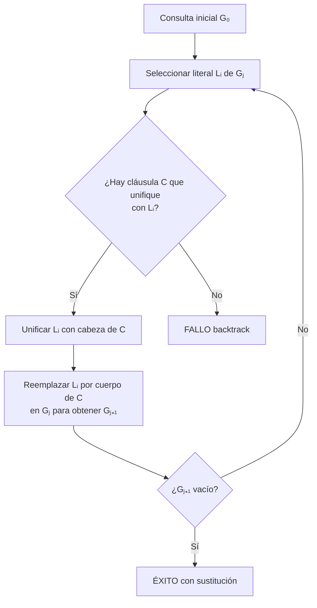
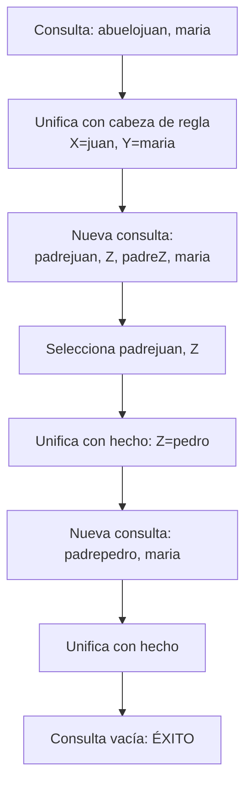

# Lógica Computacional - El paradigma de programación lógica

## 6.1 Resolución SLD: cláusulas de Horn y programas lógicos.

---

### 1. Introducción al Paradigma de Programación Lógica

La programación lógica se basa en el uso de la lógica formal como lenguaje de programación. **Prolog** es el lenguaje más representativo de este paradigma, donde los programas se construyen mediante cláusulas lógicas y la ejecución se realiza mediante inferencia lógica.

### 2. Cláusulas de Horn

#### 2.1 Definición Formal

Una **cláusula de Horn** es una cláusula disyuntiva con **como máximo un literal positivo**.

**Forma general:**

$$¬A_1 ∨ ¬A_2 ∨ \cdots ∨ ¬A_n ∨ B$$

Que es equivalente a:

$$A_1 ∧ A_2 ∧ \cdots ∧ A_n → B$$

#### 2.2 Tipos de Cláusulas de Horn

| Tipo         | Forma Lógica             | Forma en Prolog         | Descripción                |
| ------------ | ------------------------ | ----------------------- | -------------------------- |
| **Hecho**    | $B$                      | `b.`                    | Afirmación atómica         |
| **Regla**    | $A_1 ∧ \cdots ∧ A_n → B$ | `b :- a1, a2, ..., an.` | Implicación condicional    |
| **Consulta** | $¬A_1 ∨ \cdots ∨ ¬A_n$   | `?- a1, a2, ..., an.`   | Conjunto de metas a probar |

#### 2.3 Ejemplos

```prolog
% Hechos
padre(juan, maria).
madre(ana, maria).

% Reglas
abuelo(X, Y) :- padre(X, Z), padre(Z, Y).
hermano(X, Y) :- padre(Z, X), padre(Z, Y), X \= Y.

% Consulta
?- abuelo(juan, maria).
```

### 3. Programas Lógicos

Un **programa lógico** es un conjunto finito de cláusulas de Horn definidas (hechos y reglas).

**Definición formal:**
$$P = \{C_1, C_2, \ldots, C_n\}$$
donde cada $C_i$ es una cláusula de Horn.

### 4. Resolución SLD

#### 4.1 Concepto Fundamental

La **Resolución SLD** (Selective Linear Definite clause resolution) es el mecanismo de inferencia utilizado en programación lógica para responder consultas.

#### 4.2 Componentes de la Resolución SLD

- **S**electiva: Selección de un literal para resolver
- **L**ineal: Mantiene una cadena lineal de resolventes
- **D**efinite: Trabaja con cláusulas definidas (de Horn)

#### 4.3 Proceso de Resolución



#### 4.4 Regla de Resolución SLD

Dada una consulta $¬A_1 ∨ \cdots ∨ ¬A_i ∨ \cdots ∨ ¬A_n$ y una cláusula $B ← B_1, \ldots, B_m$ tal que $A_i$ y $B$ unifican con MGU $\theta$, la nueva consulta es:

$$(¬A_1 ∨ \cdots ∨ ¬B_1 ∨ \cdots ∨ ¬B_m ∨ \cdots ∨ ¬A_n)\theta$$

### 5. Unificación y MGU

#### 5.1 Algoritmo de Unificación

```prolog
% Ejemplo de unificación
unifica(X, Y) :- X = Y.
% X y a NO unifican
% f(X) y f(a) unifican con {X/a}
% f(X, Y) y f(a, b) unifican con {X/a, Y/b}
```

#### 5.2 Most General Unifier (MGU)

El **MGU** es la sustitución más general que hace que dos términos sean idénticos.

**Propiedad:** Si dos términos son unificables, existe un MGU único módulo renombramiento de variables.

### 6. Ejemplo Completo de Resolución SLD

#### 6.1 Programa de Ejemplo

```prolog
% Base de conocimiento
padre(juan, pedro).
padre(pedro, maria).
abuelo(X, Y) :- padre(X, Z), padre(Z, Y).
```

#### 6.2 Resolución de la consulta: `?- abuelo(juan, maria).`



### 7. Árbol SLD

El **árbol SLD** representa todas las posibles derivaciones de una consulta.

#### 7.1 Estructura del Árbol SLD

- **Nodo raíz:** Consulta inicial
- **Hijos:** Resultados de aplicar todas las cláusulas unificables
- **Hojas:** Éxito (□) o Fracaso

### 8. Ejercicios Propuestos

#### 8.1 Ejercicio 1: Familia

Dado el programa:

```prolog
padre(juan, maria).
padre(juan, carlos).
padre(carlos, ana).
madre(luisa, maria).
madre(luisa, carlos).
madre(maria, pedro).

hijo(X, Y) :- padre(Y, X).
hermano(X, Y) :- padre(Z, X), padre(Z, Y), X \= Y.
```

Resuelva manualmente las consultas:

1. `?- hijo(maria, juan).`
2. `?- hermano(maria, carlos).`
3. `?- hermano(maria, X).`

#### 8.2 Ejercicio 2: Aritmética

Dado:

```prolog
suma(0, Y, Y).
suma(s(X), Y, s(Z)) :- suma(X, Y, Z).
```

Resuelva: `?- suma(s(s(0)), s(0), R).`

#### 8.3 Ejercicio 3: Listas

Dado:

```prolog
miembro(X, [X|_]).
miembro(X, [_|Ys]) :- miembro(X, Ys).
```

Resuelva: `?- miembro(2, [1, 2, 3]).`

### 9. Implementación de Resolución SLD

```python
# Pseudocódigo de resolución SLD
def resolucion_sld(consulta, programa, sustitución):
    if consulta está vacía:
        return sustitución  # Éxito

    literal = seleccionar_literal(consulta)

    for clausula in programa:
        if unifica(literal, cabeza(clausula)):
            nueva_sust = unificar(literal, cabeza(clausula), sustitución)
            nueva_consulta = aplicar_sust(consulta_sin_literal + cuerpo(clausula), nueva_sust)
            resultado = resolucion_sld(nueva_consulta, programa, nueva_sust)
            if resultado != fallo:
                return resultado

    return fallo
```

### 10. Propiedades Teóricas

#### 10.1 Completitud

**Teorema:** La resolución SLD es completa para cláusulas de Horn:

$$P ⊨ Q \Rightarrow \exists \text{derivación SLD que prueba } Q$$

#### 10.2 Corrección

**Teorema:** La resolución SLD es correcta:

$$\exists \text{derivación SLD de } Q \Rightarrow P ⊨ Q$$

### 11. Limitaciones y Consideraciones

1. **Estrategia de selección:** La completitud depende de la estrategia de selección de literales
2. **Terminación:** Puede haber bucles infinitos
3. **Negación:** El tratamiento de la negación requiere extensiones (negación por fallo)

### 12. Referencias Bibliográficas

#### Bibliografía Básica

1. **Huth M., Ryan M.** (2004). _Logic in Computer Science, modelling and reasoning about systems_. 2nd Edition, Cambridge University Press. (Capítulo 2)
2. **Nerode A., Shore R.A.** (1997). _Logic for Applications_. 2nd Edition. Springer. (Capítulo 6)

#### Bibliografía Complementaria

3. **Ben-Ari M.** (2008). _Mathematical Logic for Computer Science_. Springer. (Capítulo 10)
4. **Fitting M.** (1996). _First-Order Logic and Automated Theorem Proving_. Springer. (Capítulo 5)

### 13. Soluciones a Ejercicios Selectos

#### Ejercicio 2.2:

```
suma(s(s(0)), s(0), R)
→ suma(s(0), s(0), s(Z1)) donde R = s(Z1)
→ suma(0, s(0), s(s(Z2))) donde Z1 = s(Z2)
→ Z2 = s(0), por tanto R = s(s(s(0)))
```

### 14. Aplicaciones Prácticas

1. **Sistemas expertos**
2. **Procesamiento de lenguaje natural**
3. **Bases de datos deductivas**
4. **Verificación formal de software**
5. **Planificación automática**
