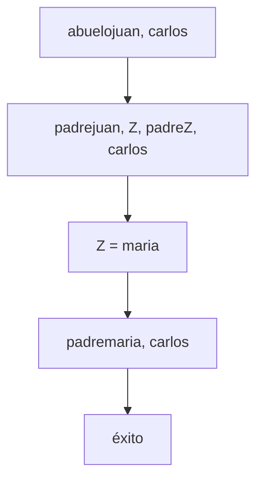

# Lógica Computacional - El paradigma de programación lógica

## 6.2 Semántica operacional y declarativa; modelos de Herbrand.

---

### 1. Introducción

En programación lógica, existen dos perspectivas fundamentales para entender el significado de los programas:

- **Semántica operacional**: Cómo se ejecuta un programa (mecanismo de inferencia)
- **Semántica declarativa**: Qué significa un programa (interpretación lógica)

Los **modelos de Herbrand** proporcionan el marco matemático para conectar ambas perspectivas.

### 2. Semántica Operacional

#### 2.1 Definición

La semántica operacional describe el comportamiento de un programa mediante un conjunto de reglas de inferencia que definen cómo se responden las consultas.

#### 2.2 Reglas de Inferencia en PROLOG

```prolog
% Ejemplo: Base de conocimientos
padre(juan, maria).
padre(maria, carlos).
abuelo(X, Y) :- padre(X, Z), padre(Z, Y).

% Consulta: ?- abuelo(juan, carlos).
% Proceso operacional:
% 1. Unificar abuelo(juan, carlos) con cabeza de regla
% 2. Sustituir: padre(juan, Z), padre(Z, carlos)
% 3. Resolver padre(juan, Z) → Z = maria
% 4. Resolver padre(maria, carlos) → éxito
```

#### 2.3 Árbol de Derivación SLD



### 3. Semántica Declarativa

#### 3.1 Definición

La semántica declarativa se centra en el significado lógico de un programa, independientemente de su mecanismo de ejecución. Un programa se interpreta como una teoría lógica y las consultas como teoremas a demostrar.

#### 3.2 Significado Declarativo

Para el programa anterior:

- Hechos: `padre(juan, maria)`, `padre(maria, carlos)`
- Regla: `∀X∀Y∀Z [padre(X, Z) ∧ padre(Z, Y) → abuelo(X, Y)]`
- Consulta: `∃X abuelo(juan, X)` es verdadera porque `abuelo(juan, carlos)` es consecuencia lógica

### 4. Base de Herbrand

#### 4.1 Universo de Herbrand

El **universo de Herbrand** $H$ para un programa $P$ es el conjunto de todos los términos básicos (ground terms) que se pueden construir con los símbolos de función y constantes en $P.$

**Fórmula:**

$$H = \{t \mid t \text{ es un término básico de } P\}$$

#### 4.2 Base de Herbrand

La **base de Herbrand** $B$ para un programa $P$ es el conjunto de todos los átomos básicos (ground atoms) que se pueden construir con los predicados en $P$ y los términos del universo de Herbrand.

**Fórmula:**

$$B = \{A \mid A \text{ es un átomo básico de } P\}$$

#### 4.3 Ejemplo

Dado el programa:

```prolog
padre(juan, maria).
padre(maria, carlos).
abuelo(X, Y) :- padre(X, Z), padre(Z, Y).
```

- Universo de Herbrand: $ H = \lbrace $ juan, maria, carlos $ \rbrace $
- Base de Herbrand: $B = \lbrace $ padre(juan, juan), padre(juan, maria), ..., abuelo(juan, juan), ... $ \rbrace $

### 5. Interpretaciones y Modelos de Herbrand

#### 5.1 Interpretación de Herbrand

Una **interpretación de Herbrand** $I$ es un subconjunto de la base de Herbrand $B.$ Los átomos en $I$ se consideran verdaderos, los demás falsos.

#### 5.2 Modelo de Herbrand

Un **modelo de Herbrand** para un programa $P$ es una interpretación de Herbrand que satisface todas las cláusulas de $P.$

#### 5.3 Modelo Mínimo de Herbrand

Todo programa lógico tiene un **modelo mínimo de Herbrand** $M_P$ que es la intersección de todos sus modelos de Herbrand.

**Teorema:** $M_P$ existe y es único para todo programa lógico $P.$

### 6. Semántica de Punto Fijo

#### 6.1 Operador de Consecuencia Inmediata $T_P$

Para un programa $P$ y una interpretación $I,$ definimos:

$$T_P(I) = \{A \in B \mid A ← B_1, ..., B_n \text{ es una instancia básica de una cláusula en } P \text{ y } \{B_1, ..., B_n\} \subseteq I\}$$

#### 6.2 Punto Fijo

El modelo mínimo de Herbrand es el **punto fijo mínimo** del operador $T_P:$

$$M_P = T_P ↑ \omega = \bigcup_{n=0}^{\infty} T_P ↑ n$$

donde:

- $T_P ↑ 0 = \varnothing $
- $T_P ↑ (n+1) = T_P(T_P ↑ n)$

#### 6.3 Ejemplo de Aplicación de $T_P$

Para el programa:

```prolog
padre(juan, maria).
padre(maria, carlos).
abuelo(X, Y) :- padre(X, Z), padre(Z, Y).
```

- $T_P ↑ 0 = \varnothing $
- $T_P ↑ 1 = \{padre(juan, maria), padre(maria, carlos)\}$
- $T_P ↑ 2 = T_P ↑ 1 ∪ \{abuelo(juan, carlos)\}$
- $T_P ↑ 3 = T_P ↑ 2$ (punto fijo)

### 7. Equivalencia entre Semánticas

#### 7.1 Teorema Fundamental

Para cualquier programa lógico $P$ y átomo básico $A:$

$$P ⊢ A \text{ (semántica operacional)} \iff A ∈ M_P \text{ (semántica declarativa)}$$

#### 7.2 Corolario

Las semánticas operacional y declarativa son equivalentes para programas lógicos con cláusulas de Horn.

### 8. Ejercicios Propuestos

#### 8.1 Ejercicio 1: Base y Universo de Herbrand

Dado el programa:

```prolog
p(a).
q(b).
r(X) :- p(X).
s(X, Y) :- q(X), r(Y).
```

Calcule:

1. El universo de Herbrand $H$
2. La base de Herbrand $B$
3. El modelo mínimo de Herbrand $M_P$

#### 8.2 Ejercicio 2: Aplicación de $T_P$

Para el programa:

```prolog
par(0).
par(s(s(X))) :- par(X).
```

Calcule:

1. $T_P ↑ 0,$ $T_P ↑ 1,$ $T_P ↑ 2,$ $T_P ↑ 3$
2. El punto fijo $T_P ↑ \omega$

#### 8.3 Ejercicio 3: Modelos de Herbrand

Para el programa:

```prolog
camino(X, Y) :- arista(X, Y).
camino(X, Y) :- arista(X, Z), camino(Z, Y).
arista(a, b).
arista(b, c).
```

Encuentre el modelo mínimo de Herbrand y verifique si contiene:

1. `camino(a, b)`
2. `camino(a, c)`
3. `camino(c, a)`

### 9. Implementación del Operador $T_P$

```python
def operador_Tp(programa, interpretacion):
    nueva_interpretacion = set(interpretacion)

    # Instanciar todas las cláusulas con términos básicos
    for clausula in programa:
        if es_hecho(clausula):
            # Añadir todas las instancias básicas del hecho
            for instancia in instancias_basicas(clausula):
                nueva_interpretacion.add(instancia)
        else:
            # Para reglas: cabeza :- cuerpo
            cabeza, cuerpo = obtener_cabeza_cuerpo(clausula)
            for sustitucion in sustituciones_basicas(cuerpo, interpretacion):
                instancia_cabeza = aplicar_sustitucion(cabeza, sustitucion)
                nueva_interpretacion.add(instancia_cabeza)

    return nueva_interpretacion

def punto_fijo_minimo(programa):
    I_actual = set()
    while True:
        I_siguiente = operador_Tp(programa, I_actual)
        if I_siguiente == I_actual:
            return I_siguiente  # Punto fijo alcanzado
        I_actual = I_siguiente
```

### 10. Limitaciones y Extensiones

#### 10.1 Limitaciones de los Modelos de Herbrand

1. Solo funcionan para cláusulas de Horn
2. Asumen que todos los modelos son sobre el mismo dominio
3. No capturan completamente la semántica de programas con negación

#### 10.2 Extensiones para Programas Complejos

Para programas con negación, se utilizan:

- **Semántica de puntos fijos estabilizados** (para programas estratificados)
- **Modelos estables** (para programas answer set)

### 11. Referencias Bibliográficas

#### Bibliografía Básica

1. **Huth M., Ryan M.** (2004). _Logic in Computer Science_. Capítulo 2: "Predicate Logic" y Capítulo 6: "Logic Programming"
2. **Nerode A., Shore R.A.** (1997). _Logic for Applications_. Capítulo 6: "Logic Programming"

#### Bibliografía Complementaria

3. **Ben-Ari M.** (2008). _Mathematical Logic for Computer Science_. Capítulo 10: "First-Order Logic for Programming"
4. **Fitting M.** (1996). _First-Order Logic and Automated Theorem Proving_. Capítulo 5: "Herbrand's Theorem"

### 12. Soluciones a Ejercicios Selectos

#### Ejercicio 8.1:

1. Universo de Herbrand: $H = \{a, b\}$
2. Base de Herbrand: $B = \{p(a), p(b), q(a), q(b), r(a), r(b), s(a,a), s(a,b), s(b,a), s(b,b)\}$
3. Modelo mínimo: $M_P = \{p(a), q(b), r(a), s(b,a)\}$

#### Ejercicio 8.2:

1. $T_P ↑ 0 = \varnothing $
2. $T_P ↑ 1 = \{par(0)\}$
3. $T_P ↑ 2 = \{par(0), par(s(s(0)))\}$
4. $T_P ↑ 3 = \{par(0), par(s(s(0))), par(s(s(s(s(0)))))\}$
5. $T_P ↑ \omega = \{par(s^{2n}(0)) \mid n \in \mathbb{N}\}$

### 13. Aplicaciones Prácticas

1. **Verificación de programas**: Demostrar propiedades sobre programas lógicos
2. **Optimización de consultas**: Basada en el significado declarativo
3. **Análisis de terminación**: Usando interpretaciones de Herbrand
4. **Integración de bases de datos**: Modelado de información incompleta

Esta guía proporciona una comprensión sólida de los fundamentos teóricos de la programación lógica y cómo las diferentes semánticas se relacionan a través de los modelos de Herbrand.
