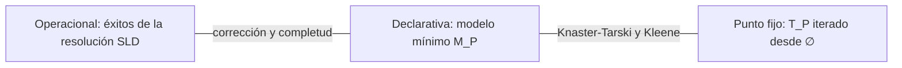

# Lógica Computacional - El paradigma de programación lógica

## 6.2 Semántica operacional y declarativa; modelos de Herbrand.

---

Un programa lógico tiene dos lecturas. La **operacional** dice qué hace: qué respuestas produce la resolución SLD. La **declarativa** dice qué significa: qué afirma el programa como conjunto de fórmulas. Una tercera, la de **punto fijo**, construye el significado de abajo hacia arriba aplicando las reglas. El resultado central de la teoría, debido a van Emden y Kowalski (1976), es que las tres coinciden: los átomos que Prolog puede demostrar son exactamente los que el programa implica lógicamente, y son los que se obtienen iterando las reglas. Este acuerdo es lo que hace de la programación lógica un paradigma **declarativo**.

### Universo y base de Herbrand

Para hablar de los modelos de un programa basta considerar estructuras hechas con su propia sintaxis.

**Definición.** Sea $P$ un programa.

- El **universo de Herbrand** $U_P$ es el conjunto de términos básicos (sin variables) formados con las constantes y funciones de $P;$ si no hay constantes, se añade una.
- La **base de Herbrand** $B_P$ es el conjunto de átomos básicos formados con los predicados de $P$ y términos de $U_P.$
- Una **interpretación de Herbrand** es un subconjunto $I \subseteq B_P:$ el dominio es $U_P,$ cada término se interpreta como sí mismo, y un átomo básico es verdadero si y solo si está en $I.$
- Un **modelo de Herbrand** de $P$ es una interpretación de Herbrand que satisface todas las cláusulas de $P.$

**Ejemplo.** Para el programa con `p(a)`, `q(b)`, `r(X) :- p(X)` y `s(X, Y) :- q(X), r(Y)`, el universo es $\{a, b\}$ y la base tiene diez átomos: $p(a), p(b), q(a), q(b), r(a), r(b)$ y los cuatro $s(x, y).$ Con un símbolo de función, como en `par(0)` y `par(s(s(X))) :- par(X)`, el universo $\{0, s(0), s(s(0)), \ldots\}$ es infinito.

Una interpretación de Herbrand satisface una cláusula si satisface todas sus **instancias básicas**: para cada instancia $A \leftarrow B_1, \ldots, B_n,$ si $B_1, \ldots, B_n \in I$ entonces $A \in I.$

**Por qué bastan.** Para cláusulas (fórmulas universales sin cuantificadores existenciales), un conjunto tiene un modelo si y solo si tiene un modelo de Herbrand: dado un modelo cualquiera $\mathcal{M},$ el conjunto de átomos básicos verdaderos en $\mathcal{M}$ es un modelo de Herbrand. Es la base del teorema de Herbrand (tema 5.5).

### Semántica declarativa: el modelo mínimo

**Proposición (intersección de modelos).** Si $\{I_j\}$ es una familia no vacía de modelos de Herbrand de un programa definido $P,$ su intersección también es un modelo.

**Demostración.** Sea $A \leftarrow B_1, \ldots, B_n$ una instancia básica de una cláusula, con $B_1, \ldots, B_n \in \bigcap I_j.$ Entonces cada $B_i$ está en cada $I_j,$ y como cada $I_j$ es modelo, $A \in I_j$ para todo $j.$ Así, $A \in \bigcap I_j.$ $\blacksquare$

Como $B_P$ es un modelo (todo es verdadero), la familia no es vacía, y la intersección de **todos** los modelos de Herbrand es el **modelo mínimo** $M_P.$ Esto falla para cláusulas no definidas: $\{P \lor Q\}$ tiene los modelos $\{P\}$ y $\{Q\},$ cuya intersección no es modelo.

**Teorema.** $M_P = \{A \in B_P \mid P \models A\}.$

**Demostración.** Si $P \models A,$ $A$ es verdadero en todo modelo, en particular en todos los de Herbrand, así que $A \in M_P.$ Si $P \not\models A,$ hay un modelo $\mathcal{M}$ de $P$ en el que $A$ es falso; los átomos básicos verdaderos en $\mathcal{M}$ forman un modelo de Herbrand que no contiene a $A,$ así que $A \notin M_P.$ $\blacksquare$

El modelo mínimo es el **significado declarativo** del programa: exactamente los hechos básicos que se siguen de él. Todo lo demás es falso en algún modelo.

### Semántica de punto fijo

**Definición.** El **operador de consecuencia inmediata** $T_P : 2^{B_P} \rightarrow 2^{B_P}$ es

$$ T_P(I) = \{A \in B_P \mid A \leftarrow B_1, \ldots, B_n \text{ es instancia básica de una cláusula de } P \text{ y } B_1, \ldots, B_n \in I\} $$

$T_P(I)$ son los hechos que se obtienen de $I$ aplicando una vez cada regla. Dos propiedades:

- $T_P$ es **monótono**: si $I \subseteq J,$ entonces $T_P(I) \subseteq T_P(J).$
- $I$ es un modelo de $P$ si y solo si $T_P(I) \subseteq I:$ el modelo es cerrado bajo las reglas.

**Teorema (van Emden y Kowalski, 1976).** $M_P$ es el menor punto fijo de $T_P,$ y

$$ M_P = T_P \uparrow \omega = \bigcup_{n \geq 0} T_P \uparrow n, \qquad T_P \uparrow 0 = \emptyset, \quad T_P \uparrow (n + 1) = T_P(T_P \uparrow n) $$

**Idea de la demostración.** Por el teorema de Knaster-Tarski, un operador monótono sobre un retículo completo tiene un menor punto fijo, que es la intersección de los $I$ con $T_P(I) \subseteq I,$ es decir, de los modelos: es $M_P.$ Como cada instancia básica tiene un cuerpo finito, $T_P$ es además **continuo**, y la iteración desde el vacío alcanza el menor punto fijo en $\omega$ pasos (teorema de Kleene). $\blacksquare$

La iteración es la **evaluación de abajo hacia arriba** de las bases de datos deductivas (Datalog): sin símbolos de función, $B_P$ es finita y el punto fijo se alcanza en un número finito de pasos.

**Ejemplo.** Para el programa de la base de Herbrand anterior: $T_P \uparrow 1 = \{p(a), q(b)\},$ $T_P \uparrow 2$ añade $r(a),$ $T_P \uparrow 3$ añade $s(b, a),$ y $T_P \uparrow 4 = T_P \uparrow 3.$ El modelo mínimo es $\{p(a), q(b), r(a), s(b, a)\}.$

### Semántica operacional y su equivalencia

**Definición.** El **conjunto de éxitos** de $P$ es el conjunto de átomos básicos $A$ tales que $\leftarrow A$ tiene una refutación SLD.

**Teorema (Apt y van Emden, 1982).** Para todo programa definido $P,$

$$ \text{éxitos SLD}(P) = M_P = T_P \uparrow \omega = \{A \in B_P \mid P \models A\} $$

La inclusión de izquierda a derecha es la corrección de la resolución SLD; la otra es su completud (tema 6.1), que se demuestra por inducción sobre el $n$ con $A \in T_P \uparrow n:$ si $A$ se obtuvo de la instancia $A \leftarrow B_1, \ldots, B_k$ con los $B_i$ en $T_P \uparrow (n - 1),$ las refutaciones de los $B_i$ se combinan en una de $A.$



**Lo que la equivalencia no cubre.** El teorema habla de lo que **se puede** demostrar, no de lo que Prolog **encuentra**: con la búsqueda en profundidad, un átomo de $M_P$ puede quedar detrás de una rama infinita (tema 6.1). Tampoco dice nada de los átomos **falsos**: la resolución SLD nunca demuestra que algo no se sigue. Para eso Prolog usa la **negación por fallo**, que concluye $\lnot A$ cuando el árbol SLD de $A$ es finito y sin éxitos; su semántica, la **compleción de Clark** (1978), y para programas con negación, los **modelos estables** de Gelfond y Lifschitz (1988), extienden esta teoría.

### Implementación en Python

El programa calcula $T_P \uparrow n$ de abajo hacia arriba: para cada regla, busca las sustituciones que hacen verdaderos los átomos del cuerpo en la interpretación actual, unificando con los hechos ya obtenidos, y añade las cabezas. Usa el intérprete SLD del tema 6.1 para comparar: los átomos `camino(x, y)` que la resolución SLD demuestra son exactamente los del modelo mínimo. Para el programa de los números pares el punto fijo es infinito y la iteración no termina.

```python
import re, itertools

# ---------- Términos al estilo Prolog: variables con mayúscula, compuestos como tuplas ----------
def es_var(t): return isinstance(t, str) and (t[0].isupper() or t[0] == '_')

def leer_termino(s):
    toks = re.findall(r"[A-Za-z_][A-Za-z0-9_]*|\d+|[(),\[\]|]", s)
    pos = [0]
    def ver(): return toks[pos[0]] if pos[0] < len(toks) else None
    def tomar(): pos[0] += 1; return toks[pos[0] - 1]
    def termino():
        if ver() == '[':
            tomar()
            if ver() == ']': tomar(); return '[]'
            elems = [termino()]
            while ver() == ',': tomar(); elems.append(termino())
            cola = '[]'
            if ver() == '|': tomar(); cola = termino()
            tomar()
            for e in reversed(elems): cola = ('.', e, cola)
            return cola
        nombre = tomar()
        if ver() == '(':
            tomar(); args = [termino()]
            while ver() == ',': tomar(); args.append(termino())
            tomar()
            return (nombre,) + tuple(args)
        return nombre
    return termino()

def dividir(s):
    """Divide por comas de primer nivel."""
    partes, nivel, actual = [], 0, ''
    for ch in s:
        if ch in '([': nivel += 1
        if ch in ')]': nivel -= 1
        if ch == ',' and nivel == 0: partes.append(actual); actual = ''
        else: actual += ch
    return partes + [actual]

def leer_programa(texto):
    clausulas = []
    for c in re.split(r'\.\s*(?:\n|$)', texto.strip()):
        c = re.sub(r'%.*', '', c).strip()
        if not c: continue
        if ':-' in c:
            cabeza, cuerpo = c.split(':-')
            clausulas.append((leer_termino(cabeza), [leer_termino(b) for b in dividir(cuerpo)]))
        else:
            clausulas.append((leer_termino(c), []))
    return clausulas

def tt(t):
    if isinstance(t, str): return t
    if t[0] == '.':
        elems = []
        while isinstance(t, tuple) and t[0] == '.': elems.append(tt(t[1])); t = t[2]
        return '[' + ', '.join(elems) + ('' if t == '[]' else '|' + tt(t)) + ']'
    return t[0] + '(' + ', '.join(map(tt, t[1:])) + ')'

# ---------- Unificación ----------
def resolver(t, s):
    while es_var(t) and t in s: t = s[t]
    return t

def aplicar(t, s):
    t = resolver(t, s)
    if isinstance(t, str): return t
    return (t[0],) + tuple(aplicar(r, s) for r in t[1:])

def aparece(x, t, s):
    t = resolver(t, s)
    if t == x: return True
    return isinstance(t, tuple) and any(aparece(x, r, s) for r in t[1:])

def unificar(a, b, s):
    a, b = resolver(a, s), resolver(b, s)
    if a == b: return s
    if es_var(a): return None if aparece(a, b, s) else {**s, a: b}
    if es_var(b): return unificar(b, a, s)
    if isinstance(a, str) or isinstance(b, str) or a[0] != b[0] or len(a) != len(b): return None
    for x, y in zip(a[1:], b[1:]):
        s = unificar(x, y, s)
        if s is None: return None
    return s

def renombrar(clausula, n):
    def r(t):
        if es_var(t): return f'{t}_{n}'
        if isinstance(t, str): return t
        return (t[0],) + tuple(r(x) for x in t[1:])
    cabeza, cuerpo = clausula
    return r(cabeza), [r(b) for b in cuerpo]

# ---------- Resolución SLD: regla de selección izquierda, búsqueda en profundidad ----------
def sld(programa, metas, s=None, prof=0, contador=None, traza=None, max_prof=30):
    s = s or {}
    contador = contador or itertools.count(1)
    if not metas:
        yield s
        return
    if prof >= max_prof:
        if traza is not None: traza.append('  ' * prof + '... profundidad máxima')
        return
    seleccionada, resto = metas[0], metas[1:]
    for clausula in programa:
        cabeza, cuerpo = renombrar(clausula, next(contador))
        s2 = unificar(seleccionada, cabeza, s)
        if s2 is None: continue
        nuevas = cuerpo + resto
        if traza is not None:
            traza.append('  ' * prof + f'← {", ".join(tt(aplicar(m, s2)) for m in nuevas) or "□"}')
        yield from sld(programa, nuevas, s2, prof + 1, contador, traza, max_prof)

def respuestas(programa, consulta, n=10, traza=None, max_prof=30):
    metas = [leer_termino(m) for m in dividir(consulta)]
    vs = sorted({v for m in metas for v in variables(m)})
    res = []
    for s in sld(programa, metas, traza=traza, max_prof=max_prof):
        res.append(', '.join(f'{v} = {tt(aplicar(v, s))}' for v in vs) or 'sí')
        if len(res) >= n: break
    return res

def variables(t):
    if es_var(t): return {t}
    if isinstance(t, str): return set()
    return set().union(*(variables(r) for r in t[1:]))

def T(programa, I):
    """Operador de consecuencia inmediata: cabezas de instancias cuyas premisas están en I.
    (Supone hechos básicos y reglas en las que toda variable de la cabeza aparece en el cuerpo.)"""
    nuevo = set()
    for cabeza, cuerpo in programa:
        sustituciones = [{}]
        for atomo in cuerpo:
            sustituciones = [s2 for s in sustituciones for hecho in I
                             if (s2 := unificar(atomo, hecho, s)) is not None]
        nuevo |= {aplicar(cabeza, s) for s in sustituciones}
    return frozenset(nuevo)

def iterar(programa, max_pasos=10, mostrar=True):
    I = frozenset()
    for n in range(1, max_pasos + 1):
        J = T(programa, I)
        if mostrar:
            print(f'   T↑{n}: {len(J):2} átomos', '  nuevos:', ', '.join(sorted(map(tt, J - I))))
        if J == I:
            print(f'   punto fijo alcanzado: T↑{n - 1} = T↑{n}')
            return I
        I = J
    print('   (se detiene la iteración: el punto fijo no se alcanza en un número finito de pasos)')
    return I

ej1 = leer_programa("""
p(a).
q(b).
r(X) :- p(X).
s(X, Y) :- q(X), r(Y).
""")
print('ejercicio 1')
M1 = iterar(ej1)

grafo = leer_programa("""
arista(a, b).
arista(b, c).
arista(c, d).
camino(X, Y) :- arista(X, Y).
camino(X, Y) :- arista(X, Z), camino(Z, Y).
""")
print('caminos')
M = iterar(grafo)
# Semántica operacional: los átomos camino(x, y) que la resolución SLD demuestra
nodos = ['a', 'b', 'c', 'd']
exitos = {('camino', x, y) for x in nodos for y in nodos if respuestas(grafo, f'camino({x}, {y})', n=1)}
print('   éxitos SLD = átomos camino del modelo mínimo:', exitos == {A for A in M if A[0] == 'camino'})

pares = leer_programa("""
par(0).
par(s(s(X))) :- par(X).
""")
print('pares')
iterar(pares, max_pasos=4)
```

Salida:

```text
ejercicio 1
   T↑1:  2 átomos   nuevos: p(a), q(b)
   T↑2:  3 átomos   nuevos: r(a)
   T↑3:  4 átomos   nuevos: s(b, a)
   T↑4:  4 átomos   nuevos: 
   punto fijo alcanzado: T↑3 = T↑4
caminos
   T↑1:  3 átomos   nuevos: arista(a, b), arista(b, c), arista(c, d)
   T↑2:  6 átomos   nuevos: camino(a, b), camino(b, c), camino(c, d)
   T↑3:  8 átomos   nuevos: camino(a, c), camino(b, d)
   T↑4:  9 átomos   nuevos: camino(a, d)
   T↑5:  9 átomos   nuevos: 
   punto fijo alcanzado: T↑4 = T↑5
   éxitos SLD = átomos camino del modelo mínimo: True
pares
   T↑1:  1 átomos   nuevos: par(0)
   T↑2:  2 átomos   nuevos: par(s(s(0)))
   T↑3:  3 átomos   nuevos: par(s(s(s(s(0)))))
   T↑4:  4 átomos   nuevos: par(s(s(s(s(s(s(0)))))))
   (se detiene la iteración: el punto fijo no se alcanza en un número finito de pasos)
```

### Ejercicios Propuestos

1. **Herbrand.** Para `p(a)`, `q(b)`, `r(X) :- p(X)` y `s(X, Y) :- q(X), r(Y)`, calcula el universo, la base y el modelo mínimo de Herbrand.

2. **Iteración infinita.** Para `par(0)` y `par(s(s(X))) :- par(X)`, calcula $T_P \uparrow n$ para $n \leq 3$ y $T_P \uparrow \omega.$

3. **Caminos.** Para el grafo con aristas $a \to b,$ $b \to c$ y las dos reglas de `camino`, calcula el modelo mínimo y decide si contiene `camino(a, c)` y `camino(c, a)`.

4. **Otros modelos.** Da un modelo de Herbrand del programa del ejercicio 1 distinto del mínimo. ¿Qué afirma de más?

5. **Sin modelo mínimo.** Muestra que $\{p(a) \lor p(b)\}$ no tiene un modelo de Herbrand mínimo, y explica por qué no es un programa definido.

6. **Monotonía.** Demuestra que $T_P$ es monótono y que $I$ es modelo de $P$ si y solo si $T_P(I) \subseteq I.$

### Soluciones

**Ejercicio 1.** $U_P = \{a, b\};$ $B_P = \{p(a), p(b), q(a), q(b), r(a), r(b), s(a, a), s(a, b), s(b, a), s(b, b)\};$ $M_P = \{p(a), q(b), r(a), s(b, a)\},$ como en la salida del programa.

**Ejercicio 2.** $T_P \uparrow 0 = \emptyset,$ $T_P \uparrow 1 = \{\text{par}(0)\},$ $T_P \uparrow 2 = \{\text{par}(0), \text{par}(s^2(0))\},$ $T_P \uparrow 3 = \{\text{par}(0), \text{par}(s^2(0)), \text{par}(s^4(0))\},$ y $T_P \uparrow \omega = \{\text{par}(s^{2n}(0)) \mid n \in \mathbb{N}\}.$

**Ejercicio 3.** $M_P$ contiene `arista(a, b)`, `arista(b, c)`, `camino(a, b)`, `camino(b, c)` y `camino(a, c)`. Contiene `camino(a, c)`, que se añade en $T_P \uparrow 3,$ y no contiene `camino(c, a)`: ninguna regla lo produce, y la interpretación sin él es un modelo.

**Ejercicio 4.** $B_P$ entero es un modelo. Otro más pequeño: $M_P \cup \{p(b), r(b), s(b, b)\}.$ Afirma de más que $p(b)$ es verdadero, lo cual es consistente con el programa pero no se sigue de él.

**Ejercicio 5.** Los modelos de Herbrand son los conjuntos que contienen $p(a)$ o $p(b).$ $\{p(a)\}$ y $\{p(b)\}$ son modelos minimales, pero su intersección, vacía, no es modelo. La cláusula tiene dos literales positivos, así que no es definida.

**Ejercicio 6.** Si $I \subseteq J$ y $A \in T_P(I),$ hay una instancia con cuerpo en $I,$ y por tanto en $J,$ así que $A \in T_P(J).$ $I$ es modelo si y solo si para cada instancia con cuerpo en $I$ la cabeza está en $I,$ que es exactamente $T_P(I) \subseteq I.$

### Referencias

1. Lloyd, J. W., _Foundations of Logic Programming_. Springer, 1987. Capítulos 1 y 2.
2. van Emden, M. H., and Kowalski, R. A. (1976). The semantics of predicate logic as a programming language. _Journal of the ACM_, 23(4), 733-742.
3. Apt, K. R., and van Emden, M. H. (1982). Contributions to the theory of logic programming. _Journal of the ACM_, 29(3), 841-862.
4. Apt, K. R., _From Logic Programming to Prolog_. Prentice Hall, 1997. Capítulo 4.
5. Abiteboul, S., Hull, R., and Vianu, V., _Foundations of Databases_. Addison-Wesley, 1995. Capítulo 12.
