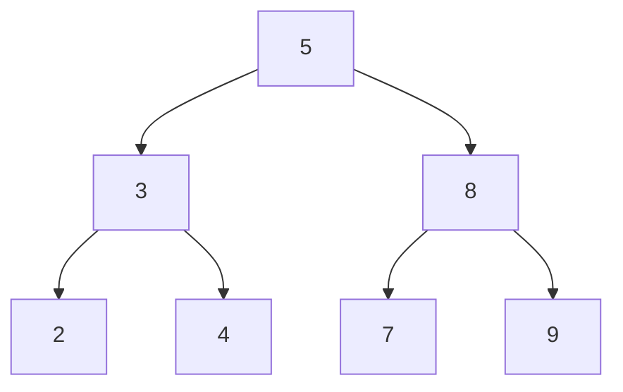
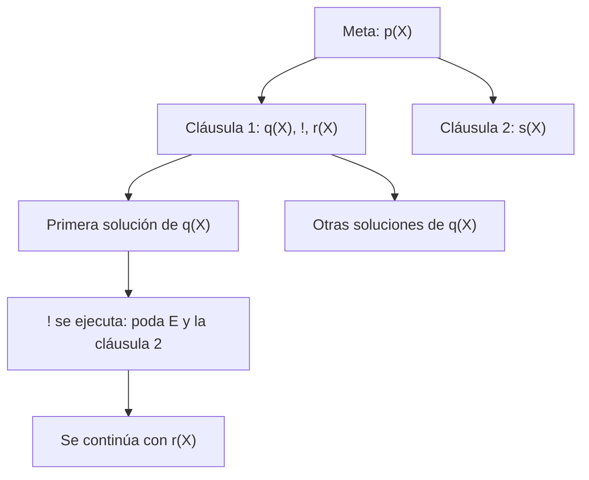

# Lógica Computacional - El paradigma de programación lógica

## 6.3 El lenguaje de programación Prolog: aritmética, listas, árboles, el operador de corte.

---

**Prolog** (Colmerauer y Roussel, 1972) es la realización práctica de la resolución SLD (tema 6.1): un programa es una lista de cláusulas definidas, se ejecuta seleccionando siempre el átomo de más a la izquierda y probando las cláusulas en orden, con búsqueda en profundidad y retroceso. A ese núcleo lógico añade lo necesario para programar: aritmética, estructuras de datos como listas y árboles, y mecanismos de control como el **corte**. Este tema presenta esos elementos con un programa completo, ejecutado en SWI-Prolog, y señala dónde Prolog se aparta de la lógica pura.

### Términos y sintaxis

Los datos de Prolog son **términos**: constantes (`juan`, `0`, `'Hola'`), variables (que empiezan con mayúscula o `_`) y términos compuestos `f(t1, ..., tn)`. Una variable que aparece una sola vez en una cláusula se escribe `_`, la **variable anónima**. Las cláusulas terminan en punto; `:-` se lee "si" y la coma, "y". Las consultas se escriben con `?-` en el intérprete.

Dos formas de igualdad que no deben confundirse:

| Operador | Significado | Ejemplo |
| --- | --- | --- |
| `=` | unificación | `f(X, b) = f(a, Y)` tiene éxito con `X = a, Y = b` |
| `==` | identidad sintáctica, sin ligar variables | `X == Y` falla si son variables distintas |
| `is` | evaluación aritmética | `X is 2 + 3` liga `X` con `5` |
| `=:=` | igualdad aritmética de expresiones evaluadas | `2 + 3 =:= 5` tiene éxito |

### Aritmética

En Prolog, `2 + 3` es solo el término `+(2, 3)`; no se evalúa por sí mismo. `X = 2 + 3` liga `X` con ese término, no con 5. La evaluación se pide con `is`: `X is E` evalúa la expresión `E`, que debe estar completamente instanciada, y unifica el resultado con `X`. Las comparaciones `<`, `=<`, `>`, `>=`, `=:=` y `=\=` también evalúan sus dos lados.

Esto rompe la reversibilidad de la lógica pura: `factorial(N, 120)` no calcula `N`, sino que produce un error, porque `N > 0` se evalúa con `N` sin valor. La aritmética de Prolog es **direccional**. Las bibliotecas de **restricciones** como `clpfd` recuperan la reversibilidad para enteros: con `#=` en lugar de `is`, `X + 3 #= 5` da `X = 2`.

**Recursión de cola.** La versión de `factorial` con **acumulador** hace la llamada recursiva al final; Prolog la ejecuta sin acumular marcos en la pila, como un ciclo. Es la técnica estándar para recorridos largos.

### Listas

Una lista es la constante `[]` o un término `[Cabeza|Cola]`, abreviatura de `'[|]'(Cabeza, Cola)` en SWI-Prolog (`'.'(Cabeza, Cola)` en el estándar ISO). `[a, b, c]` abrevia `[a|[b|[c|[]]]]`. Las definiciones siguen la estructura recursiva: un caso para `[]` y uno para `[X|Xs]`, exactamente como la recursión estructural del tema 2.1.

**Relaciones, no funciones.** `concatenar(Xs, Ys, Zs)` define la relación "Zs es Xs seguida de Ys", así que sirve en varias direcciones: concatenar dos listas, quitar un prefijo o, con las dos primeras sin instanciar, enumerar todas las formas de partir una lista.

**Eficiencia.** `invertir` ingenuo llama a `concatenar` en cada paso, con costo cuadrático; con un acumulador, `invertir_ac` es lineal. El patrón del acumulador, construir el resultado en un argumento extra, es frecuente.

### Árboles

Los árboles se representan con términos: aquí, `vacio` o `nodo(Izquierdo, Valor, Derecho)`. Un **árbol binario de búsqueda** tiene los valores menores a la izquierda y los mayores a la derecha. Los predicados `insertar`, `en_orden` y `altura` siguen la estructura del término, y `es_abb` comprueba la propiedad recorriendo en orden y verificando que la lista resultante sea creciente. Insertando $5, 3, 8, 2, 4, 7, 9$ se obtiene el árbol:



### El corte

El **corte**, `!`, es una meta que siempre tiene éxito, pero al ejecutarse **elimina** los puntos de elección pendientes: las alternativas para las metas a su izquierda en el cuerpo y las demás cláusulas del mismo predicado. Se compromete con las elecciones hechas hasta ese punto. En el árbol SLD, poda las ramas a la derecha.

**Cortes verdes y rojos.**

- Un corte es **verde** si quitarlo no cambia las respuestas: solo evita explorar ramas que de todos modos fracasarían. En `maximo`, la segunda cláusula tiene la condición `X < Y`, que es incompatible con la primera; el corte evita probarla inútilmente.
- Un corte es **rojo** si cambia las respuestas: el programa depende de él. En `clasificar`, la última cláusula no tiene condición y solo es correcta porque los cortes impiden llegar a ella cuando una anterior ya tuvo éxito. Es el equivalente de un "si-entonces-si no", que también se escribe `( Condición -> Entonces ; Si_no )`.

**Un error clásico.** `maximo_mal` omite la condición en la segunda cláusula confiando en el corte. Funciona con `maximo_mal(5, 2, M)`, pero la consulta `maximo_mal(5, 2, 2)` tiene éxito: la cabeza de la primera cláusula no unifica con `2` como tercer argumento, así que el corte nunca se ejecuta y se usa la segunda. El significado lógico del programa ya no corresponde a su intención. La regla práctica es poner las unificaciones de salida **después** del corte, o usar cortes verdes.

**Negación por fallo.** Con el corte se define `\+`, la negación de Prolog: `no(Meta)` ejecuta `Meta`; si tiene éxito, el corte compromete y `fail` hace fracasar todo; si no, la segunda cláusula tiene éxito. Es la **negación por fallo** (tema 6.2): $\lnot A$ se concluye cuando no se puede demostrar $A,$ lo que coincide con la negación lógica solo bajo la hipótesis del **mundo cerrado** y con metas sin variables libres.



### Programa completo

El programa reúne los ejemplos del tema. Se carga en SWI-Prolog y las consultas de abajo se ejecutan con un pequeño predicado que escribe todas las respuestas de cada una.

```prolog
% ---------- Aritmética ----------
factorial(0, 1).
factorial(N, F) :-
    N > 0,
    N1 is N - 1,
    factorial(N1, F1),
    F is N * F1.

% Con acumulador: la llamada recursiva es la última (recursión de cola)
factorial_ac(N, F) :- factorial_ac(N, 1, F).
factorial_ac(0, F, F).
factorial_ac(N, Ac, F) :-
    N > 0,
    Ac1 is Ac * N,
    N1 is N - 1,
    factorial_ac(N1, Ac1, F).

mcd(A, 0, A) :- A > 0.
mcd(A, B, D) :- B > 0, R is A mod B, mcd(B, R, D).

primo(2).
primo(N) :- N > 2, N mod 2 =\= 0, \+ divisor_impar(N, 3).
divisor_impar(N, D) :- D * D =< N, N mod D =:= 0.
divisor_impar(N, D) :- D * D =< N, D2 is D + 2, divisor_impar(N, D2).

% ---------- Listas ----------
concatenar([], Ys, Ys).
concatenar([X|Xs], Ys, [X|Zs]) :- concatenar(Xs, Ys, Zs).

% Inversión ingenua (cuadrática) y con acumulador (lineal)
invertir([], []).
invertir([X|Xs], Ys) :- invertir(Xs, Zs), concatenar(Zs, [X], Ys).
invertir_ac(Xs, Ys) :- invertir_ac(Xs, [], Ys).
invertir_ac([], Ys, Ys).
invertir_ac([X|Xs], Ac, Ys) :- invertir_ac(Xs, [X|Ac], Ys).

longitud([], 0).
longitud([_|Xs], N) :- longitud(Xs, M), N is M + 1.

palindromo(Xs) :- invertir_ac(Xs, Xs).

% Ordenamiento rápido
particion(_, [], [], []).
particion(P, [X|Xs], [X|Menores], Mayores) :- X =< P, particion(P, Xs, Menores, Mayores).
particion(P, [X|Xs], Menores, [X|Mayores]) :- X > P, particion(P, Xs, Menores, Mayores).
quicksort([], []).
quicksort([P|Xs], Ordenada) :-
    particion(P, Xs, Menores, Mayores),
    quicksort(Menores, M1),
    quicksort(Mayores, M2),
    concatenar(M1, [P|M2], Ordenada).

% ---------- Árboles binarios: vacio o nodo(Izq, Valor, Der) ----------
insertar(vacio, X, nodo(vacio, X, vacio)).
insertar(nodo(I, R, D), X, nodo(I2, R, D)) :- X < R, insertar(I, X, I2).
insertar(nodo(I, R, D), X, nodo(I, R, D2)) :- X > R, insertar(D, X, D2).
insertar(nodo(I, R, D), R, nodo(I, R, D)).

desde_lista(Xs, T) :- desde_lista(Xs, vacio, T).
desde_lista([], T, T).
desde_lista([X|Xs], T0, T) :- insertar(T0, X, T1), desde_lista(Xs, T1, T).

en_orden(vacio, []).
en_orden(nodo(I, R, D), Xs) :-
    en_orden(I, Is), en_orden(D, Ds), concatenar(Is, [R|Ds], Xs).

altura(vacio, 0).
altura(nodo(I, _, D), H) :- altura(I, HI), altura(D, HD), H is max(HI, HD) + 1.

es_abb(T) :- en_orden(T, Xs), creciente(Xs).
creciente([]).
creciente([_]).
creciente([X, Y|Ys]) :- X < Y, creciente([Y|Ys]).

% ---------- El corte ----------
% Corte verde: no cambia las respuestas, solo evita trabajo inútil
maximo(X, Y, X) :- X >= Y, !.
maximo(X, Y, Y) :- X < Y.

% Corte rojo mal usado: la segunda cláusula omite la condición
maximo_mal(X, Y, X) :- X >= Y, !.
maximo_mal(_, Y, Y).

% Corte rojo bien usado: si-entonces-si no
clasificar(0, cero) :- !.
clasificar(N, positivo) :- N > 0, !.
clasificar(_, negativo).

% La negación por fallo se define con el corte
no(Meta) :- call(Meta), !, fail.
no(_).
```

Respuestas:

```text
?- factorial(10, F)
   F = 3628800
?- factorial_ac(20, F)
   F = 2432902008176640000
?- mcd(84, 36, D)
   D = 12
?- findall(P, (between(1, 40, P), primo(P)), Ps)
   Ps = [2,3,5,7,11,13,17,19,23,29,31,37]
?- concatenar(X, Y, [1, 2, 3])
   X = [], Y = [1,2,3]
   X = [1], Y = [2,3]
   X = [1,2], Y = [3]
   X = [1,2,3], Y = []
?- invertir_ac([a, b, c], R)
   R = [c,b,a]
?- palindromo([r, a, d, a, r])
   true.
?- quicksort([5, 3, 8, 1, 9, 2], L)
   L = [1,2,3,5,8,9]
?- desde_lista([5, 3, 8, 2, 4, 7, 9], T), en_orden(T, Xs), altura(T, H)
   T = nodo(nodo(nodo(vacio,2,vacio),3,nodo(vacio,4,vacio)),5,nodo(nodo(vacio,7,vacio),8,nodo(vacio,9,vacio))), Xs = [2,3,4,5,7,8,9], H = 3
?- es_abb(nodo(nodo(vacio, 5, vacio), 3, vacio))
   false.
?- maximo(5, 2, M)
   M = 5
?- maximo(5, 2, 2)
   false.
?- maximo_mal(5, 2, 2)
   true.
?- clasificar(-3, C)
   C = negativo
?- no(primo(9))
   true.
```

`maximo(5, 2, 2)` falla, como debe, mientras que `maximo_mal(5, 2, 2)` tiene éxito: el corte rojo mal colocado da una respuesta incorrecta. `es_abb` rechaza el árbol con 5 a la izquierda de 3.

### Ejercicios Propuestos

1. **Potencia.** Escribe `potencia(Base, Exponente, Resultado)` para exponentes naturales.

2. **Palíndromos.** Escribe `palindromo(Lista)`. ¿Por qué conviene usar la inversión con acumulador?

3. **Árboles de búsqueda.** Explica por qué `es_abb` es correcto y da una versión que no construya la lista intermedia.

4. **Corte.** Reescribe con cortes `clasificar(0, cero)`, `clasificar(N, positivo) :- N > 0` y `clasificar(N, negativo) :- N < 0`, y di si los cortes son verdes o rojos.

5. **Rutas.** Con hechos `arista(Origen, Destino, Peso)`, escribe `ruta(O, D, Ruta, Costo)` que enumere las rutas sin repetir nodos y `ruta_minima` que encuentre la de menor costo.

6. **Aritmética.** ¿Qué responde Prolog a `X = 2 + 3, Y is X * 2`? ¿Y a `Y is X * 2, X = 3`?

### Soluciones

**Ejercicios 1 y 5.**

```prolog
% Ejercicio 1: potencia con exponente natural
potencia(_, 0, 1).
potencia(B, E, R) :- E > 0, E1 is E - 1, potencia(B, E1, R1), R is B * R1.

% Ejercicio 5: rutas sin repetir nodos en un grafo con pesos
arista(a, b, 4).  arista(a, c, 1).  arista(c, b, 2).
arista(b, d, 5).  arista(c, d, 8).  arista(d, a, 3).

ruta(Origen, Destino, Ruta, Costo) :-
    ruta(Origen, Destino, [Origen], Inversa, Costo),
    reverse(Inversa, Ruta).
ruta(Destino, Destino, Visitados, Visitados, 0).
ruta(Actual, Destino, Visitados, Ruta, Costo) :-
    arista(Actual, Siguiente, Peso),
    \+ member(Siguiente, Visitados),
    ruta(Siguiente, Destino, [Siguiente|Visitados], Ruta, Resto),
    Costo is Peso + Resto.

ruta_minima(O, D, Ruta, Costo) :-
    aggregate_all(min(C, R), ruta(O, D, R, C), min(Costo, Ruta)).
```

```text
?- potencia(2, 10, R)
   R = 1024
?- ruta(a, d, Ruta, Costo)
   Ruta = [a,b,d], Costo = 9
   Ruta = [a,c,b,d], Costo = 8
   Ruta = [a,c,d], Costo = 9
?- ruta_minima(a, d, Ruta, Costo)
   Ruta = [a,c,b,d], Costo = 8
```

`ruta` lleva la lista de nodos visitados para no entrar en ciclos, porque el grafo tiene el ciclo $a \to b \to d \to a,$ y la invierte al final. `ruta_minima` usa `aggregate_all` con `min`, que recorre todas las soluciones.

**Ejercicio 2.** `palindromo(Xs) :- invertir_ac(Xs, Xs).`, como en el programa. Con la inversión ingenua el costo sería cuadrático.

**Ejercicio 3.** Un árbol es de búsqueda si y solo si su recorrido en orden es estrictamente creciente, lo que se demuestra por inducción sobre el árbol. Una versión directa lleva cotas: `abb(vacio, _, _).` y `abb(nodo(I, R, D), Min, Max) :- Min < R, R < Max, abb(I, Min, R), abb(D, R, Max).`, llamada con cotas $-\infty$ e $\infty$ (por ejemplo, `inf` y `-inf` en SWI-Prolog).

**Ejercicio 4.** Es la versión `clasificar` del programa: `clasificar(0, cero) :- !.`, `clasificar(N, positivo) :- N > 0, !.` y `clasificar(_, negativo).` Los cortes son rojos, porque la última cláusula perdió su condición; además, `clasificar(5, negativo)` tendría éxito, el mismo error que `maximo_mal`. Con las tres condiciones originales y cortes al final de las dos primeras, los cortes serían verdes.

**Ejercicio 6.** La primera da `X = 2+3, Y = 10`: `X` se liga al término, y `is` lo evalúa. La segunda produce un error de instanciación, porque `X` no tiene valor cuando se evalúa `X * 2`: el orden de las metas importa en la aritmética.

### Referencias

1. Sterling, L., and Shapiro, E., _The Art of Prolog_. MIT Press, 1994. Capítulos 3, 8 y 11.
2. Bratko, I., _Prolog Programming for Artificial Intelligence_. Addison-Wesley, 2012. Capítulos 2, 3 y 5.
3. Clocksin, W. F., and Mellish, C. S., _Programming in Prolog_. Springer, 2003.
4. Colmerauer, A., and Roussel, P. (1996). The birth of Prolog. En _History of Programming Languages II_, ACM, 331-367.
5. Wielemaker, J., et al. (2012). SWI-Prolog. _Theory and Practice of Logic Programming_, 12(1-2), 67-96.
