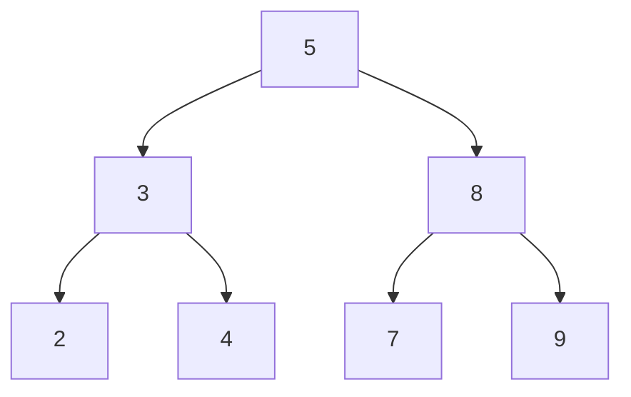
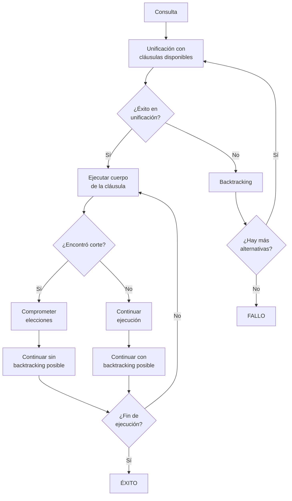

# Lógica Computacional - El paradigma de programación lógica

## 6.3 El lenguaje de programación Prolog: aritmética, listas, árboles, el operador de corte.

---

### 1. Introducción a Prolog

**Prolog** (PROgramming in LOGic) es el lenguaje principal del paradigma de programación lógica. Se basa en:

- Lógica de primer orden
- Resolución SLD
- Unificación y backtracking

### 2. Aritmética en Prolog

#### 2.1 Operadores Aritméticos Básicos

```prolog
% Operadores estándar
X is 5 + 3.        % X = 8
Y is 10 - 4.       % Y = 6
Z is 6 * 7.        % Z = 42
W is 15 / 3.       % W = 5.0
V is 17 mod 5.     % V = 2
```

#### 2.2 Predicados Aritméticos

```prolog
% Comparaciones aritméticas
5 =:= 2 + 3.       % true
5 =\= 2 + 4.       % true
7 > 3 + 2.         % true
4 < 10 - 3.        % true
8 >= 4 * 2.        % true
6 =< 3 + 3.        % true
```

#### 2.3 Ejemplo: Factorial

```prolog
factorial(0, 1).
factorial(N, F) :-
    N > 0,
    N1 is N - 1,
    factorial(N1, F1),
    F is N * F1.
```

#### 2.4 Ejemplo: Números Primos

```prolog
es_primo(2).
es_primo(3).
es_primo(P) :-
    P > 3,
    P mod 2 =\= 0,
    \+ tiene_divisor(P, 3).

tiene_divisor(N, D) :-
    D * D =< N,
    (N mod D =:= 0; D2 is D + 2, tiene_divisor(N, D2)).
```

### 3. Listas en Prolog

#### 3.1 Representación de Listas

```prolog
% Sintaxis: [Elemento1, Elemento2, ..., ElementoN]
[]          % Lista vacía
[a]         % Lista con un elemento
[a, b, c]   % Lista con tres elementos
[X|Xs]      % Cabeza X y cola Xs
```

#### 3.2 Predicados Básicos de Listas

```prolog
% member/2: Verificar pertenencia
member(X, [X|_]).
member(X, [_|Xs]) :- member(X, Xs).

% append/3: Concatenar listas
append([], L, L).
append([X|Xs], Ys, [X|Zs]) :- append(Xs, Ys, Zs).

% length/2: Longitud de lista
length([], 0).
length([_|Xs], N) :- length(Xs, M), N is M + 1.
```

#### 3.3 Ejemplos con Listas

```prolog
% Invertir una lista
invertir([], []).
invertir([X|Xs], Ys) :-
    invertir(Xs, Zs),
    append(Zs, [X], Ys).

% Sumar elementos de lista
suma_lista([], 0).
suma_lista([X|Xs], S) :-
    suma_lista(Xs, S1),
    S is X + S1.

% Máximo elemento
max_lista([X], X).
max_lista([X|Xs], M) :-
    max_lista(Xs, M1),
    (X > M1 -> M = X; M = M1).
```

### 4. Árboles en Prolog

#### 4.1 Representación de Árboles

```prolog
% Árbol binario: árbol vacío o nodo(Valor, Izquierdo, Derecho)
arbol_vacio(void).
nodo(Valor, Izq, Der).
```

#### 4.2 Operaciones con Árboles Binarios

```prolog
% Insertar en árbol binario de búsqueda
insertar(void, X, nodo(X, void, void)).
insertar(nodo(R, I, D), X, nodo(R, I2, D)) :-
    X < R, insertar(I, X, I2).
insertar(nodo(R, I, D), X, nodo(R, I, D2)) :-
    X >= R, insertar(D, X, D2).

% Recorrido en orden
en_orden(void, []).
en_orden(nodo(R, I, D), Lista) :-
    en_orden(I, LI),
    en_orden(D, LD),
    append(LI, [R|LD], Lista).

% Altura de árbol
altura(void, 0).
altura(nodo(_, I, D), H) :-
    altura(I, HI),
    altura(D, HD),
    H is max(HI, HD) + 1.
```

#### 4.3 Visualización de Árbol Binario



### 5. El Operador de Corte (!)

#### 5.1 Definición y Comportamiento

El **corte** (`!`) es un operador de control que:

- Compromete con las elecciones hechas hasta ese punto
- Elimina puntos de backtracking
- Mejora eficiencia pero reduce declaratividad

#### 5.2 Uso del Corte

```prolog
% Máximo con corte
maximo(X, Y, X) :- X >= Y, !.
maximo(X, Y, Y).

% Búsqueda con corte: encuentra primer primo
primer_primo(N, P) :-
    between(N, inf, P),
    es_primo(P), !.

% If-then-else con corte
categoria(Edad, niño) :- Edad < 12, !.
categoria(Edad, adolescente) :- Edad < 18, !.
categoria(_, adulto).
```

#### 5.3 Ejemplo: Corte Verde vs Rojo

```prolog
% Corte verde (lógicamente correcto)
minimo(X, Y, X) :- X =< Y, !.
minimo(X, Y, Y).

% Corte rojo (depende del orden)
minimo_rojo(X, Y, X) :- !, X =< Y.
minimo_rojo(X, Y, Y).
```

### 6. Programación con Restricciones (CLP)

#### 6.1 Aritmética con Restricciones

```prolog
:- use_module(library(clpfd)).

% Resolver ecuación: 2X + 3Y = 10, X + Y = 5
ejemplo_clp :-
    X in 0..10, Y in 0..10,
    2*X + 3*Y #= 10,
    X + Y #= 5,
    label([X, Y]).
```

### 7. Ejercicios Propuestos

#### 7.1 Ejercicio 1: Aritmética

Escriba un predicado `potencia(Base, Exponente, Resultado)` que calcule la potencia de un número.

#### 7.2 Ejercicio 2: Listas

Implemente un predicado `palindromo(Lista)` que determine si una lista es palíndromo.

#### 7.3 Ejercicio 3: Árboles

Cree un predicado `es_abb(Arbol)` que verifique si un árbol binario es de búsqueda.

#### 7.4 Ejercicio 4: Corte

Reescriba el siguiente predicado usando corte donde sea apropiado:

```prolog
clasificar(0, cero).
clasificar(N, positivo) :- N > 0.
clasificar(N, negativo) :- N < 0.
```

#### 7.5 Ejercicio 5: Proyecto Integrador

Implemente un sistema de búsqueda de rutas en un grafo representado como lista de aristas `arista(Nodo1, Nodo2, Peso)`.

### 8. Diagrama de Flujo de Ejecución Prolog



### 9. Buenas Prácticas en Prolog

#### 9.1 Estilo de Programación

```prolog
% ✔️ BUENO: Usar tail recursion cuando sea posible
suma_lista_tail(Lista, Suma) :- suma_lista_tail(Lista, 0, Suma).
suma_lista_tail([], Acum, Acum).
suma_lista_tail([X|Xs], Acum, Suma) :-
    NuevoAcum is Acum + X,
    suma_lista_tail(Xs, NuevoAcum, Suma).

% (X) MALO: Recursión no tail recursive
suma_lista_no_tail([], 0).
suma_lista_no_tail([X|Xs], Suma) :-
    suma_lista_no_tail(Xs, Suma1),
    Suma is X + Suma1.  % Operación después de recursión
```

#### 9.2 Uso Adecuado del Corte

```prolog
% ✔️ Corte verde (lógicamente correcto)
p(X) :- q(X), !, r(X).
p(X) :- s(X).

% (X) Corte rojo (depende del orden)
p(X) :- !, q(X), r(X).
p(X) :- s(X).
```

### 10. Referencias Bibliográficas

#### Bibliografía Básica

1. **Huth M., Ryan M.** (2004). _Logic in Computer Science_. Capítulo 6: "Logic Programming"
2. **Nerode A., Shore R.A.** (1997). _Logic for Applications_. Capítulo 6: "Logic Programming"

#### Bibliografía Complementaria

3. **Bratko I.** (2012). _Prolog Programming for Artificial Intelligence_
4. **Clocksin W.F., Mellish C.S.** (2003). _Programming in Prolog_
5. **Sterling L., Shapiro E.** (1994). _The Art of Prolog_

### 11. Soluciones a Ejercicios Selectos

#### Ejercicio 7.1: Potencia

```prolog
potencia(_, 0, 1).
potencia(Base, Exponente, Resultado) :-
    Exponente > 0,
    Exponente1 is Exponente - 1,
    potencia(Base, Exponente1, Resultado1),
    Resultado is Base * Resultado1.
```

#### Ejercicio 7.2: Palíndromo

```prolog
palindromo(Lista) :- invertir(Lista, Lista).

% Versión más eficiente
palindromo_eficiente(Lista) :- palindromo_aux(Lista, Lista, []).

palindromo_aux([], Resto, Resto).
palindromo_aux([_|Xs], [Y|Ys], Acum) :-
    palindromo_aux(Xs, Ys, [Y|Acum]).
```

### 12. Herramientas y Entornos de Desarrollo

#### 12.1 Implementaciones de Prolog

- **SWI-Prolog**: Implementación popular con amplias librerías
- **GNU Prolog**: Compilador a código nativo
- **SICStus Prolog**: Versión comercial robusta

#### 12.2 Extensiones y Librerías

```prolog
% Carga de librerías comunes
:- use_module(library(clpfd)).   % Restricciones sobre dominios finitos
:- use_module(library(lists)).   % Operaciones con listas
:- use_module(library(apply)).   % Operaciones de alto orden
```
